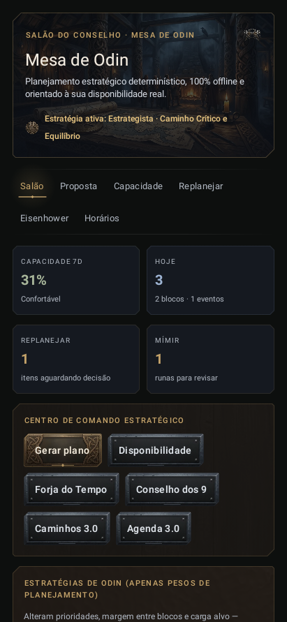
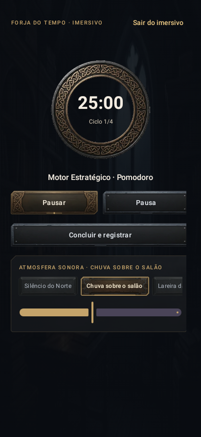

# ASCEND — Crônicas da Ascensão · 1.7.5

[**Baixar APK Android 1.7.5**](downloads/ASCEND-1.7.5.apk?raw=true) · [APK 1.7.3.1](downloads/ASCEND-1.7.3.1.apk?raw=true) · [APK 1.7.3](downloads/ASCEND-1.7.3.apk?raw=true) · [APK 1.7.2](downloads/ASCEND-1.7.2.apk?raw=true) · [APK 1.7.1](downloads/ASCEND-1.7.1.apk?raw=true) · [APK 1.7.0.1](downloads/ASCEND-1.7.0.1.apk?raw=true) · [APK 1.6.9.19](downloads/ASCEND-1.6.9.19.apk?raw=true)

Sistema pessoal offline de planejamento estratégico, projetos avançados, agenda adaptativa, foco, base de conhecimento e RPG nórdico para Android 8.0 ou superior. **Tudo funciona localmente**, sem conta, internet, IA externa, anúncios, assinatura ou serviços pagos. O GitHub distribui o código e o instalador; o aplicativo não tem permissão INTERNET.

A versão **1.7.5 — A Mesa de Odin** (*Strategic Planning & Nordic Intelligence Update*) transforma o ASCEND em um centro de planejamento estratégico pessoal sobre a base `feat/ascend-1.7.3.1`, preservando integralmente a Heráldica Rúnica, o Codex Rúnico, a Forja de Darian, o Retrato Vivo, o Atlas 2.0, a Biblioteca de Mímir e toda a integridade econômica do RPG:
- **Mesa de Odin (`OdinPlanningEngine.kt`, `OdinCouncilScreens.kt`):** motor determinístico 100% offline de planejamento adaptativo orientado à disponibilidade semanal real (nunca presume 24h livres), 6 estratégias que alteram exclusivamente pesos de planejamento (*Guardião*, *Erudito*, *Berserker*, *Estrategista*, *Explorador*, *Artífice*), Simulador de Capacidade em 5 períodos sem dupla contagem, propostas explicáveis com edição/fixação e aplicação transacional com desfazer inteligente (preserva blocos editados manualmente), replanejamento adaptativo sem punição no RPG e Matriz de Eisenhower explícita. [Mesa de Odin](docs/MESA-DE-ODIN.md).
- **Caminhos 3.0 (`Paths30Screens.kt`, `CaminhosScreens.kt`):** dependências *finish-to-start* com detecção de ciclos `O(V + E)` e liberação manual auditada, Caminho Crítico (CPM) com projeção por esforço vs disponibilidade real, Gráfico de Gantt interativo em Compose (escala diária/semanal, linha de hoje, marcos, tarefas críticas), Quadro Kanban 4 colunas acessível sobre a mesma `PathTask`, Marcos (`PathMilestone`) e 6 modelos reutilizáveis de projeto. [Caminhos 3.0](docs/CAMINHOS-3.0.md).
- **Agenda 3.0 (`AgendaScreens.kt`):** integrada ao `PlannerScreen` existente com fixação de blocos (`pinned`), recorrência (`RecurrenceRule`: diária, semanal, dias selecionados, mensal, exceção única sem mutar histórico), diferenciação visual (`runic_calendar_atlas.webp`) e atalhos para Mesa de Odin e Forja do Tempo. [Agenda 3.0](docs/AGENDA-3.0.md).
- **A Forja do Tempo (`TimeForgeScreen.kt`, `AmbientAudio.kt`, `Reminders.kt`):** 5 modos (*Foco livre*, *Pomodoro*, *Concentração profunda*, *Contagem regressiva*, *Ciclos personalizados*), medição monotônica com detecção de anomalia de relógio, pausas nunca contadas como foco, vínculo direto com `blockId`, Modo Imersivo Nórdico opcional e 3 paisagens sonoras procedurais offline via `AudioTrack`. [Forja do Tempo](docs/FORJA-DO-TEMPO.md).
- **Conselho dos Nove (`CouncilOfNineScreen.kt`, `StrategicData.kt`):** 9 áreas opcionais da vida com selos metálicos e Objetivos Pessoais trimestrais e anuais com progresso verificável a partir de Caminhos e Hábitos vinculados, sem economia paralela no RPG. [Conselho dos Nove](docs/CONSELHO-DOS-NOVE.md).
- **Design System 3.2 & Etapa 0 (`NordicCouncilDesign.kt`):** diversidade controlada de materiais nórdicos (madeira, velino, couro, bronze, prata oxidada, ferro), 10 novos recursos pictóricos originais (`648,6 KB / 0,63 MB` no APK + prancha conceitual fora do APK), persistência local de favoritos do Codex Rúnico em DataStore e documentação corrigida das 24 runas do Elder Futhark. [Design System 3.2](docs/DESIGN-SYSTEM-3.2.md) · [Relatório Visual 1.7.5](docs/VISUAL-1.7.5.md).

A `1.7.5` tem **218 testes aprovados** (`202` preservados + `16` novos, incluindo benchmarks de 50/200/1.000 tarefas e migração SQLite `10 → 11`), **17 capturas reais inspecionadas** e Android Lint com **0 erros**. **Room v11** (`MIGRATION_10_11`) e **backup v13** são puramente aditivos, sem alteração destrutiva e retrocompatíveis com `v1`–`v13`.

**Atualização dos APKs 1.1 a 1.7.3.1:** a `1.7.5` (`versionCode 27`) mantém `applicationId` (`br.com.ascend.aetheris`), certificado oficial SHA-256 (`e1f003ef...`) e migração explícita `10 → 11`; exporte um backup de segurança e instale por cima, **sem desinstalar**. A antiga 1.0 possui assinatura diferente; consulte [INSTALACAO.md](INSTALACAO.md).

- [Instalação e atualização](INSTALACAO.md)
- [Funcionalidades e limites reais](PROGRESSO.md)
- [Assinatura e preservação de atualizações](ASSINATURA.md)
- [Validação](VALIDACAO.md)
- [Mesa de Odin](docs/MESA-DE-ODIN.md) · [Caminhos 3.0](docs/CAMINHOS-3.0.md) · [Agenda 3.0](docs/AGENDA-3.0.md) · [Forja do Tempo](docs/FORJA-DO-TEMPO.md) · [Conselho dos Nove](docs/CONSELHO-DOS-NOVE.md) · [Design System 3.2](docs/DESIGN-SYSTEM-3.2.md) · [Visual 1.7.5](docs/VISUAL-1.7.5.md) · [Diário 1.7.5](docs/DESENVOLVIMENTO-1.7.5.md)
- [Heráldica Rúnica](docs/HERALDICA-RUNICA.md) · [Codex Rúnico](docs/CODEX-RUNICO.md) · [Coleções Lendárias](docs/COLECOES-LENDARIAS.md) · [Aprimoramentos da Forja](docs/APRIMORAMENTOS-DA-FORJA.md) · [Visual 1.7.3.1](docs/VISUAL-1.7.3.1.md)
- [Retrato Vivo 1.7.3](docs/RETRATO-VIVO-1.7.3.md) · [Forja de Darian 1.7.3](docs/FORJA-DARIAN-1.7.3.md) · [Arsenal 1.7.3](docs/ARSENAL-1.7.3.md) · [Visual 1.7.3](docs/VISUAL-1.7.3.md)
- [Exploração 1.7.2](docs/EXPLORACAO-1.7.2.md) · [Atlas 2.0](docs/ATLAS-2.0.md) · [Design System 3.0](docs/DESIGN-SYSTEM-3.0.md) · [Biblioteca de Mímir 1.7.1](docs/BIBLIOTECA-MIMIR-1.7.1.md)

## Visual

| Mesa de Odin (Salão do Conselho) | Caminhos 3.0 · Gantt Interativo | Forja do Tempo · Modo Imersivo |
|---|---|---|
|  |  |  |

**[Relatório visual e 17 capturas reais 1.7.5](docs/VISUAL-1.7.5.md)** · [Visual 1.7.3.1](docs/VISUAL-1.7.3.1.md) · [Visual 1.7.3](docs/VISUAL-1.7.3.md) · [Visual 1.7.2](docs/VISUAL-1.7.2.md) · [Visual 1.7.1](docs/VISUAL-1.7.1.md) · [Visual 1.7.0](docs/VISUAL-1.7.0.md)

Capturas dos testes de interface com personagens de teste. Nenhuma conclusão, expedição, fabricação, heráldica, plano ou objetivo fictício é incluído no aplicativo.

## Desenvolvimento

Kotlin, Jetpack Compose, Material 3, Room, DataStore, MVVM, Navigation Compose, Coroutines e StateFlow. JDK 17 ou 21, SDK Android 35, Gradle Wrapper 8.9. Configure o SDK por `ANDROID_HOME` ou `local.properties`.

```sh
./gradlew testDebugUnitTest assembleDebug lintDebug
```

APK: `app/build/outputs/apk/debug/app-debug.apk`. Preparar as dependências de desenvolvimento exige internet; usar o APK não exige conexão. Não é necessário pagar por nenhuma ferramenta.

Para usar a chave de depuração preservada, configure `ASCEND_KEYSTORE_PATH` com o caminho do arquivo antes da compilação. Sem essa variável, o Android Gradle Plugin usa a chave de depuração padrão do ambiente. Consulte `ASSINATURA.md` antes de gerar atualizações.

O fluxo central continua: registro por hábito/dia → recompensa com chave determinística → ledger transacional → nível/atributos/moedas derivados. Recompensas são snapshots; editar um hábito não reescreve XP histórico. Estratégias da Mesa de Odin, replanejamentos, Caminhos 3.0, Agenda 3.0, pausas da Forja do Tempo, Conselho dos Nove e Objetivos Pessoais não inventam XP ou moedas nem aplicam penalidades ao RPG.

Banco **Room v11**, com migrações explícitas `1 → 2 → 3 → 4 → 5 → 6 → 7 → 8 → 9 → 10 → 11`; **backups v13** leem também arquivos `v1`–`v12`. A migração `10 → 11` é puramente aditiva, acrescentando colunas com `DEFAULT` e 9 novas tabelas estratégicas sem reconstruir ou alterar dados históricos. Nenhum fallback destrutivo é usado. Preferências de aparência, favoritos do Codex, som ambiente e notificações ficam no aparelho via DataStore.
