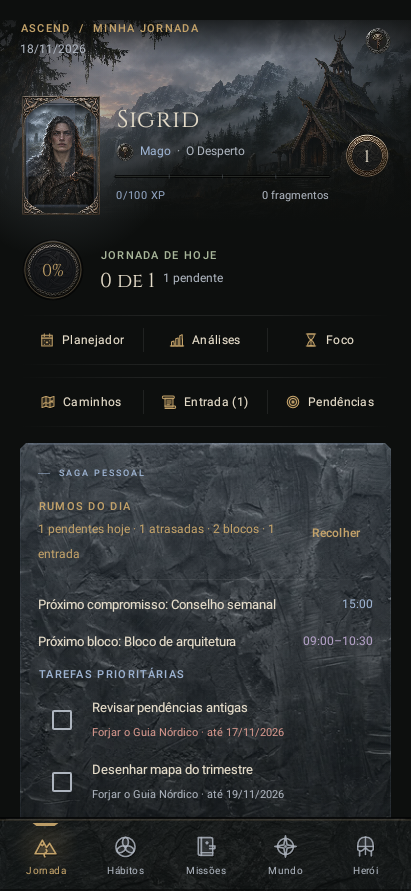
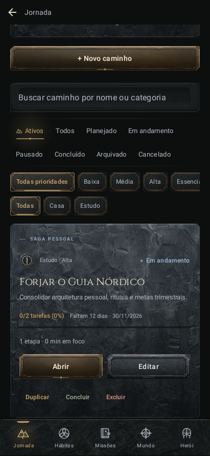
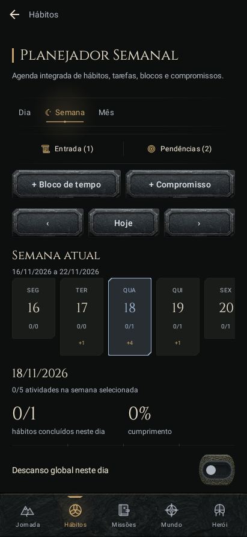

# ASCEND — Crônicas da Ascensão · 1.7.0

[**Baixar APK Android 1.7.0 (assinatura oficial preservada)**](downloads/ASCEND-1.7.0.apk?raw=true) · [APK 1.6.9.19](downloads/ASCEND-1.6.9.19.apk?raw=true) · [APK 1.6.9.15](downloads/ASCEND-1.6.9.15.apk?raw=true) · [APK 1.6.9](downloads/ASCEND-1.6.9.apk?raw=true)

RPG de hábitos, projetos pessoais e agenda avançada para Android 8.0 ou superior. **Tudo funciona localmente**, sem conta, internet, anúncios, assinatura ou serviços pagos. O GitHub distribui o código e o instalador; o aplicativo não tem permissão INTERNET.

A versão **1.7.0 — Os Nove Caminhos** (*Personal Projects & Advanced Productivity Update*) expande o ASCEND para um sistema integrado de desenvolvimento pessoal preservando integralmente a Biblioteca da Forja (`1.6.9.19`), o RPG, as narrativas e a economia de XP/moedas:
- **Caminhos (Projetos Pessoais):** projetos estruturados com etapas, tarefas, subtarefas reordenáveis, prazos, duplicação, vínculo opcional a hábitos (sem XP duplicado), sessões de foco dedicadas (`0 XP` extra) e registro de conclusões no `Salão das Memórias` (filtro `Caminhos`). [Documentação técnica de Caminhos](docs/CAMINHOS-1.7.0.md).
- **Agenda Profissional 2.0:** visões **Dia**, **Semana** e **Mês**, blocos de tempo com detecção de sobreposição e comparação planejado × foco real, compromissos sem XP, **Caixa de Entrada** com triagem atômica e **Central de Pendências** com 6 recortes operacionais. [Documentação da Agenda 2.0](docs/AGENDA-1.7.0.md).
- **Jornada ("Rumos do Dia"):** painel expansível na tela inicial com próximo compromisso, próximo bloco, tarefas prioritárias com conclusão rápida e caminhos próximos, além dos atalhos diretos `Caminhos`, `Entrada` e `Pendências`.

**143 testes aprovados** e Android Lint sem erros (22 avisos documentados). **Room v7** (`MIGRATION_6_7`) e **backup v9** têm migração explícita e leitura dos formatos anteriores (`v1`–`v8`). Pinturas, RPG, economia e dados existentes são preservados. [Visual 1.7.0](docs/VISUAL-1.7.0.md) · [Caminhos 1.7.0](docs/CAMINHOS-1.7.0.md) · [Agenda 2.0](docs/AGENDA-1.7.0.md) · [Biblioteca da Forja 1.6.9.19](docs/VISUAL-1.6.9.19.md) · [Design System](docs/DESIGN-SYSTEM-2.0.md).

**Atualização dos APKs 1.1 a 1.6.9.19:** a `1.7.0` (`versionCode 20`) mantém `applicationId` (`br.com.ascend.aetheris`), certificado oficial SHA-256 (`e1f003ef...`), e migração aditiva Room `v6 → v7` / backup `v9`; exporte um backup de segurança e instale por cima, **sem desinstalar**. A antiga 1.0 possui assinatura diferente; consulte [INSTALACAO.md](INSTALACAO.md).

- [Instalação e atualização](INSTALACAO.md)
- [Funcionalidades e limites reais](PROGRESSO.md)
- [Assinatura e preservação de atualizações](ASSINATURA.md)
- [Validação](VALIDACAO.md)
- [Caminhos 1.7.0](docs/CAMINHOS-1.7.0.md) · [Agenda 2.0](docs/AGENDA-1.7.0.md) · [Visual 1.7.0](docs/VISUAL-1.7.0.md)
- [Biblioteca da Forja 1.6.9.19](docs/VISUAL-1.6.9.19.md) · [Legado da Forja 1.6.9.15](docs/VISUAL-1.6.9.15.md) · [Refinamento 1.6.9.10](docs/VISUAL-1.6.9.10.md) · [Consolidação 1.6.9](docs/VISUAL-1.6.9.md)
- [Auditoria, correções e checklist físico da 1.5.2](docs/ESTABILIDADE-1.5.2.md)
- [Exploração, fases, recompensas e widgets](docs/EXPLORACAO-1.5.md)

## Visual

| Jornada + Rumos do Dia | Caminhos | Agenda 2.0 (Semana) |
|---|---|---|
|  |  |  |

**[Relatório visual e capturas 1.7.0](docs/VISUAL-1.7.0.md)** · [Prancha da biblioteca e comparações 1.6.9.19](docs/VISUAL-1.6.9.19.md) · [Comparações 1.6.9.15](docs/VISUAL-1.6.9.15.md) · [Comparações 1.6.9.10](docs/VISUAL-1.6.9.10.md) · [Comparações 1.6.9](docs/VISUAL-1.6.9.md) · [Guia do Grimório e rotinas](docs/GRIMORIO.md)

Capturas dos testes de interface com personagens de teste. Nenhuma conclusão fictícia é incluída no aplicativo.

## Desenvolvimento

Kotlin, Jetpack Compose, Material 3, Room, DataStore, MVVM, Navigation Compose, Coroutines e StateFlow. JDK 17 ou 21, SDK Android 35, Gradle Wrapper 8.9. Configure o SDK por `ANDROID_HOME` ou `local.properties`.

```sh
./gradlew testDebugUnitTest assembleDebug
```

APK: `app/build/outputs/apk/debug/app-debug.apk`. Preparar as dependências de desenvolvimento exige internet; usar o APK não exige conexão. Não é necessário pagar por nenhuma ferramenta.

Para usar a chave de depuração preservada, configure `ASCEND_KEYSTORE_PATH` com o caminho do arquivo antes da compilação. Sem essa variável, o Android Gradle Plugin usa a chave de depuração padrão do ambiente. Consulte `ASSINATURA.md` antes de gerar atualizações.

O fluxo central continua: registro por hábito/dia → recompensa com chave determinística → ledger transacional → nível/atributos/moedas derivados. Recompensas são snapshots; editar um hábito não reescreve XP histórico. Reverter moedas já gastas gera compensação futura, com saldo disponível limitado a zero. Projetos (`Caminhos`), tarefas, blocos de tempo, compromissos e foco em projeto não inventam XP ou moedas.

Banco **Room v7**, com migrações explícitas `1 → 2 → 3 → 4 → 5 → 6 → 7`; **backups v9** leem também arquivos `v1`–`v8`. A migração `6 → 7` acrescenta `paths`, `path_stages`, `path_tasks`, `path_subtasks`, `path_habit_links`, `time_blocks`, `agenda_events`, `inbox_items` e vínculo opcional em `focus`/`focus_sessions` sem reconstruir ou alterar dados históricos. Nenhum fallback destrutivo é usado. Preferências de aparência, interesses e sugestões dispensadas ficam no aparelho e não são transferidas pelo backup.
