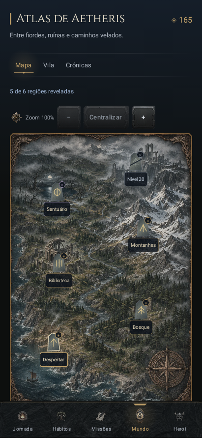
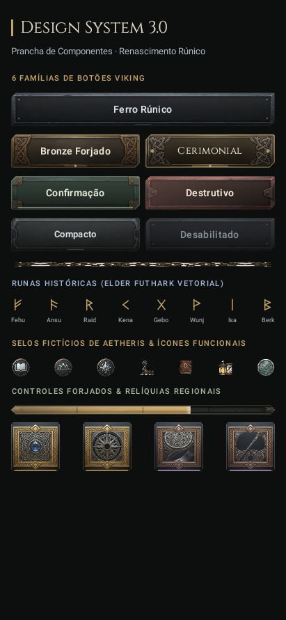

# ASCEND — Crônicas da Ascensão · 1.7.2

[**Baixar APK Android 1.7.2**](downloads/ASCEND-1.7.2.apk?raw=true) · [APK 1.7.1](downloads/ASCEND-1.7.1.apk?raw=true) · [APK 1.7.0.1](downloads/ASCEND-1.7.0.1.apk?raw=true) · [APK 1.7.0](downloads/ASCEND-1.7.0.apk?raw=true) · [APK 1.6.9.19](downloads/ASCEND-1.6.9.19.apk?raw=true)

RPG de hábitos, projetos pessoais, agenda avançada, base de conhecimento e exploração de mundo offline para Android 8.0 ou superior. **Tudo funciona localmente**, sem conta, internet, anúncios, assinatura ou serviços pagos. O GitHub distribui o código e o instalador; o aplicativo não tem permissão INTERNET.

A versão **1.7.2 — Além das Fronteiras** (*World Expansion & Nordic Viking Renaissance Update*) expande o universo explorável de Aetheris e eleva a identidade visual nórdica e viking sobre a base consolidada da `1.7.1`, preservando a Biblioteca de Mímir, os Arquétipos, os Caminhos, a Agenda 2.0, o Foco e toda a integridade econômica:
- **Atlas de Aetheris 2.0 & Motor Regional Extensível:** zoom por pinça/arrasto com limites (`100%`–`240%`), controles acessíveis (`−`, `Centralizar`, `+`), lista acessível de regiões, 6 estados reais (`RegionAtlasState`) e sinalização honesta *"Sem conteúdo interativo ainda"* para Santuário do Equilíbrio (nível 12) e Fortaleza da Vontade (nível 20). [Atlas 2.0](docs/ATLAS-2.0.md).
- **Novas Regiões Exploráveis, Guardiões & Relíquias:** **Biblioteca das Eras** (nível 5, guardiã **Eydis**, 3 expedições / 8 fases) e **Montanhas da Disciplina** (nível 8, guardião **Haldor**, 3 expedições / 8 fases), integradas opcionalmente a **Tarefas de Caminhos**, **dias de revisão na Biblioteca de Mímir** e **sessões reais de Foco** (com fallback explícito para hábitos e sem punição em dias de descanso), além de **4 relíquias exclusivas da exploração**, 4 conquistas regionais e 2 títulos (*Guardião das Eras* e *Testemunha dos Cumes*). [Exploração 1.7.2](docs/EXPLORACAO-1.7.2.md).
- **Design System 3.0 & Renascimento Rúnico:** 6 famílias de botões viking com 9-slice por célula (`VikingButtonStyle`), separação estrita entre 12 runas históricas *Elder Futhark* vetoriais e 12 selos fictícios de Aetheris, 16 ícones funcionais talhados, controles forjados e **10 novos recursos pictóricos originais** (`1` prancha conceitual fora do APK + `9` atlas WebP somando `825,2 KB / 0,81 MB`). [Design System 3.0](docs/DESIGN-SYSTEM-3.0.md) · [Renascimento Rúnico](docs/RENASCIMENTO-RUNICO.md) · [Relatório Visual 1.7.2](docs/VISUAL-1.7.2.md).

A `1.7.2` tem **181 testes aprovados** (`167` preservados + `14` novos) e Android Lint com **0 erros**. **Room v8** e **backup v10** permanecem intactos, sem alteração destrutiva de esquema e com retrocompatibilidade `v1`–`v10`.

**Atualização dos APKs 1.1 a 1.7.1:** a `1.7.2` (`versionCode 23`) mantém `applicationId` (`br.com.ascend.aetheris`), certificado oficial SHA-256 (`e1f003ef...`) e esquema Room `v8` / backup `v10`; exporte um backup de segurança e instale por cima, **sem desinstalar**. A antiga 1.0 possui assinatura diferente; consulte [INSTALACAO.md](INSTALACAO.md).

- [Instalação e atualização](INSTALACAO.md)
- [Funcionalidades e limites reais](PROGRESSO.md)
- [Assinatura e preservação de atualizações](ASSINATURA.md)
- [Validação](VALIDACAO.md)
- [Exploração 1.7.2](docs/EXPLORACAO-1.7.2.md) · [Atlas 2.0](docs/ATLAS-2.0.md) · [Design System 3.0](docs/DESIGN-SYSTEM-3.0.md) · [Renascimento Rúnico](docs/RENASCIMENTO-RUNICO.md) · [Visual 1.7.2](docs/VISUAL-1.7.2.md)
- [Biblioteca de Mímir 1.7.1](docs/BIBLIOTECA-MIMIR-1.7.1.md) · [Arquétipos 1.7.1](docs/ARQUETIPOS-1.7.1.md) · [Visual 1.7.1](docs/VISUAL-1.7.1.md)
- [Auditoria 1.7.0.1](docs/AUDITORIA-1.7.0.1.md) · [Caminhos 1.7.0](docs/CAMINHOS-1.7.0.md) · [Agenda 2.0](docs/AGENDA-1.7.0.md) · [Visual 1.7.0](docs/VISUAL-1.7.0.md)
- [Biblioteca da Forja 1.6.9.19](docs/VISUAL-1.6.9.19.md) · [Legado da Forja 1.6.9.15](docs/VISUAL-1.6.9.15.md) · [Refinamento 1.6.9.10](docs/VISUAL-1.6.9.10.md) · [Consolidação 1.6.9](docs/VISUAL-1.6.9.md)
- [Auditoria, correções e checklist físico da 1.5.2](docs/ESTABILIDADE-1.5.2.md)
- [Exploração, fases, recompensas e widgets](docs/EXPLORACAO-1.5.md)

## Visual

| Atlas de Aetheris 2.0 | Biblioteca das Eras (Restaurada) | Design System 3.0 |
|---|---|---|
|  |  |  |

**[Relatório visual e 14 capturas reais 1.7.2](docs/VISUAL-1.7.2.md)** · [Visual 1.7.1](docs/VISUAL-1.7.1.md) · [Visual 1.7.0](docs/VISUAL-1.7.0.md) · [Guia do Grimório e rotinas](docs/GRIMORIO.md)

Capturas dos testes de interface com personagens de teste. Nenhuma conclusão, expedição, caderno ou flashcard fictício é incluído no aplicativo.

## Desenvolvimento

Kotlin, Jetpack Compose, Material 3, Room, DataStore, MVVM, Navigation Compose, Coroutines e StateFlow. JDK 17 ou 21, SDK Android 35, Gradle Wrapper 8.9. Configure o SDK por `ANDROID_HOME` ou `local.properties`.

```sh
./gradlew testDebugUnitTest assembleDebug lintDebug
```

APK: `app/build/outputs/apk/debug/app-debug.apk`. Preparar as dependências de desenvolvimento exige internet; usar o APK não exige conexão. Não é necessário pagar por nenhuma ferramenta.

Para usar a chave de depuração preservada, configure `ASCEND_KEYSTORE_PATH` com o caminho do arquivo antes da compilação. Sem essa variável, o Android Gradle Plugin usa a chave de depuração padrão do ambiente. Consulte `ASSINATURA.md` antes de gerar atualizações.

O fluxo central continua: registro por hábito/dia → recompensa com chave determinística → ledger transacional → nível/atributos/moedas derivados. Recompensas são snapshots; editar um hábito não reescreve XP histórico. Reverter moedas já gastas gera compensação futura, com saldo disponível limitado a zero. Projetos (`Caminhos`), tarefas, blocos de tempo, compromissos, foco em projeto, cadernos, páginas, revisões SM-2 e especializações não inventam XP ou moedas.

Banco **Room v8**, com migrações explícitas `1 → 2 → 3 → 4 → 5 → 6 → 7 → 8`; **backups v10** leem também arquivos `v1`–`v9`. A migração `7 → 8` acrescenta a coluna `specialization` em `player` e as tabelas `knowledge_notebooks`, `knowledge_pages`, `knowledge_page_links`, `knowledge_references`, `flashcards` e `flashcard_reviews` sem reconstruir ou alterar dados históricos. Nenhum fallback destrutivo é usado. Preferências de aparência, interesses e sugestões dispensadas ficam no aparelho e não são transferidas pelo backup.
