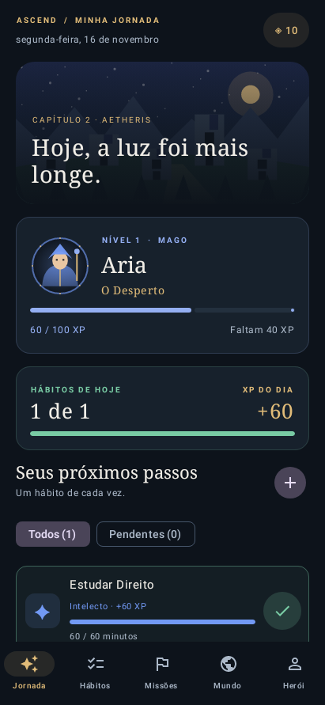
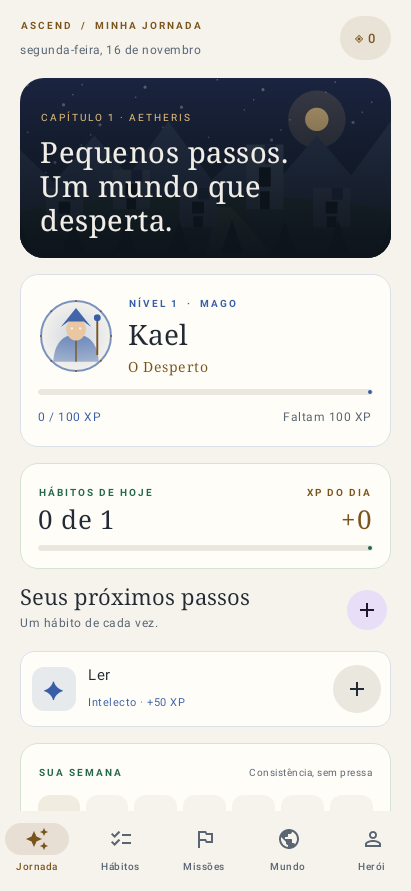

# ASCEND — Crônicas da Ascensão · 1.1

[**Baixar APK Android 1.1.0**](downloads/ASCEND-1.1.0.apk?raw=true)

RPG de hábitos para Android 8.0 ou superior. **Tudo funciona localmente**, sem conta, internet, anúncios, assinatura ou serviços pagos. O GitHub distribui o código e o instalador; o aplicativo não tem permissão INTERNET.

A versão 1.1 renova a Jornada, acrescenta temas claro/escuro/sistema, modo minimalista, acessibilidade de movimento, busca e detalhes de hábitos, descanso planejado, estatísticas mais precisas e quatro capítulos de história. [Veja as mudanças](CHANGELOG.md).

**Se você usa a 1.0:** exporte um backup antes de instalar. O APK desta entrega tem uma nova assinatura, pois a chave original não está disponível. Para este APK, exporte → desinstale a 1.0 → instale a 1.1 → importe. Com a chave original, é possível recompilar a 1.1 e atualizar sem reinstalação. [Instruções completas](INSTALACAO.md).

- [Instalação e atualização](INSTALACAO.md)
- [Funcionalidades e limites reais](PROGRESSO.md)
- [Assinatura e preservação de atualizações](ASSINATURA.md)
- [Validação](VALIDACAO.md)

## Visual

| Tema escuro | Tema claro |
|---|---|
|  |  |

Capturas dos testes de interface com personagens de teste. Nenhuma conclusão fictícia é incluída no aplicativo.

## Desenvolvimento

Kotlin, Jetpack Compose, Material 3, Room, DataStore, MVVM, Navigation Compose, Coroutines e StateFlow. JDK 17 ou 21, SDK Android 35, Gradle Wrapper 8.9. Configure o SDK por `ANDROID_HOME` ou `local.properties`.

```sh
./gradlew testDebugUnitTest assembleDebug
```

APK: `app/build/outputs/apk/debug/app-debug.apk`. Preparar as dependências de desenvolvimento exige internet; usar o APK não exige conexão. Não é necessário pagar por nenhuma ferramenta.

Para usar a chave de depuração preservada, configure `ASCEND_KEYSTORE_PATH` com o caminho do arquivo antes da compilação. Sem essa variável, o Android Gradle Plugin usa a chave de depuração padrão do ambiente. Consulte `ASSINATURA.md` antes de gerar atualizações.

O fluxo central continua: registro por hábito/dia → recompensa com chave determinística → ledger transacional → nível/atributos/moedas derivados. Recompensas são snapshots; editar um hábito não reescreve XP histórico. Reverter moedas já gastas gera compensação futura, com saldo disponível limitado a zero.

Banco Room v2, com migração explícita de v1; backups v2 leem também arquivos v1. Nenhum fallback destrutivo é usado. As preferências de aparência são locais ao aparelho e não são transferidas pelo backup.
