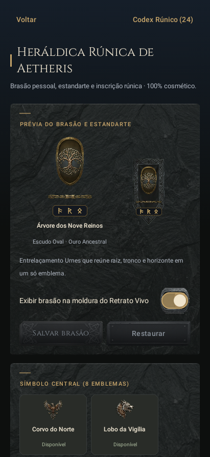
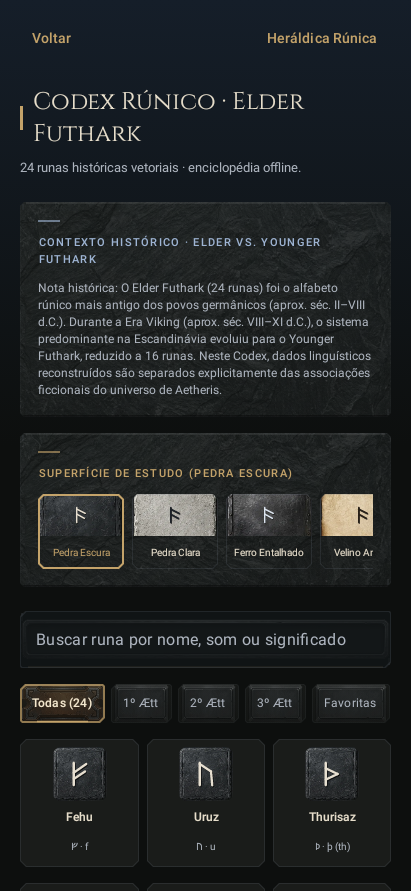
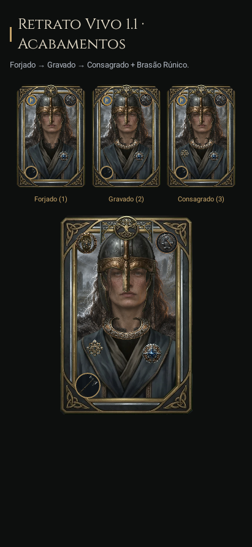

# ASCEND — Crônicas da Ascensão · 1.7.3.1

[**Baixar APK Android 1.7.3.1**](downloads/ASCEND-1.7.3.1.apk?raw=true) · [APK 1.7.3](downloads/ASCEND-1.7.3.apk?raw=true) · [APK 1.7.2](downloads/ASCEND-1.7.2.apk?raw=true) · [APK 1.7.1](downloads/ASCEND-1.7.1.apk?raw=true) · [APK 1.7.0.1](downloads/ASCEND-1.7.0.1.apk?raw=true) · [APK 1.7.0](downloads/ASCEND-1.7.0.apk?raw=true) · [APK 1.6.9.19](downloads/ASCEND-1.6.9.19.apk?raw=true)

RPG de hábitos, projetos pessoais, agenda avançada, base de conhecimento, exploração de mundo, fabricação cosmética e heráldica rúnica offline para Android 8.0 ou superior. **Tudo funciona localmente**, sem conta, internet, anúncios, assinatura ou serviços pagos. O GitHub distribui o código e o instalador; o aplicativo não tem permissão INTERNET.

A versão **1.7.3.1 — O Legado das Runas** (*Runic Heritage & Legendary Collections Update*) conclui e aprofunda o sistema de identidade e oficina da `1.7.3`, preservando integralmente os três retratos originais, o Atlas 2.0, a Biblioteca de Mímir, os Arquétipos, os Caminhos, a Agenda 2.0, o Foco e toda a integridade econômica:
- **Heráldica Rúnica de Aetheris (`RunicHeritageData.kt`, `HeraldryAndCodex.kt`):** brasão pessoal, estandarte e inscrição curta de até 6 runas (8 símbolos, 4 formatos, 4 metais, 5 cores, 5 ornamentos, 3 estandartes e transliteração aproximada explicitamente diferenciada de tradução), 100% cosmético, persistido em **Room v10 (`heraldry_profile`)** e **Backup v12**, exibido em Jornada, Perfil, Retrato Ampliado, Retrato Vivo 1.1, Arsenal, Salão das Memórias, Crônicas e Coleções concluídas. [Heráldica Rúnica](docs/HERALDICA-RUNICA.md).
- **Codex Rúnico Completo (`VikingDesignSystem.kt`, `HeraldryAndCodex.kt`):** expansão das 12 runas iniciais para os **24 caracteres históricos vetoriais do Elder Futhark** (preservando os ordinais `0..11` originais e substituindo fallback por módulo pelo mapeamento explícito `sealFallbackRune`), com 6 superfícies limpas de estudo, busca/filtros/favoritos e distinção rigorosa entre *Elder Futhark* (24), *Younger Futhark* (16, Era Viking) e associações ficcionais de Aetheris. [Codex Rúnico](docs/CODEX-RUNICO.md).
- **Forja de Darian (12 Receitas), Aprimoramentos (3 Estágios) & 3 Coleções Lendárias (`ForgeCrafting.kt`, `ForgeScreen.kt`):** 4 novas obras exclusivas (`vigil-axe`, `runic-staff`, `northern-blade`, `constellation-brooch`, total 12 em `forge:<recipeId>`, `0 XP`, fora da Loja), aprimoramento determinístico **Forjado → Gravado → Consagrado** (`forge-upgrade:<itemId>:<stage>`, `0 XP`) e **3 Coleções Lendárias** (*Juramento de Ferro*, *Sabedoria de Mímir*, *Vigília Boreal* — independentes das 3 Configurações de Equipamento *Jornada*, *Conselho* e *Expedição*). [Coleções Lendárias](docs/COLECOES-LENDARIAS.md) · [Aprimoramentos da Forja](docs/APRIMORAMENTOS-DA-FORJA.md).
- **Retrato Vivo 1.1, Arsenal 2.1 & Correções da 1.7.3 (`LivingPortrait.kt`, `EquipmentScreen.kt`, `Repository.kt`):** acabamentos *Gravado*/*Consagrado* e brasão no Retrato Vivo; Arsenal organizado em 4 abas compactas com busca, filtros combináveis e 5 ordenações; **equipamento idempotente** (`equipItem`/`unequipItem`/`setEquipment`), **regra versionada de foco em expedições** (`focusRuleVersion` preservando fases legadas e exigindo `>= 300s` nas novas), **aplicação parcial segura de configurações** com prévia explícita e **rascunho preservado no Estúdio**. [Relatório Visual 1.7.3.1](docs/VISUAL-1.7.3.1.md).

A `1.7.3.1` tem **202 testes aprovados** (`191` preservados + `11` novos), **8 novos recursos pictóricos originais** (`647,5 KB / 0,63 MB` no APK + prancha conceitual fora do APK) e Android Lint com **0 erros**. **Room v10** (`MIGRATION_9_10`) e **backup v12** são aditivos, sem alteração destrutiva e com retrocompatibilidade `v1`–`v12`.

**Atualização dos APKs 1.1 a 1.7.3:** a `1.7.3.1` (`versionCode 25`) mantém `applicationId` (`br.com.ascend.aetheris`), certificado oficial SHA-256 (`e1f003ef...`) e migração explícita `9 → 10`; exporte um backup de segurança e instale por cima, **sem desinstalar**. A antiga 1.0 possui assinatura diferente; consulte [INSTALACAO.md](INSTALACAO.md).

- [Instalação e atualização](INSTALACAO.md)
- [Funcionalidades e limites reais](PROGRESSO.md)
- [Assinatura e preservação de atualizações](ASSINATURA.md)
- [Validação](VALIDACAO.md)
- [Heráldica Rúnica](docs/HERALDICA-RUNICA.md) · [Codex Rúnico](docs/CODEX-RUNICO.md) · [Coleções Lendárias](docs/COLECOES-LENDARIAS.md) · [Aprimoramentos da Forja](docs/APRIMORAMENTOS-DA-FORJA.md) · [Visual 1.7.3.1](docs/VISUAL-1.7.3.1.md) · [Diário 1.7.3.1](docs/DESENVOLVIMENTO-1.7.3.1.md)
- [Retrato Vivo 1.7.3](docs/RETRATO-VIVO-1.7.3.md) · [Forja de Darian 1.7.3](docs/FORJA-DARIAN-1.7.3.md) · [Arsenal 1.7.3](docs/ARSENAL-1.7.3.md) · [Visual 1.7.3](docs/VISUAL-1.7.3.md)
- [Exploração 1.7.2](docs/EXPLORACAO-1.7.2.md) · [Atlas 2.0](docs/ATLAS-2.0.md) · [Design System 3.0](docs/DESIGN-SYSTEM-3.0.md) · [Renascimento Rúnico](docs/RENASCIMENTO-RUNICO.md) · [Visual 1.7.2](docs/VISUAL-1.7.2.md)
- [Biblioteca de Mímir 1.7.1](docs/BIBLIOTECA-MIMIR-1.7.1.md) · [Arquétipos 1.7.1](docs/ARQUETIPOS-1.7.1.md) · [Visual 1.7.1](docs/VISUAL-1.7.1.md)
- [Auditoria 1.7.0.1](docs/AUDITORIA-1.7.0.1.md) · [Caminhos 1.7.0](docs/CAMINHOS-1.7.0.md) · [Agenda 2.0](docs/AGENDA-1.7.0.md) · [Visual 1.7.0](docs/VISUAL-1.7.0.md)
- [Biblioteca da Forja 1.6.9.19](docs/VISUAL-1.6.9.19.md) · [Legado da Forja 1.6.9.15](docs/VISUAL-1.6.9.15.md) · [Refinamento 1.6.9.10](docs/VISUAL-1.6.9.10.md) · [Consolidação 1.6.9](docs/VISUAL-1.6.9.md)
- [Auditoria, correções e checklist físico da 1.5.2](docs/ESTABILIDADE-1.5.2.md)
- [Exploração, fases, recompensas e widgets](docs/EXPLORACAO-1.5.md)

## Visual

| Heráldica Rúnica | Codex Rúnico (24 Runas) | Retrato Vivo 1.1 · Acabamentos |
|---|---|---|
|  |  |  |

**[Relatório visual e 15 capturas reais 1.7.3.1](docs/VISUAL-1.7.3.1.md)** · [Visual 1.7.3](docs/VISUAL-1.7.3.md) · [Visual 1.7.2](docs/VISUAL-1.7.2.md) · [Visual 1.7.1](docs/VISUAL-1.7.1.md) · [Visual 1.7.0](docs/VISUAL-1.7.0.md) · [Guia do Grimório e rotinas](docs/GRIMORIO.md)

Capturas dos testes de interface com personagens de teste. Nenhuma conclusão, expedição, fabricação, heráldica, caderno ou flashcard fictício é incluído no aplicativo.

## Desenvolvimento

Kotlin, Jetpack Compose, Material 3, Room, DataStore, MVVM, Navigation Compose, Coroutines e StateFlow. JDK 17 ou 21, SDK Android 35, Gradle Wrapper 8.9. Configure o SDK por `ANDROID_HOME` ou `local.properties`.

```sh
./gradlew testDebugUnitTest assembleDebug lintDebug
```

APK: `app/build/outputs/apk/debug/app-debug.apk`. Preparar as dependências de desenvolvimento exige internet; usar o APK não exige conexão. Não é necessário pagar por nenhuma ferramenta.

Para usar a chave de depuração preservada, configure `ASCEND_KEYSTORE_PATH` com o caminho do arquivo antes da compilação. Sem essa variável, o Android Gradle Plugin usa a chave de depuração padrão do ambiente. Consulte `ASSINATURA.md` antes de gerar atualizações.

O fluxo central continua: registro por hábito/dia → recompensa com chave determinística → ledger transacional → nível/atributos/moedas derivados. Recompensas são snapshots; editar um hábito não reescreve XP histórico. Reverter moedas já gastas gera compensação futura, com saldo disponível limitado a zero. Projetos (`Caminhos`), tarefas, blocos de tempo, compromissos, foco em projeto, cadernos, páginas, revisões SM-2, especializações, heráldica, coleções lendárias e fabricação/aprimoramento na Forja (`forge:<recipeId>` / `forge-upgrade:<itemId>:<stage>`) não inventam XP ou moedas.

Banco **Room v10**, com migrações explícitas `1 → 2 → 3 → 4 → 5 → 6 → 7 → 8 → 9 → 10`; **backups v12** leem também arquivos `v1`–`v11`. A migração `9 → 10` acrescenta apenas a coluna `focusRuleVersion` (`DEFAULT 0`) em `quests`/`claims` e a tabela `heraldry_profile`, sem reconstruir ou alterar dados históricos. Nenhum fallback destrutivo é usado. Preferências de aparência, interesses e sugestões dispensadas ficam no aparelho e não são transferidas pelo backup.
