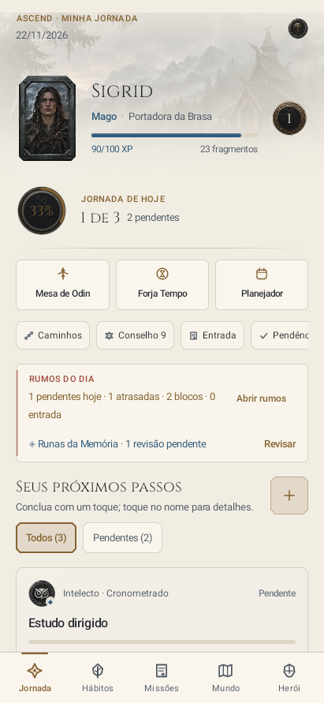

# ASCEND — Crônicas da Ascensão · NORTHBORN 4.1

A branch 1.7.5.9.1 contém o protótipo visual **O Renascimento de Northborn** para Jornada, Mesa de Odin e Biblioteca de Mímir. [Comparações em Compose](docs/design/THREE-SCREEN-VISUAL-REVIEW.md) · [Direção artística](docs/design/NORTHBORN-ART-DIRECTION.md)

[APK de desenvolvimento · acabamento rústico e movimento](downloads/ASCEND-1.7.5.9.1-dev-rustico.apk?raw=true) · [SHA-256](downloads/ASCEND-1.7.5.9.1-dev-rustico.apk.sha256) · [Arte e comparativos](docs/design/NORTHBORN-MOVIMENTO.md) · [Validação](VALIDACAO.md)

[APK de fundos e gravuras](downloads/ASCEND-1.7.5.9.1-dev-gravuras.apk?raw=true) · [APK de escudo, madeira e velino](downloads/ASCEND-1.7.5.9.1-dev-entalhe.apk?raw=true) · [APK da revisão nórdica](downloads/ASCEND-1.7.5.9.1-dev-nordico.apk?raw=true) · [APK do primeiro protótipo](downloads/ASCEND-1.7.5.9.1-dev.apk?raw=true)

[**Baixar APK Android 1.7.5.9**](downloads/ASCEND-1.7.5.9.apk?raw=true) · [APK 1.7.5.1](downloads/ASCEND-1.7.5.1.apk?raw=true) · [APK 1.7.5](downloads/ASCEND-1.7.5.apk?raw=true) · [APK 1.7.3.1](downloads/ASCEND-1.7.3.1.apk?raw=true) · [APK 1.7.3](downloads/ASCEND-1.7.3.apk?raw=true) · [APK 1.7.2](downloads/ASCEND-1.7.2.apk?raw=true) · [APK 1.7.1](downloads/ASCEND-1.7.1.apk?raw=true) · [APK 1.7.0.1](downloads/ASCEND-1.7.0.1.apk?raw=true) · [APK 1.6.9.19](downloads/ASCEND-1.6.9.19.apk?raw=true)

Sistema pessoal offline de planejamento estratégico, projetos avançados, agenda adaptativa, foco, base de conhecimento e RPG nórdico para Android 8.0 ou superior. **Tudo funciona localmente**, sem conta, internet, IA externa, anúncios, assinatura ou serviços pagos. O GitHub distribui o código e o instalador; o aplicativo não tem permissão INTERNET.

A versão **1.7.5.9 — A Reforma de Aetheris** (*Total UI Reforge & Authentic Nordic Identity Update · NORTHBORN Design System 4.0*) reconstrói integralmente a linguagem visual do aplicativo sobre a base técnica estabilizada da `1.7.5.1`, preservando **100% das regras de negócio**, **Room v11**, **Backup v13**, todos os testes anteriores e a economia do RPG:
- **NORTHBORN Design System 4.0 (`NorthbornDesignSystem.kt`, `Design.kt`, `DesignSystem2.kt`, `NorthComponents.kt`, `AetherisNavigation.kt`, `NordicCouncilDesign.kt`):** paleta mineral escura (`#121417`) e tema claro documental em linho arquivístico (`#F2EDE3` / `#FAF6EE`), 3 famílias tipográficas, escala `4/8/12/16/24/32 dp`, 5 papéis de superfície (`Operational`, `Document`, `Strategic`, `Ceremonial`, `Informative`) sem cabeçalhos automáticos repetitivos, Botões 4.0 em 7 níveis sem adesivos rasterizados, `NorthbornDivider` vetorial, `NorthbornTopBar`, 15 ícones escandinavos de traço uniforme (`NorthbornIcon`) e atlas de 8 materiais autênticos (`northborn_materials_atlas.webp`, `47,4 KB`).
- **Reconstrução Estrutural por Módulo:** Jornada desenclausurada (3 paredes de atalhos consolidadas em 1 faixa de 3 módulos + pílulas leves), Hábitos e Perfil sem aninhamento caixa-em-caixa, Mesa de Odin com faixas abertas de comando/leitura, Agenda 3.0 com faixa única e calendários claro/escuro corrigidos, Gantt e Kanban em raias arquitetônicas limpas, Forja do Tempo serena, Conselho dos Nove com variação controlada, Biblioteca de Mímir e Flashcards SM-2 em identidade manuscrita (`Document`), Arsenal/Forja/Atlas/Codex/Configurações/Onboarding unificados.

A `1.7.5.9` tem **228 testes aprovados** (`227` preservados da `1.7.5.1` + suíte de **30 capturas reais** em `NorthbornUiReforgeTest`), Android Lint com **0 erros**, **Room v11** e **backup v13** retrocompatíveis com `v1`–`v13`.

**Atualização dos APKs 1.1 a 1.7.5.1:** a `1.7.5.9` (`versionCode 29`) mantém `applicationId` (`br.com.ascend.aetheris`), certificado oficial SHA-256 (`e1f003ef...`) e Room v11; exporte um backup de segurança e instale por cima, **sem desinstalar**. A antiga 1.0 possui assinatura diferente; consulte [INSTALACAO.md](INSTALACAO.md).

- [Instalação e atualização](INSTALACAO.md)
- [Funcionalidades e limites reais](PROGRESSO.md)
- [Assinatura e preservação de atualizações](ASSINATURA.md)
- [Validação](VALIDACAO.md)
- [Auditoria Visual 1.7.5.9](docs/AUDITORIA-VISUAL-1.7.5.9.md) · [NORTHBORN Design System 4.0](docs/NORTHBORN-DESIGN-SYSTEM-4.0.md) · [UI Reforge 1.7.5.9](docs/UI-REFORGE-1.7.5.9.md) · [Visual 1.7.5.9 (30 capturas)](docs/VISUAL-1.7.5.9.md) · [Diário 1.7.5.9](docs/DESENVOLVIMENTO-1.7.5.9.md)
- [Auditoria 1.7.5.1](docs/AUDITORIA-1.7.5.1.md) · [Estabilidade 1.7.5.1](docs/ESTABILIDADE-1.7.5.1.md) · [Design System 3.2.1](docs/DESIGN-SYSTEM-3.2.1.md) · [Visual 1.7.5.1](docs/VISUAL-1.7.5.1.md)
- [Mesa de Odin](docs/MESA-DE-ODIN.md) · [Caminhos 3.0](docs/CAMINHOS-3.0.md) · [Agenda 3.0](docs/AGENDA-3.0.md) · [Forja do Tempo](docs/FORJA-DO-TEMPO.md) · [Conselho dos Nove](docs/CONSELHO-DOS-NOVE.md) · [Design System 3.2](docs/DESIGN-SYSTEM-3.2.md) · [Visual 1.7.5](docs/VISUAL-1.7.5.md)
- [Heráldica Rúnica](docs/HERALDICA-RUNICA.md) · [Codex Rúnico](docs/CODEX-RUNICO.md) · [Coleções Lendárias](docs/COLECOES-LENDARIAS.md) · [Aprimoramentos da Forja](docs/APRIMORAMENTOS-DA-FORJA.md) · [Visual 1.7.3.1](docs/VISUAL-1.7.3.1.md)
- [Retrato Vivo 1.7.3](docs/RETRATO-VIVO-1.7.3.md) · [Forja de Darian 1.7.3](docs/FORJA-DARIAN-1.7.3.md) · [Arsenal 1.7.3](docs/ARSENAL-1.7.3.md) · [Visual 1.7.3](docs/VISUAL-1.7.3.md)
- [Exploração 1.7.2](docs/EXPLORACAO-1.7.2.md) · [Atlas 2.0](docs/ATLAS-2.0.md) · [Design System 3.0](docs/DESIGN-SYSTEM-3.0.md) · [Biblioteca de Mímir 1.7.1](docs/BIBLIOTECA-MIMIR-1.7.1.md)

## Visual

| Jornada (Escuro Mineral) | Jornada (Tema Claro Documental) | Mesa de Odin (NORTHBORN 4.0) |
|---|---|---|
|  |  |  |

**[Relatório visual e 30 capturas reais 1.7.5.9](docs/VISUAL-1.7.5.9.md)** · [Visual 1.7.5.1](docs/VISUAL-1.7.5.1.md) · [Visual 1.7.5](docs/VISUAL-1.7.5.md) · [Visual 1.7.3.1](docs/VISUAL-1.7.3.1.md) · [Visual 1.7.3](docs/VISUAL-1.7.3.md) · [Visual 1.7.2](docs/VISUAL-1.7.2.md) · [Visual 1.7.1](docs/VISUAL-1.7.1.md) · [Visual 1.7.0](docs/VISUAL-1.7.0.md)

Capturas dos testes de interface com personagens de teste. Nenhuma conclusão, expedição, fabricação, heráldica, plano ou objetivo fictício é incluído no aplicativo.

## Desenvolvimento

Kotlin, Jetpack Compose, Material 3, Room, DataStore, MVVM, Navigation Compose, Coroutines e StateFlow. JDK 17 ou 21, SDK Android 35, Gradle Wrapper 8.9. Configure o SDK por `ANDROID_HOME` ou `local.properties`.

```sh
./gradlew testDebugUnitTest assembleDebug lintDebug
```

APK: `app/build/outputs/apk/debug/app-debug.apk`. Preparar as dependências de desenvolvimento exige internet; usar o APK não exige conexão. Não é necessário pagar por nenhuma ferramenta.

Para usar a chave de depuração preservada, configure `ASCEND_KEYSTORE_PATH` com o caminho do arquivo antes da compilação. Sem essa variável, o Android Gradle Plugin usa a chave de depuração padrão do ambiente. Consulte `ASSINATURA.md` antes de gerar atualizações.

O fluxo central continua: registro por hábito/dia → recompensa com chave determinística → ledger transacional → nível/atributos/moedas derivados. Recompensas são snapshots; editar um hábito não reescreve XP histórico. Estratégias da Mesa de Odin, replanejamentos, Caminhos 3.0, Agenda 3.0, pausas da Forja do Tempo, Conselho dos Nove e Objetivos Pessoais não inventam XP ou moedas nem aplicam penalidades ao RPG.

Banco **Room v11**, com migrações explícitas `1 → 2 → 3 → 4 → 5 → 6 → 7 → 8 → 9 → 10 → 11`; **backups v13** leem também arquivos `v1`–`v12`. A migração `10 → 11` é puramente aditiva, acrescentando colunas com `DEFAULT` e 9 novas tabelas estratégicas sem reconstruir ou alterar dados históricos. Nenhum fallback destrutivo é usado. Preferências de aparência, favoritos do Codex, som ambiente e notificações ficam no aparelho via DataStore.
