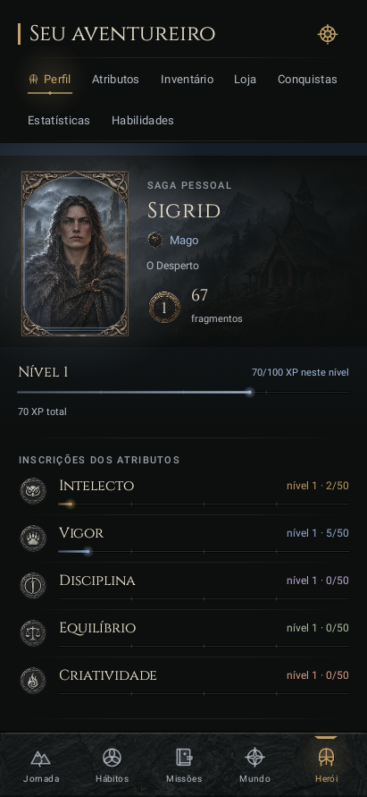

# ASCEND — Crônicas da Ascensão · 1.6.9.19

[**Baixar APK Android 1.6.9.19 (assinatura oficial preservada)**](downloads/ASCEND-1.6.9.19.apk?raw=true) · [APK 1.6.9.15](downloads/ASCEND-1.6.9.15.apk?raw=true) · [APK 1.6.9.10](downloads/ASCEND-1.6.9.10.apk?raw=true) · [APK 1.6.9](downloads/ASCEND-1.6.9.apk?raw=true)

RPG de hábitos para Android 8.0 ou superior. **Tudo funciona localmente**, sem conta, internet, anúncios, assinatura ou serviços pagos. O GitHub distribui o código e o instalador; o aplicativo não tem permissão INTERNET.

A versão **1.6.9.19 — A Biblioteca da Forja** (*Nordic Pictorial Library*) introduz uma biblioteca de **20 novos recursos pictóricos originais** gerados via `image-generator` e integrados com recorte 9-slice (`drawNineSlice` / `pictorialFrame`) sobre o Design System Nórdico da `1.6.9.15`: seis estudos de materiais (`mat_iron_nordic`, `mat_bronze_ancient`, `mat_silver_oxidized`, `mat_slate_volcanic`, `mat_leather_carved`, `mat_vellum_aged`), sete placas e superfícies de interface (`ui_plate_primary`, `ui_plate_secondary`, `ui_plate_ceremonial`, `ui_field_inscription`, `ui_tablet_selector`, `ui_control_surface`, `ui_frame_dialog`), quatro atlas ornamentais (`orn_divider_forged`, `orn_frames_rarity`, `orn_medallions_seals`, `orn_track_progress`) e duas tábuas pictóricas para widgets (`wid_plate_compact`, `wid_plate_expanded`), preservando integralmente todos os recursos anteriores. [Prancha da biblioteca, catálogo técnico e comparativos reais](docs/VISUAL-1.6.9.19.md) · [Inventário de arte](docs/art/README.md).

**Planejador Semanal:** agenda real, inclusão/dispensa por data, descansos e programação compartilhada com widgets, métricas e lembretes. **Central de Análises:** períodos móveis/civis, comparações, gráficos, insights locais e detalhes por hábito. **Histórico de Foco:** sessões persistidas, duração/estado, consulta e totais, sem XP adicional.

**135 testes aprovados** e Android Lint sem erros (22 avisos documentados). Room v6 e backup v8 têm migração explícita e leitura dos formatos anteriores. Pinturas, RPG, economia e dados existentes são preservados. [Comparações 1.6.9.15 × 1.6.9.19](docs/VISUAL-1.6.9.19.md) · [Legado da Forja 1.6.9.15](docs/VISUAL-1.6.9.15.md) · [Refinamento 1.6.9.10](docs/VISUAL-1.6.9.10.md) · [Consolidação 1.6.9](docs/VISUAL-1.6.9.md) · [Design System](docs/DESIGN-SYSTEM-2.0.md) · [Produtividade e regras](docs/PRODUTIVIDADE-1.6.md).

**Atualização dos APKs 1.1, 1.2, 1.3, 1.3.1, 1.4, 1.4.5, 1.5.0, 1.5.1, 1.5.2, 1.6.0, 1.6.1, 1.6.8, 1.6.9, 1.6.9.10 ou 1.6.9.15:** a `1.6.9.19` (`versionCode 19`) mantém `applicationId` (`br.com.ascend.aetheris`), certificado oficial SHA-256 (`e1f003ef...`), Room v6 e backup v8; exporte um backup de segurança e instale por cima, **sem desinstalar**. A antiga 1.0 possui assinatura diferente; consulte [INSTALACAO.md](INSTALACAO.md).

- [Instalação e atualização](INSTALACAO.md)
- [Funcionalidades e limites reais](PROGRESSO.md)
- [Assinatura e preservação de atualizações](ASSINATURA.md)
- [Validação](VALIDACAO.md)
- [Biblioteca da Forja 1.6.9.19](docs/VISUAL-1.6.9.19.md) · [Legado da Forja 1.6.9.15](docs/VISUAL-1.6.9.15.md) · [Refinamento 1.6.9.10](docs/VISUAL-1.6.9.10.md) · [Consolidação 1.6.9](docs/VISUAL-1.6.9.md)
- [Auditoria, correções e checklist físico da 1.5.2](docs/ESTABILIDADE-1.5.2.md)
- [Exploração, fases, recompensas e widgets](docs/EXPLORACAO-1.5.md)

## Visual

| Jornada | Herói | Arsenal |
|---|---|---|
|  |  |  |

**[Prancha da biblioteca e comparações 1.6.9.15 × 1.6.9.19](docs/VISUAL-1.6.9.19.md)** · [Comparações 1.6.9.10 × 1.6.9.15](docs/VISUAL-1.6.9.15.md) · [Comparações 1.6.9 × 1.6.9.10](docs/VISUAL-1.6.9.10.md) · [Comparações 1.6.8 × 1.6.9](docs/VISUAL-1.6.9.md) · [Comparações reais e revisão da 1.5.1](docs/VISUAL-1.5.1.md) · [Expansão da 1.5](docs/VISUAL-1.5.md) · [Guia do Grimório e rotinas](docs/GRIMORIO.md) · [Comparação 1.2 → 1.3](docs/VISUAL-1.3.md) · [Missões](docs/screenshots/livro-missoes.png) · [Chefe](docs/screenshots/chefe.png) · [Crônicas](docs/screenshots/cronicas.png)

Capturas dos testes de interface com personagens de teste. Nenhuma conclusão fictícia é incluída no aplicativo.

## Desenvolvimento

Kotlin, Jetpack Compose, Material 3, Room, DataStore, MVVM, Navigation Compose, Coroutines e StateFlow. JDK 17 ou 21, SDK Android 35, Gradle Wrapper 8.9. Configure o SDK por `ANDROID_HOME` ou `local.properties`.

```sh
./gradlew testDebugUnitTest assembleDebug
```

APK: `app/build/outputs/apk/debug/app-debug.apk`. Preparar as dependências de desenvolvimento exige internet; usar o APK não exige conexão. Não é necessário pagar por nenhuma ferramenta.

Para usar a chave de depuração preservada, configure `ASCEND_KEYSTORE_PATH` com o caminho do arquivo antes da compilação. Sem essa variável, o Android Gradle Plugin usa a chave de depuração padrão do ambiente. Consulte `ASSINATURA.md` antes de gerar atualizações.

O fluxo central continua: registro por hábito/dia → recompensa com chave determinística → ledger transacional → nível/atributos/moedas derivados. Recompensas são snapshots; editar um hábito não reescreve XP histórico. Reverter moedas já gastas gera compensação futura, com saldo disponível limitado a zero.

Banco Room v6, com migrações explícitas 1 → 2 → 3 → 4 → 5 → 6; backups v8 leem também arquivos v1–v7. A migração 5 → 6 acrescenta planejamento e histórico de foco sem reconstruir tabelas antigas. Nenhum fallback destrutivo é usado. Preferências de aparência, interesses e sugestões dispensadas ficam no aparelho e não são transferidas pelo backup.
