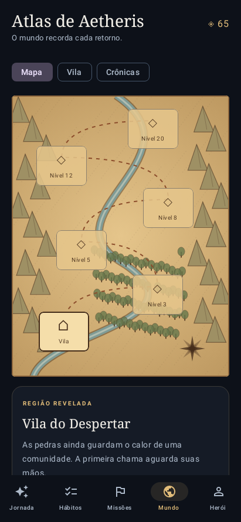

# ASCEND — Crônicas da Ascensão · 1.2

[**Baixar APK Android 1.2.0**](downloads/ASCEND-1.2.0.apk?raw=true)

RPG de hábitos para Android 8.0 ou superior. **Tudo funciona localmente**, sem conta, internet, anúncios, assinatura ou serviços pagos. O GitHub distribui o código e o instalador; o aplicativo não tem permissão INTERNET.

A versão 1.2 — **O Despertar de Aetheris** — acrescenta livro de missões em pergaminho, mapa ilustrado selecionável, inventário com equipamentos no retrato, raridades, seis habilidades cosméticas, três contratos de moradores e diálogos ligados à reconstrução. [Veja as mudanças](CHANGELOG.md).

**Se usa o APK 1.1 desta entrega:** a assinatura foi preservada. Exporte um backup por precaução e instale a 1.2 por cima, sem desinstalar. Dados e preferências permanecem locais. A assinatura da antiga 1.0 é diferente; veja [as instruções específicas](INSTALACAO.md).

- [Instalação e atualização](INSTALACAO.md)
- [Funcionalidades e limites reais](PROGRESSO.md)
- [Assinatura e preservação de atualizações](ASSINATURA.md)
- [Validação](VALIDACAO.md)

## Visual

| Livro de missões | Mapa de Aetheris | Inventário |
|---|---|---|
|  |  |  |

Capturas dos testes de interface com personagens de teste. Nenhuma conclusão fictícia é incluída no aplicativo.

## Desenvolvimento

Kotlin, Jetpack Compose, Material 3, Room, DataStore, MVVM, Navigation Compose, Coroutines e StateFlow. JDK 17 ou 21, SDK Android 35, Gradle Wrapper 8.9. Configure o SDK por `ANDROID_HOME` ou `local.properties`.

```sh
./gradlew testDebugUnitTest assembleDebug
```

APK: `app/build/outputs/apk/debug/app-debug.apk`. Preparar as dependências de desenvolvimento exige internet; usar o APK não exige conexão. Não é necessário pagar por nenhuma ferramenta.

Para usar a chave de depuração preservada, configure `ASCEND_KEYSTORE_PATH` com o caminho do arquivo antes da compilação. Sem essa variável, o Android Gradle Plugin usa a chave de depuração padrão do ambiente. Consulte `ASSINATURA.md` antes de gerar atualizações.

O fluxo central continua: registro por hábito/dia → recompensa com chave determinística → ledger transacional → nível/atributos/moedas derivados. Recompensas são snapshots; editar um hábito não reescreve XP histórico. Reverter moedas já gastas gera compensação futura, com saldo disponível limitado a zero.

Banco Room v2, com migração explícita de v1; backups v3 leem também arquivos v1 e v2. Nenhum fallback destrutivo é usado. As preferências de aparência são locais ao aparelho e não são transferidas pelo backup.
