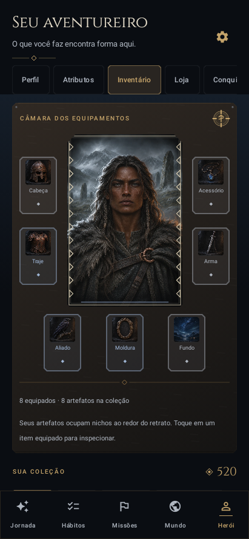

# ASCEND — Crônicas da Ascensão · 1.5.2

[**Baixar APK Android 1.5.2**](downloads/ASCEND-1.5.2.apk?raw=true)

RPG de hábitos para Android 8.0 ou superior. **Tudo funciona localmente**, sem conta, internet, anúncios, assinatura ou serviços pagos. O GitHub distribui o código e o instalador; o aplicativo não tem permissão INTERNET.

A versão **1.5.2 — A Forja da Estabilidade** corrige validação de registros, snapshots desatualizados, início de foco, datas de backup e atalhos de widgets. Rascunhos de hábito/registro sobrevivem à restauração de estado; sair de uma edição alterada pede confirmação. Progresso inválido não é convertido silenciosamente em zero.

**116 testes aprovados**, incluindo os 97 anteriores. Room v5, backup v7, economia, pinturas e recursos da 1.5.1 foram preservados. O relatório separa defeitos reproduzidos, proteções preventivas e verificações físicas pendentes.

**Atualização dos APKs 1.1, 1.2, 1.3, 1.3.1, 1.4, 1.4.5, 1.5.0 ou 1.5.1 fornecidos neste repositório:** exporte um backup de segurança e instale a 1.5.2 por cima, **sem desinstalar**. O certificado é o mesmo. A antiga 1.0 possui assinatura diferente; consulte [INSTALACAO.md](INSTALACAO.md).

- [Instalação e atualização](INSTALACAO.md)
- [Funcionalidades e limites reais](PROGRESSO.md)
- [Assinatura e preservação de atualizações](ASSINATURA.md)
- [Validação](VALIDACAO.md)
- [Auditoria, correções e checklist físico da 1.5.2](docs/ESTABILIDADE-1.5.2.md)
- [Exploração, fases, recompensas e widgets](docs/EXPLORACAO-1.5.md)

## Visual

| Jornada | Atlas | Arsenal |
|---|---|---|
|  |  |  |

**[Comparações reais e revisão da 1.5.1](docs/VISUAL-1.5.1.md)** · [Expansão da 1.5](docs/VISUAL-1.5.md) · [Guia do Grimório e rotinas](docs/GRIMORIO.md) · [Comparação 1.2 → 1.3](docs/VISUAL-1.3.md) · [Missões](docs/screenshots/livro-missoes.png) · [Chefe](docs/screenshots/chefe.png) · [Crônicas](docs/screenshots/cronicas.png)

Capturas dos testes de interface com personagens de teste. Nenhuma conclusão fictícia é incluída no aplicativo.

## Desenvolvimento

Kotlin, Jetpack Compose, Material 3, Room, DataStore, MVVM, Navigation Compose, Coroutines e StateFlow. JDK 17 ou 21, SDK Android 35, Gradle Wrapper 8.9. Configure o SDK por `ANDROID_HOME` ou `local.properties`.

```sh
./gradlew testDebugUnitTest assembleDebug
```

APK: `app/build/outputs/apk/debug/app-debug.apk`. Preparar as dependências de desenvolvimento exige internet; usar o APK não exige conexão. Não é necessário pagar por nenhuma ferramenta.

Para usar a chave de depuração preservada, configure `ASCEND_KEYSTORE_PATH` com o caminho do arquivo antes da compilação. Sem essa variável, o Android Gradle Plugin usa a chave de depuração padrão do ambiente. Consulte `ASSINATURA.md` antes de gerar atualizações.

O fluxo central continua: registro por hábito/dia → recompensa com chave determinística → ledger transacional → nível/atributos/moedas derivados. Recompensas são snapshots; editar um hábito não reescreve XP histórico. Reverter moedas já gastas gera compensação futura, com saldo disponível limitado a zero.

Banco Room v5, com migrações explícitas 1 → 2 → 3 → 4 → 5; backups v7 leem também arquivos v1–v6. A 1.5.2 mantém o esquema v5 e o formato de backup v7 da 1.5.0, sem migração adicional. Nenhum fallback destrutivo é usado. Preferências de aparência, interesses e sugestões dispensadas ficam no aparelho e não são transferidas pelo backup.
