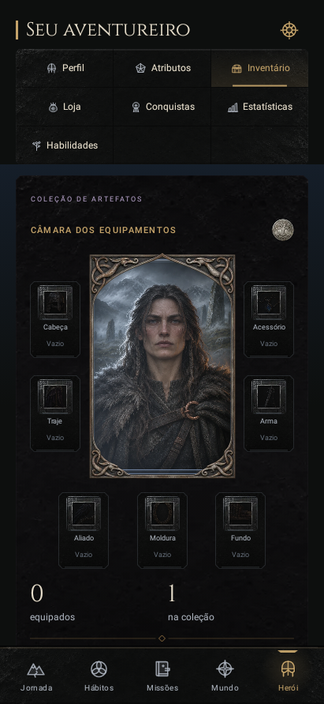

# ASCEND — Crônicas da Ascensão · 1.6.9

[**Baixar APK Android 1.6.8 (assinatura oficial preservada)**](downloads/ASCEND-1.6.8.apk?raw=true)

> **Status do APK 1.6.9:** A versão `1.6.9` (`versionCode 16`) foi compilada e validada no GitHub Actions (execução `44190969728`), porém o secret `ASCEND_KEYSTORE_BASE64` ainda não estava configurado no repositório; por segurança, `downloads/ASCEND-1.6.9.apk` não foi publicado com o certificado temporário do runner. Consulte [ASSINATURA.md](ASSINATURA.md) para gerar o APK oficial compatível com atualizações sobre `1.1–1.6.8`.

RPG de hábitos para Android 8.0 ou superior. **Tudo funciona localmente**, sem conta, internet, anúncios, assinatura ou serviços pagos. O GitHub distribui o código e o instalador; o aplicativo não tem permissão INTERNET.

A versão **1.6.9 — O Último Entalhe** encerra a série `1.6` com a consolidação artística definitiva (*Nordic Cinematic UI*): nova família de 25 símbolos vetoriais originais (`CarvedArt.kt`), folhas `.webp` entalhadas para classes, atributos e selos cerimoniais, placas metálicas de ferro e bronze nos botões, molduras de artefatos no inventário, abas e navegação discretas e superfície de ardósia refinada nos widgets. [Capturas e limites da entrega](docs/VISUAL-1.6.9.md).

**Planejador Semanal:** agenda real, inclusão/dispensa por data, descansos e programação compartilhada com widgets, métricas e lembretes. **Central de Análises:** períodos móveis/civis, comparações, gráficos, insights locais e detalhes por hábito. **Histórico de Foco:** sessões persistidas, duração/estado, consulta e totais, sem XP adicional.

**135 testes aprovados** e Android Lint sem erros (22 avisos documentados). Room v6 e backup v8 têm migração explícita e leitura dos formatos anteriores. Pinturas, RPG, economia e dados existentes são preservados. [Comparações reais](docs/VISUAL-1.6.9.md) · [Design System](docs/DESIGN-SYSTEM-2.0.md) · [Produtividade e regras](docs/PRODUTIVIDADE-1.6.md).

**Atualização dos APKs 1.1, 1.2, 1.3, 1.3.1, 1.4, 1.4.5, 1.5.0, 1.5.1, 1.5.2, 1.6.0, 1.6.1 ou 1.6.8:** a `1.6.9` mantém `applicationId` (`br.com.ascend.aetheris`), Room v6 e backup v8; após assinatura com `ascend-1.1.keystore` (`e1f003ef...`), exporte um backup de segurança e instale por cima, **sem desinstalar**. A antiga 1.0 possui assinatura diferente; consulte [INSTALACAO.md](INSTALACAO.md).

- [Instalação e atualização](INSTALACAO.md)
- [Funcionalidades e limites reais](PROGRESSO.md)
- [Assinatura e preservação de atualizações](ASSINATURA.md)
- [Validação](VALIDACAO.md)
- [Comparativos visuais 1.6.9](docs/VISUAL-1.6.9.md) · [Revisão 1.6.8](docs/VISUAL-1.6.8.md)
- [Auditoria, correções e checklist físico da 1.5.2](docs/ESTABILIDADE-1.5.2.md)
- [Exploração, fases, recompensas e widgets](docs/EXPLORACAO-1.5.md)

## Visual

| Jornada | Missões | Arsenal |
|---|---|---|
|  |  |  |

**[Comparações 1.6.8 × 1.6.9](docs/VISUAL-1.6.9.md)** · [Comparações reais e revisão da 1.5.1](docs/VISUAL-1.5.1.md) · [Expansão da 1.5](docs/VISUAL-1.5.md) · [Guia do Grimório e rotinas](docs/GRIMORIO.md) · [Comparação 1.2 → 1.3](docs/VISUAL-1.3.md) · [Missões](docs/screenshots/livro-missoes.png) · [Chefe](docs/screenshots/chefe.png) · [Crônicas](docs/screenshots/cronicas.png)

Capturas dos testes de interface com personagens de teste. Nenhuma conclusão fictícia é incluída no aplicativo.

## Desenvolvimento

Kotlin, Jetpack Compose, Material 3, Room, DataStore, MVVM, Navigation Compose, Coroutines e StateFlow. JDK 17 ou 21, SDK Android 35, Gradle Wrapper 8.9. Configure o SDK por `ANDROID_HOME` ou `local.properties`.

```sh
./gradlew testDebugUnitTest assembleDebug
```

APK: `app/build/outputs/apk/debug/app-debug.apk`. Preparar as dependências de desenvolvimento exige internet; usar o APK não exige conexão. Não é necessário pagar por nenhuma ferramenta.

Para usar a chave de depuração preservada, configure `ASCEND_KEYSTORE_PATH` com o caminho do arquivo antes da compilação. Sem essa variável, o Android Gradle Plugin usa a chave de depuração padrão do ambiente. Consulte `ASSINATURA.md` antes de gerar atualizações.

O fluxo central continua: registro por hábito/dia → recompensa com chave determinística → ledger transacional → nível/atributos/moedas derivados. Recompensas são snapshots; editar um hábito não reescreve XP histórico. Reverter moedas já gastas gera compensação futura, com saldo disponível limitado a zero.

Banco Room v6, com migrações explícitas 1 → 2 → 3 → 4 → 5 → 6; backups v8 leem também arquivos v1–v7. A migração 5 → 6 acrescenta planejamento e histórico de foco sem reconstruir tabelas antigas. Nenhum fallback destrutivo é usado. Preferências de aparência, interesses e sugestões dispensadas ficam no aparelho e não são transferidas pelo backup.
