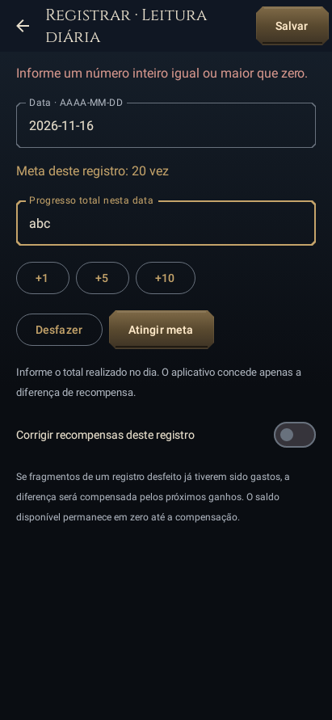

# ASCEND 1.5.2 — A Forja da Estabilidade

Base: `feat/ascend-1.5.1`, commit `2ab6c47a0abafb26d6094d80f14f5c2651ee8dbe`. Trabalho em `feat/ascend-1.5.2`, sem substituir a principal ou o APK anterior. Android 8+, Room v5, backup v7, recursos locais e identidade nórdica preservados.

## Defeitos confirmados e correções

| Prioridade | Reprodução/observação | Causa e correção | Regressão |
|---|---|---|---|
| P0 — integridade do registro | Quantidade negativa no repositório apaga o progresso anterior; texto inválido no formulário usa zero como fallback | `coerceIn` aceitava negativos como zero e `toIntOrNull() ?: 0` confundia erro com desfazer. Agora negativos são rejeitados; entrada inválida recebe mensagem local, preserva o campo e não chama o salvamento. Zero explícito/Desfazer continuam válidos | `invalidAmountCannotEraseAnExistingRecord`, `invalidProgressStaysEditableWithoutErasingTheRecord` |
| P1 — fotografia desatualizada | Salvar com uma referência antiga após mudar meta/recompensas: o novo registro concede 30 XP em vez dos 120 XP atuais | A criação usava o objeto recebido pela tela. O repositório consulta o hábito persistido dentro da transação; registros já existentes conservam seus snapshots | `pendingRecordUsesCurrentHabitButPreservesExistingSnapshots` |
| P1 — foco incompatível | Uma tela antiga inicia foco depois de mudar o hábito para simples ou excluí-lo | A validação usava só o objeto recebido. Agora consulta o hábito atual e exige cronometrado ativo. Não interrompe sessões antigas válidas nem perde minutos já registrados | `focusStartRejectsAStaleHabitChangedToSimple`, `deletedHabitCannotStartANewFocusFromAnOldScreen` |
| P1 — classificação histórica | Foco iniciado em descanso registra `scheduled=true` | Encerramento não passava os descansos globais ao cálculo de programação. Agora usa as datas do banco. A recompensa da atividade extra continua permitida | `focusRespectsRestDayInItsHistoricalSnapshot` |
| P1 — validação de backup | Envelope com checksum correto contendo data inválida do personagem ou do foco era aceito | Faltavam verificações dessas datas. A validação agora as interpreta e verifica os limites de sessão antes da substituição transacional. Não mudou o formato v7 | `invalidCharacterDateIsRejectedByBackupValidation`, `invalidFocusBackupIsRejectedBeforeReplacingProgress` |
| P1 — rascunho de formulário | Restauração do estado salvo fecha o editor de hábito e perde o texto não salvo | Pedido do editor e campos usavam apenas `remember`. Agora há estado salvável para os pedidos e campos de hábito/registro, com confirmação ao descartar alterações. Não se grava um hábito automaticamente | `habitDraftSurvivesSavedStateAndCanStillBeCancelled`, `widgetRecordDraftAndConsumedIntentSurviveActivityRecreation` |
| P1 — feedback do widget | PendingIntent do dia anterior é recusado corretamente, mas sem explicar o motivo | O receiver descartava a exceção. Agora apresenta mensagem curta em português e atualiza a leitura; erros de carregamento têm estado recuperável com acesso à Jornada | `oldPendingIntentRefusesPaymentAndExplainsTheNewDay` |
| P1 — registro por atalho | Inspeção do manipulador mostrou que um hábito arquivado/pausado podia abrir pelo atalho antigo; só exclusão era filtrada | Atalhos novos levam a data. O app revalida tipo, atividade, programação e data antes de abrir; legado sem data continua compatível. Pedidos inválidos vão à Jornada com explicação. Extras consumidos continuam removidos | `complexWidgetRequestsRecheckDateTypeAndAvailability`; entrada válida e recriação exercitadas pelas suítes de UI |
| P2 — indicador sem significado | Widget sem hábitos mantém barra vazia | Agora oculta a barra também quando não há atividades programadas; o símbolo decorativo some na largura mínima para proteger o título em 130% | `emptyCompactHasNoMeaninglessProgressAndFitsItsMinimumWidth` |

As sete verificações iniciais do núcleo falharam antes das correções; passaram depois. Os dois testes iniciais de widget reproduziram barra vazia e ausência de feedback. Os testes de formulário também foram executados com os arquivos de interface da 1.5.1 para confirmar a regressão antes de restaurar a implementação corrigida. Nenhum teste de falha esperado foi apresentado como aprovação da versão final.

## Melhorias preventivas e de uso

- Mensagens de erro para progresso, data e recompensas inválidas ficam no formulário; valores não são silenciosamente convertidos em zero. A edição permanece aberta para correção.
- Hábitos excluídos não criam registros novos por referências antigas; a correção de registros históricos existentes continua permitida. A data de registro é interpretada antes da gravação.
- Foco restaurado exige identificador, data, duração, tempo e baseline coerentes. O tempo persistido e o teto de duração existentes foram mantidos, sem serviço contínuo.
- Falha de carregamento do widget não deixa uma coroutine sem tratamento nem apresenta ações de dados antigos. Esse fallback é uma proteção preventiva, exercitada por falha de leitura injetada em banco de teste, incluindo as flags de navegação de retorno. Não foi simulada falha física de armazenamento.
- A diferença entre modo livre e widget é explicada nas Configurações: os widgets seguem os dias programados. Não foi alterada a semântica do modo livre.
- Período com início e fim iguais mostra só uma data brasileira. O editor do Diário também formata a data de leitura. Datas digitáveis ISO continuam identificadas pelo formato; banco e backup permanecem ISO.
- Nenhuma imagem, fonte ou efeito sonoro foi substituído. Comparação dos APKs confirmou a preservação dos recursos gráficos/fontes/sons compartilhados. Não há alegação de ganho físico de FPS, memória ou bateria.

## Auditoria das áreas preservadas

| Área | Evidência executada | Resultado/decisão |
|---|---|---|
| Hábitos/Grimório | Criação/edição, metas, XP personalizado, busca, rotinas, duplicatas, programação, arquivo/pausa, histórico e persistência nas suítes existentes e novas | Preservados; corrigidos somente validação de entrada e snapshot novo |
| Recompensas | Idempotência, correção, snapshots, compensação de saldo, compras transacionais, níveis e resgates concorrentes | Fórmula e valores preservados; sem evidência de duplicação de XP nos testes |
| Foco | Pausa/retomada, reload do repositório, tempo em execução, encerramento repetido e sobreposição com registro manual | Tempo efetivo e pagamento único verificados; corrigidos início desatualizado e descanso |
| Widgets | Compacto/expandido, claro/escuro, 180/220 dp, 130%, vazio, nomes longos, ações reais por PendingIntent/receiver, host, correções, agenda alterada, pausa/arquivo/exclusão, descanso e restauração | Programação estrita preservada; registros complexos não são concluídos pelo receiver |
| Expedições | Atlas → região → local → aventura, três aventuras, sete marcos, três fases do Guardião, fotografias, correções, revalidação, concorrência, transformação e Memórias | Nenhum defeito adicional reproduzido; lógica e conteúdo mantidos |
| Sagas | Criação/edição, prazo, baselines, marcos, abandono/arquivo/reinício, resgate, correções, backup e integração com Expedição | Independência e recompensa original única preservadas; sem reescrita |
| Crônicas/Memórias | Semana civil, dias vazios, correção dos derivados, datas, filtros, conversas e inscrições reais | Cálculos mantidos; apenas período de um dia e data do Diário refinados |
| Banco/backup | Migrações anteriores, Room v5, envelopes antigos, checksum, backup inválido e restauração | Mantidos; falha injetada após exclusão das tabelas demonstra rollback integral |
| Navegação | Cinco áreas e telas secundárias nas suítes de UI, retorno, intenção recebida, estado salvo e duas recriações reais da Activity no Robolectric | Editor conserva sete unidades digitadas, sem criar registro; após descarte/Herói, nova recriação não reabre atalho |
| Sons/recursos | Inspeção de `AetherisAudio`, descarte do SoundPool em `DisposableEffect`, um coletor de eventos por composição; testes de preferências/seleção/respeito a silêncio e volume existentes | Não foi reproduzido defeito que justificasse substituir sons. Audição física pendente |
| Imagens/desempenho | Carregamento pelos recursos Compose, listas eficientes já existentes, observador de ciclo de vida removido no descarte; suíte de regressão | Sem benchmark físico nem problema demonstrado que justificasse refatoração ampla |

A falha de restauração é injetada por trigger SQLite de teste: a importação tenta limpar/inserir, a gravação falha, a transação é desfeita e um repositório recarregado encontra o estado original, incluindo diário e XP. Após remover a falha, o mesmo backup válido restaura normalmente. Isso verifica a proteção existente; não significa que houve corrupção real de um aparelho.

## Testes e build

`testDebugUnitTest assembleDebug`: **BUILD SUCCESSFUL**, **116 testes**, zero falhas, erros ou ignorados. Foram preservados os 97 anteriores e adicionados 19 testes:

- `StabilityTest`: 11 — registros/snapshots, validação, foco, backup, rollback, resolução de atalho e período brasileiro.
- `WidgetStabilityTest`: 5 — dimensões mínimas, ação antiga com feedback, alterações de agenda/estado com concorrência host após restauração/correção e falha de leitura com acesso recuperável à Jornada.
- `StabilityUiTest`: 3 — entrada inválida recuperável, rascunho/restauração/descarte e recriação da Activity após widget.

O teste anterior da Crônica foi atualizado para aceitar o período compacto quando as datas coincidem. Nenhuma asserção de recompensa ou integridade anterior foi removida.

Android Lint (`lintDebug`): **BUILD SUCCESSFUL**, zero erros e **21 avisos**. Foram revisados: oito sugestões de atualização de dependências, quatro atributos de dimensionamento usados a partir da API 31 (com dimensões mínimas de fallback), seis textos XML fixos, um texto de 10 sp no botão do widget, uma sugestão de offset por lambda e uma de simetria RTL. Não foram suprimidos. São pendências de manutenção/acabamento, sem defeito funcional adicional reproduzido; não houve atualização ampla de dependências nesta entrega. [Relatório Lint](validation/LINT-1.5.2.txt).

[XMLs, log e verificação do APK](validation/) · [Validação consolidada](../VALIDACAO.md).

## Ambiente e limites

O ambiente foi inspecionado: SDK Android 35, build-tools, platform-tools e ADB disponíveis; `adb devices -l` sem dispositivos. Não há diretório de emulador, system-images ou AVD disponível. Não foi instalada infraestrutura de emulação adicional.

UI/RemoteViews: Robolectric API 28, renderização nativa onde usada, 411/320 dp, claro/escuro, 130%, minimalista e redução de movimento. Recriação da Activity foi executada no Robolectric, além da restauração de estado Compose; não equivale a encerramento físico do processo ou validação de fabricante. O teclado é tratado por `adjustResize`/`imePadding` existentes e campos foram exercitados; teclado virtual real e insets do fabricante não foram simulados como aparelho completo.

Mudanças de data são exercitadas por pedidos antigos e funções de programação/datas; callbacks de atualização e agendamento têm host simulado. Não foram executados virada real da meia-noite, fuso manual, bloqueio/reboot físico ou restrições reais de bateria. Foco foi testado por timestamps e reload, sem alegar teste de bloqueio físico.

Widgets seguem o tema do sistema; a atualização pelo launcher/Android continua aproximada. As Expedições continuam sem edição/abandono após início, conforme as regras anteriores. Arquivos de backup permanecem limitados a 20 MB na leitura. Preferências de aparelho não são transferidas pelo backup. Nenhum desses limites foi apresentado como defeito novo ou recurso concluído.

## Checklist físico pendente — nada abaixo foi marcado como aprovado

- [ ] Exportar backup na 1.5.1; instalar a 1.5.2 por cima, sem desinstalar; conferir personagem, hábitos, XP, inventário, memórias e histórico.
- [ ] Colocar widgets compacto/expandido no launcher; redimensionar e aumentar fonte; testar sistema claro/escuro.
- [ ] Concluir hábito simples pelo widget, repetir o toque e verificar XP único e Jornada atualizada.
- [ ] Abrir registro quantitativo/cronometrado com app fechado, em segundo plano e já aberto; conferir hábito, rascunho e retorno.
- [ ] Virar o dia, alterar fuso/horário e tocar numa ação antiga; verificar recusa segura e mensagem.
- [ ] Reiniciar aparelho; verificar widgets e reagendamento de lembretes, incluindo dia de descanso.
- [ ] Executar foco, bloquear tela, trocar de app, pausar/retomar e encerrar processo; conferir minutos e ausência de duplicação ao reabrir.
- [ ] Exercitar teclado virtual e navegação por gestos em 320/411 dp, fonte 130%, claro/escuro e redução de movimento.
- [ ] Usar leitor de tela para seleção, botões, progressos e mensagens; conferir contraste no aparelho.
- [ ] Ouvir efeitos com preferência ligada/desligada, volume e modo silencioso.
- [ ] Iniciar/progredir/resgatar Expedições, corrigir registros e verificar santuário/Guardião/Memórias; testar Saga paralela.
- [ ] Exportar/abrir/restaurar backup por provedores Android locais, simular erro de arquivo e conferir preservação do estado.
- [ ] Executar fluxos em modo avião, incluindo widgets e retomada após reinício.

## Evidências visuais pontuais

| Validação recuperável do registro | Widget sem atividades, sem barra fictícia |
|---|---|
|  |  |

Capturas reais dos testes, com dados de teste. Não são mockups. A direção de arte da 1.5.1 foi mantida.
