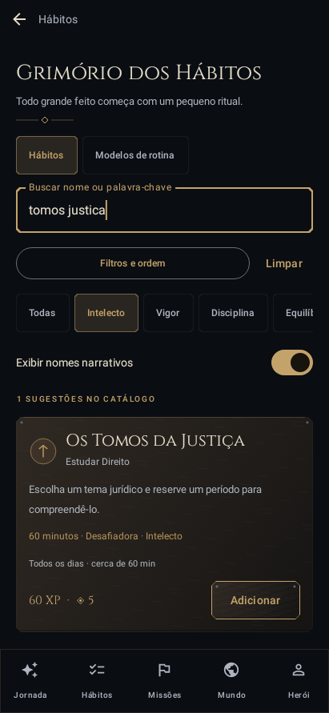
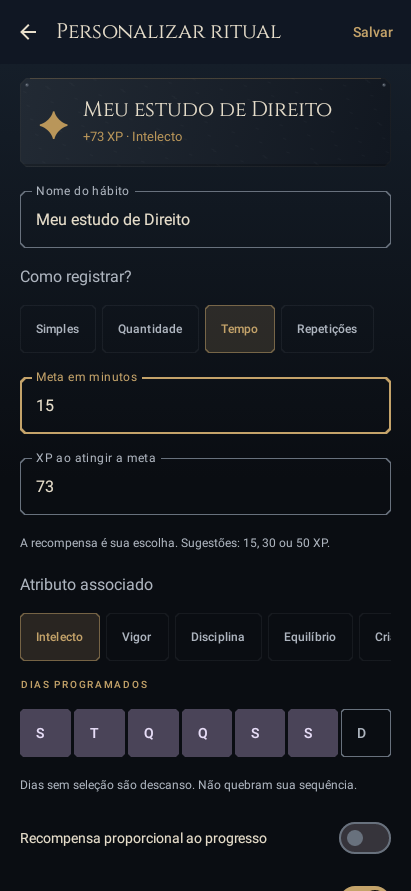
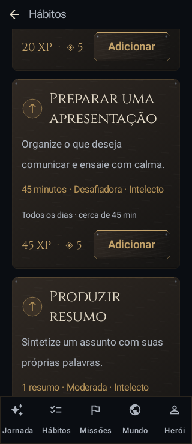
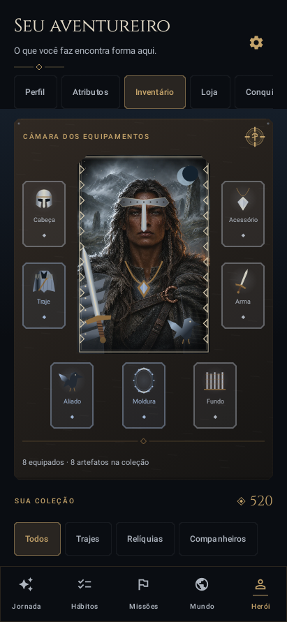
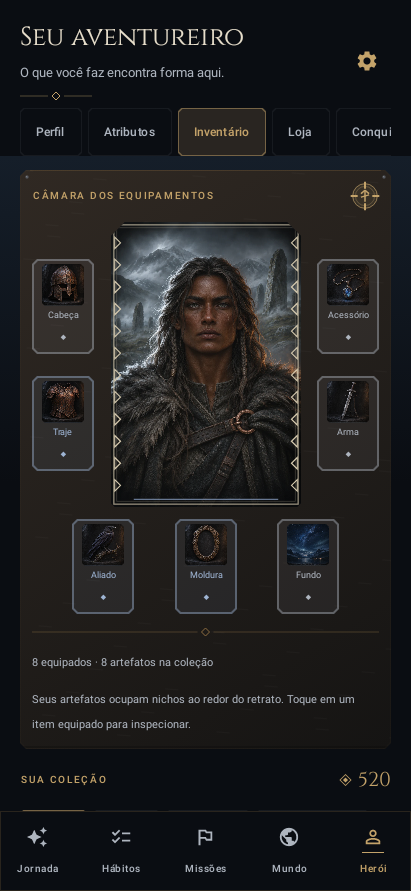
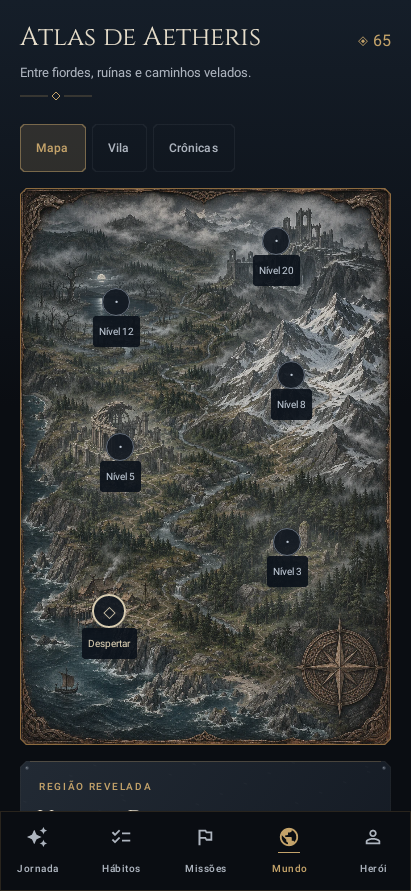
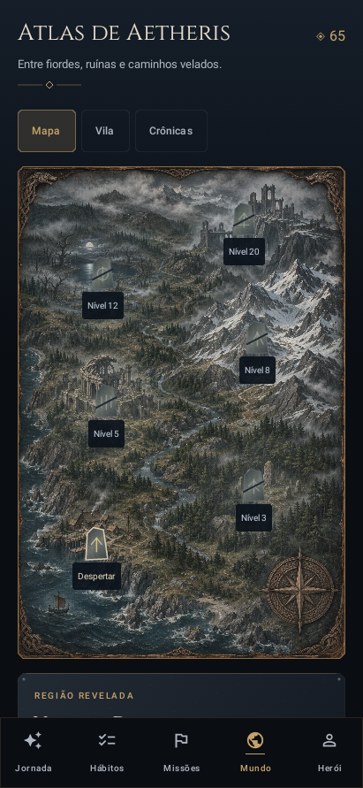
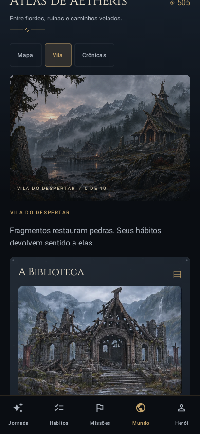
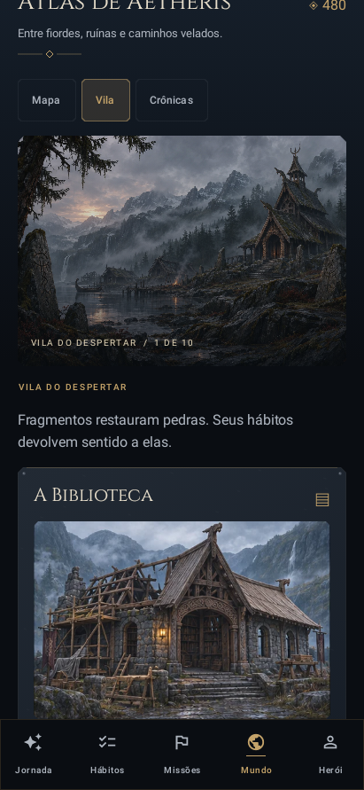
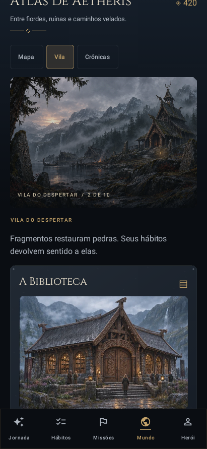

# Revisão artística — ASCEND 1.3.1

A 1.3 estabeleceu as pinturas, a paleta fria e o códice. A 1.3.1 aproxima os elementos interativos dessa direção: artefatos pintados em nichos, marcos de pedra, quinze cenas de reconstrução e um catálogo de rituais com o mesmo couro, ferro, entalhes e tipografia. Os controles permanecem texto nativo e áreas clicáveis, separados das imagens.

## Grimório e personalização

| Busca funcional/narrativa · 411 dp | Personalização antes de salvar | Cartão · 320 dp, texto 130% |
|---|---|---|
|  |  |  |

[Catálogo por categoria](screenshots/grimoire-catalogo.png) · [Sugestões por interesse](screenshots/grimoire-sugestoes.png) · [Seleção parcial de rotina](screenshots/rotina-selecao-320.png) · [Guia funcional](GRIMORIO.md).

Os cartões usam superfícies escuras em couro, rebites discretos, símbolos de atributo e recompensa separada do objetivo. O cabeçalho e os filtros rolam junto com a lista, deixando espaço para o conteúdo em telas menores. Busca, categorias, filtros e listas são componentes reais, não parte de uma pintura.

## Inventário e atlas: comparação com 1.3

| Tela | 1.3 | 1.3.1 |
|---|---|---|
| Equipamentos |  |  |
| Mapa |  |  |

**Personagem/inventário:** espada, elmo e amuleto deixam de cobrir o corpo pintado. Equipamentos e companheiros ocupam nichos ao redor do retrato e uma galeria no perfil; sombras e iluminação já fazem parte das pinturas. Os 17 itens têm correspondência visual própria, incluindo âmbar/azul dos amuletos, manto verde/violeta, armadura de cobre, coroa, lâminas, corvo, raposa, dragão, molduras, biblioteca, céu e lanterna. Slots vazios ficam esmaecidos, com rótulo explícito. Equipar/retirar mantém persistência, exclusividade e feedback. O retrato continua estático, comum às classes e disponível em três tons de pele; os itens não são vestimentas articuladas sobre o corpo.

**Atlas:** seis pedras regionais recebem símbolo esculpido, textura, fratura para bloqueio, nível legível e contorno de seleção. A área de toque mantém nome acessível e seleção funcional. A pintura geográfica da 1.3 permanece; não há novo zoom/pan nem mudança nos requisitos de região.

## Reconstrução com mudanças arquitetônicas

| Biblioteca em ruínas | Em reconstrução | Restaurada |
|---|---|---|
|  |  |  |

Biblioteca, forja, jardim, torre do cronista e praça central têm três imagens cada. Paredes danificadas, andaimes, telhados, vegetação, luzes e atividade diferenciam os estágios. São quinze cenas originais em dois atlas WebP, escolhidas pelo estado real já salvo da construção. O panorama geral da vila continua com os sinais luminosos existentes; as pinturas de cada etapa aparecem no painel de cada construção. Custos de restauração permanecem 30/60 fragmentos.

## Componentes e telas revisadas

| Área | Revisão na 1.3.1 |
|---|---|
| Jornada / Hábitos | Cartões com nome narrativo opcional, nome funcional acessível, dificuldade e progresso. Ações diretas preservadas. |
| Grimório | Novo catálogo e prévia de rotinas, separadores, selos, busca e filtros. Salvar utiliza o sistema existente. |
| Perfil / Inventário / Loja | Pinturas coerentes por item; nichos separados do retrato; inspeção, raridade e procedência mantidas. |
| Mundo / Vila | Pedras interativas e cenas distintas para os três estágios de cada construção. |
| Missões / Chefes / Crônicas | Códice e pinturas da 1.3 preservados; medidores compartilhados recebem trilho escurecido e preenchimento entalhado. Não foram adicionadas novas regras de missão. |
| Formulários / ações | Botões em couro/ferro, cantos recortados, seleção de dias com rótulos acessíveis e altura mínima de 48 dp. Campos continuam editáveis e legíveis. |
| Navegação / recompensas | Estrutura da 1.3 preservada, mantendo notificações, transições e celebração de nível. Não houve reconstrução dessas telas. |

## Verificações e limites

Capturas reais da renderização nativa Robolectric API 28, com fixtures de teste. O aplicativo entregue não inclui o personagem nem o progresso dessas capturas. Foram exercitados 411 × 891 dp, 320 × 740 dp, texto em 130%, tema claro e redução de movimento. A revisão corrigiu o espaço ocupado pelo cabeçalho do catálogo, o ajuste de recompensa/botão em largura estreita, o enquadramento quadrado das cenas cívicas, a aparência de slots vazios e a correspondência de arte de cada item.

As imagens são estáticas e locais; não há efeitos em loop novos. Reduzir animações continua desligando transições, medidores animados e brilho de equipamento. Sem benchmark ou instalação em telefone físico; não se afirma validação de todos os aparelhos, tamanhos ou permissões de fabricantes. [Testes e compilação](../VALIDACAO.md).

Todas as pinturas são originais produzidas para ASCEND, sem incorporar recursos oficiais de outras franquias. [Recursos e hashes](art/README.md).
