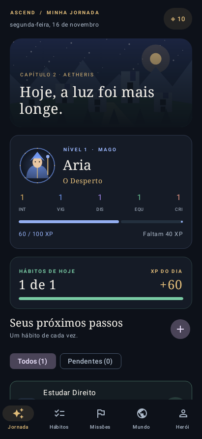
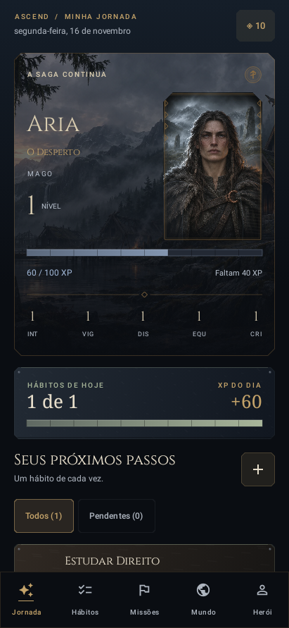
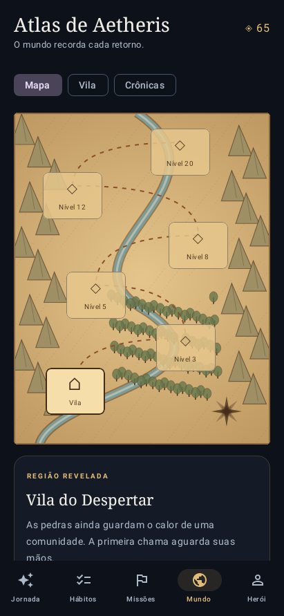
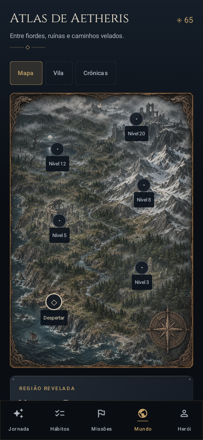
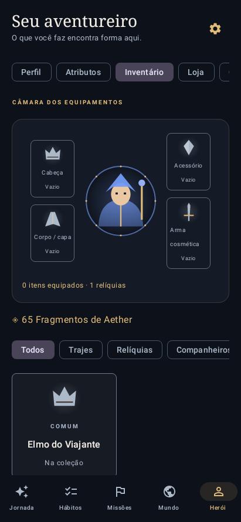
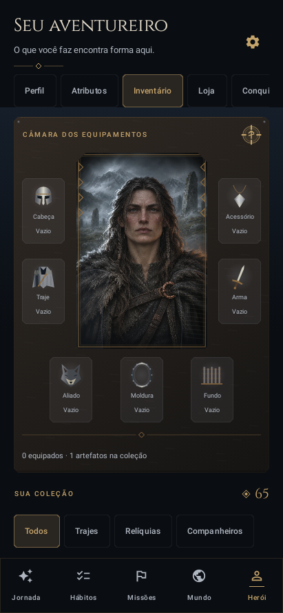
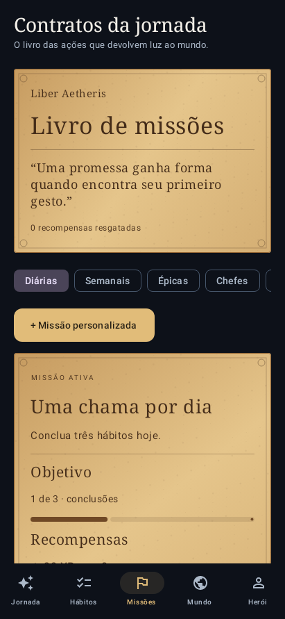
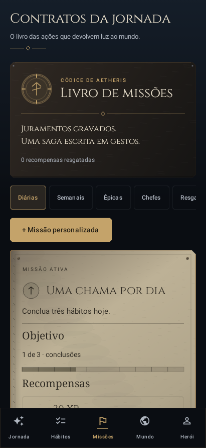

# Revisão visual — ASCEND 1.3

A direção de arte deixa a geometria esquemática da 1.2 e passa a combinar pinturas originais de fantasia nórdica com controles nativos. A hierarquia prioriza o retrato, o território e os documentos da saga. Couro, metal e páginas têm tratamentos diferentes; o brilho fica restrito a fogo, recompensas e equipamento.

## Comparação direta

| Tela | 1.2 | 1.3 |
|---|---|---|
| Jornada |  |  |
| Mapa |  |  |
| Inventário |  |  |
| Missões |  |  |

As capturas vêm da renderização nativa de testes, não de mockups. Personagens e recompensas são fixtures locais de teste; o aplicativo não recebe dados fictícios.

## Revisão tela por tela

| Tela | Resultado visual e funcional conferido |
|---|---|
| Jornada | Cena com profundidade, retrato adulto, nome/nível/XP legíveis; criação, conclusão e edição dos hábitos continuam funcionando. |
| Perfil | Busto maior, molduras entalhadas, personalização preservada. O retrato é comum às classes, com três tons de pele. |
| Inventário | Sete espaços e sinais distintos de equipado; elmo, traje, amuleto, espada, moldura, corvo e fundo aparecem no retrato. Equipar/desequipar verificados pela interface. |
| Loja | Cabeçalho de arsenal, ícones detalhados, símbolos de raridade além da cor e preço claro. |
| Atlas | Terreno e pontos de interesse legíveis; os seis marcadores mantêm nomes acessíveis, seleção e requisitos por nível. Não é um mapa 3D nem há zoom nesta versão. |
| Missões | Capa de couro e documentos desaturados, com hierarquia de estado, objetivo e recompensa. Resgate/edição preservados. |
| Chefes | Presença mítica ilustrada, enquadramento escuro e vida ligada à meta real. |
| Vila | Pintura de fiorde com fogos e sinais de restauração discretos; ruínas, recuperação e etapa final continuam ligadas aos assets existentes. |
| Crônicas | Leitura em folha costurada, texto serifado legível e navegação de retorno. |
| Hábitos, conquistas e estatísticas | Componentes recebem materiais, barras entalhadas, tipografia e selos, preservando indicadores e controles. |

Durante a revisão, foram corrigidos: sobreposições opacas nos ombros, rótulos quebrados na navegação estreita, título do inventário colidindo com o selo, abas do Herói fora da tela, contraste da barra de XP no tema claro e blocos de vila que destoavam da pintura.

## Outras capturas

- [Inventário equipado](screenshots/inventario-equipado.png), [perfil](screenshots/perfil.png) e [loja](screenshots/loja.png).
- [Vila](screenshots/vila.png), [crônicas abertas](screenshots/cronicas.png) e [chefe](screenshots/chefe.png).
- [Tema claro](screenshots/jornada-claro.png).
- [Jornada em 320 dp com texto a 130%](screenshots/jornada-320-texto130.png).
- [Inventário em 320 dp com texto a 130%](screenshots/inventario-320-texto130.png).
- [Modo minimalista](screenshots/jornada-minimalista.png).

## Materiais, movimento e desempenho

As pinturas são WebP locais. A fonte Cinzel é incorporada e acompanha sua licença OFL. Os textos e controles são compostos separadamente da arte, permitindo ampliação e semântica acessível. Grão de painéis é determinístico e cacheado; não há partículas em loop sobre as telas. A troca de equipamento usa um brilho curto, as abas do Herói fazem transição de 220 ms e os medidores animam por 550 ms; reduzir movimento desativa os três. A celebração de nível também respeita essa preferência.

Não houve benchmark em aparelho físico. A validação cobre renderização nativa Robolectric, telas de 411 e 320 dp, texto a 130%, tema claro e navegação com redução de movimento. Nem todos os tamanhos de tela ou escalas de texto foram testados.

A identidade é original: nenhuma arte, personagem, marca, logotipo ou cenário oficial de outra obra foi incorporado. [Origem dos recursos](art/README.md).
