# ASCEND 1.4.5 — As Vozes de Aetheris

A atualização troca a barra convencional por um instrumento de ferro entalhado, com cinco inscrições originais, e organiza menus secundários em placas inteiras. Ações em bronze continuam distintas da navegação. As pinturas e os 102 modelos do Grimório foram preservados; não houve geração de arte redundante.

## Navegação: comparação com a 1.4

| Área | 1.4 | 1.4.5 |
|---|---|---|
| Jornada e barra inferior | 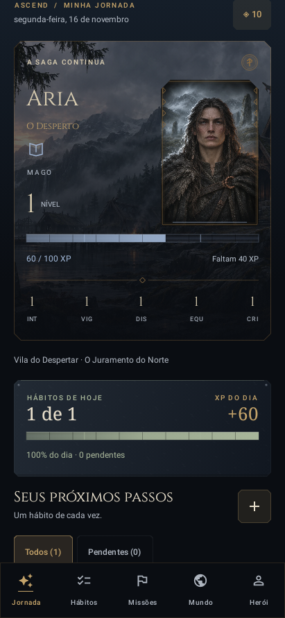 | 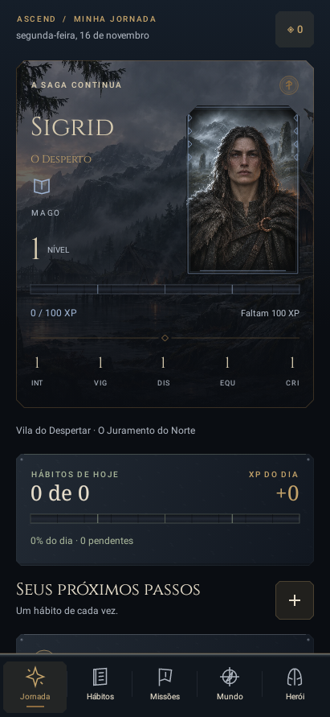 |
| Menus de Missões | 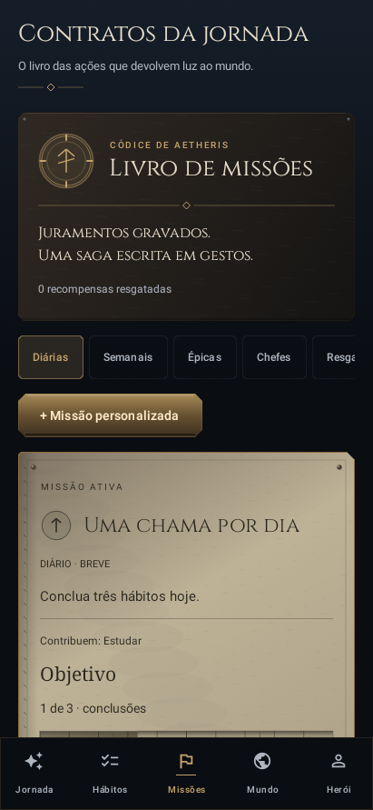 | 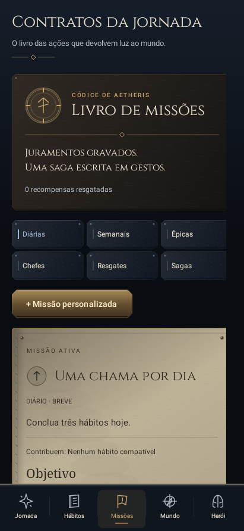 |
| Herói / Inventário | 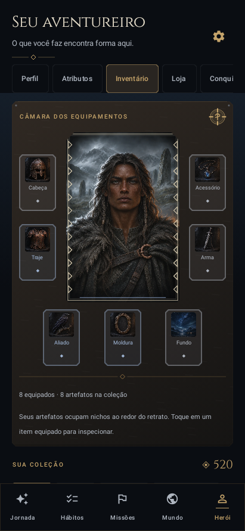 | 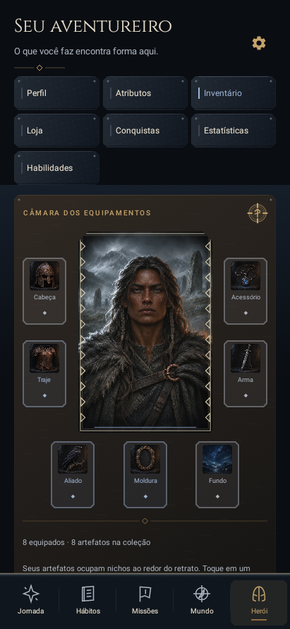 |

**AetherisNavigation:** cinco ícones Canvas com mesma espessura: estrela-guia, códice, estandarte, bússola e elmo. Material em ferro com iluminação superior, separadores e seleção por placa/entalhe. Rótulos não usam ellipsis ou largura forçada; podem crescer verticalmente com a fonte. Área mínima de 64 dp, semântica de aba selecionada, animação de 160 ms e `navigationBarsPadding`. Rotas existentes e retorno do Android são preservados. A seleção acompanha a área de origem do Salão (Perfil ou Crônicas), do Grimório e da Crônica semanal.

**AetherisTabs:** duas colunas abaixo de 350 dp úteis, três nas demais larguras, limitadas ao número de opções. Menu de Missões mostra Diárias, Semanais, Épicas, Chefes, Resgates e Sagas por inteiro. Herói, Mundo, seções de Hábitos e Grimório compartilham o componente. Filtros longos e paletas de ícones continuam em chips roláveis, pois são seletores de conteúdo; não são menus de seção. O Herói preserva rolagem de cada seção com SaveableStateHolder; aba e busca do Grimório também usam estado salvável.

## Crônica e memórias

| Crônica com atividade registrada | Salão dos feitos | Conversas guardadas |
|---|---|---|
| 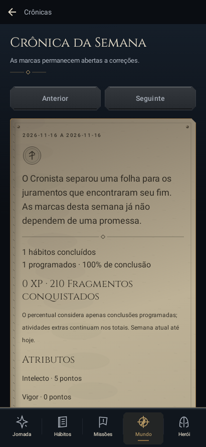 | 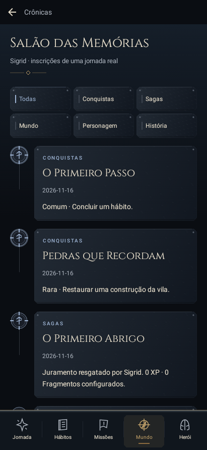 | 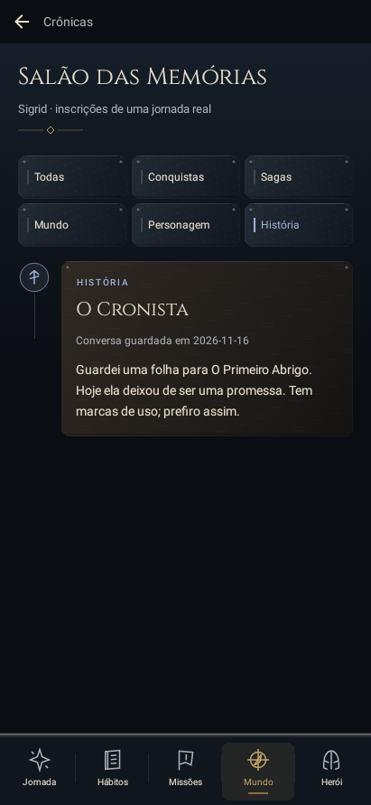 |

A Crônica da Semana abre em Mundo → Crônicas. Anterior/Seguinte navegam semanas civis, segunda a domingo; a semana corrente vai até hoje. Estatísticas, atributos, contratos resgatados, sagas avançadas/resgatadas, conquistas e reconstrução são derivados dos registros atuais. Não se grava um resumo duplicado. Correções mudam os totais. Textos locais variam por fatos, com linguagem neutra em semanas silenciosas. O percentual exclui atividades extras/descansos do denominador, conforme a regra existente; os totais de atividades ainda incluem extras.

O Salão abre pelo Perfil e pelas Crônicas. As inscrições têm emblema, categoria, título, data quando conhecida e contexto. Filtros: Conquistas, Sagas, Mundo, Personagem e História. Datas de região/título usam evidência do nível quando disponível; dados sem data dizem “Data não disponível”. Conversas são datadas pelo momento em que foram guardadas, explicitamente identificado. Não há recompensa por abrir o Salão.

## Sagas e Herói

[Histórico de saga](screenshots/v1.4.5/saga-historico-145.png) · [Retrato ampliado](screenshots/v1.4.5/retrato-ampliado-145.png) · [Inventário](screenshots/v1.4.5/inventario-145.png).

- Sagas em curso ficam separadas do histórico. Abandonar exige confirmação, congela data/progresso e não paga recompensa. Arquivar organiza tentativas encerradas. Reiniciar gera novo UUID e fotografia atual, sem importar o progresso da tentativa anterior.
- O prazo usa calendário nativo Android, com opção Sem prazo. O formulário avisa antes de descartar mudanças. Nome/meta/recompensas continuam editáveis até o resgate; seleção de hábitos e métrica conservam os termos originais depois do início.
- Os quatro marcos mantêm percentuais/símbolos e texto contextual, sem recompensas intermediárias. Recompensa, hábitos e estado são separados; novas ações secundárias ficam em ferro, abandono em brasa discreta.
- O retrato ampliado conserva arte, classe, título, nível e moldura equipada. A moldura base recebe tom de classe quando não há outra escolha de moldura. Detalhes do arsenal usam arte de 170 dp, raridade, estado equipado, descrição e procedência.
- Painéis de vozes têm nome e símbolo do habitante. Falas novas reconhecem reconstrução parcial, estudo prolongado, descoberta de Ione e retorno. O texto de uma conversa reconhecida passa a ser guardado no próprio asset de memória, preservando a fala mesmo após mudanças nos registros.

## Larguras e estados

| 320 dp, fonte 130%, claro | Sagas na mesma configuração | Crônica na mesma configuração |
|---|---|---|
| 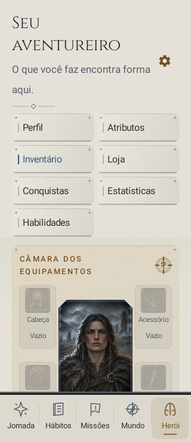 | 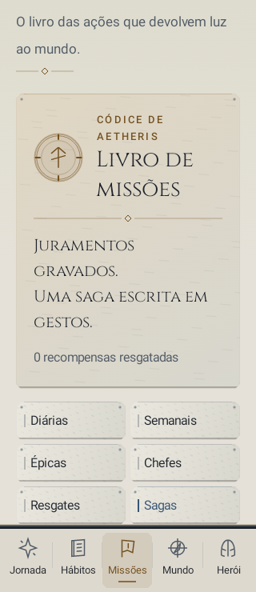 | 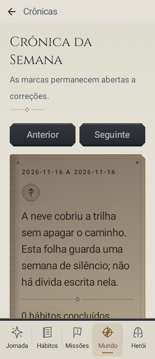 |

Vazios de saga, histórico, memória, conversas e semana sem atividade têm textos próprios; buscas e coleção preservam seus vazios anteriores. Nenhum dado fictício é adicionado ao APK. Capturas vêm dos testes com renderização nativa Robolectric e fixtures locais.

## Sons e limites

Cinco sons originais curtos (metal, madeira, sino, marca e folha) são opcionais e começam desligados, com volume local. Modo silencioso e volume de mídia zero impedem a execução. Não há música contínua nem vibração. [Recursos sonoros](art/SOUNDS.md).

Foram testados navegação/retorno, seleção das cinco áreas, menus, retrato, Crônica, Salão e ciclo de saga em 411/320 dp, fonte 130%, tema claro/escuro e redução de movimento. Testes anteriores cobrem modo minimalista e os sistemas preservados. Não houve aparelho físico, audição dos efeitos no telefone, benchmark ou validação física das barras Android de gestos/três botões; os insets são tratados no código.

Limites históricos: a primeira conclusão é a primeira ainda presente nos registros corrigidos; regiões e títulos mostram disponibilidade derivada do progresso atual. Conversas de backups anteriores sem texto só recuperam a fala quando a condição original ainda pode ser reconstruída; caso contrário informam a ausência do texto. O estado de abandono é uma fotografia, não uma nova versão de todos os registros. Preferências de áudio/aparência permanecem locais ao aparelho.

[Validação e APK](../VALIDACAO.md) · [Regras das Sagas](../SAGAS.md).
