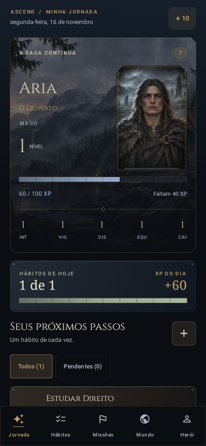
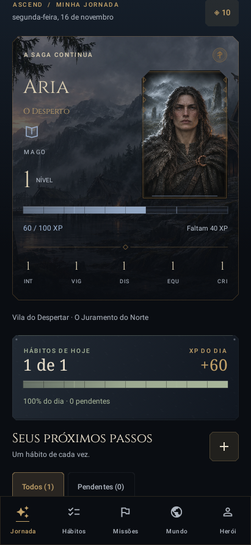
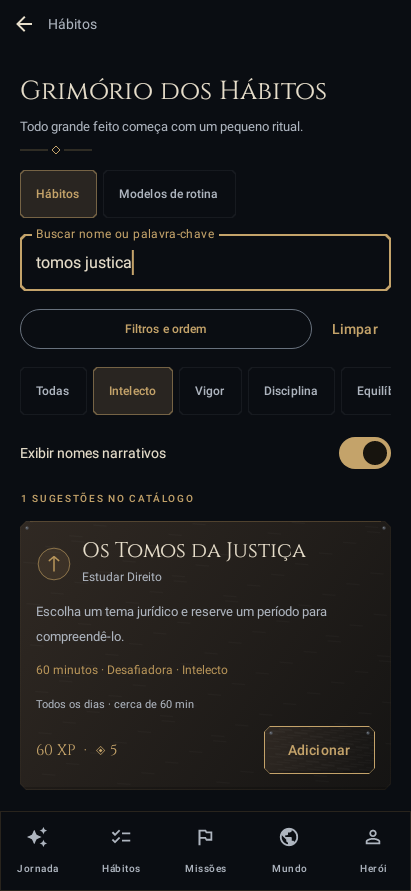
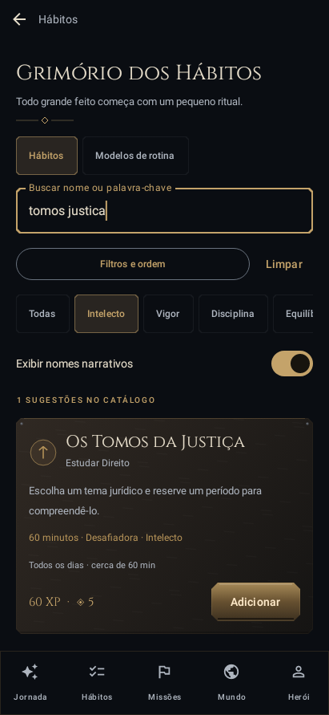
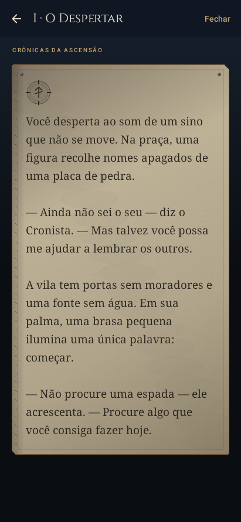
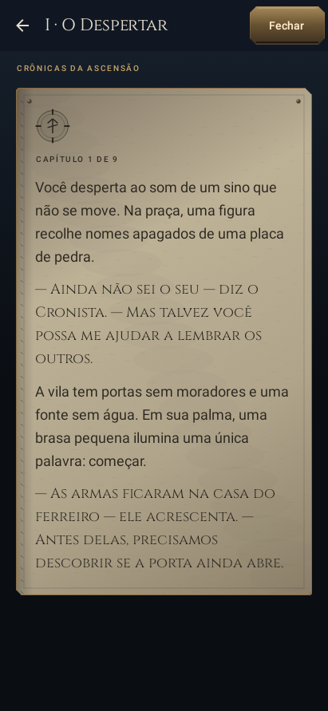
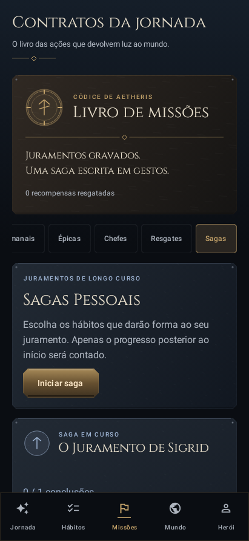
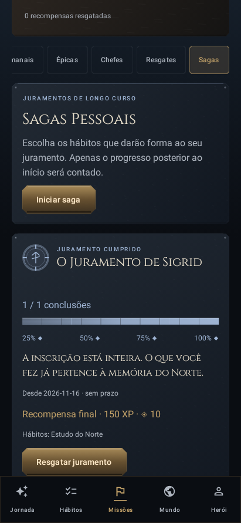
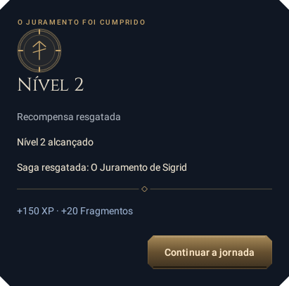

# ASCEND 1.4 — O Juramento do Norte

A direção da 1.4 conserva as pinturas e trabalha sobre os instrumentos do mundo: bronze com relevo nas ações, ferro nos controles, marcos azuis nas sagas e documentos mais legíveis. Não foram geradas novas imagens; as dez pinturas/atlas e a fonte local da 1.3.1 continuam incorporadas.

## Comparação com a 1.3.1

| Área | 1.3.1 | 1.4 |
|---|---|---|
| Jornada |  |  |
| Ações no Grimório |  |  |
| Crônicas |  |  |

## Juramentos e recompensas

| Saga em curso | Juramento cumprido | Recompensas da mesma ação |
|---|---|---|
|  |  |  |

[Formulário de saga](screenshots/saga-editor.png) · [Diálogo após o resgate](screenshots/dialogo-saga.png) · [Saga em 320 dp e texto 130%](screenshots/saga-320-texto130.png) · [Regras completas](../SAGAS.md).

As imagens são capturas da renderização nativa Robolectric, não mockups. Personagens, moedas e progresso são fixtures de testes; não são inseridos no APK de produção.

## Revisão das telas e componentes

- **SagaButton / Action:** superfície de bronze com três tons, iluminação superior, sombra inferior e recortes. Pressão desloca a superfície em 1 dp em 90 ms. Secundário usa ferro; destrutivo tem tons de brasa. O componente oferece estados desativado, carregando e concluído; o estado de carregamento está disponível para uso, não representa uma tarefa fictícia. Redução de movimento elimina a transição. Botões de salvar, Grimório, missões, sagas, restauração, habilidades e confirmação do arsenal compartilham o componente. Alguns controles secundários nativos permanecem, estilizados pelo tema.
- **Jornada / Hábitos:** emblema da classe, região, percentual, pendências e próxima atividade por ordem dos hábitos programados; cards mantêm ações diretas, com ferro recortado no controle de progresso. A XP vem do ledger real, como antes.
- **Medidores:** trilho mais espesso, iluminação, entalhes e divisões em quartos. Azul para saga/XP, bronze e verde para reconstrução, tons próprios para atributos. A barra animada respeita redução de movimento.
- **Missões:** tipos identificados por duração narrativa, texto com hábitos compatíveis e resgate no novo botão; as regras anteriores permanecem. Sagas ficam na mesma área, sem sexta aba principal. Contribuição é baseada em métrica, atributo e seleção, não apenas no nome do hábito.
- **Recompensas:** avisos comuns mostram XP, aumento real do saldo disponível e atributos. O painel especial reúne nível, conquista rara, item, restauração e resgate que ocorreram na mesma transação. Não há sequência de janelas para os eventos de uma ação; não há efeitos em loop. Exemplo capturado: 150 XP da saga e 20 Fragmentos (10 da saga + 10 pelo nível 2).
- **Crônicas / narrativa:** progresso de capítulos revelados, divisões por parágrafo, corpo funcional e diálogos em Cinzel. Oito capítulos receberam intervenções pontuais, sem mudar nomes, condições de desbloqueio ou acontecimentos. O sétimo foi preservado. A referência a “últimas pedras” do terceiro foi corrigida para não prometer restauração completa quando o desbloqueio exige só a primeira etapa.
- **Classes:** emblemas originais de escudo/ferro, tomo, escudo/juramento, direção/montanha e ferramenta. Aparecem na seleção, perfil e Jornada, com descrições próprias; não alteram atributos, gênero ou tom de pele.
- **Árvore:** conexões em separadores de constelação, pontos disponíveis, indicação de bloqueio/disponibilidade/aquisição e nome do pré-requisito. Os seis efeitos cosméticos e custos anteriores são mantidos; as descrições remetem aos nichos reais, sem prometer combate.
- **Inventário / loja / conquistas:** pinturas, slots e raridades preservados, confirmação do arsenal em bronze, medidores compartilhados refinados. Novos itens e conquistas raras recebem reconhecimento no painel consolidado. Não foi criada uma galeria nova nem alteradas as condições das conquistas.
- **Mundo / reconstrução:** contagem de regiões reveladas, pinturas preservadas e crossfade de 450 ms entre etapas (zero em redução de movimento). O evento informa construção, etapa e Fragmentos usados; diálogos locais reconhecem biblioteca, forja e jardim completos. Custos 30/60 preservados.

## Limites assumidos

Sons e vibração ficaram fora desta entrega. Não houve nova pintura, mapa, árvore ou economia. Não há zoom no atlas, combate, editor anatômico, abandono de saga ou importação opcional de histórico para uma saga. O retorno contextual usa a conquista de retorno já existente; não rastreia sessões de uso. Mensagens aguardam a confirmação “Guardar esta memória” para sair da fila e acompanham o backup.

A validação cobre 411/320 dp, fonte 130%, modo claro, minimalista e redução de movimento. Sem instalação ou benchmark em telefone físico. [Resultado dos testes e APK](../VALIDACAO.md).
