# ASCEND 1.5.1 — O Polimento de Aetheris

Refinamento da 1.5.0 (`b539db00a355273e016c911d8a89b7c1e82dda0d`), preservando pinturas, sistemas, dados e economia. Não há novas regiões, moedas ou etapas. A direção permanece nórdica sombria; a intervenção concentra o acabamento nos controles e na organização da leitura.

## Widgets: um fragmento da Jornada

| 1.5.0 | 1.5.1 — claro | 1.5.1 — escuro |
|---|---|---|
| 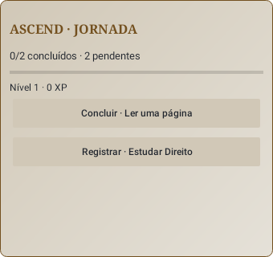 | 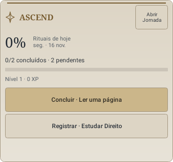 | 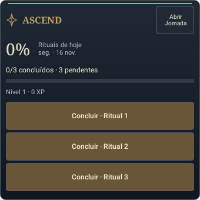 |

- Superfície em ferro/bronze com moldura dupla discreta, pequeno símbolo original e divisor superior. Sem pintura pesada no fundo.
- Percentual grande e data brasileira no expandido; resumo, progresso e nível com pesos distintos. O compacto prioriza resumo e acesso à Jornada.
- **Concluir** usa bronze; **Registrar** usa superfície secundária. Os nomes completos e a finalidade da ação ficam disponíveis à acessibilidade. **Abrir Jornada** tem alvo próprio de 64 × 48 dp, além do cabeçalho.
- A altura disponível, a largura e a escala da fonte determinam quantas ações cabem e quando retirar o bloco numérico. Em altura pequena, o texto fica mais curto. Os botões continuam com pelo menos 48 dp de altura.
- Sem personagem: convite para iniciar, sem barra fictícia. Sem rituais programados: mensagem explícita, sem mostrar 100% de uma meta inexistente.
- Conclusão simples e abertura de registro complexo continuam usando o repositório e os PendingIntents anteriores. Extras já consumidos são retirados da Activity, evitando reaproveitamento indevido do atalho.

| Sem personagem — 220 × 110 dp / 130% | Sem rituais — mesma configuração | 220 × 320 dp / 130% | Após concluir um hábito real de teste |
|---|---|---|---|
| 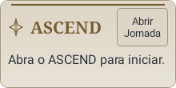 | 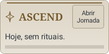 | 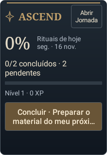 | 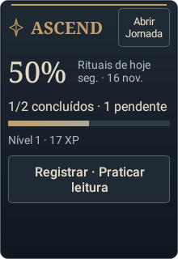 |

## Floresta, locais e Expedições

| Tela | 1.5.0 | 1.5.1 |
|---|---|---|
| Floresta | 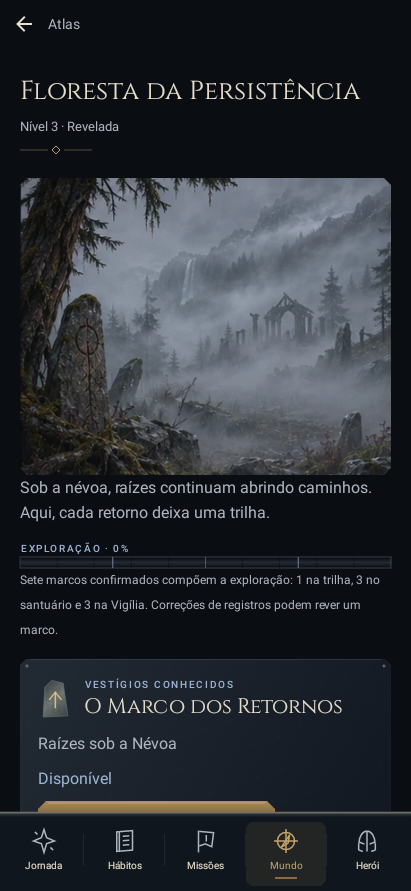 | 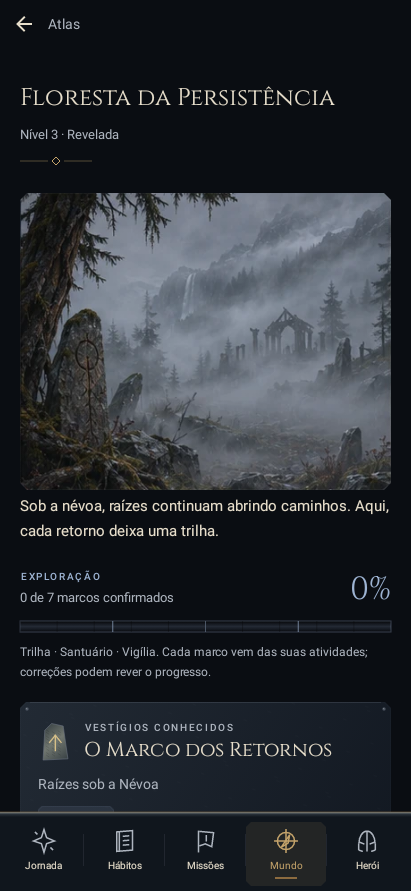 |
| Local | 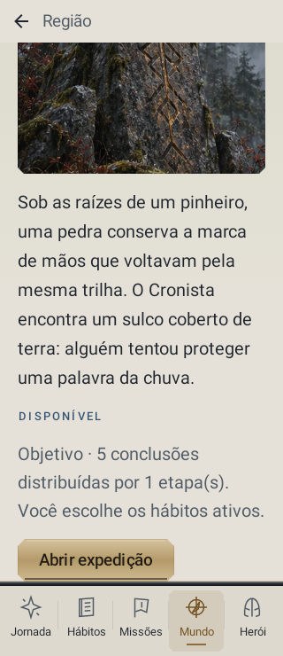 | 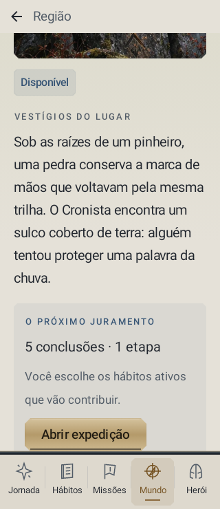 |
| Expedição | 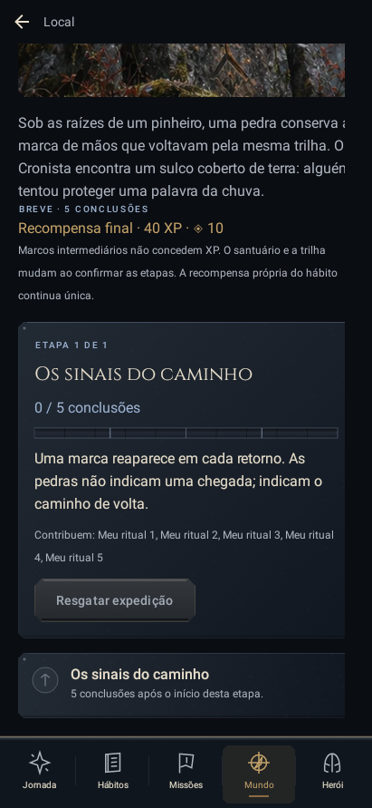 | 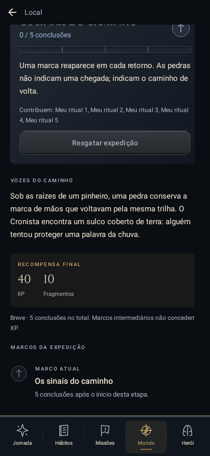 |
| Guardião | 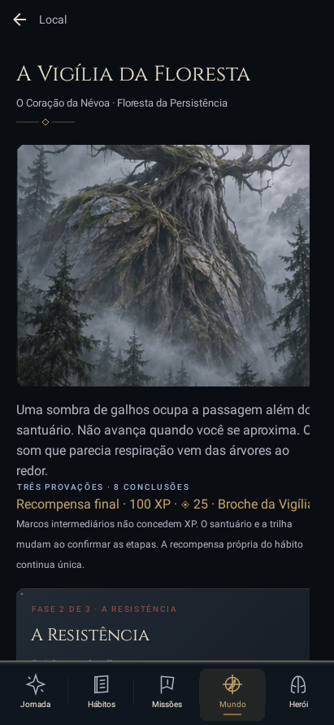 | 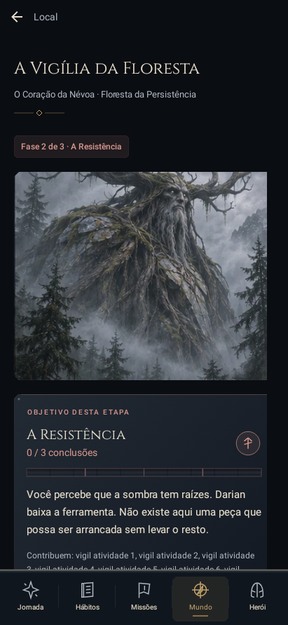 |

A região ganha respiros entre seções, percentual com contagem dos sete marcos e estados com selos discretos. Os locais separam vestígios, objetivo e consequência. As pinturas anteriores continuam locais e originais; o enquadramento das Expedições comuns ocupa menos altura para deixar o objetivo mais próximo.

Nas Expedições, a ordem passa a ser estado/fase → cena → objetivo/ação → premissa → recompensa final → marcos. O Guardião conserva as três fases e a mesma pintura, com fase atual visível antes da criatura e objetivo cerimonial em destaque. O painel de espólios separa XP, fragmentos e artefato. Concluído e resgatado têm mensagens e ações próprias, sem novo prêmio.

[Meta alcançada](screenshots/v1.5.1/expedicao-marco-150.png) · [Guardião concluído](screenshots/v1.5.1/guardiao-concluido-150.png) · [Floresta final](screenshots/v1.5.1/floresta-final-150.png).

## Memórias e Crônica Semanal

| Tela | 1.5.0 | 1.5.1 |
|---|---|---|
| Memórias da Floresta | 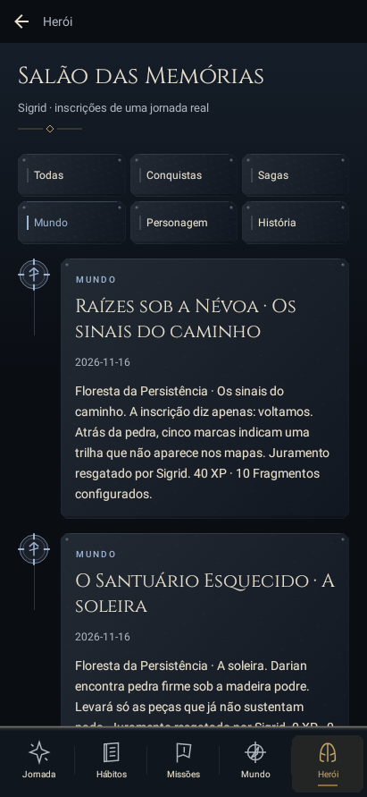 | 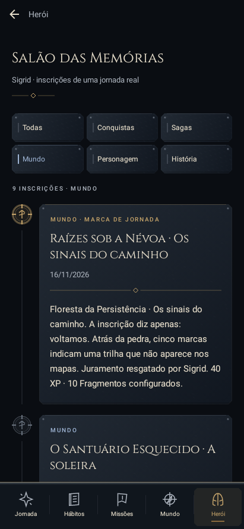 |
| Crônica Semanal | 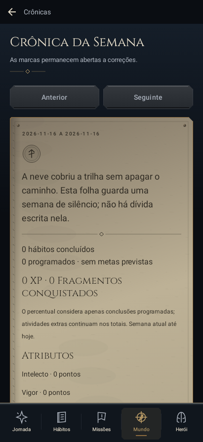 | 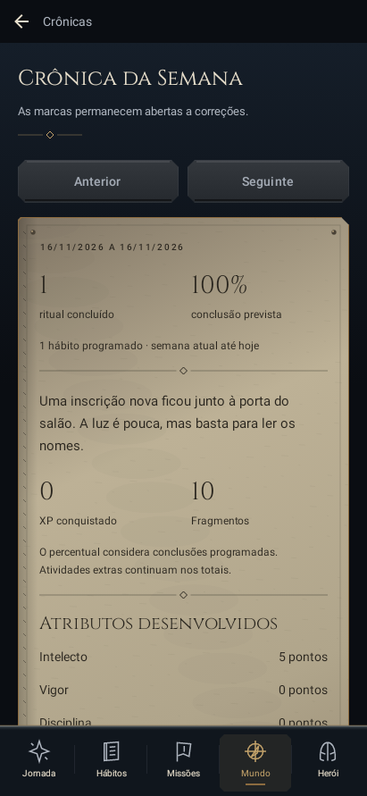 |

O Salão usa LazyColumn com chaves estáveis. A linha acompanha a altura real da inscrição, inclusive com fonte ampliada, em vez de terminar no meio do cartão. Datas recebem tamanho próprio e formato `dd/MM/yyyy`. Conclusões finais de Expedições e inscrições de Sagas recebem acento e separador discretos. Não há nova classificação econômica.

A Crônica organiza números em pares, mantém a narrativa em fonte funcional e agrupa acontecimentos. Grupos sem registros não geram uma sequência de cartões vazios. O período e as contagens distinguem semana atual/encerrada e singular/plural. Cálculos e narrativa condicional local permanecem os mesmos.

[Conversa guardada com data brasileira](screenshots/v1.5.1/memorias-151.png) · [Filtro sem inscrições](screenshots/v1.5.1/memorias-vazio-151.png).

## Perfil, inventário e controles

| Tela | Base 1.5.0 | 1.5.1 |
|---|---|---|
| Perfil | 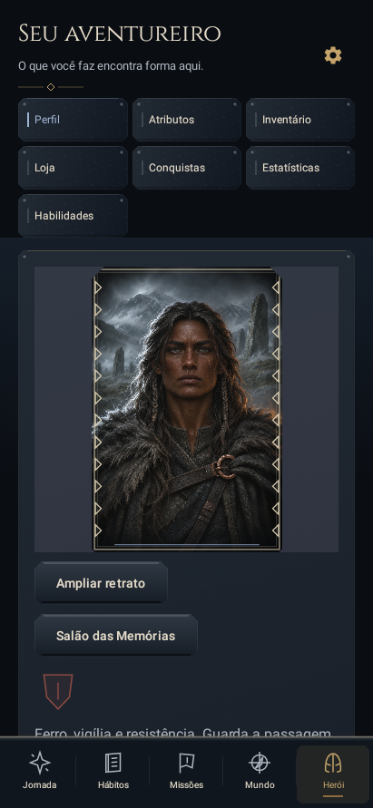 | 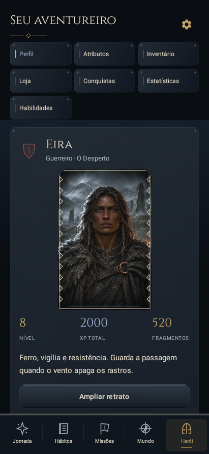 |
| Inventário | 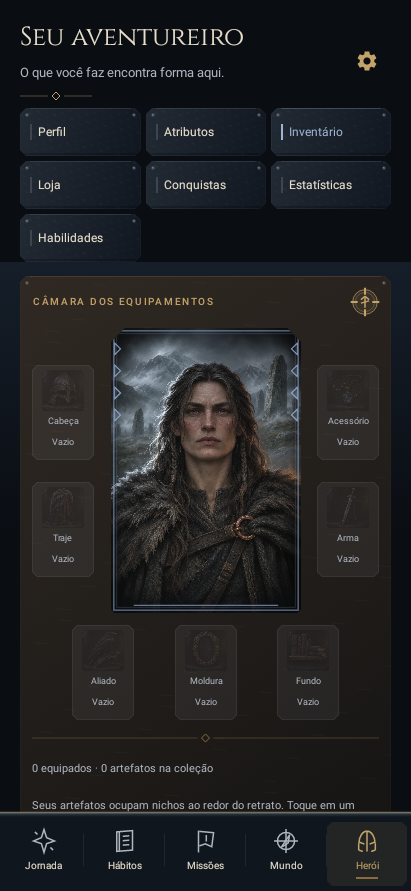 | 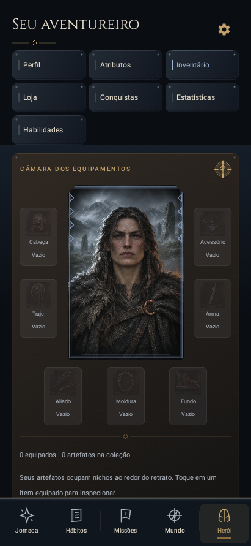 |

O cabeçalho fixo do Herói perde o subtítulo repetido, liberando área em telas estreitas. Nome, classe e título antecedem o retrato; dados e ações seguem em grupos. A ampliação limita a imagem à largura disponível. Os nichos pintados permanecem; os detalhes de artefatos têm imagem um pouco maior, estado “Equipado” explícito e data de aquisição brasileira. A grade não foi reconstruída.

[Perfil 320 dp / 130%](screenshots/v1.5.1/perfil-320-151.png) · [Inventário na mesma configuração](screenshots/v1.5.1/inventario-320-151.png) · [Dias da semana no formulário](screenshots/v1.5.1/dias-320-151.png).

A auditoria encontrou sete seletores de dias apertados na largura de 320 dp. Agora ficam em duas linhas, com rótulos de três letras e descrição completa para acessibilidade; o teste mede alvo mínimo de 48 × 48 dp e salva a programação alterada pelo formulário real.

## Acabamento compartilhado

- Títulos ligeiramente menores, entrelinhas explícitas e espaçamento consistente. Cinzel permanece nos títulos e números; narrativas longas das telas refinadas usam fonte funcional de 15 sp / 25 sp.
- Textura material menos ruidosa; bronze primário mais sóbrio, realce e profundidade de pressão menores. Estados desabilitado, selecionado e secundário permanecem distintos.
- `ReadingBlock`, `StatusSeal`, `Spoils` e `ChronicleNumber` organizam leitura, estado, recompensa e dados sem adicionar sistemas.
- Campos de formulário usam tipografia funcional. Datas de Memórias, Crônicas, Sagas, aquisições, histórico, recompensas e registros são formatadas só na apresentação. Seletores e persistência continuam usando o ISO existente.
- Transição de cenas refinada para 260 ms; redução de movimento conserva duração zero. Os controles reaproveitam as microinterações existentes, sem partículas ou animações contínuas.
- Estados vazios têm ornamento discreto e mensagem curta. Sons e pinturas não foram substituídos sem evidência de problema; nenhuma trilha foi adicionada.

## Revisão crítica e limites

As comparações mostram uma intervenção de composição e leitura, preservando a força das pinturas da 1.5. O mapa continua sendo o atlas existente, sem regiões novas. A criatura não recebeu ilustrações novas; a melhoria está na presença e hierarquia do confronto. O inventário conserva a composição de nichos, com polimento pontual de detalhes. Nem todo controle do aplicativo foi redesenhado individualmente.

As imagens são capturas reais de Views/Compose/RemoteViews em renderização nativa Robolectric API 28, com dados de teste. Não são mockups. Os nomes de alguns arquivos terminam em `150` ou `145` porque os testes originais foram preservados; as imagens da coluna atual foram regeneradas pelo build 1.5.1. A base 1.5.0 está congelada em `screenshots/v1.5/`. Cenários diferentes podem ter dados de teste distintos; isso não representa alteração econômica.

Foram executados 97 testes (os 90 existentes e sete adicionais), com cenários de 411 e 320 dp, temas claro/escuro, fonte 130%, redução de movimento, estados sem conteúdo e integração de Expedições. Não houve instalação em aparelho/emulador completo, launcher físico, rotação física, benchmark, audição ou teste físico de bateria/reinício/virada do dia. A lógica de data e a recusa de ações antigas do widget são testadas; agendamento real permanece sujeito ao Android/fabricante.

Room v5, backup v7, dados, certificate/applicationId e economia foram preservados. [Resultados e APK](../VALIDACAO.md) · [Instalação](../INSTALACAO.md).
