# ASCEND 1.5 — O Despertar dos Reinos

A expansão conserva o Atlas, a navegação em ferro e os nichos. Uma nova pintura original em grade acrescenta nove cenas de floresta, arquitetura, criatura e artefato. Região, local e aventura são telas funcionais, com objetivos reais; não são mockups ou menus com conteúdo simulado.

## Atlas e região

| Atlas 1.4.5 | Atlas 1.5 | Floresta inicial |
|---|---|---|
| 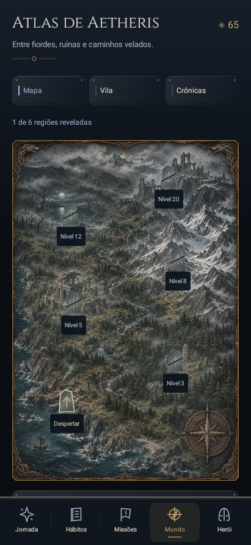 | 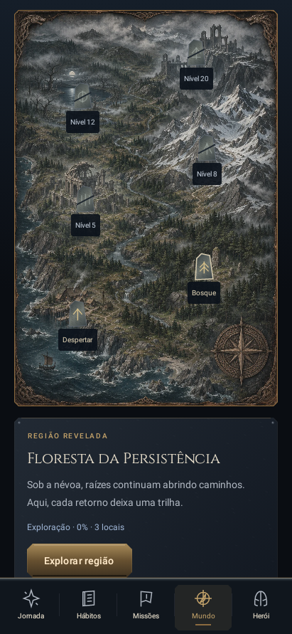 | 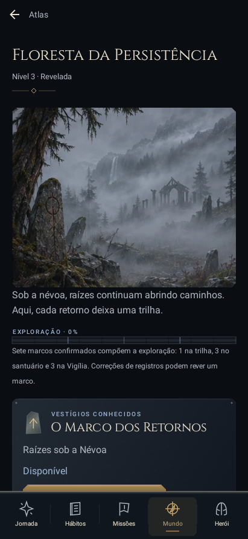 |

| Exploração concluída | Local velado em 320 dp / claro / 130% | Local disponível na mesma configuração |
|---|---|---|
| 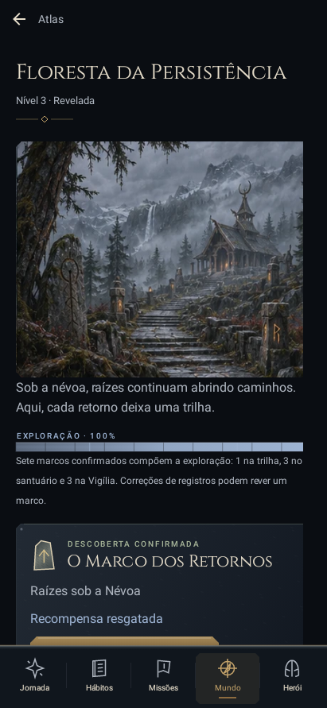 | 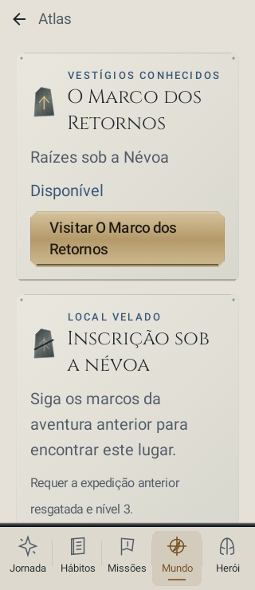 | 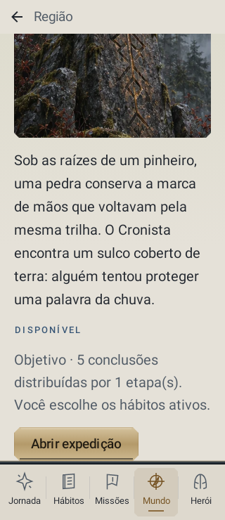 |

O Atlas mantém os seis territórios e suas pedras. A Floresta recebe indicação discreta do percentual e botão de entrada no painel. Na região, o percentual deriva de sete marcos válidos, não do nível do personagem. Locais futuros ficam sob inscrições veladas, com requisito textual e sem ação indevida. As demais regiões informam que ainda não têm expedições próprias.

## Expedições

[Etapa ativa](screenshots/expedicao-ativa-150.png) · [Meta alcançada](screenshots/expedicao-marco-150.png) · [Memórias da Floresta](screenshots/memorias-floresta-150.png).

Cada aventura tem pintura, local, premissa, dificuldade narrativa, recompensa, seleção de hábitos ativos, objetivo, estado e etapas. As listas de região/expedição usam LazyColumn. Etapas futuras ocultam seus textos, mantendo só o esforço necessário. A confirmação de cada fase inicia a próxima com fotografia de progresso nova, sem animação fictícia ou consumo repetido das atividades anteriores.

As narrativas são originais e não alteram os nove capítulos. Cronista, Darian e Seren reconhecem os sinais da trilha e o cuidado com as raízes, sem antecipar revelações de capítulos bloqueados. O final da Vigília é uma passagem concedida pelo Guardião, não uma morte ou vitória de combate.

## Santuário reativo

| Abandonado | Recuperação parcial | Restaurado |
|---|---|---|
| 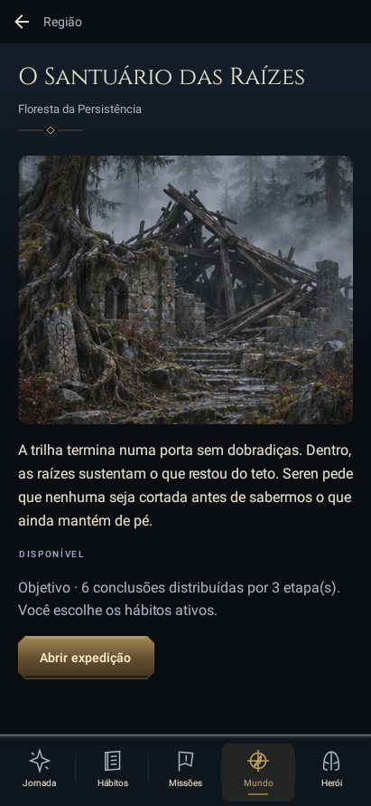 | 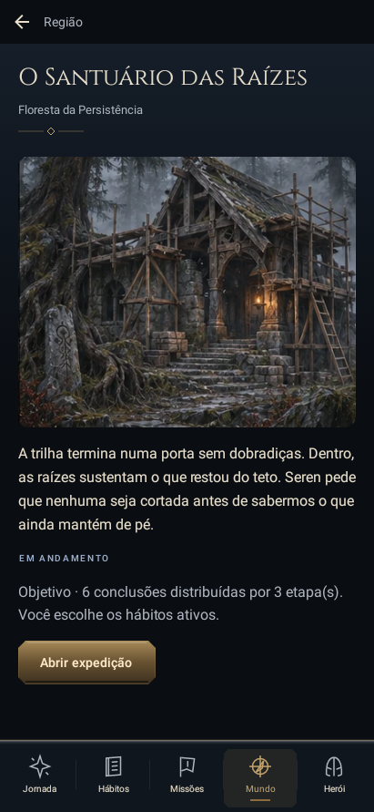 | 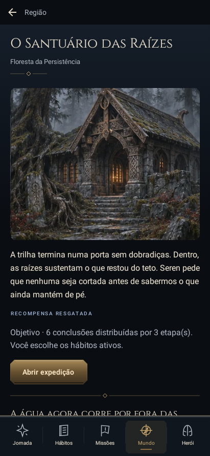 |

São três composições com diferenças reais de telhado, paredes, andaimes e luz. Não são apenas recolorações. O primeiro marco do santuário revela a recuperação; a segunda etapa conserva esse estágio visual e aprofunda a narrativa; a terceira confirma a restauração. A floresta tem estados próprios de trilha perdida, recuperada e final. As imagens são estáticas com crossfade de 400 ms, desligado na redução de movimento. O estado vem do banco e pode ser revisto por correções de histórico.

## Guardião da Névoa

| O Chamado | A Resistência | O Juramento |
|---|---|---|
| 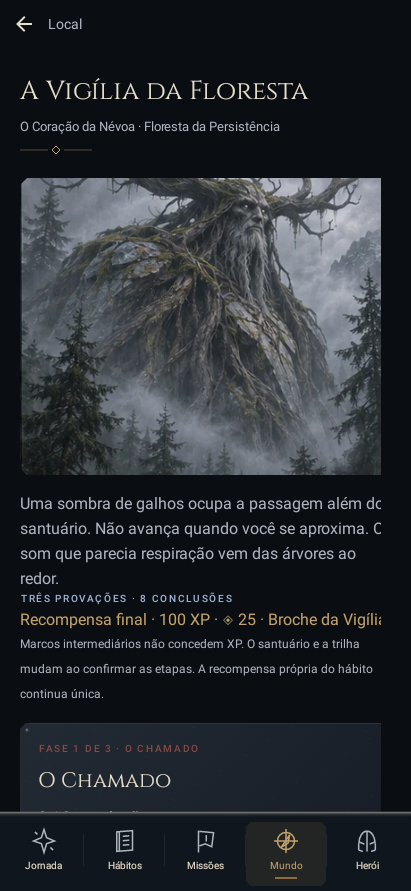 | 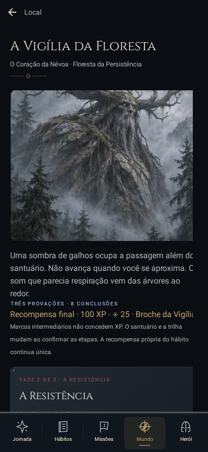 | 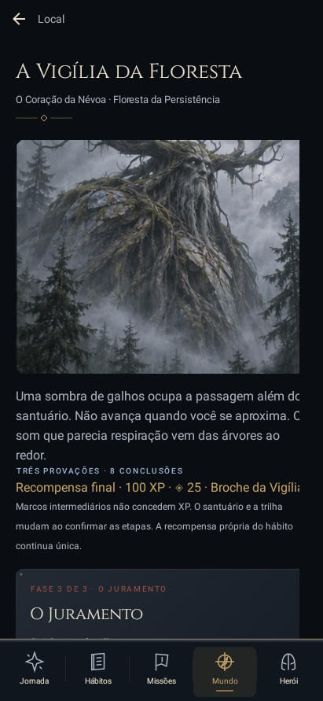 |

[Confronto encerrado](screenshots/guardiao-concluido-150.png). A mesma pintura original de criatura é utilizada nas três fases; a mudança é de objetivo, texto, número da fase e progresso real, sem afirmar ter três pinturas distintas do chefe. A recompensa final inclui Broche da Vigília, ilustrado na nona célula e equipável no nicho de acessório. Conquista e título cosmético são apresentados pelos sistemas existentes.

## Widgets nativos

| Compacto | Expandido | Sistema escuro |
|---|---|---|
| 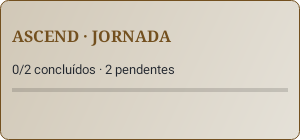 | 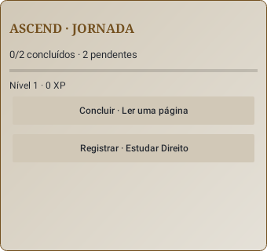 | 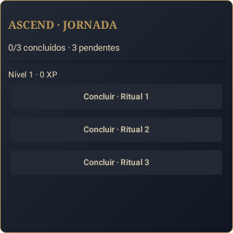 |

São capturas de RemoteViews Android reais aplicadas e desenhadas no Robolectric, não fotografias de um launcher instalado. O teste executa o PendingIntent de conclusão simples e verifica o repositório, a ausência de XP duplicado e a atualização. Para hábitos complexos, o PendingIntent abre o formulário, sem completar o hábito. Outro teste instala o provider num host simulado e verifica mudanças/correções e o agendamento da próxima atualização.

O widget usa superfície discreta em ferro/bronze, texto nativo e claro/escuro do sistema. Ao reduzir a altura, diminui a quantidade de ações. Não exibe diário ou conversas e não requer serviço contínuo. Atualizações podem ser atrasadas pelo Android; a ação sempre revalida data e programação.

## Evidências e limites

Todas as capturas são renderizações reais com dados de teste; nenhum personagem, hábito ou progresso fictício é incluído no APK de produção. Foram exercitados 411 e 320 dp, claro/escuro, fonte 130%, redução de movimento e modo minimalista, além da regressão das telas anteriores.

Novos retratos alternativos não foram incluídos; as três aparências atuais e personalizações permanecem disponíveis. A expansão cobre a Floresta, não seis regiões novas. Não houve instalação em telefone/launcher físico, benchmark, teste físico de reinício, bateria ou virada de data. O widget foi validado por host/receiver/PendingIntent simulados, o que não substitui testes em diferentes fabricantes.

[Regras, arquitetura e recompensas](EXPLORACAO-1.5.md) · [Validação](../VALIDACAO.md) · [Origem da pintura](art/README.md).
