# ASCEND 1.6.1 — As Forjas de Aetheris

## Nordic Cinematic UI / Design System 2.1

Atualização exclusivamente de apresentação sobre `feat/ascend-1.6`, base `861acb5`. Não há alterações em repositórios, entidades, esquemas, backup, recompensas, permissões ou programação. Room v6 e backup v8 permanecem intactos.

### Biblioteca original efetivamente utilizada

`ForgeArt.kt` contém desenhos procedurais originais em Canvas/Path, sem downloads, serviços ou novos arquivos raster. As trajetórias são armazenadas por `drawWithCache`; a granulação tem semente fixa e não há animação contínua. Ornamentos são dimensionados em dp para manter a espessura durante o redimensionamento.

- **Operacional:** ferro/ardósia, pequenos riscos, filete interno, rebites e recorte curto; aplicado aos hábitos, planejamento e análises.
- **Heroica:** chapas dobradas nos cantos, entrelaçado, luz fria, moldura dupla e medalhão com doze marcas. A Jornada recupera a pintura original do fiorde atrás do retrato e XP; o Perfil amplia o retrato original sem sobrepor equipamentos.
- **Cerimonial:** couro escuro, costuras, sulco superior, bronze e selos existentes; capas, contratos épicos e Sagas. Os requisitos e recompensas são os mesmos.
- **Manuscrito:** granulação de papel, margem vertical, duplo acabamento inferior e tinta sépia. As Memórias recuperam o eixo externo com símbolos conectando inscrições, preservando datas brasileiras e filtros.
- **Artefato:** superfície rebaixada, presilhas e lábio metálico nos nichos existentes; imagens e raridades preservadas.

Os entrelaçados são curvas pareadas originais; não se atribui tradução histórica a inscrições inventadas. Selos, ícones de classe, trilhos de XP e cinco símbolos de navegação originais existentes foram reutilizados. As pinturas anteriores permanecem com a origem documentada em [art/README.md](art/README.md). O novo código segue a licença do projeto; não contém recursos de jogos comerciais.

### Componentes e ergonomia

`AetherSurface`, `SagaButton`, `CompactHero`, barra inferior, ficha do Herói, nichos e linha do tempo compartilham a biblioteca. Botões têm recorte chanfrado, filete e relevo ao pressionar; a aba ativa usa placa metálica e iluminação localizada, mantendo as cinco ações e sem cápsula arredondada. Botões destrutivos, secundários e resgatados preservam seus estados e callbacks.

O Planejador troca as palavras longas por setas, com descrições acessíveis **Semana anterior** e **Próxima semana**. O teste mantém a mesma navegação e passa a selecionar a descrição acessível. O modo minimalista suprime granulação, entrelaçados e rebites; a redução de movimento continua governando o feedback e o progresso existentes. Não foi acrescentada animação ou cerimônia obrigatória.

## Comparações reais — mesma fixture do tour

Renderizações nativas de Compose/Android em Robolectric, com o aplicativo e repositório reais em dados de teste; não são mockups nem capturas em telefone físico. As imagens anteriores da 1.6 foram preservadas, sem recompilar a versão antiga.

| Tela | 1.6 | 1.6.1 |
|---|---|---|
| Jornada | 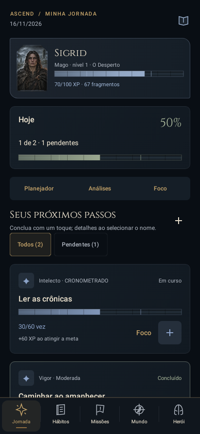 | 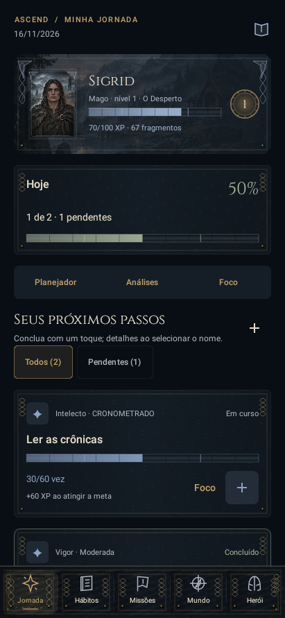 |
| Missões | 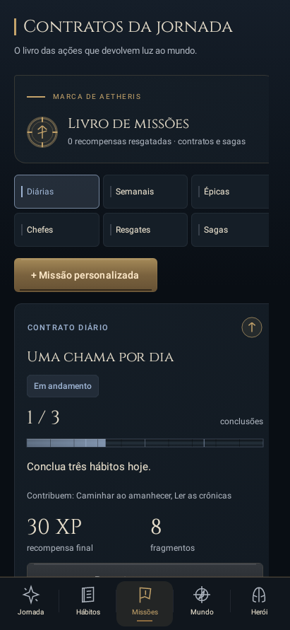 | 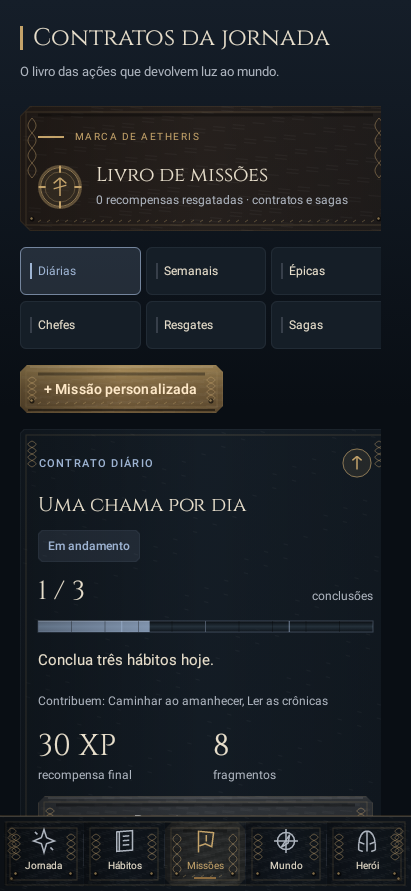 |
| Herói | 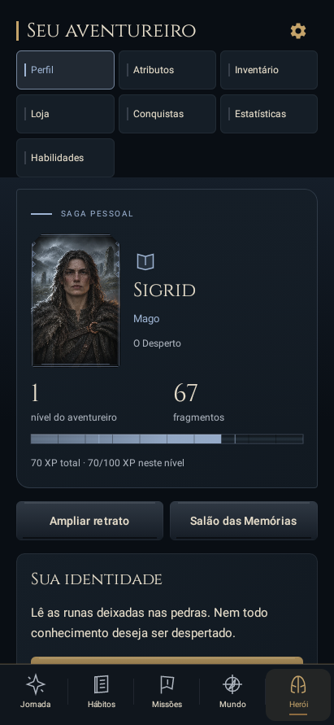 | 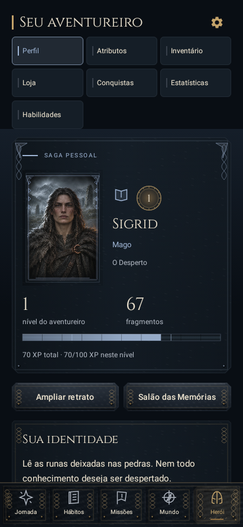 |
| Inventário | 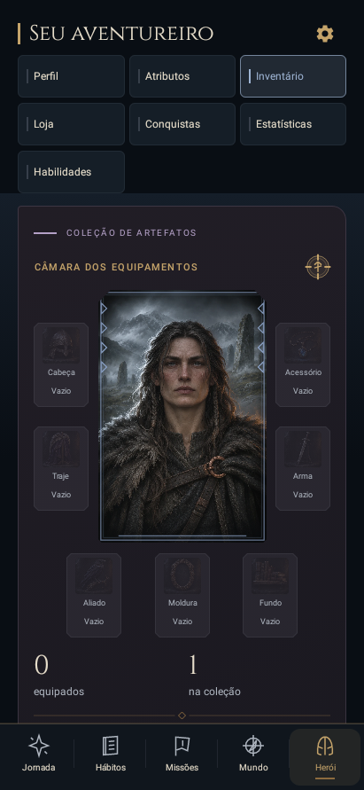 | 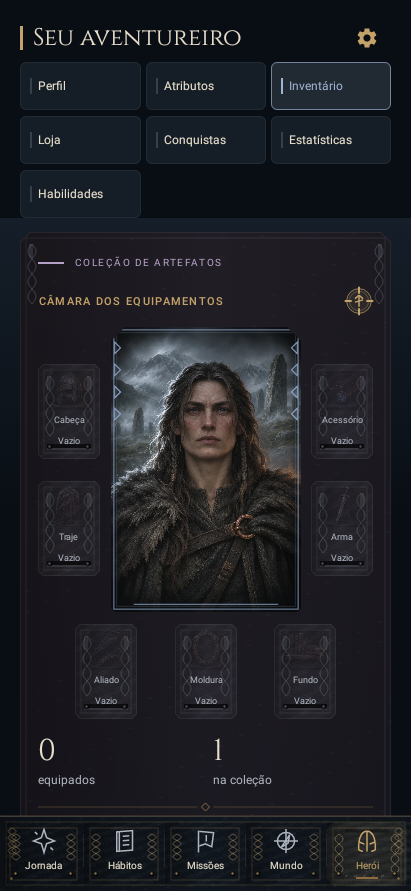 |
| Salão das Memórias | 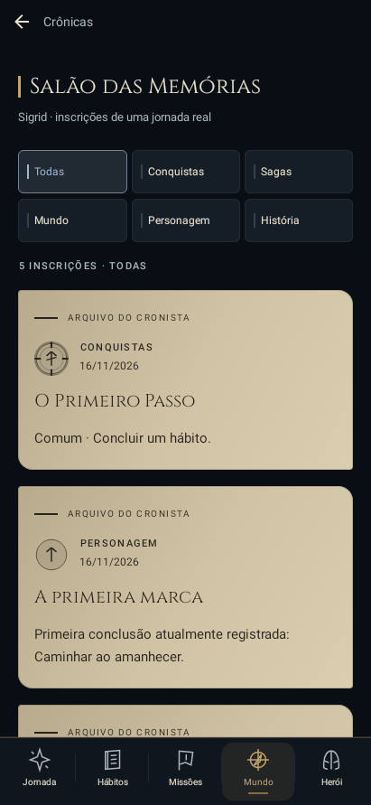 | 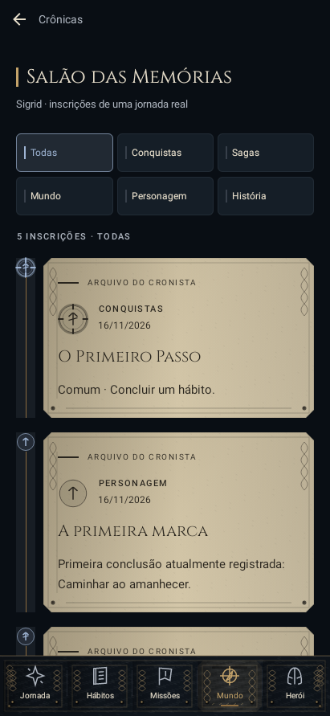 |
| Planejador Semanal | 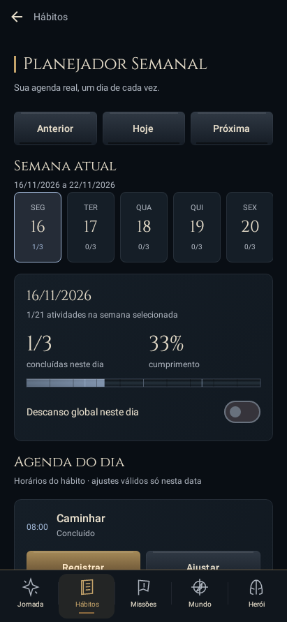 | 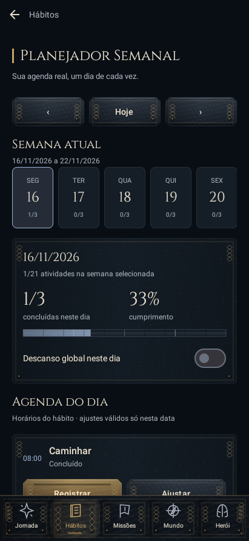 |

### Aplicação adicional e responsividade

| Central de Análises | Planejador 320 dp / 130% | Jornada 320 dp / 130% |
|---|---|---|
| 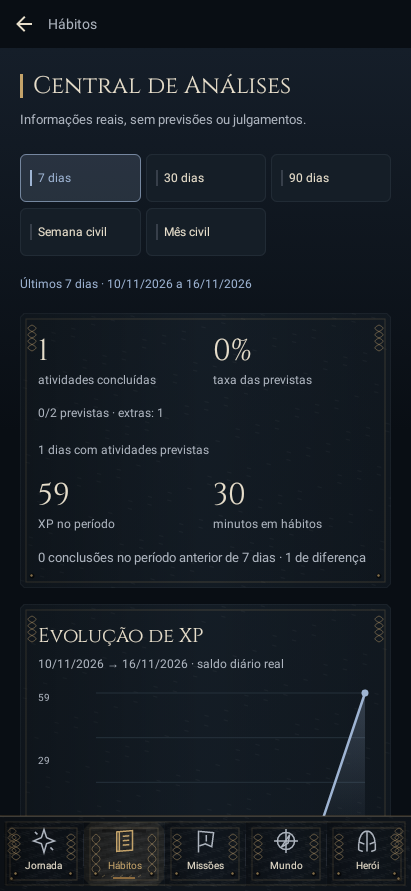 | 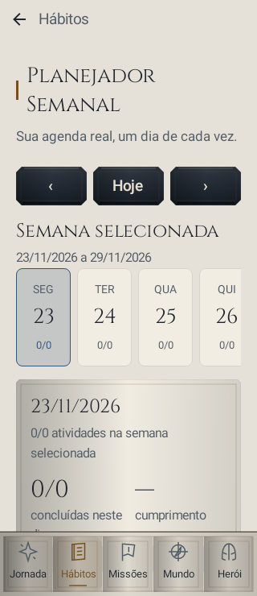 | 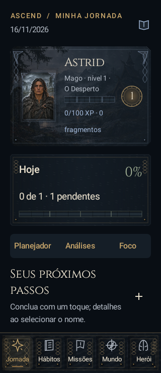 |

## Validação e limites

As seis telas P0 e Análises foram inspecionadas nas renderizações produzidas pela suíte. A composição estreita do Planejador mantém seleção de dias com rolagem horizontal, sem comprimir os sete dias. A Jornada ampliada mantém as ações diárias disponíveis por rolagem. As texturas são discretas e procedurais, não fotografias de materiais. Há controles legados que continuam Material 3, como alguns formulários e filtros; esta entrega não afirma redesenho manual de todos eles. Widgets conservam a apresentação nativa da 1.6, sem a textura Canvas das telas Compose.

Os 135 testes anteriores são mantidos; nenhum teste econômico foi removido. Resultados executados, integridade do APK e limites de instalação constam em [VALIDACAO.md](../VALIDACAO.md). Não houve validação física em launcher, TalkBack, teclado ou instalação sobre a 1.6; a identidade de pacote/certificado e o versionCode são conferidos no APK.
