# ASCEND 1.6.2 — Refinamento Visual Nórdico

Base: `feat/ascend-1.6.1`, commit `4add529`. Entrega exclusivamente visual em `feat/ascend-1.6.2`, sem alterações em funcionalidades, repositórios, entidades, esquemas Room v6, backup v8, permissões ou regras de recompensa.

## Materiais e acabamento

A repetição de riscos, rebites e entrelaçados da 1.6.1 foi retirada de `ForgeArt.kt`. Quatro recursos originais foram produzidos com a ferramenta de geração de imagens e otimizados em WebP: `forge_iron`, `forge_leather`, `forge_vellum` e `forge_brooch`. São estudos de material e um medalhão de bronze com relevo orgânico; não são capturas de interface nem recursos extraídos de jogos. Os materiais têm centro discreto para leitura; o medalhão mantém transparência fora da silhueta.

As texturas de 1024 px e o medalhão de 256 px ficam em `drawable-nodpi`. A renderização preserva a proporção por recorte central, sem repetição em mosaico ou deformação; a pintura do fiorde e os retratos anteriores são preservados. `drawWithCache` prepara a composição, sem geração contínua de ruído, partículas ou novas animações. Os recursos ficam no APK e não exigem conexão.

## Componentes e telas

- **Navegação:** uma base contínua de ferro substitui cinco caixas ornamentadas. A seleção usa um pendente em forma de escudo, iluminação localizada e marca superior. Os cinco símbolos receberam preenchimento discreto e junções suaves. Mesmas áreas, rotas, descrições e ações.
- **Botões:** placa escura com desgaste de material, borda de bronze contida e recorte assimétrico. Primários, secundários, destrutivos e resgatados mantêm estados e callbacks. Abas internas usam placas discretas, com seleção explícita; não há mais entrelaçados nas bordas de cada opção.
- **Jornada:** retrato e identidade sobre o fiorde, medalhão real de bronze, XP em registro inferior e progresso diário em mostrador circular acessível. Atalhos preservados com ícones e alvos confortáveis; resumo compactado após a primeira inspeção para aproximar a lista de hábitos do topo.
- **Missões:** capa de couro com medalhão; contratos diários em velino com tinta escura e semanais/épicos em couro. Estados, progresso, objetivos e recompensas permanecem os mesmos. O contraste de status e rótulos foi corrigido após a primeira renderização.
- **Herói:** material forjado, novo medalhão, retrato em moldura com profundidade e retirada dos pequenos dentes geométricos da moldura antiga. As variações cosméticas continuam diferenciadas por acabamento, cor e espessura; nenhum equipamento é sobreposto ao corpo.
- **Inventário:** nichos mais sóbrios, moldura material do retrato, raridade e borda de seleção preservadas. Imagens originais dos artefatos continuam em uso.
- **Aplicação global:** superfícies operacionais, cerimoniais, manuscritos e coleções propagam os materiais a Planejador, Análises, Sagas, Crônicas, Memórias e outras telas Compose que usam os componentes compartilhados. Os gráficos não recebem ruído desenhado sobre os dados.

## Comparações reais

Renderizações nativas de Compose/Views em Robolectric, usando as telas e o repositório reais com dados de teste. Não são mockups nem fotografias de aparelho físico. As capturas anteriores da 1.6.1 foram preservadas; o tour usa a mesma fixture.

| Tela | 1.6.1 | 1.6.2 |
|---|---|---|
| Jornada e navegação | 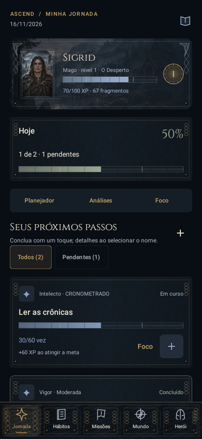 | 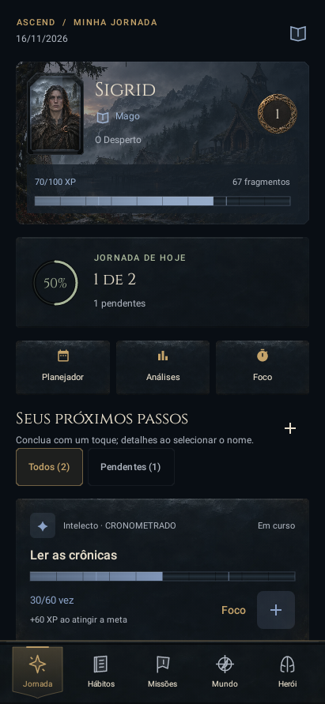 |
| Livro de Missões | 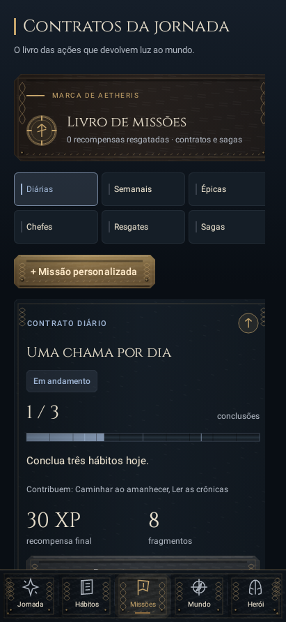 | 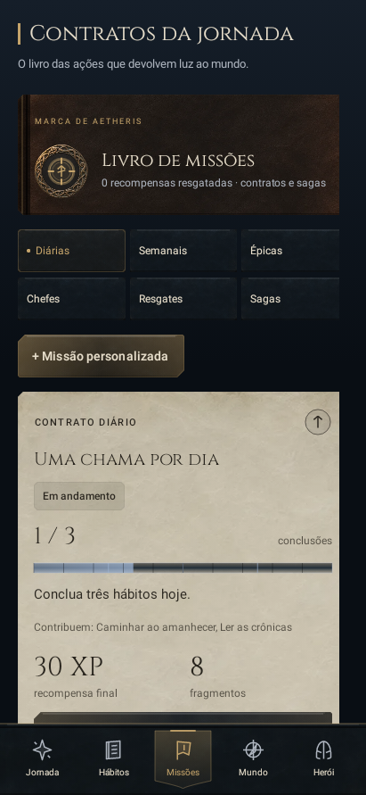 |
| Herói | 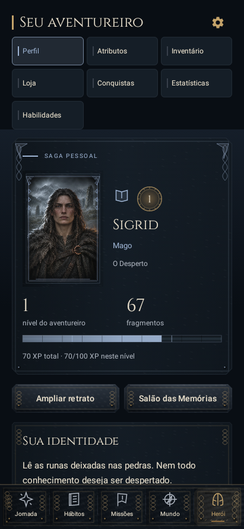 | 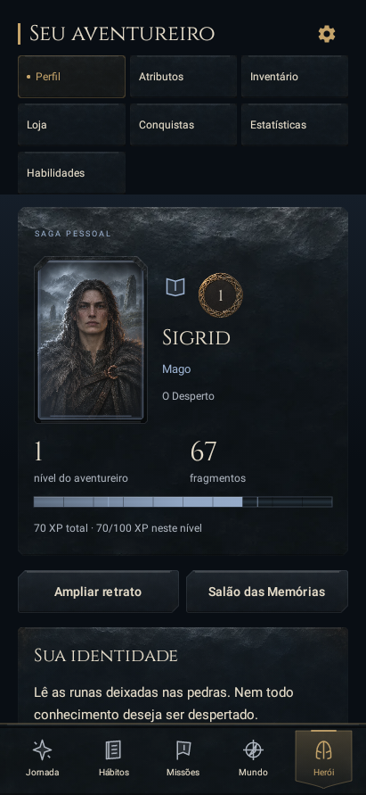 |
| Inventário | 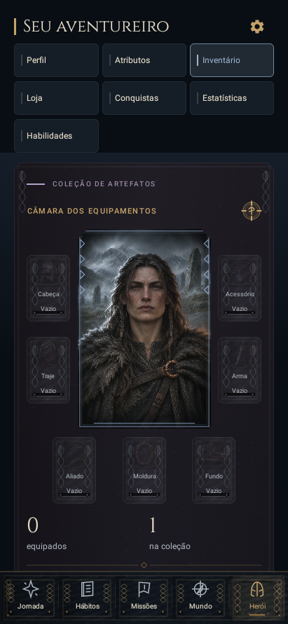 | 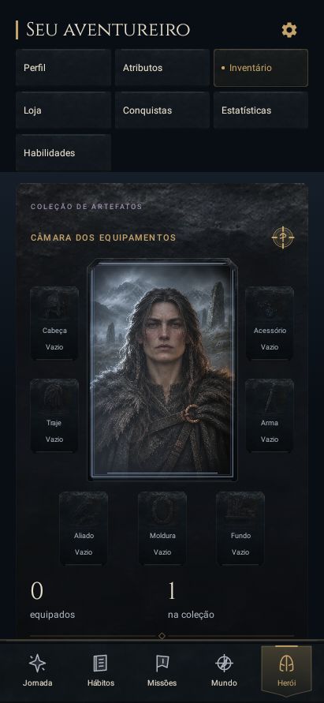 |
| Planejador | 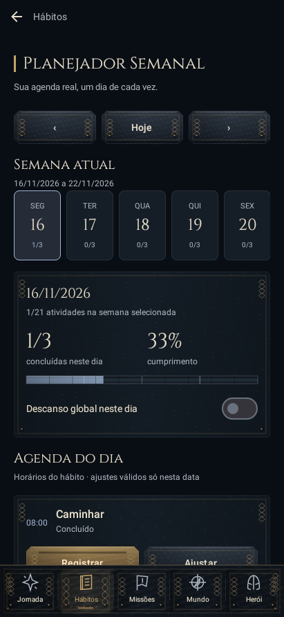 | 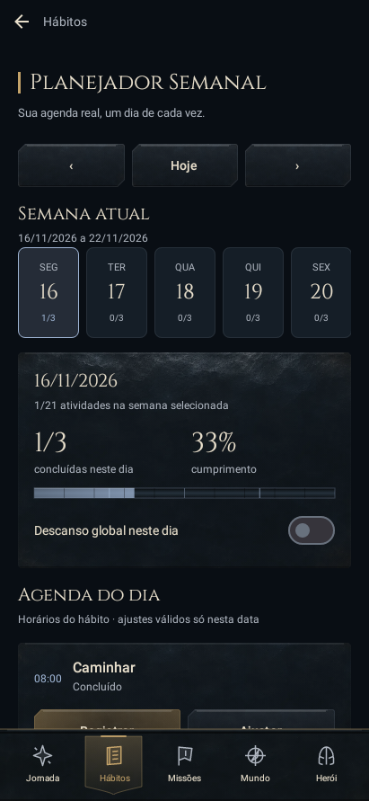 |
| Salão das Memórias | 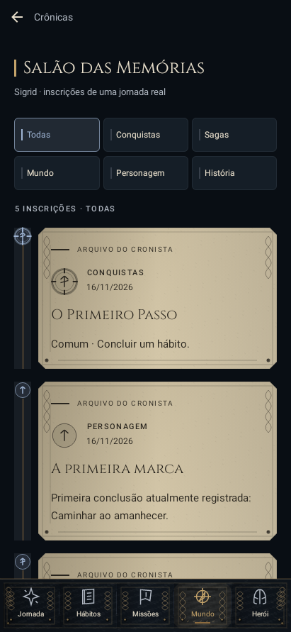 | 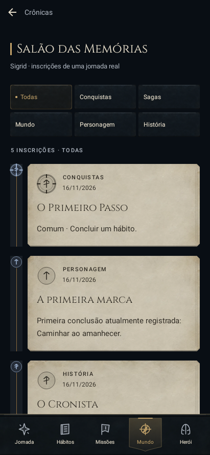 |

### Responsividade e aplicação secundária

| Jornada 320 dp / fonte130% | Planejador 320 dp / fonte130% | Central de Análises |
|---|---|---|
| 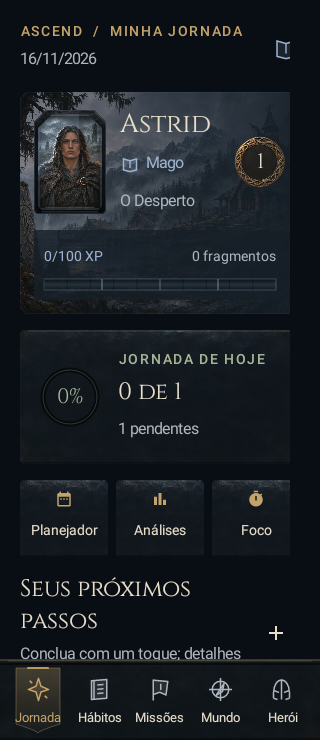 | 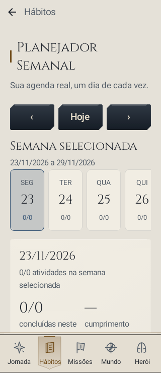 | 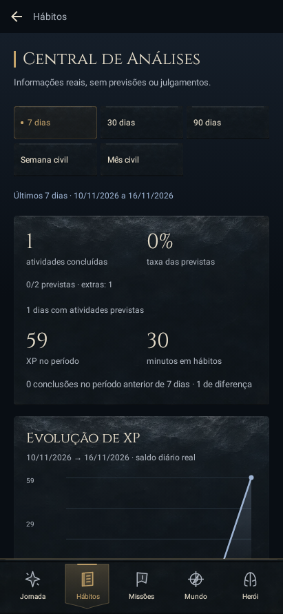 |

## Validação e limites

A suíte existente foi preservada sem alteração dos testes. A revisão das capturas guiou a redução da altura do cabeçalho e o contraste dos contratos. O mostrador diário expõe o mesmo valor como progresso acessível. O modo minimalista omite os novos materiais e o medalhão ilustrado; os temas claro/escuro e a redução de movimento mantêm os comportamentos existentes.

Não houve redesenho manual de todas as telas: alguns formulários, chips e controles Material 3 continuam nas estruturas anteriores. Os widgets são RemoteViews e conservam os recursos da 1.6.1; a nova biblioteca de materiais se aplica às telas Compose. Não houve teste em telefone físico, launcher ou TalkBack; a atualização de instalação é conferida por pacote, versionCode e certificado, sem afirmar um teste físico.

[Resultados executados e integridade do APK](../VALIDACAO.md) · [Origem dos recursos](art/README.md).
