# ASCEND 1.6.5 — As Sombras do Norte

Base `8e56c8c`, branch `feat/ascend-1.6.2`. Atualização de apresentação, preservando Room v6, backup v8 e regras existentes.

## Direção e recursos

A referência enviada orientou a integração do fiorde, retrato, bronze e mostrador diário. O [tríptico de conceitos](art/concepts/north-165.webp) mostra Jornada, Herói e Missões: é **conceito artístico gerado**, não captura do aplicativo. As telas continuam Compose nativo com dados e ações reais.

Foram gerados dois recursos originais adicionais: `north_stone.webp`, basalto mineral discreto, e `north_frame.webp`, moldura de retrato transparente com relevo orgânico. Ambos estão locais em drawable-nodpi. A moldura mantém proporção por ContentScale.Fit, sem esticar cantos. Ferro, couro, velino, medalhão, pinturas e retratos da 1.6.2 foram reutilizados. Nenhum recurso foi extraído de jogos comerciais.

## Design System 2.5 aplicado

- Paleta escura passa de azul-marinho a carvão/mineral, mantendo contraste e tema claro.
- Superfícies operacionais e nichos recebem pedra; ferro heroico, couro cerimonial e velino narrativo permanecem distintos.
- Jornada aumenta a presença do retrato e abre a pintura do fiorde; mostrador diário recebe aro de bronze.
- Herói e Inventário recebem moldura pictórica original. Nichos vazios ganham contraste e imagens mais visíveis.
- Navegação mantém cinco ações, com iluminação localizada mais discreta e menos contorno na seleção.
- Cronômetro existente usa mostrador circular; cálculo de tempo e ações preservados.
- Widgets recebem a superfície mineral em RemoteViews. Temas, redução de movimento e modo minimalista continuam disponíveis.

## Capturas reais

Renderizações nativas em Robolectric com dados de teste, não mockups. O tour anterior preserva as capturas da 1.6.2 quando disponíveis. A imagem conceitual acima não é usada como tela estática.

| Tela | 1.6.2 | 1.6.5 |
|---|---|---|
| Jornada | 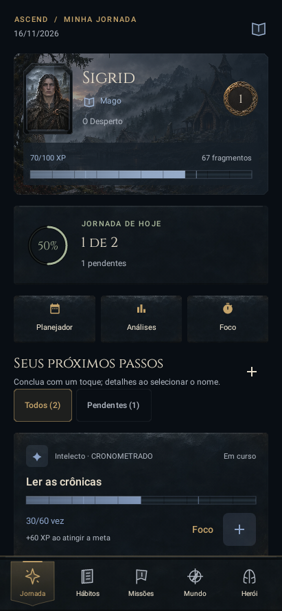 | 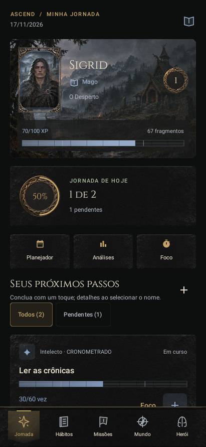 |
| Herói | 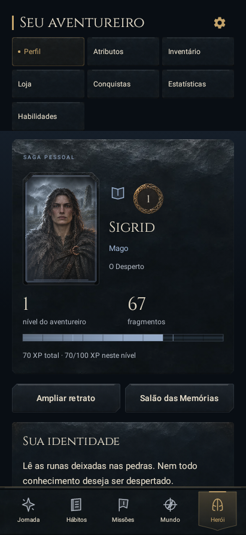 | 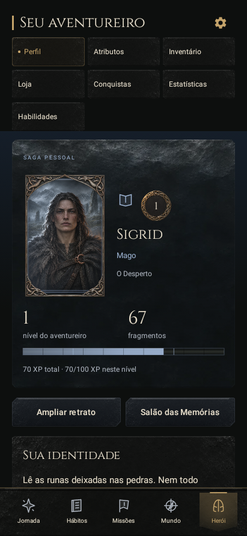 |
| Inventário | 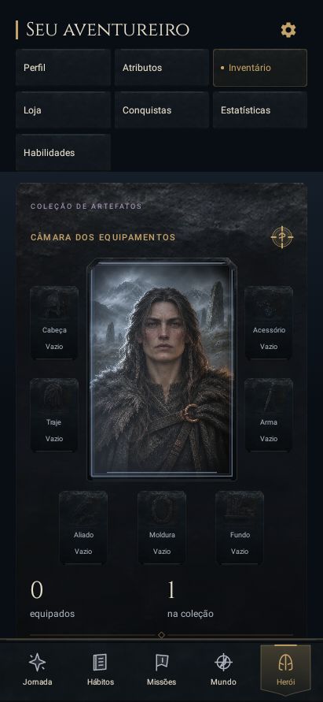 | 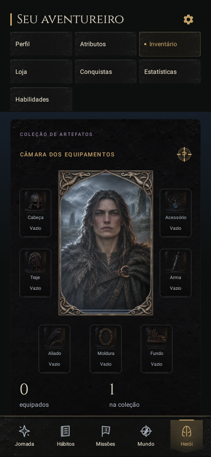 |
| Missões |  | 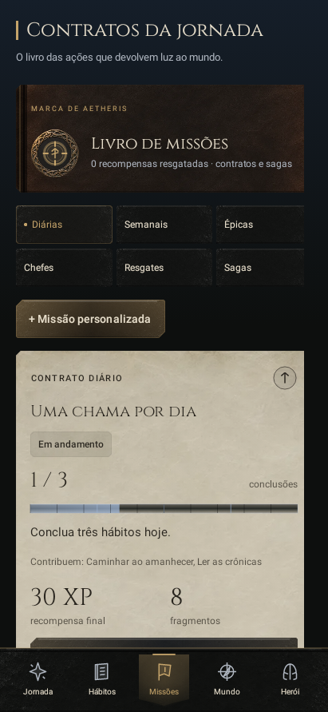 |
| Memórias | 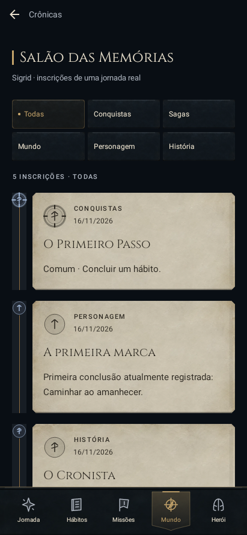 | 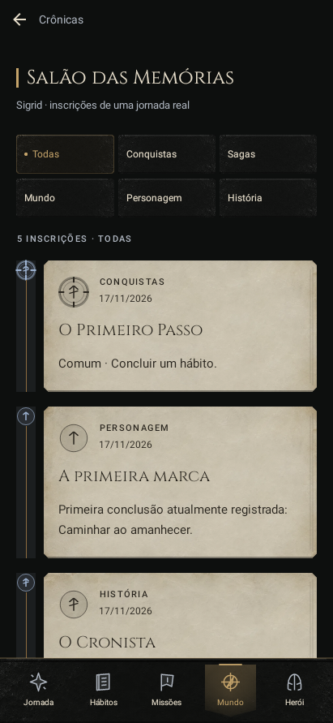 |
| Planejador | 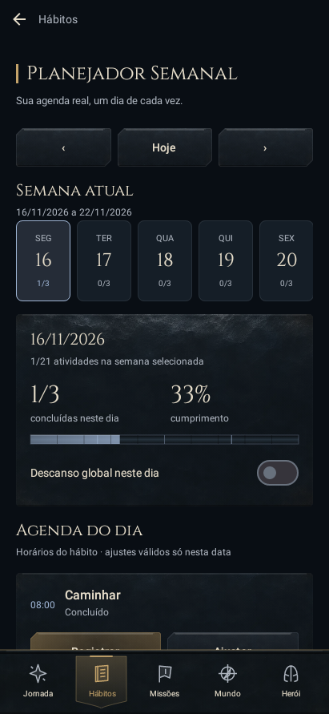 | 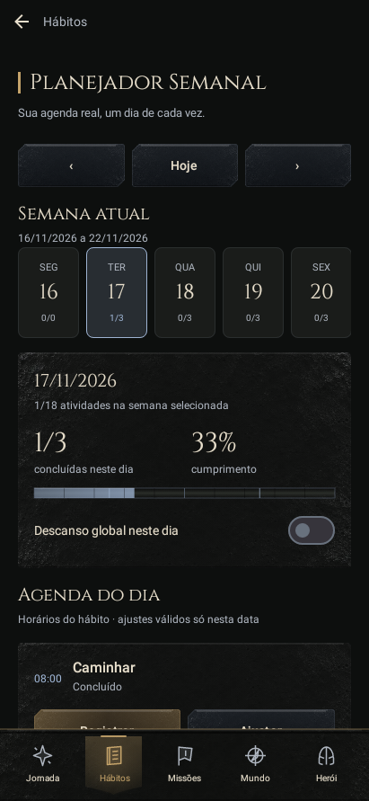 |

## Aplicação complementar

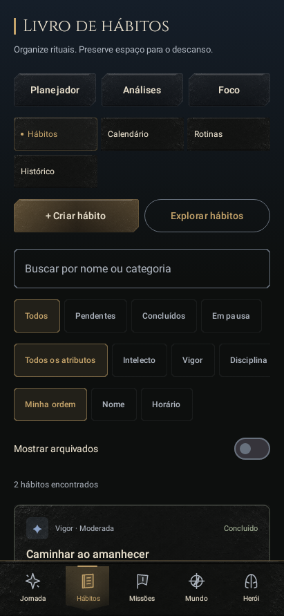
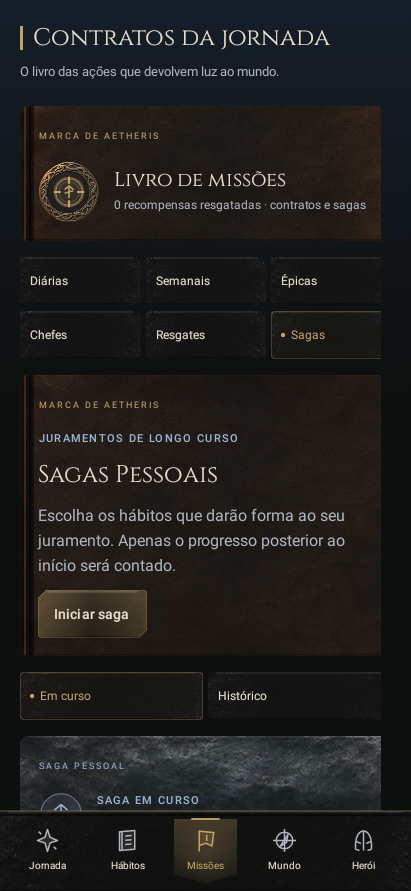
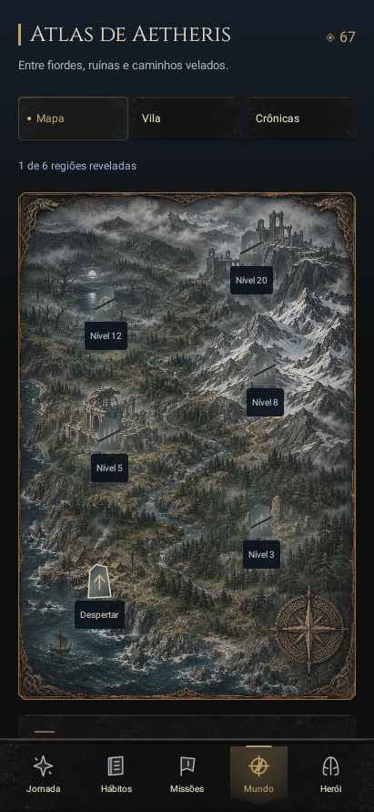
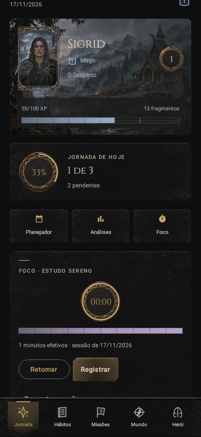
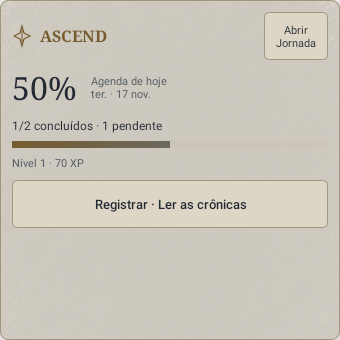
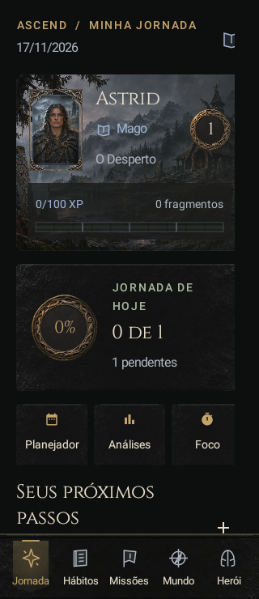
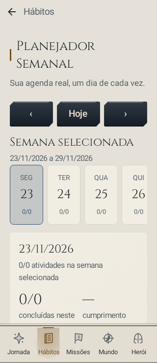

## Limitações e alcance

A biblioteca não redesenha todos os símbolos de classe/atributo ou todos os formulários: parte dos vetores e controles anteriores permanece. Não foi produzida uma nova textura de madeira, nem uma moldura específica para cada categoria de artefato. Missões, Sagas, Atlas e Memórias recebem a evolução compartilhada, sem recomposição manual integral. Esta entrega não representa a conclusão integral da ambição artística descrita no pedido.

Sem testes físicos de instalação, launcher ou TalkBack. As verificações de pacote, certificado, testes e lint constam em [VALIDACAO.md](../VALIDACAO.md).
