# ASCEND 1.6.8 — O Véu do Norte

Base `feat/ascend-1.6.5` / `cdc6ea9`. Alterações exclusivamente de apresentação, mantendo Room v6 e backup v8.

## Composição implementada

- Jornada: retrato/XP e progresso diário passam a um único agrupamento, sem a superfície independente do resumo diário.
- Herói: ficha vertical, retrato central ampliado e informações abaixo da pintura.
- Cronômetro: aro de 168 dp e números maiores; mesmo tempo, estado e ações.
- Hábitos: cabeçalho mais curto e filtros de atributo/ordem compartilham uma faixa horizontal; todas as opções permanecem disponíveis.

Os recursos artísticos originais da 1.6.5 foram preservados. Foi gerado `north_divider.webp`, divisor pictórico original transparente, aplicado seletivamente à Jornada, Herói e contratos. O símbolo da Jornada foi redesenhado como montanhas em vetor.

## Capturas reais comparativas

Renderizações nativas Robolectric, não mockups. Conceito principal: [north-165.webp](art/concepts/north-165.webp).

| Tela | 1.6.5 | 1.6.8 |
|---|---|---|
| Jornada | 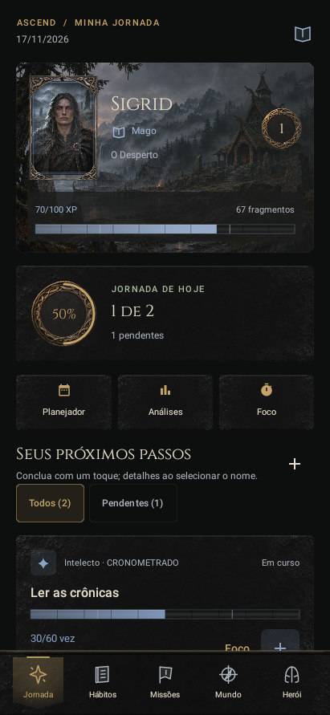 | 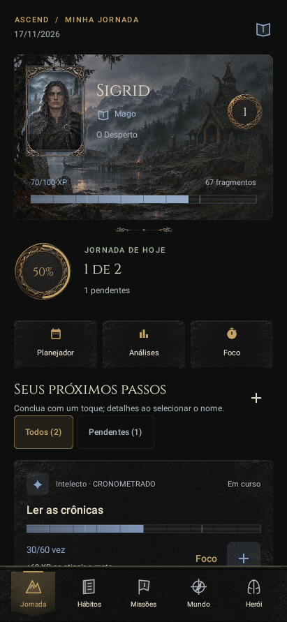 |
| Herói | 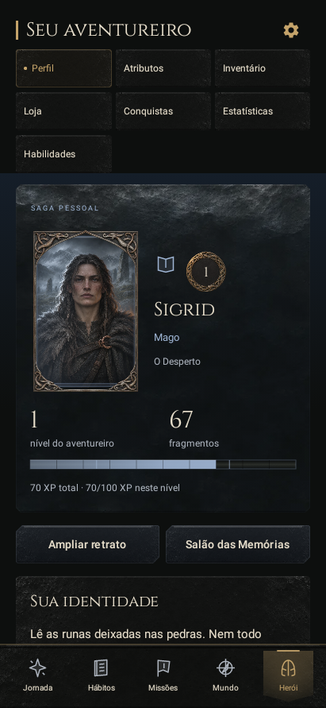 | 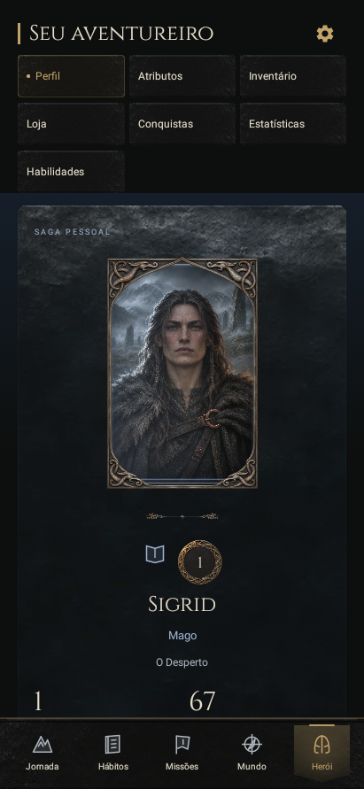 |
| Missões | 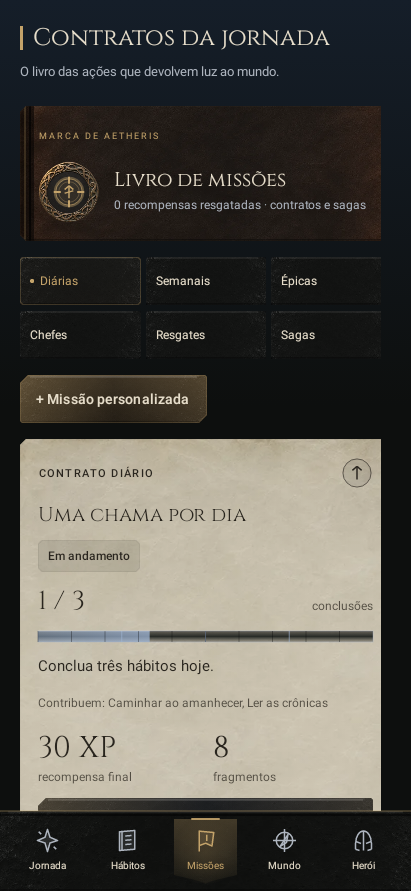 | 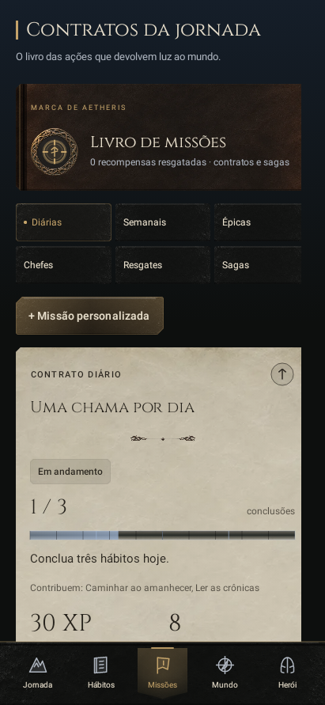 |
| Hábitos | 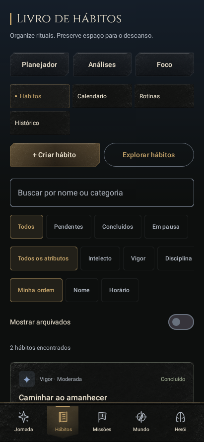 | 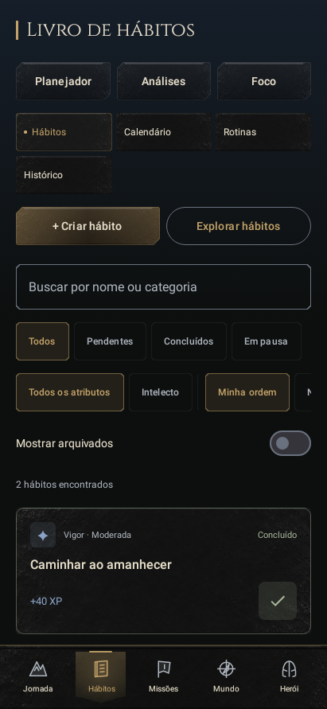 |
| Inventário | 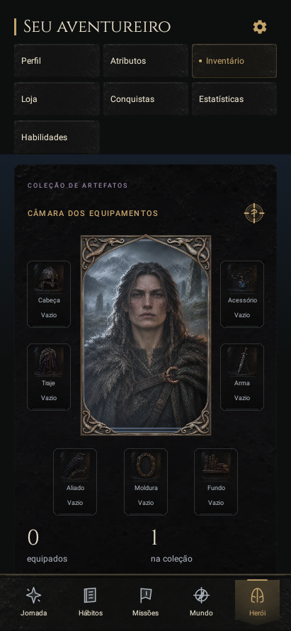 |  |
| Cronômetro | 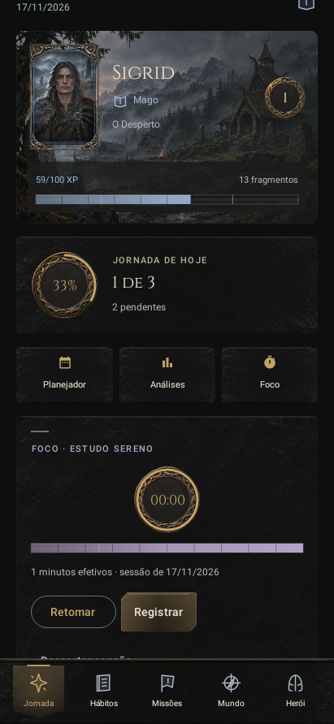 | 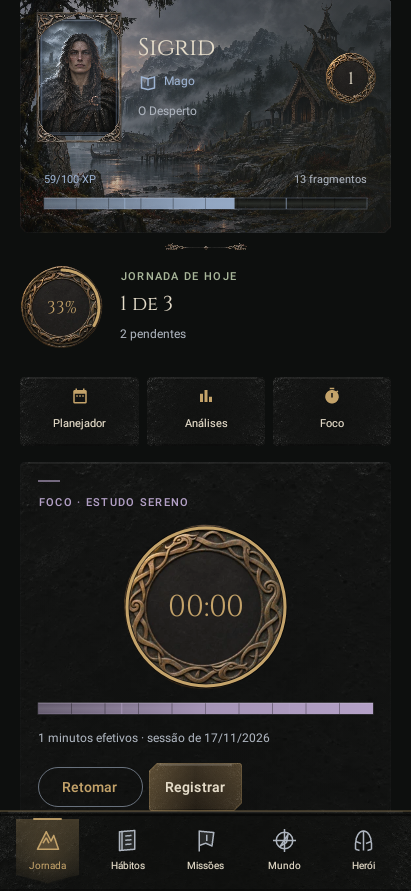 |
| Widgets |  | 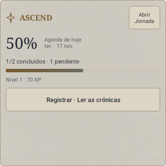 |

## Limitações

Entrega parcial em relação à consolidação artística solicitada: a iconografia completa, emblemas, botões e selos ainda não foram reformulados; Sagas, Inventário e widgets conservam a apresentação da 1.6.5. A composição implementada ainda não atinge integralmente o conceito cinematográfico. Sem teste físico de instalação, launcher ou TalkBack. Resultados executados em VALIDACAO.md.
