# ASCEND 1.6.9.10 — O Silêncio das Runas · Refinamento Cinematográfico

**18/11/2026.** Refinamento exclusivamente visual e editorial (*Nordic Cinematic UI*) sobre a base `feat/ascend-1.6.9` (`bd58ab3`), inspirado na austeridade atmosférica de *Senua's Sacrifice*, *Senua's Saga: Hellblade II*, *The Northman*, paisagens vulcânicas da Islândia e cultura material escandinava. Nenhuma regra de RPG, XP, economia, hábitos, programação, estatísticas, cronômetro, missões, sagas, expedições, narrativas, banco Room v6, backup v8 ou `applicationId` (`br.com.ascend.aetheris`) foi alterada.

## Direção de composição e filosofia editorial

A versão `1.6.9` consolidou a biblioteca gráfica original (`CarvedArt.kt` com 25 símbolos vetoriais e 6 folhas/superfícies `.webp` originais). A versão `1.6.9.10 — O Silêncio das Runas` eleva a composição das interfaces substituindo o excesso de cartões retangulares, grades de botões e cabeçalhos repetidos por espaço negativo, alinhamentos editoriais, filetes metálicos (`Hairline` e `Meter(..., slim = true)`) e pontos focais dominantes:

- **Jornada cinematográfica ([`DesignSystem2.kt`](../app/src/main/java/br/com/ascend/aetheris/DesignSystem2.kt), [`JourneyHome.kt`](../app/src/main/java/br/com/ascend/aetheris/JourneyHome.kt)):**
  - `CompactHero` funde o cabeçalho (`ASCEND / MINHA JORNADA` e data) diretamente ao céu do fiorde (`nordic_fjord`), com transição contínua de névoa e vinhetas laterais para o fundo escuro sem borda retangular.
  - Iluminação fria localizada atrás do retrato emoldurado (`ForgePortrait`), integração da barra de XP em filete metálico (`Meter(..., slim = true)`) com ponto luminoso e linha de progresso diário (`DayLedger`) sem cartão envolvente.
  - Substituição dos três grandes cartões de atalhos por uma faixa contínua e silenciosa (`ShortcutStrip`) com `CarvedGlyph` (`Planejador`, `Análises`, `Foco`), ocultando automaticamente os glifos em telas estreitas (`320 dp` / fonte `130%`) para preservar rótulos íntegros e aproximar os hábitos do topo.
- **Navegação e menus secundários ([`AetherisNavigation.kt`](../app/src/main/java/br/com/ascend/aetheris/AetherisNavigation.kt), [`Design.kt`](../app/src/main/java/br/com/ascend/aetheris/Design.kt)):**
  - Barra inferior preservada em sua direção artística de ferro e bronze, com proporções e iluminação localizada refinadas.
  - `AetherisTabs` reformulado como linha aberta de inscrições (`FlowRow`) com glifo ativo e sublinhado de bronze iluminado para a aba selecionada, eliminando a grade de botões retangulares nas 7 opções do Herói, 6 opções de Missões e 4 opções de Hábitos.
  - `ChipRow` compactado (`32 dp` de altura mínima com cantos chanfrados sutis e opção `scrollable = false`), evitando truncamento em contêineres aninhados na tela de Hábitos.
- **Ficha cinematográfica do Herói ([`HeroSheet.kt`](../app/src/main/java/br/com/ascend/aetheris/HeroSheet.kt), [`CharacterScreen.kt`](../app/src/main/java/br/com/ascend/aetheris/CharacterScreen.kt)):**
  - `HeroStage` integra retrato, fiorde sangrando de borda a borda (`-20 dp` de compensação horizontal), luz fria localizada, nome, classe (`ClassEmblem`), título, medalhão de nível (`ForgeMedallion`) e fragmentos em um único palco visual.
  - `HeroEvolution` apresenta o progresso do nível em filete metálico contínuo.
  - `AttributeInscriptions` substitui a sucessão de cartões independentes por inscrições editoriais separadas por `Hairline()`, com emblema (`AttributeEmblem`), nome, nível e filete de evolução.
- **Câmara de artefatos no Inventário ([`EquipmentScreen.kt`](../app/src/main/java/br/com/ascend/aetheris/EquipmentScreen.kt), [`RpgDesign.kt`](../app/src/main/java/br/com/ascend/aetheris/RpgDesign.kt)):**
  - Iluminação fria localizada atrás do retrato central e aprofundamento dos 7 nichos (`EquipmentSlot` e `RelicArt`) com gradiente interno de câmara, chanfro iluminado, maior visibilidade das silhuetas nos nichos vazios (`alpha = 0.50f`) e aura por raridade nos itens equipados, sem sobrepor o retrato.
- **Livro de Missões e Sagas ([`DesignSystem2.kt`](../app/src/main/java/br/com/ascend/aetheris/DesignSystem2.kt), [`RpgDesign.kt`](../app/src/main/java/br/com/ascend/aetheris/RpgDesign.kt), [`SagaScreen.kt`](../app/src/main/java/br/com/ascend/aetheris/SagaScreen.kt)):**
  - `SagaCover` refinado como lombada de couro e bronze com broche (`forge_brooch`) e selo cerimonial.
  - `MissionCard2` diferencia contratos cotidianos (velino compacto com filete `slim = true` e ações `Resgatar recompensa` + `Editar missão` alinhadas na mesma faixa) de grandes juramentos semanais/épicos (encadernação cerimonial em couro e ouro).
  - `SagaBook` remove o cartão cerimonial redundante do cabeçalho, conecta os marcos `25% · 50% · 75% · 100%` por trilha horizontal contínua e organiza as ações secundárias em `FlowRow` sem quebra de palavras em `320 dp / 130%`.
- **Hábitos, Planejador e Central de Análises ([`JourneyScreens.kt`](../app/src/main/java/br/com/ascend/aetheris/JourneyScreens.kt), [`ProductivityScreens.kt`](../app/src/main/java/br/com/ascend/aetheris/ProductivityScreens.kt)):**
  - Em Hábitos, filtros permanecem completos em faixa única sem corte lateral e a linha de sequência acompanha diretamente cada `HabitCard`.
  - No Planejador Semanal e na Central de Análises, os resumos numéricos, distribuição por atributo e cumprimento por hábito passam para composição editorial aberta com `Hairline()`, destacando o gráfico `Evolução de XP` e os cartões da agenda do dia.
- **Memórias, Crônicas, Atlas e Expedições ([`ChronicleScreens.kt`](../app/src/main/java/br/com/ascend/aetheris/ChronicleScreens.kt), [`WorldScreen.kt`](../app/src/main/java/br/com/ascend/aetheris/WorldScreen.kt), [`ExplorationScreens.kt`](../app/src/main/java/br/com/ascend/aetheris/ExplorationScreens.kt)):**
  - No Salão das Memórias, acontecimentos solenes (`Sagas` e conclusões de `Expedições`) recebem superfície `Ceremonial` com moldura dourada e `NorthDivider`, enquanto registros cotidianos aparecem como inscrições abertas ao longo do eixo vertical com um único selo por entrada.
  - No Atlas de Aetheris, marcadores de região usam pedra translúcida (`alpha = 0.74f`) e a região selecionada abre em leitura editorial contínua abaixo do mapa. Nas Expedições, os selos de fase conectam-se por eixo vertical.
- **Cronômetro e Widgets ([`JourneyScreens.kt`](../app/src/main/java/br/com/ascend/aetheris/JourneyScreens.kt), [`widget_surface.xml`](../app/src/main/res/drawable/widget_surface.xml), [`widget_complete.xml`](../app/src/main/res/drawable/widget_complete.xml), [`widget_secondary.xml`](../app/src/main/res/drawable/widget_secondary.xml)):**
  - `FocusCard` preserva o aro ornamental (`DayDial` em `168 dp`) sobre halo radial violeta, com filete de progresso e controles `Pausar/Retomar` + `Registrar` lado a lado.
  - Widgets compacto e expandido ganham iluminação superior fria sobre a ardósia (`widget_slate.webp`) e chanfro metálico de `1 dp` nos botões de ação.

## Comparações reais `1.6.9` × `1.6.9.10` (renderização Robolectric)

| Área | 1.6.9 | 1.6.9.10 |
|---|---|---|
| Jornada | 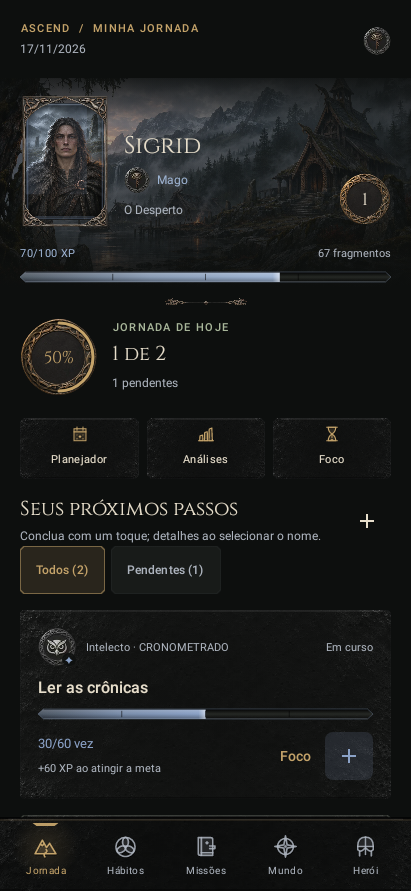 | 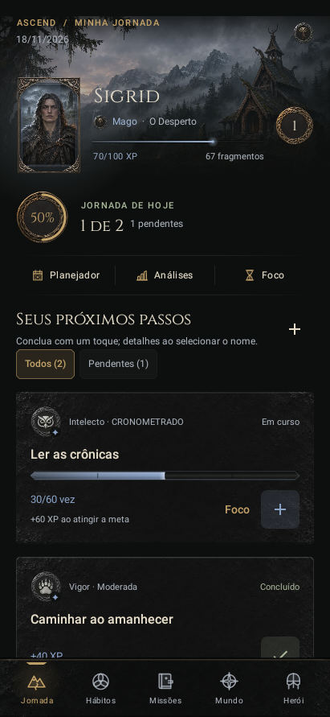 |
| Herói (Perfil e Atributos) | 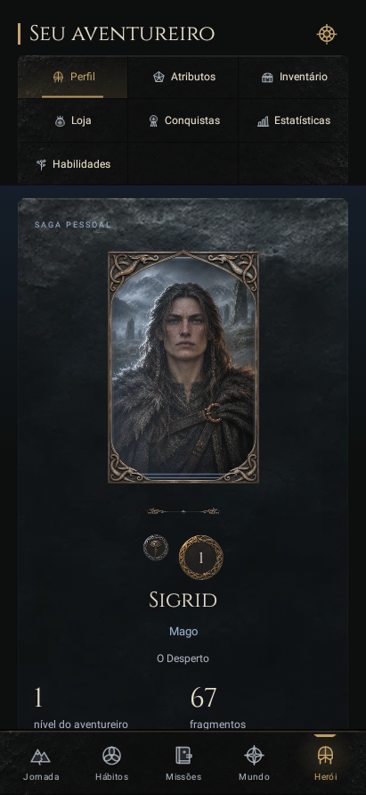 | 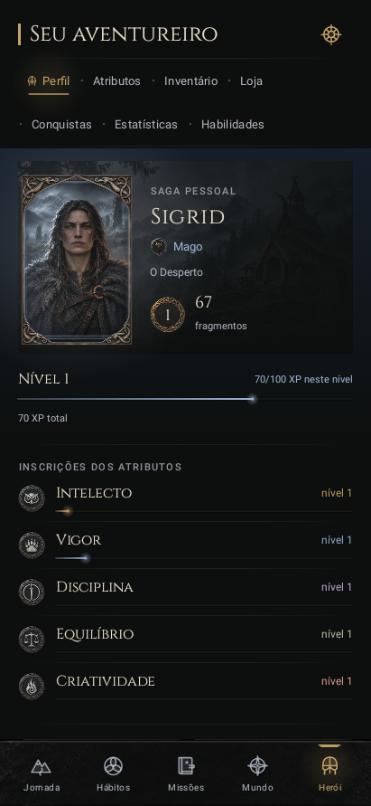 |
| Inventário (Câmara de Artefatos) | 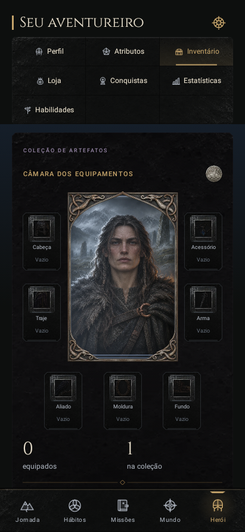 | 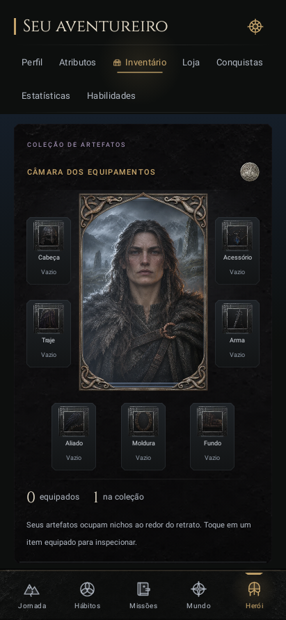 |
| Livro de Missões | 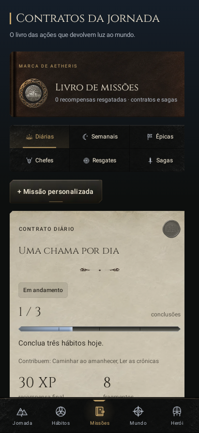 | 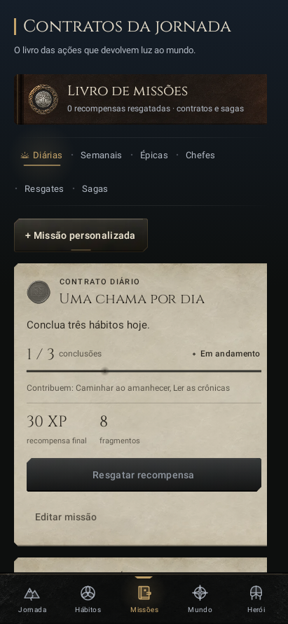 |
| Sagas Pessoais | 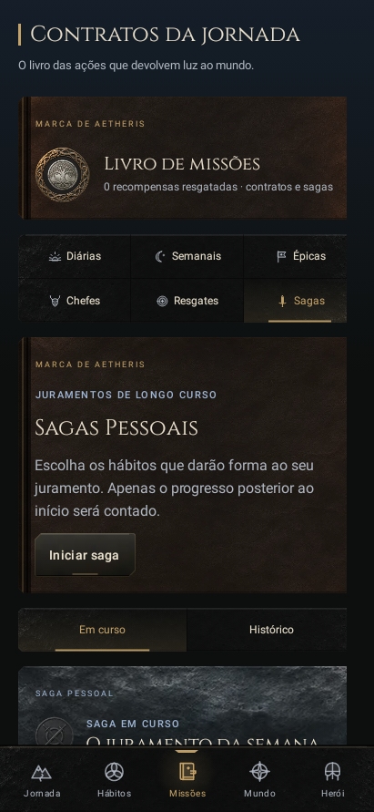 | 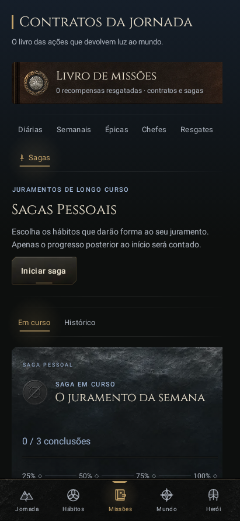 |
| Livro de Hábitos | 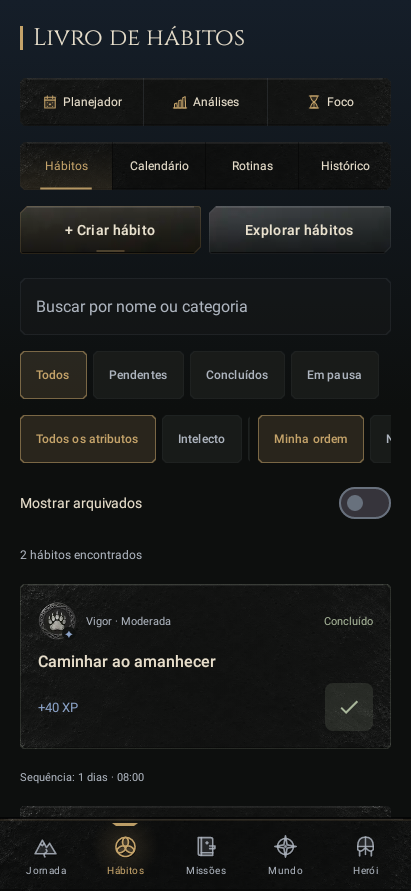 | 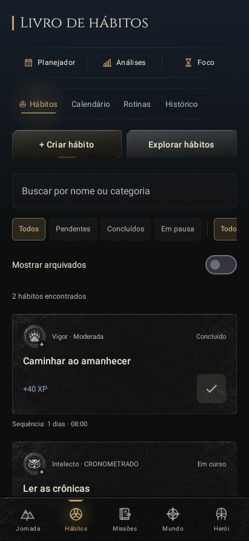 |
| Planejador Semanal | 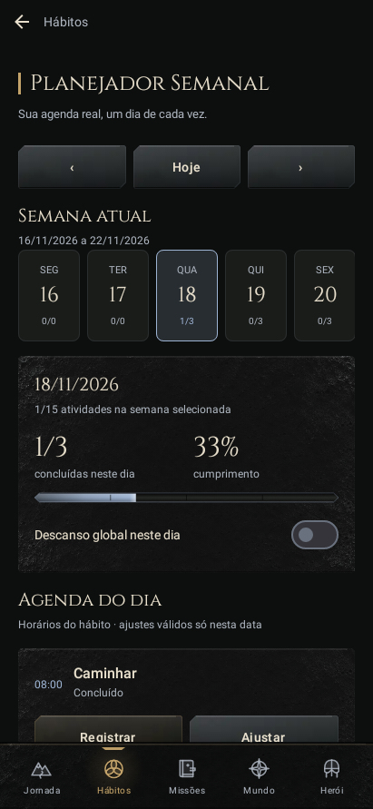 | 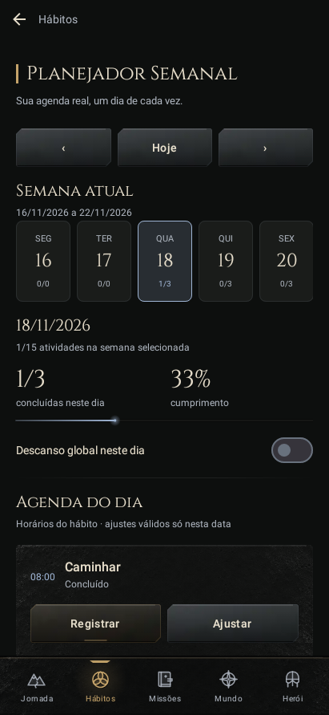 |
| Central de Análises | 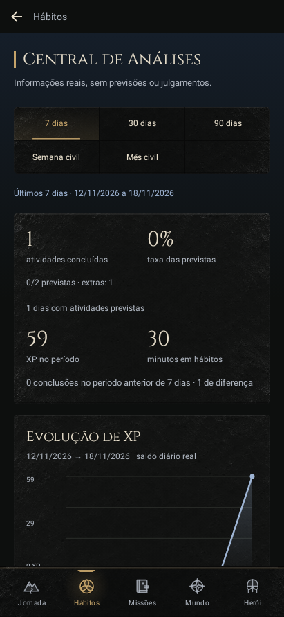 | 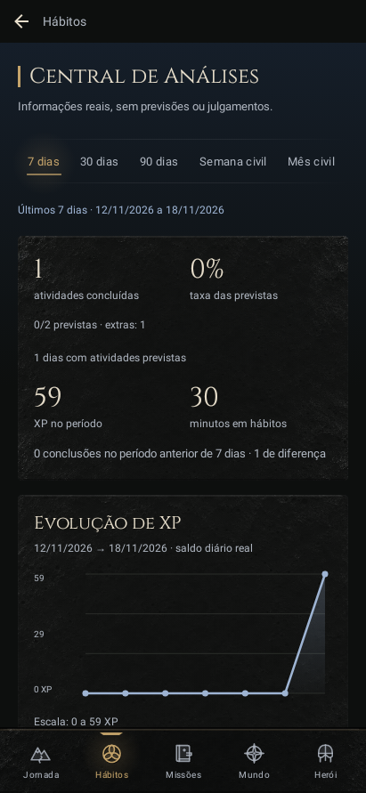 |
| Salão das Memórias | 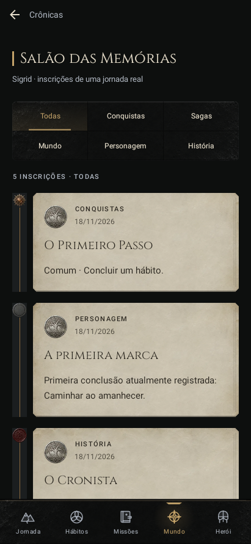 | 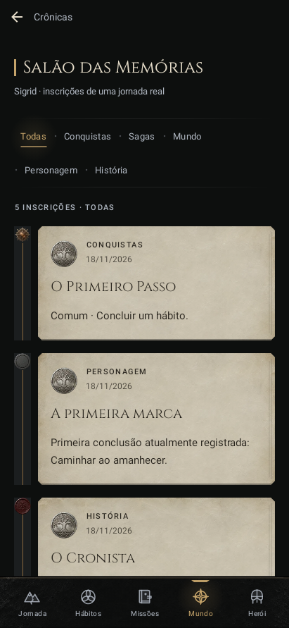 |
| Atlas de Aetheris | 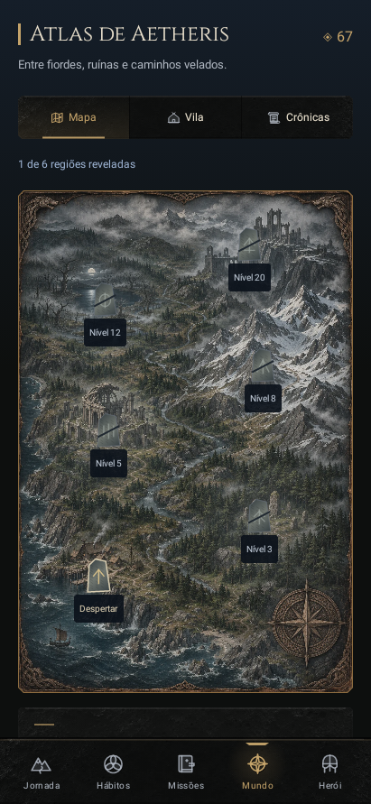 | 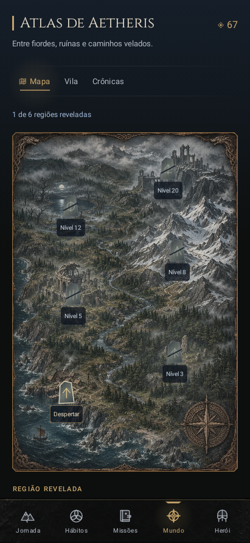 |
| Cronômetro de Foco | 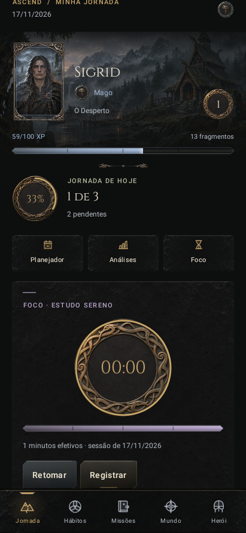 | 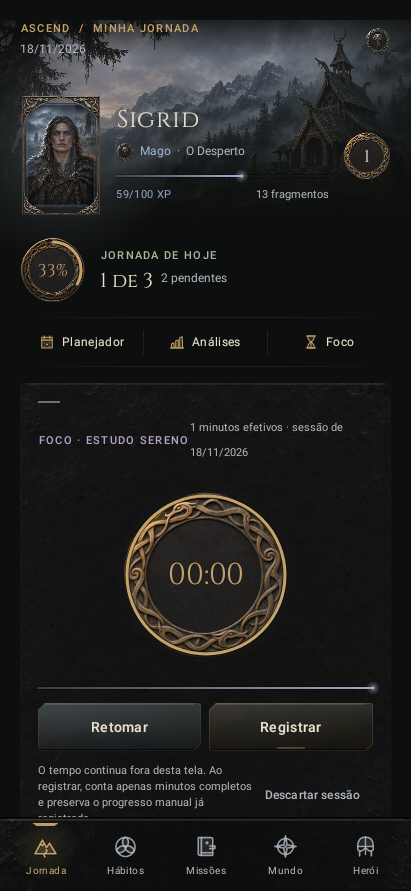 |
| Widget (claro e escuro) | 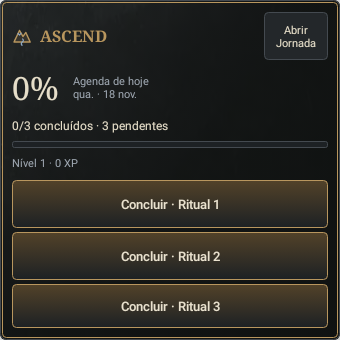 | 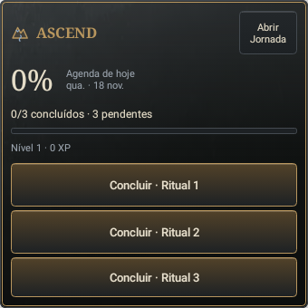 |

## Cenários de acessibilidade em `320 dp` e fonte `130%` (`1.6.9` × `1.6.9.10`)

| Cenário (`320 dp · 130%`) | 1.6.9 | 1.6.9.10 |
|---|---|---|
| Jornada estreita | 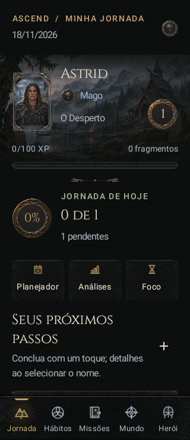 | 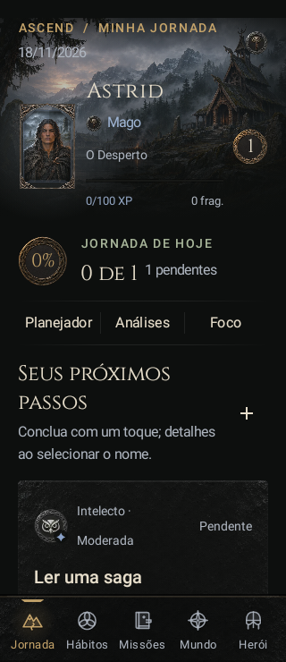 |
| Inventário estreito | 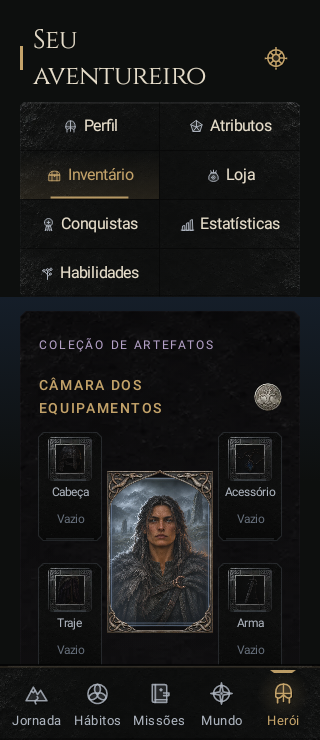 | 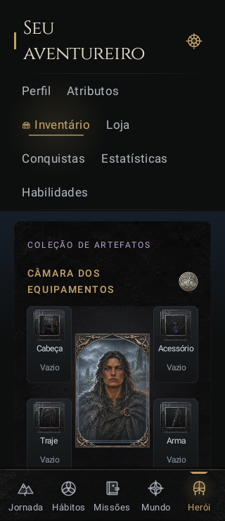 |
| Saga estreita |  | 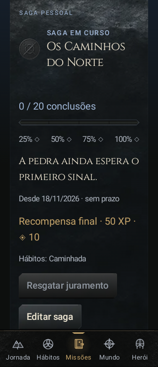 |
| Planejador estreito (tema claro / minimalista) | 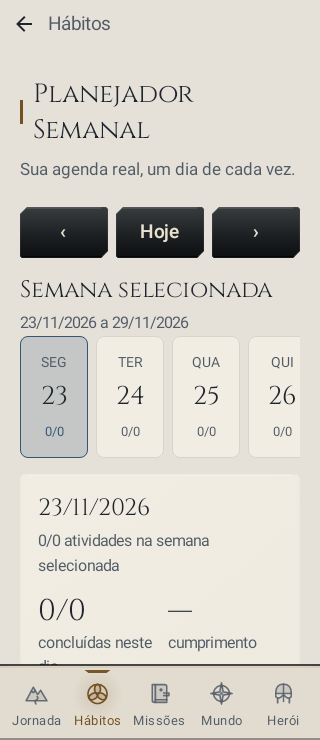 |  |
| Widget estreito (`130%`) | 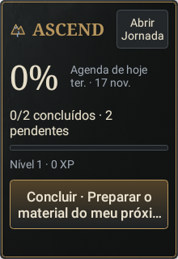 | 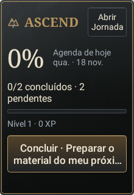 |

## Escopo, assinatura e limitações reais da validação

- **Assinatura oficial preservada:** O secret `ASCEND_KEYSTORE_BASE64` foi configurado com a chave privada oficial (`ascend-1.1.keystore`) e tan­to a `1.6.9` (na branch `feat/ascend-1.6.9`) quanto a `1.6.9.10` (`downloads/ASCEND-1.6.9.10.apk`, `versionCode 17`, `versionName 1.6.9.10`) foram assinadas e verificadas com o certificado SHA-256 `e1f003efe40d53754db66325c40177178aaa81d4ad02ab910c85642c681caae4` (veja [validation/APK-1.6.9.10.txt](validation/APK-1.6.9.10.txt)).
- **Testes automatizados e Lint:** A suíte completa executada no GitHub Actions (`./gradlew testDebugUnitTest assembleDebug lintDebug`) aprovou **135 testes** (0 falhas, 0 erros, 0 ignorados) em [validation/BUILD-1.6.9.10.txt](validation/BUILD-1.6.9.10.txt) e Android Lint com **0 erros** em [validation/LINT-1.6.9.10.txt](validation/LINT-1.6.9.10.txt).
- **Limitações honestas:**
  - Todas as **21 capturas** em `docs/screenshots/v1.6.9.10/` foram renderizadas em testes automatizados headless (Robolectric); não houve execução em aparelho Android físico, teste em launcher real nem auditoria prática com TalkBack nesta etapa.
  - Durante a sessão, o serviço `generate_image` retornou indisponibilidade temporária de capacidade (`503 OVERLOADED`); por isso, o refinamento `1.6.9.10` reutilizou integralmente as pinturas, retratos e os 6 assets `.webp` originais da `1.6.9`, concentrando todas as melhorias em composição, iluminação, contraste, espaço negativo e acabamento em Jetpack Compose e drawables XML.
