# ASCEND 1.6.9.15 — O Legado da Forja · Design System Nórdico e Acabamento Profissional

**18/11/2026.** Consolidação artística de componentes compartilhados, Widgets 3.0 e acabamento profissional (*Premium Nordic Experience*) sobre a base `feat/ascend-1.6.9.10` (`b13904c`), inspirada em *Senua's Sacrifice*, *Senua's Saga: Hellblade II*, *The Northman*, paisagens vulcânicas da Islândia, cultura material escandinava e ornamentações históricas *Urnes*, *Borre* e *Ringerike*. Nenhuma regra de negócio, XP, economia, hábitos, programação, estatísticas, cronômetro, missões, sagas, expedições, narrativas, banco Room v6, backup v8 ou `applicationId` (`br.com.ascend.aetheris`) foi alterada.

## 1. Prancha do Design System Nórdico (`prancha-componentes-16915.png`)

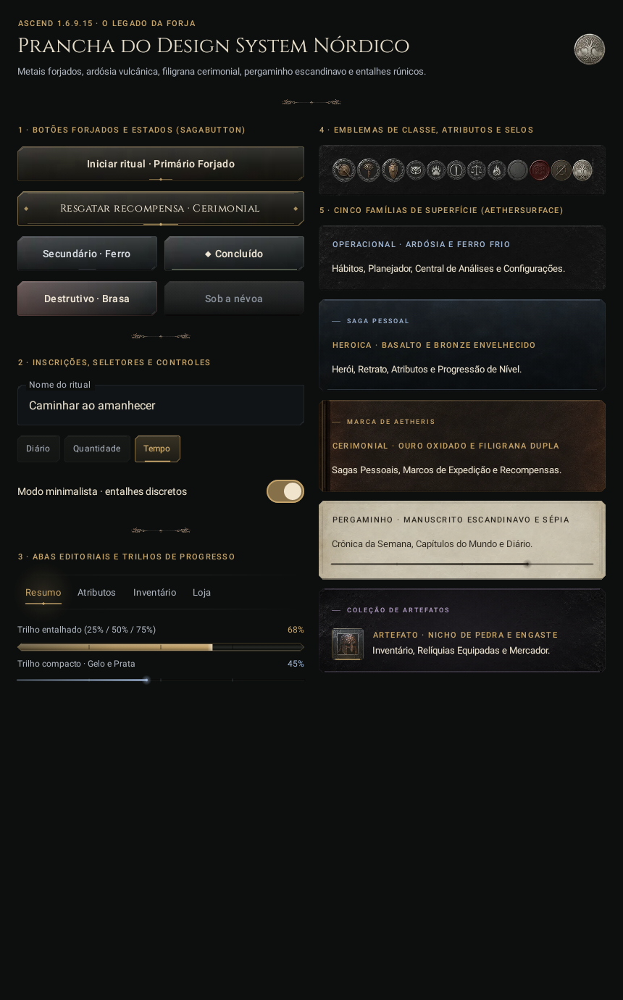

A versão `1.6.9.15` consolida uma linguagem material própria para cada família de componentes compartilhados:

- **Botões forjados e estados ([`NorthComponents.kt`](../app/src/main/java/br/com/ascend/aetheris/NorthComponents.kt), [`CarvedArt.kt`](../app/src/main/java/br/com/ascend/aetheris/CarvedArt.kt)):**
  - **Primário (Bronze Forjado):** cantos chanfrados (`CutCornerShape`), textura `plate_bronze.webp`, chanfro superior especular, entalhes diagonais de cinzel nos cantos e filete inferior com diamante central.
  - **Cerimonial (`ceremonial = true` — Ouro Oxidado e Filigrana):** reservado para resgates de contratos, conclusão de Sagas, marcos finais de Expedições, restauração da Vila, registro de Foco e subida de nível (`LevelUp`), com dupla filigrana horizontal, diamantes laterais em `Canvas` e tipografia `SagaFont`.
  - **Secundário (Ferro Escurecido e Ardósia):** superfície `plate_iron.webp` discreta, chanfro frio e filete central contido, sem competir com o botão primário.
  - **Concluído (`◆`), Destrutivo (Brasa) e Desativado (Pedra Apagada):** diferenciação material imediata por cor, relevo e insígnia.
- **Campos de inscrição, seletores e controles ([`Design.kt`](../app/src/main/java/br/com/ascend/aetheris/Design.kt), [`Forms.kt`](../app/src/main/java/br/com/ascend/aetheris/Forms.kt)):**
  - `FormField` reformulado como tábua de pedra/ferro rebaixada com marcas de cinzel nos cantos e linha de base em bronze.
  - `ChipRow` e seletores semanais (`FilterChip` em `Forms.kt`) convertidos em tabuletas chanfradas de ardósia com barra inferior de bronze no item ativo.
  - `Toggle` (`Switch`) estilizado em bronze envelhecido e ferro frio.
- **Abas editoriais e trilhos de progresso ([`AetherisNavigation.kt`](../app/src/main/java/br/com/ascend/aetheris/AetherisNavigation.kt), [`Design.kt`](../app/src/main/java/br/com/ascend/aetheris/Design.kt)):**
  - `AetherisTabs` com sublinhado de bronze e diamante central no item ativo, além de compactação responsiva automática em telas de `320 dp` (`maxWidth < 360.dp && values.size >= 6`), reduzindo o menu de 7 itens do Herói de 4 linhas para **2 linhas** em `320 dp / 130%`.
  - `Meter` (entalhado e `slim`) com marcações rúnicas em `25% · 50% · 75%` e contraste em sépia/bronze reforçado sobre superfícies claras de pergaminho (`LocalContentColor.current == Sepia`).
- **Cinco famílias de superfície e modais ([`ForgeArt.kt`](../app/src/main/java/br/com/ascend/aetheris/ForgeArt.kt), [`DesignSystem2.kt`](../app/src/main/java/br/com/ascend/aetheris/DesignSystem2.kt)):**
  - Diferenciação estrutural de cantos, iluminação localizada e filetes nas 5 famílias de `AetherSurface` (`Operational`, `Heroic`, `Ceremonial`, `Parchment`, `Artifact`).
  - Novo componente compartilhado `AetherDialog` substituindo `AlertDialog` genéricos em confirmações de descarte, resgates, conclusão de foco, gerenciamento de Sagas, restauração da Vila e subida de nível.

## 2. Acabamento nas telas do produto e Widgets 3.0

- **Jornada e Hábitos ([`JourneyHome.kt`](../app/src/main/java/br/com/ascend/aetheris/JourneyHome.kt), [`JourneyScreens.kt`](../app/src/main/java/br/com/ascend/aetheris/JourneyScreens.kt), [`HabitDetails.kt`](../app/src/main/java/br/com/ascend/aetheris/HabitDetails.kt)):**
  - `WeekStrip` com tabuletas chanfradas de pedra para os dias da semana e botão `+` de criação forjado em bronze.
  - `HabitCard` com diferenciação imediata de estado (`◆ Concluído` em verde-musgo, `◈ Em curso` em azul-geleira, `Pendente` em ardósia), barra vertical lateral, botões de ação chanfrados (`Foco` e `+`/`✓`) e correção da unidade em hábitos cronometrados (`30/60 minutos`).
  - Indicador explícito de rolagem horizontal nos filtros do Livro de Hábitos (`FILTROS E ORDEM · Deslize para atributos e ordem ›`) e revisão completa de singular/plural (`1 pendente`, `1 hábito encontrado`, `Sequência: 1 dia`).
- **Herói, Inventário, Missões, Sagas, Grimório e Mundo ([`HeroSheet.kt`](../app/src/main/java/br/com/ascend/aetheris/HeroSheet.kt), [`EquipmentScreen.kt`](../app/src/main/java/br/com/ascend/aetheris/EquipmentScreen.kt), [`RpgDesign.kt`](../app/src/main/java/br/com/ascend/aetheris/RpgDesign.kt), [`SagaScreen.kt`](../app/src/main/java/br/com/ascend/aetheris/SagaScreen.kt), [`GrimoireScreen.kt`](../app/src/main/java/br/com/ascend/aetheris/GrimoireScreen.kt), [`WorldScreen.kt`](../app/src/main/java/br/com/ascend/aetheris/WorldScreen.kt), [`ExplorationScreens.kt`](../app/src/main/java/br/com/ascend/aetheris/ExplorationScreens.kt)):**
  - Maior legibilidade das silhuetas entalhadas nos nichos vazios do Inventário (`alpha = 0.66f` com luz fria superior).
  - Alto contraste no trilho de progresso sobre o pergaminho dos contratos diários (`MissionCard2`) e pedras rúnicas chanfradas nos marcos `25% · 50% · 75% · 100%` das Sagas (`SagaBook`).
  - Deduplicação do cabeçalho de categoria/atributo nos cartões do Grimório (`CatalogCard`).
- **Planejador, Central de Análises e Cronômetro ([`ProductivityScreens.kt`](../app/src/main/java/br/com/ascend/aetheris/ProductivityScreens.kt), [`JourneyScreens.kt`](../app/src/main/java/br/com/ascend/aetheris/JourneyScreens.kt)):**
  - Tabuletas chanfradas na tira de dias do Planejador Semanal e pontos duplos de bronze/gelo com linhas de referência sutis no gráfico `Evolução de XP` (`XpPlot`).
  - Mostrador de Foco (`FocusCard`) com anel de astrolábio em bronze, 12 marcações radiais entalhadas e ação `Registrar` cerimonial.
- **Widgets 3.0 ([`habit_widget.xml`](../app/src/main/res/layout/habit_widget.xml), [`widget_surface.xml`](../app/src/main/res/drawable/widget_surface.xml), [`widget_complete.xml`](../app/src/main/res/drawable/widget_complete.xml), [`widget_secondary.xml`](../app/src/main/res/drawable/widget_secondary.xml), [`HabitWidget.kt`](../app/src/main/java/br/com/ascend/aetheris/HabitWidget.kt)):**
  - Placa nórdica com chanfro superior em bronze, moldura interna dupla, selo compacto `Jornada ›` no cabeçalho, identificação do herói (`Nome · Nível · XP`) e hábitos pendentes redesenhados como faixas de atividade alinhadas à esquerda com barra vertical metálica de `4 dp` (bronze para `Concluir`, aço-geleira para `Registrar`).

## 3. Comparações reais `1.6.9.10` × `1.6.9.15` (renderização Robolectric)

| Área | 1.6.9.10 | 1.6.9.15 |
|---|---|---|
| Jornada | 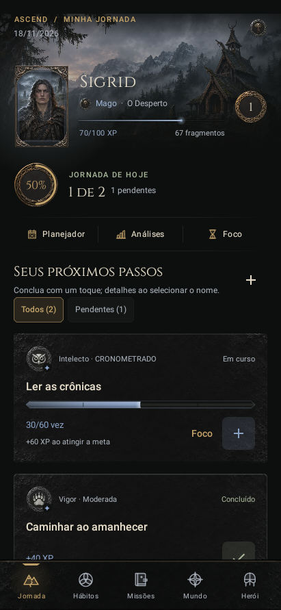 | 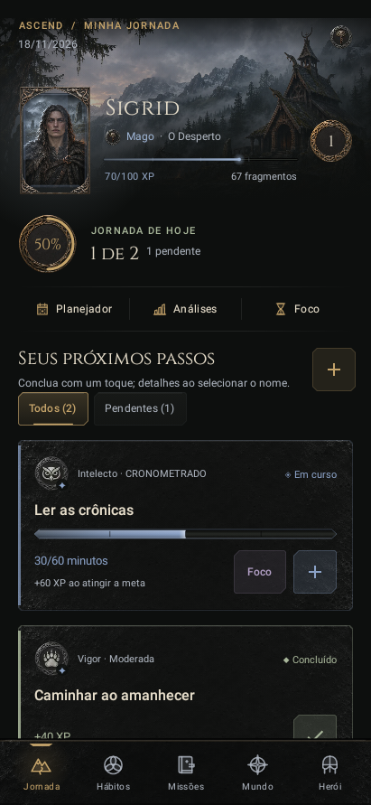 |
| Herói (Perfil e Atributos) | 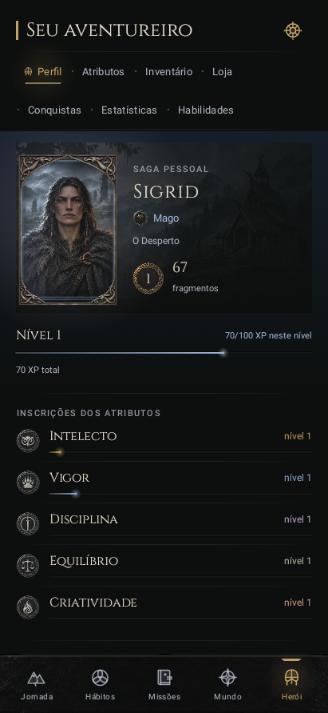 | 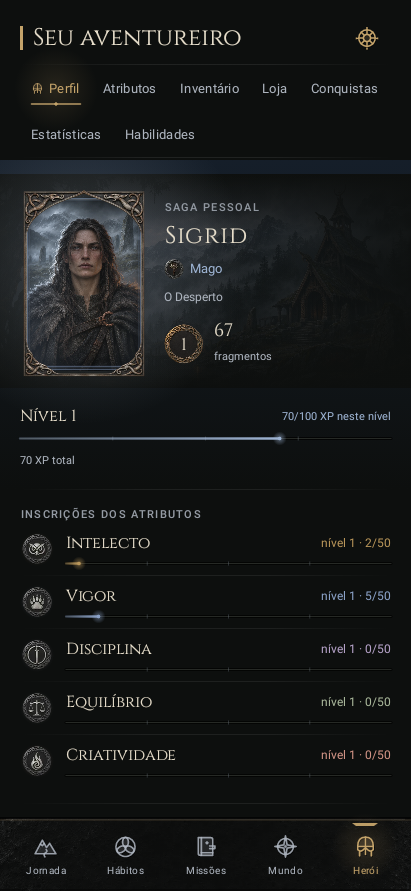 |
| Inventário (Câmara de Artefatos) | 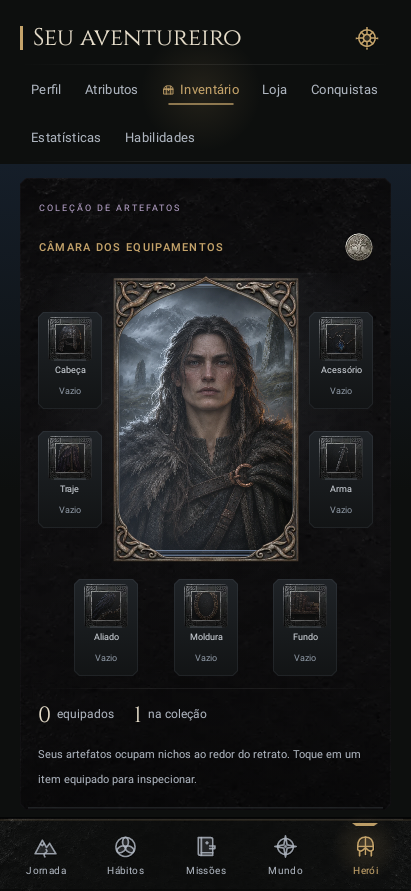 | 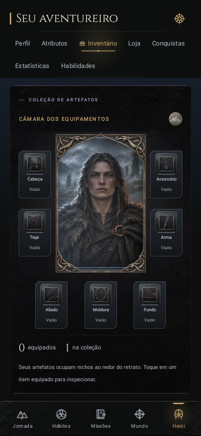 |
| Livro de Hábitos | 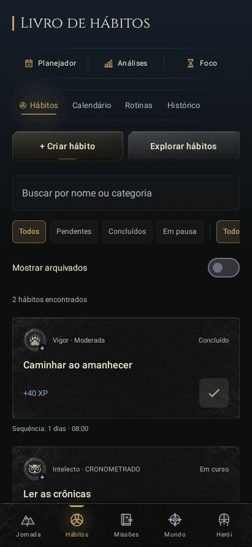 | 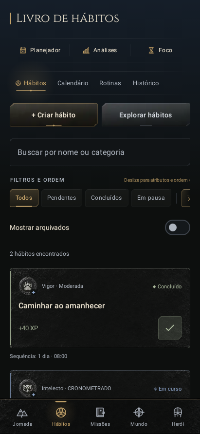 |
| Livro de Missões | 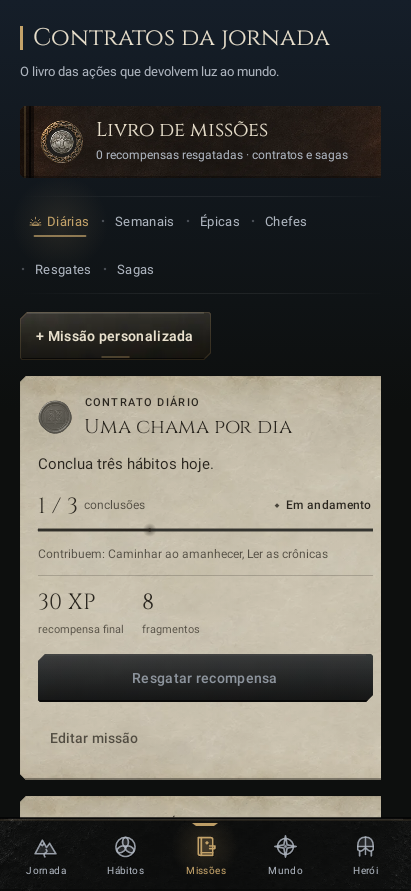 | 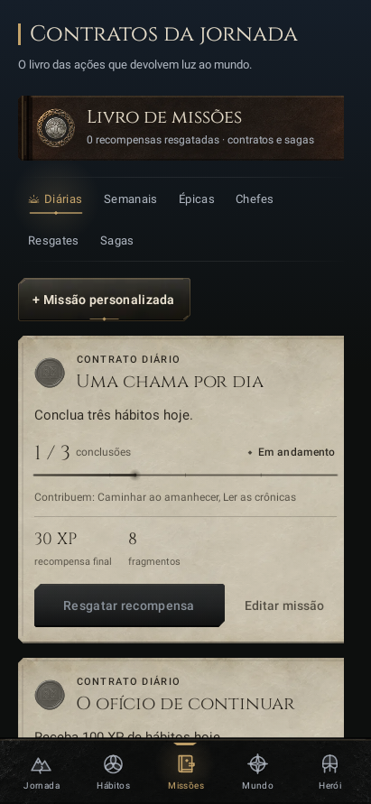 |
| Sagas Pessoais | 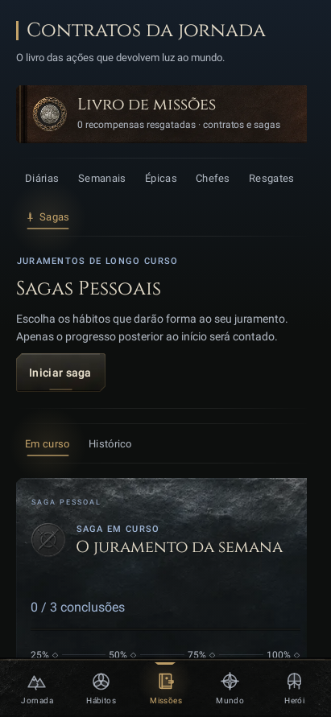 | 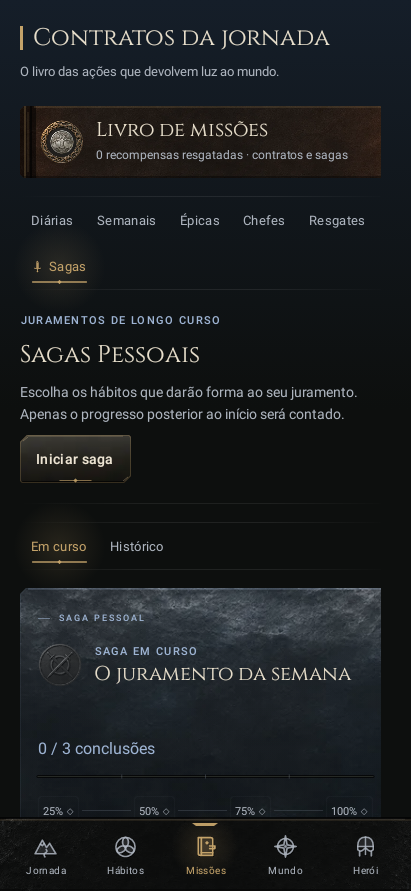 |
| Planejador Semanal | 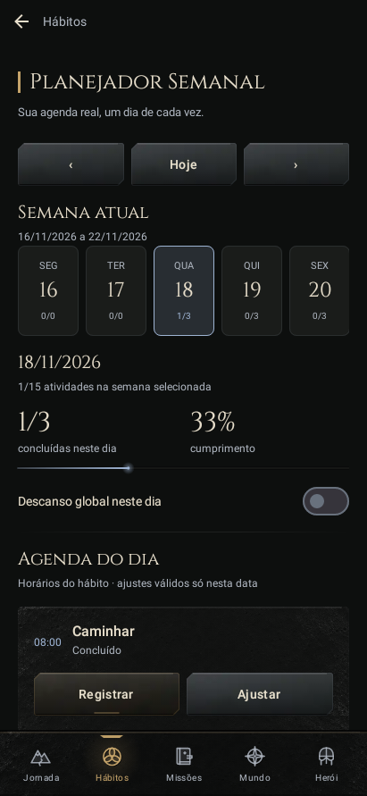 | 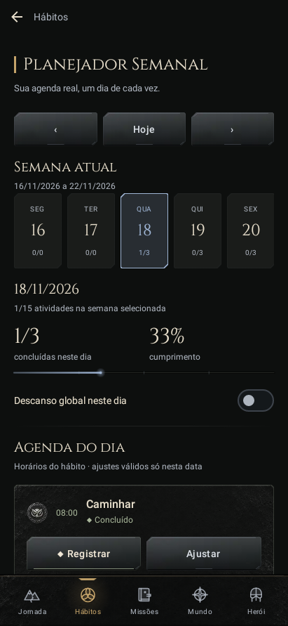 |
| Central de Análises | 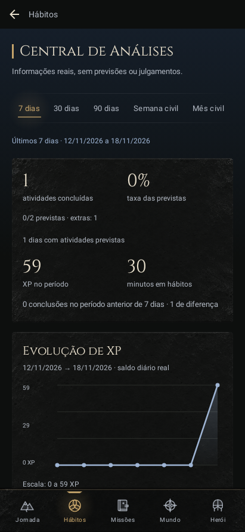 | 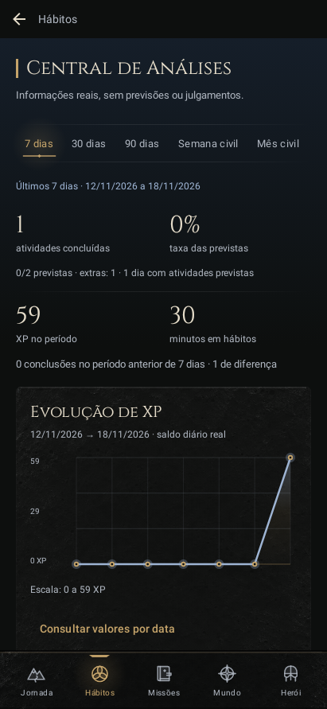 |
| Cronômetro de Foco | 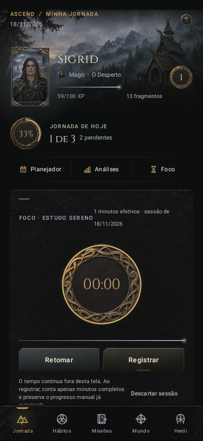 | 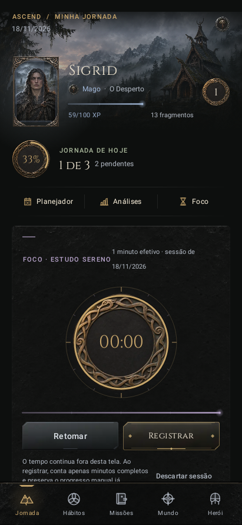 |
| Widget Compacto | 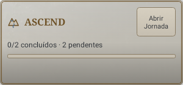 | 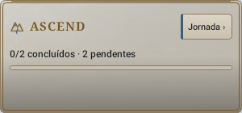 |
| Widget Expandido (claro) | 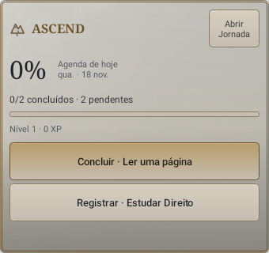 | 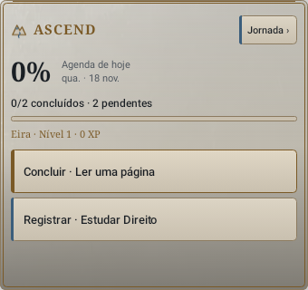 |
| Widget Expandido (escuro) | 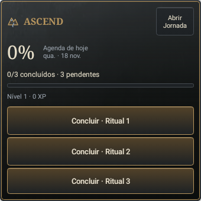 | 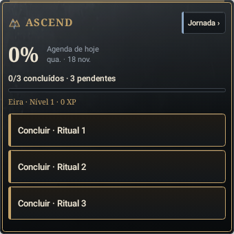 |
| Modal Cerimonial de Recompensa |  | 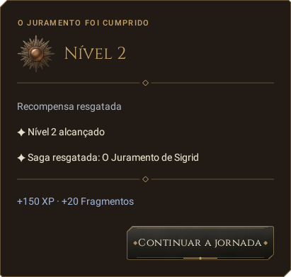 |
| Grimório dos Hábitos |  | 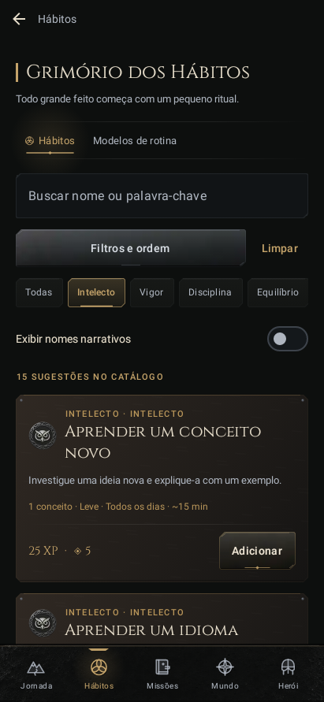 |

## 4. Cenários de acessibilidade em `320 dp` e fonte `130%` (`1.6.9.10` × `1.6.9.15`)

| Cenário (`320 dp · 130%`) | 1.6.9.10 | 1.6.9.15 |
|---|---|---|
| Jornada estreita | 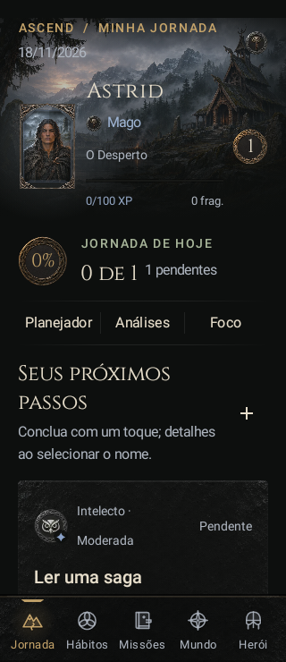 | 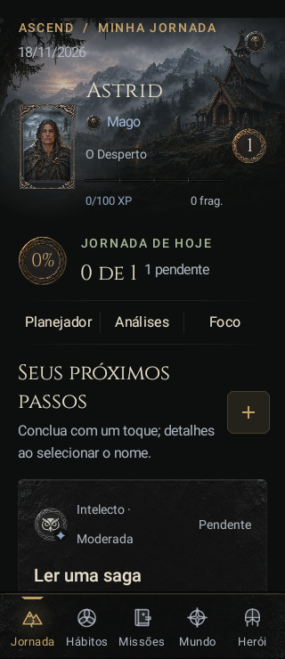 |
| Inventário estreito (menu do Herói em 2 linhas) | 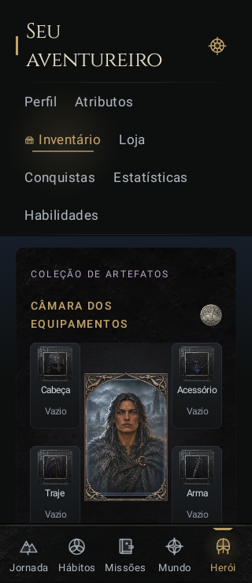 | 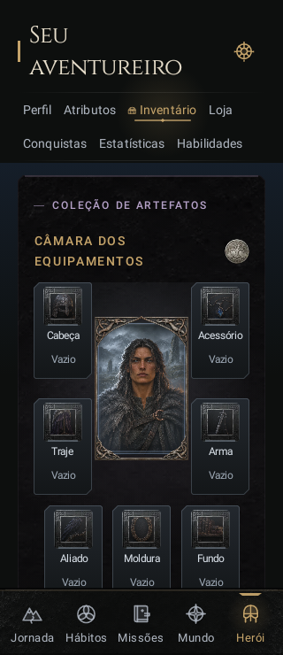 |
| Saga estreita | 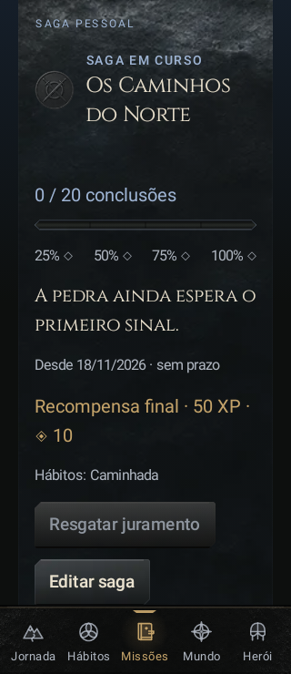 | 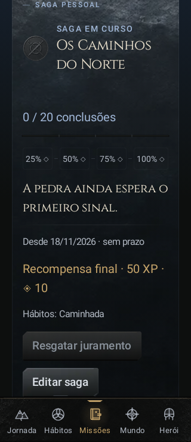 |
| Planejador estreito (tema claro / minimalista) | 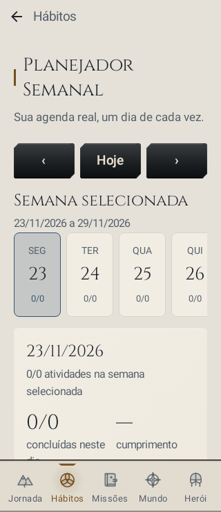 | 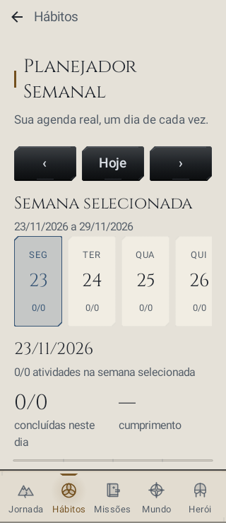 |
| Widget estreito (`130%`) | 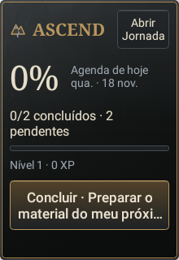 | 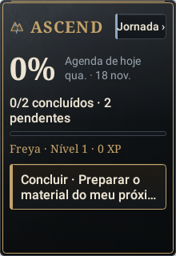 |

## 5. Validação, assinatura e limitações reais

- **Assinatura oficial preservada:** O APK publicado em `downloads/ASCEND-1.6.9.15.apk` (`versionCode 18`, `versionName 1.6.9.15`, `22914314` bytes, SHA-256 `43c70b08a1a5f970b34e25f7bcfef900236997e824526c673cf73ae84d609653`) foi assinado via GitHub Actions (`ASCEND_KEYSTORE_BASE64`) e verificado com `apksigner verify --verbose --print-certs`, confirmando o certificado oficial SHA-256 `e1f003efe40d53754db66325c40177178aaa81d4ad02ab910c85642c681caae4` (veja [validation/APK-1.6.9.15.txt](validation/APK-1.6.9.15.txt)).
- **Testes automatizados e Lint:** A suíte completa executada no GitHub Actions (`./gradlew testDebugUnitTest assembleDebug lintDebug`) aprovou **135 testes** (0 falhas, 0 erros, 0 ignorados) em [validation/BUILD-1.6.9.15.txt](validation/BUILD-1.6.9.15.txt) e Android Lint com **0 erros e 22 avisos** em [validation/LINT-1.6.9.15.txt](validation/LINT-1.6.9.15.txt).
- **Limitações honestas:**
  - Todas as **24 capturas** em `docs/screenshots/v1.6.9.15/` (incluindo `prancha-componentes-16915.png`) foram renderizadas em testes automatizados headless (Robolectric); não houve execução em aparelho Android físico, teste em launcher real nem auditoria prática com TalkBack nesta etapa.
