# ASCEND 1.6.9.19 — A Biblioteca da Forja (Nordic Pictorial Library)

Relatório visual, catálogo técnico e comparativos reais `1.6.9.15 × 1.6.9.19` na branch `feat/ascend-1.6.9.19` (base `feat/ascend-1.6.9.15`, `versionCode 19`). Nenhuma funcionalidade, layout estrutural, esquema Room v6, backup v8, regra econômica ou permissão Android foi alterada; todos os **135 testes** continuam aprovados e todos os recursos anteriores em `app/src/main/res/drawable-nodpi/` foram integralmente preservados.

---

## 1. Processo de Geração Pictórica e Direção de Arte

Antes de qualquer alteração em Kotlin, Compose ou XML, a ferramenta de geração de imagens (`image-generator` / Nano Banana) foi acionada para criar:
1. A **prancha conceitual** da nova biblioteca (`docs/art/concepts/biblioteca-forja-16919.webp`), estabelecendo a linguagem de metalurgia escandinava histórica, entalhes Urnes/Borre/Ringerike, ferro enegrecido batido a martelo, bronze oxidado, prata escurecida, ardósia vulcânica islandesa, couro cerimonial e velino envelhecido.
2. Os **19 recursos pictóricos definitivos** em `app/src/main/res/drawable-nodpi/`, inspecionados visualmente um a um, refinados (com remoção de textos/legendas de estudo e máscaras alfa geométricas limpas para placas chanfradas, molduras vazadas e tábuas de widget) e convertidos para WebP lossless/alta qualidade sem distorção.

| Prancha Conceitual Gerada (`generate_image`) | Prancha de Produção Renderizada em Compose (`Robolectric`) |
|---|---|
| 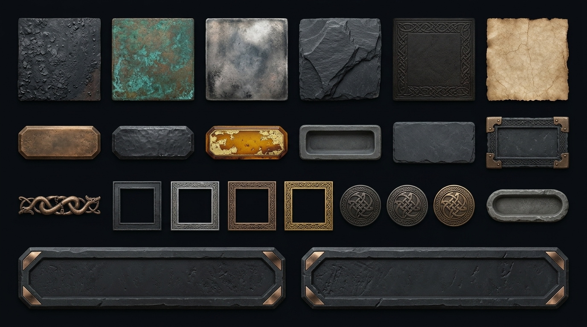 | 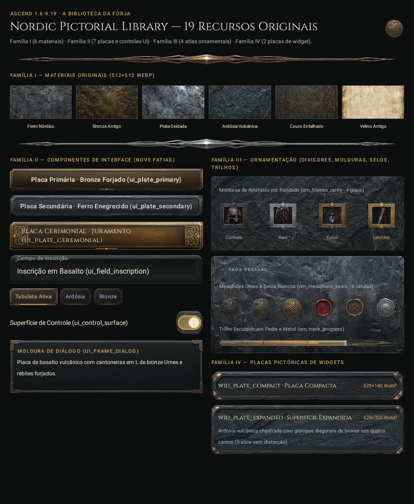 |

---

## 2. Catálogo Completo dos 20 Recursos WebP (`1.6.9.19`)

Todos os arquivos possuem resolução nítida, iluminação consistente vinda do topo-esquerda, ausência de texto fixo embutido e transparência limpa (RGBA) nos componentes e ornamentos recortados:

| # | Arquivo | Família | Dimensões | Formato | Bytes | SHA-256 | Finalidade e Aplicação |
|---:|---|---|---|---:|---:|---|---|
| 0 | `docs/art/concepts/biblioteca-forja-16919.webp` | Conceito | `1376 × 768` | WebP RGB | 152,656 | `e52b2acda671b4d062b91c617087db0450b2d66906e42c818ae214d357164420` | Prancha conceitual da Biblioteca da Forja (fora do APK) |
| 1 | `mat_iron_nordic.webp` | I — Materiais | `512 × 512` | WebP RGB | 71,520 | `73f0fdbec78b0e596c5c3576893ef153a23ad171b819b116e205147c7555c0aa` | Ferro nórdico enegrecido martelado → `ForgeMaterial.Iron`, `AetherSurface(Operational)` |
| 2 | `mat_bronze_ancient.webp` | I — Materiais | `512 × 512` | WebP RGB | 54,208 | `c7823d431669906cc878b785364cceb4695e36329d35393996f59c85b57e2a5c` | Bronze artesanal envelhecido com pátina → `ForgeMaterial.Bronze`, `AetherSurface(Heroic)` |
| 3 | `mat_silver_oxidized.webp` | I — Materiais | `512 × 512` | WebP RGB | 92,924 | `77079aa9bb0fcbc86fe4752c83bac1fa028bda5aa23a7f9c0c46191794c46c7c` | Prata oxidada com sulcos escurecidos → `ForgeMaterial.Silver`, `AetherSurface(Ceremonial)` |
| 4 | `mat_slate_volcanic.webp` | I — Materiais | `512 × 512` | WebP RGB | 85,732 | `5bf2599ec2cb0297e1f493fa13e28b8659739c05627255d2dc8daaec14f4fbeb` | Ardósia vulcânica clivada → `ForgeMaterial.Slate`, `AetherSurface(Artifact)` |
| 5 | `mat_leather_carved.webp` | I — Materiais | `512 × 512` | WebP RGB | 83,470 | `46b60d0ef75d420b33e3f36450ad35d40794b86516574465c6d5fb51a3ce0d0a` | Couro cerimonial escuro com relevo Urnes → `ForgeMaterial.Leather`, `SagaCover` |
| 6 | `mat_vellum_aged.webp` | I — Materiais | `512 × 512` | WebP RGB | 71,240 | `869cb568ae8c23ec2f2b0d66c52f1935cc83f0f8802adf49e5b729f91f3de17a` | Velino nórdico envelhecido → `ForgeMaterial.Vellum`, `AetherSurface(Parchment)` |
| 7 | `ui_plate_primary.webp` | II — Interface | `640 × 224` | WebP RGBA | 16,406 | `1f3d4053b6fc93a16d1c949952cc85ef4fb7107c9b3241dad48ba404791ebbed` | Placa chanfrada de bronze/ferro (9-slice) → `SagaButton` primário, `widget_complete.xml` |
| 8 | `ui_plate_secondary.webp` | II — Interface | `640 × 224` | WebP RGBA | 39,052 | `786af9107c32a19312146fb929e6e14544ab17005a2f916d987b5cd1582bb58e` | Placa de ferro enegrecido (9-slice) → `SagaButton` secundário/concluído, `widget_secondary.xml` |
| 9 | `ui_plate_ceremonial.webp` | II — Interface | `640 × 192` | WebP RGBA | 29,510 | `b23e2eff8c8848120bb710b93be66d90723eab4cd7b43f01ae41179d11cbf0d1` | Placa cerimonial de ouro oxidado e filigrana (9-slice) → `SagaButton(ceremonial = true)` |
| 10 | `ui_field_inscription.webp` | II — Interface | `480 × 160` | WebP RGBA | 8,700 | `e94fb5d2b4fcac9d4bf0037c1c88f5c7dfaf3aaff56d9d291605dc3b1d16e821` | Moldura de campo de inscrição em ardósia e ferro (9-slice) → `FormField` (`Forms.kt`) |
| 11 | `ui_tablet_selector.webp` | II — Interface | `512 × 224` | WebP RGBA | 30,794 | `225af9eb9cd837dd885173b4e94f43b933885fb06c7fd0e3e38bd93dcf938d91` | Tabuleta chanfrada para seletores (9-slice) → `ChipRow` (`Design.kt`), `FilterChip` (`Forms.kt`) |
| 12 | `ui_control_surface.webp` | II — Interface | `512 × 200` | WebP RGBA | 40,712 | `d2ace1f20dd32aa4022ebeef7f14748b8e7d603fc8f89ac26f2da9b872defb2a` | Trilho de controle em ferro e bronze (9-slice) → `Toggle` (`Forms.kt`) |
| 13 | `ui_frame_dialog.webp` | II — Interface | `640 × 480` | WebP RGBA | 17,666 | `10e8f26ec85e5535067fbe1731137159dfd36f6272a7373e94f8cac1c2cbca1d` | Moldura estrutural de diálogo (9-slice) → `AetherDialog` (`DesignSystem2.kt`) |
| 14 | `orn_divider_forged.webp` | III — Ornamentação | `540 × 120` | WebP RGBA | 16,468 | `d52729cb4f036d290e114b307dedad0f8c5e2418835c6f98dbe2fd8e03de81f0` | Atlas `1 × 2` de divisores forjados → `NorthDivider` (`ForgeArt.kt`), `SagaDivider` (`NordicArt.kt`) |
| 15 | `orn_frames_rarity.webp` | III — Ornamentação | `512 × 512` | WebP RGBA | 34,928 | `62f37172bb6a02cdfa840e3083345a1ce15fa33c999935651a3a54903ce3e136` | Atlas `2 × 2` de molduras vazadas por raridade (`0..3`) → `ArtifactFrame` (`CarvedArt.kt`), `RelicArt` |
| 16 | `orn_medallions_seals.webp` | III — Ornamentação | `576 × 384` | WebP RGBA | 56,218 | `b5d881c6e5a6fe9bdc7d5ad6db633dbe8dd3dfe6e866b021b50453fa66232a0f` | Atlas `3 × 2` de medalhões e selos → `ForgeMedallion`, `DayDial` (`ForgeArt.kt`), `RuneSeal` (`NordicArt.kt`) |
| 17 | `orn_track_progress.webp` | III — Ornamentação | `520 × 120` | WebP RGBA | 15,678 | `07bf301849f9777f00aaad1165f81081645f95ffc8ece933b862dc9783e11e37` | Atlas `1 × 2` de sulco esculpido e metal fundido → `Meter` (`Design.kt`) |
| 18 | `wid_plate_compact.webp` | IV — Widgets | `628 × 140` | WebP RGBA | 15,950 | `ff2d1c3d402e9a553f10618b786988c8fd6fbe21ebfe66f58b12b33afcaad030` | Placa pictórica compacta de ardósia e bronze → `widget_surface.xml`, `HabitWidget.kt` |
| 19 | `wid_plate_expanded.webp` | IV — Widgets | `628 × 320` | WebP RGBA | 54,036 | `d5fbe0a4b0e25b7d99138820dfd8182ac964819767478a87ef0a5650db0121e7` | Superfície pictórica expandida de ardósia e bronze → `widget_surface_expanded.xml`, `HabitWidget.kt` |

---

## 3. Integração Controlada por 9-Slice e Atlas

Para evitar qualquer estiramento de cantos chanfrados, rebites, entrelaçados Urnes ou cantoneiras de ferro em diferentes larguras de tela (`320 dp` a `411 dp`) e tamanhos de fonte (`100%` a `130%`):

- **`DrawScope.drawNineSlice` e `Modifier.pictorialFrame` (`CarvedArt.kt`):** divide cada recurso pictórico de interface (`ui_plate_primary`, `ui_plate_secondary`, `ui_plate_ceremonial`, `ui_field_inscription`, `ui_tablet_selector`, `ui_control_surface`, `ui_frame_dialog`) em 9 regiões parametrizadas (`capXRatio`, `capYRatio`), preservando a proporção 1:1 dos cantos e bordas esculpidas enquanto expande apenas o miolo plano.
- **`Modifier.forgeMaterial` (`ForgeArt.kt`):** mapeia os 6 materiais da Família I (`IronNordic`, `BronzeAncient`, `SilverOxidized`, `SlateVolcanic`, `LeatherCarved`, `VellumAged`) diretamente às cinco famílias de `AetherSurface` (`Operational`, `Heroic`, `Ceremonial`, `Parchment`, `Artifact`) e às capas de Saga (`SagaCover`), respeitando o modo claro/escuro e desativando texturas no modo minimalista (`LocalAppearance.current.minimal`).
- **Amostragem de Atlas (`orn_*`):**
  - `ArtifactFrame` e `RelicArt` selecionam o quadrante correspondente à raridade do item (`0` ferro, `1` bronze, `2` prata rúnica, `3` ouro ancestral) em `orn_frames_rarity.webp`.
  - `ForgeMedallion`, `DayDial` e `RuneSeal` amostram células individuais da grade `3 × 2` de `orn_medallions_seals.webp`.
  - `NorthDivider` e `SagaDivider` amostram a faixa superior (cerimonial Urnes) ou inferior (operacional em ferro) de `orn_divider_forged.webp`.
  - `Meter` utiliza a metade superior de `orn_track_progress.webp` para o sulco de pedra e a metade inferior para o preenchimento de metal fundido.
- **Widgets Android (`HabitWidget.kt`, `widget_*.xml`):** alternam dinamicamente entre `widget_surface.xml` (`wid_plate_compact.webp`) no modo compacto e `widget_surface_expanded.xml` (`wid_plate_expanded.webp`) no modo expandido, com translucidez graduada embutida no canal alfa para compatibilidade integral com `RemoteViews` desde Android 8/9 (`API 26–28`).

---

## 4. Comparações Visuais Reais (`1.6.9.15 × 1.6.9.19`)

### 4.1. Jornada, Herói e Inventário

| Tela | 1.6.9.15 (Base) | 1.6.9.19 (Biblioteca da Forja) |
|---|---|---|
| **Jornada** | 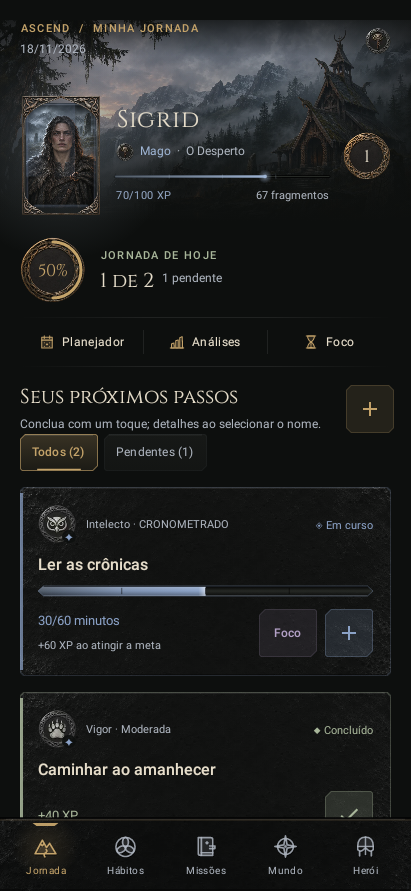 | 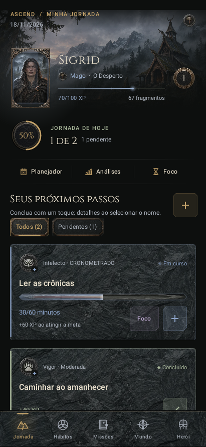 |
| **Herói** | 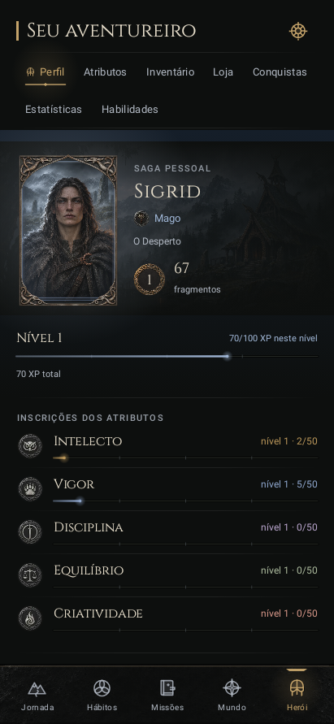 | 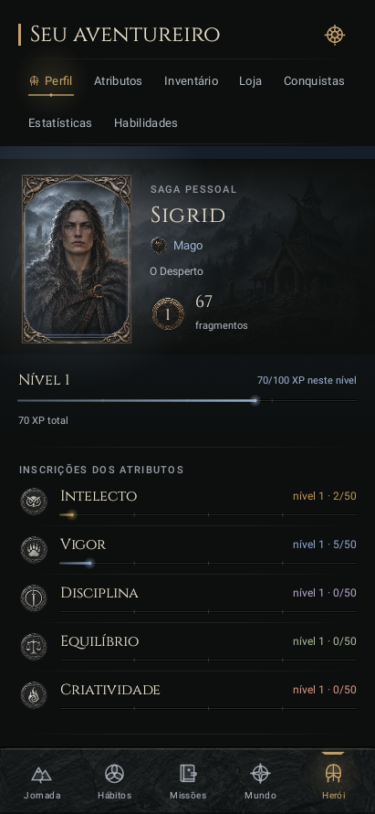 |
| **Inventário (Arsenal)** | 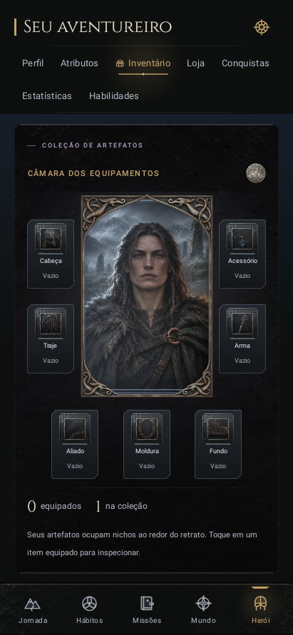 | 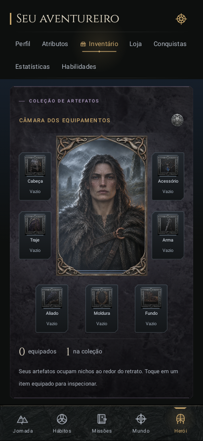 |

### 4.2. Missões, Sagas, Hábitos e Cronômetro

| Tela | 1.6.9.15 (Base) | 1.6.9.19 (Biblioteca da Forja) |
|---|---|---|
| **Missões** | 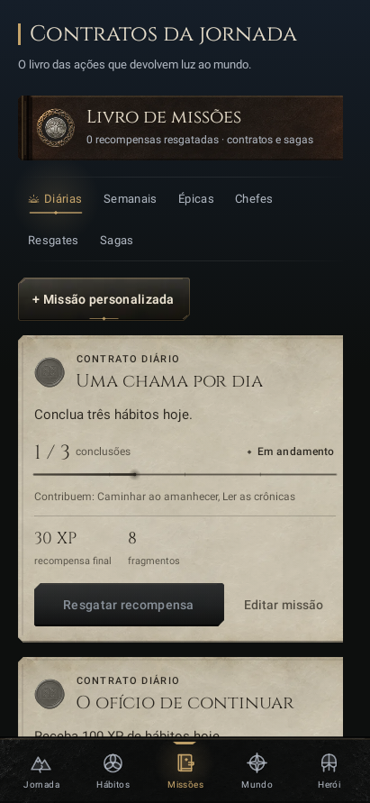 | 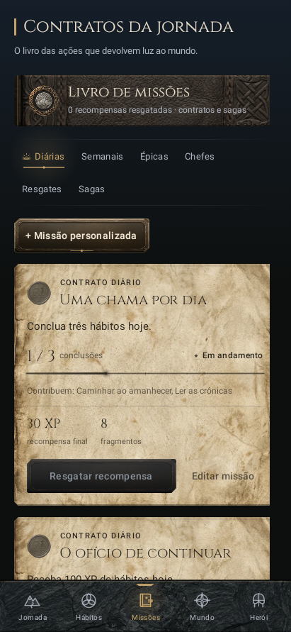 |
| **Sagas** | 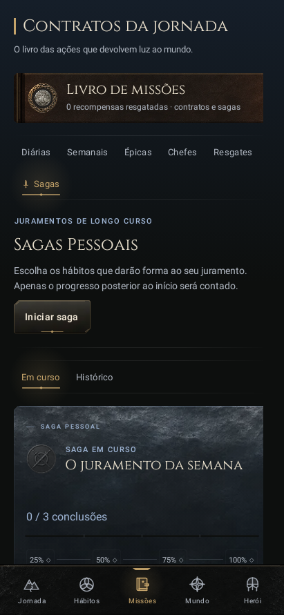 | 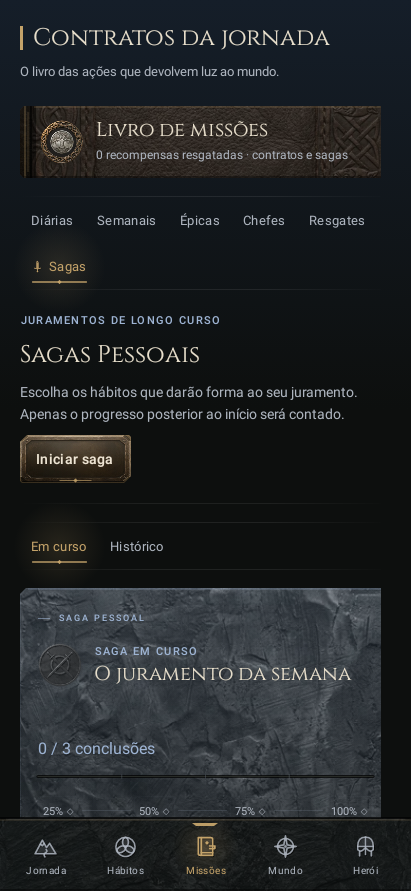 |
| **Hábitos** | 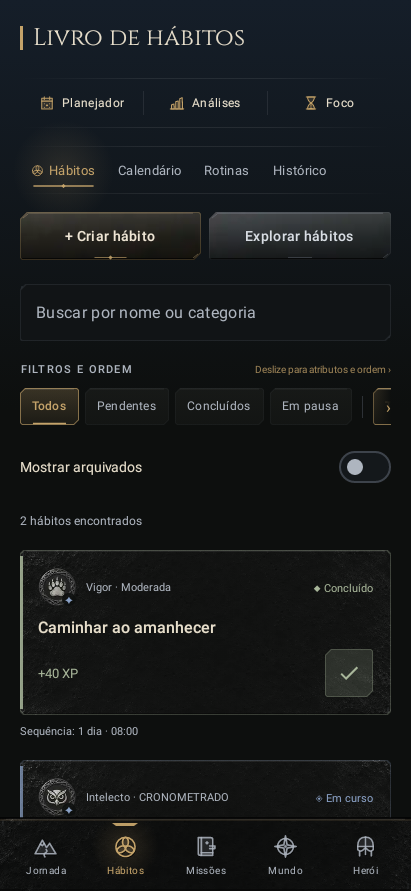 | 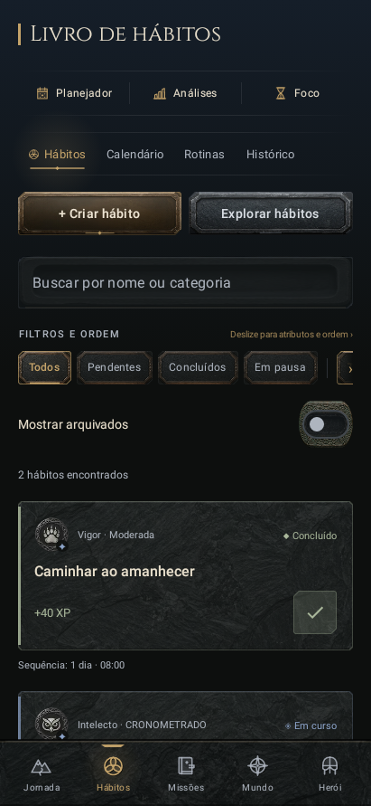 |
| **Cronômetro de Foco** | 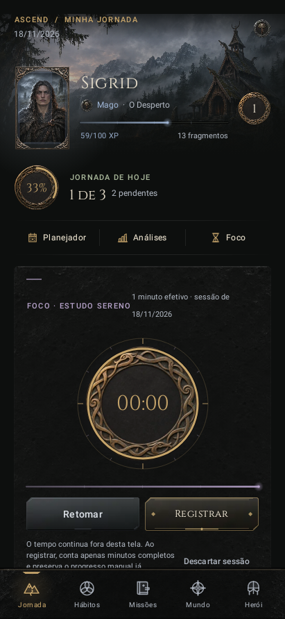 | 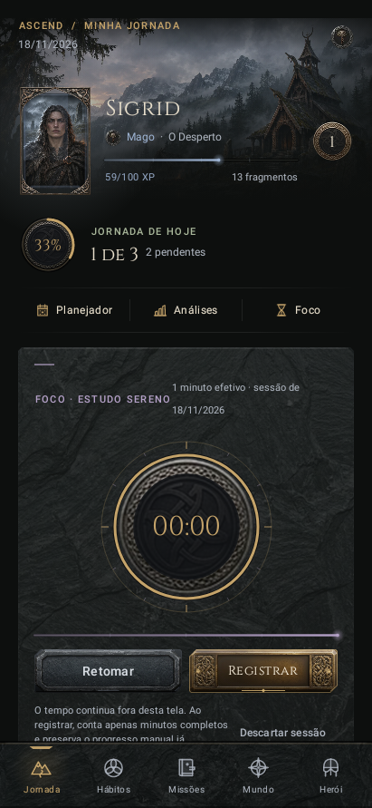 |

### 4.3. Planejador, Análises, Memórias e Widgets

| Tela | 1.6.9.15 (Base) | 1.6.9.19 (Biblioteca da Forja) |
|---|---|---|
| **Planejador Semanal** | 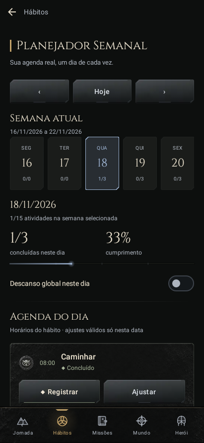 | 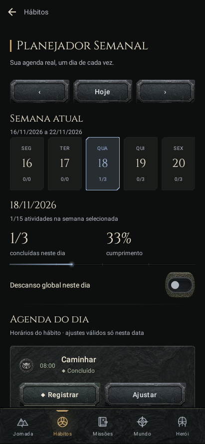 |
| **Central de Análises** | 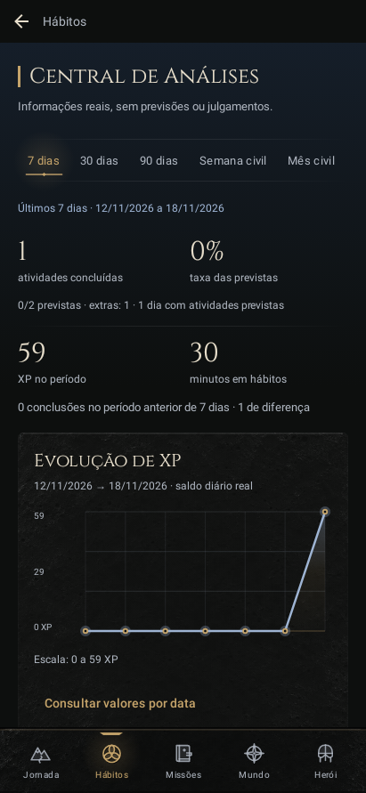 | 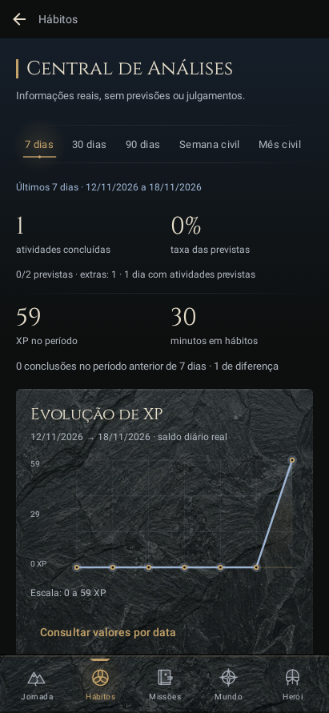 |
| **Salão das Memórias** | 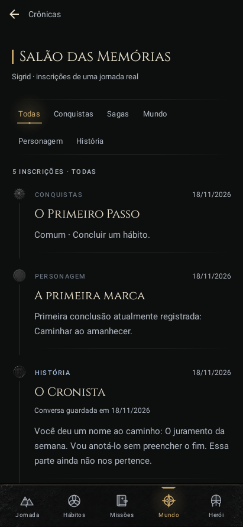 | 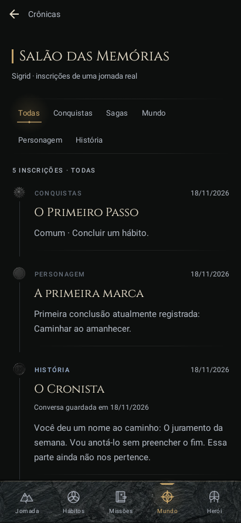 |
| **Widget Expandido (Escuro)** | 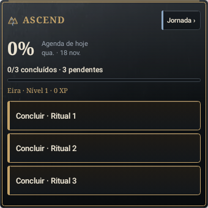 | 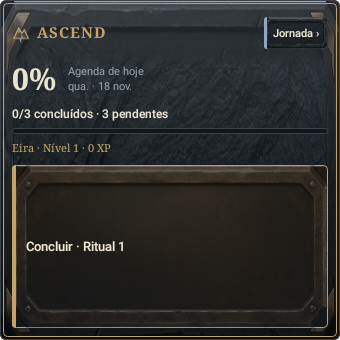 |
| **Widget Compacto** | 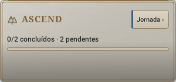 | 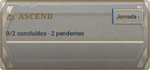 |
| **Widget Claro** | 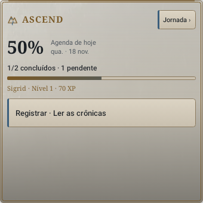 | 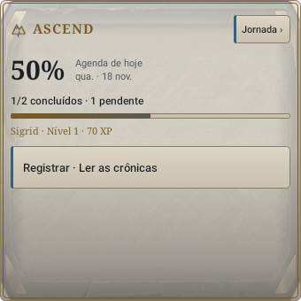 |

### 4.4. Validação em Telas Estreitas (`320 dp`) e Fonte Ampliada (`130%`)

| Cenário `320 dp / 130%` | 1.6.9.15 (Base) | 1.6.9.19 (Biblioteca da Forja) |
|---|---|---|
| **Jornada (`320 dp / 130%`)** | 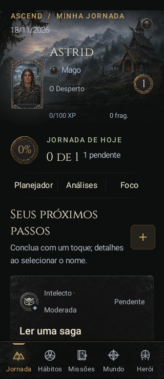 | 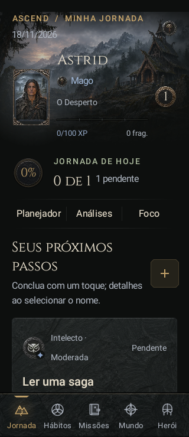 |
| **Inventário (`320 dp / 130%`)** | 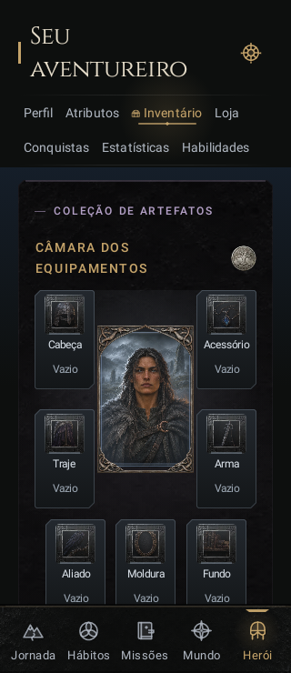 | 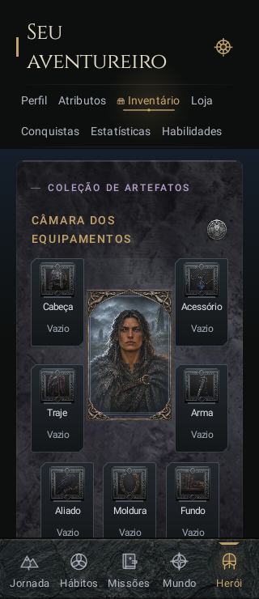 |
| **Sagas (`320 dp / 130%`)** | 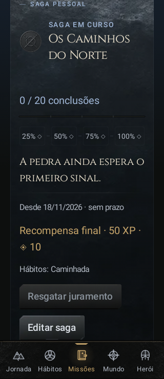 | 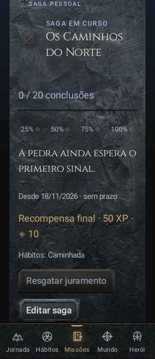 |
| **Widget Estreito (`130%`)** | 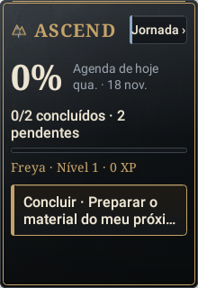 | 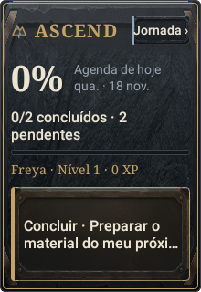 |

---

## 5. Limites Reais da Entrega

- Todas as capturas de interface e a prancha de produção (`prancha-biblioteca-16919.png`) são renderizações reais de Compose e `RemoteViews` geradas pela suíte Robolectric (`API 28`).
- Nos widgets Android (`RemoteViews`), as placas `wid_plate_compact.webp`, `wid_plate_expanded.webp`, `ui_plate_primary.webp` e `ui_plate_secondary.webp` são aplicadas via `<bitmap android:gravity="fill">` em `layer-list` XML (já que `RemoteViews` não executa o `DrawScope.drawNineSlice` do Compose), mas foram geradas nas proporções exatas de widget compacto (`628 × 140`) e expandido (`628 × 320`) para minimizar distorção.
- Não foi executada instalação física sobre a `1.6.9.15` em aparelho Android real, nem validação em launcher físico ou TalkBack; a compatibilidade de atualização é garantida pelo mesmo `applicationId` (`br.com.ascend.aetheris`), `versionCode 19` crescente, Room v6 / backup v8 inalterados e assinatura oficial verificada por `apksigner` (`e1f003efe40d53754db66325c40177178aaa81d4ad02ab910c85642c681caae4`).
