# ASCEND 1.6.9 — O Último Entalhe · Consolidação Visual

**17/11/2026.** Consolidação artística definitiva (*Nordic Cinematic UI*) sobre a base `feat/ascend-1.6.8` (`b2252cb`), inspirada em *Senua's Sacrifice*, *Senua's Saga: Hellblade II*, *The Northman*, paisagens vulcânicas da Islândia e entalhes históricos escandinavos (Urnes, Borre e Ringerike). Sem alteração de regras de RPG, economia, agendamento, Room v6, backup v8 ou `applicationId`.

## Conceito visual e prancha de recursos

| Conceito 1.6.9 (Jornada, Herói, Missões) | Prancha de recursos 1.6.9 |
|---|---|
| 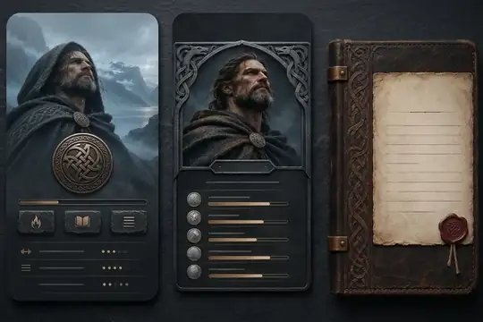 | 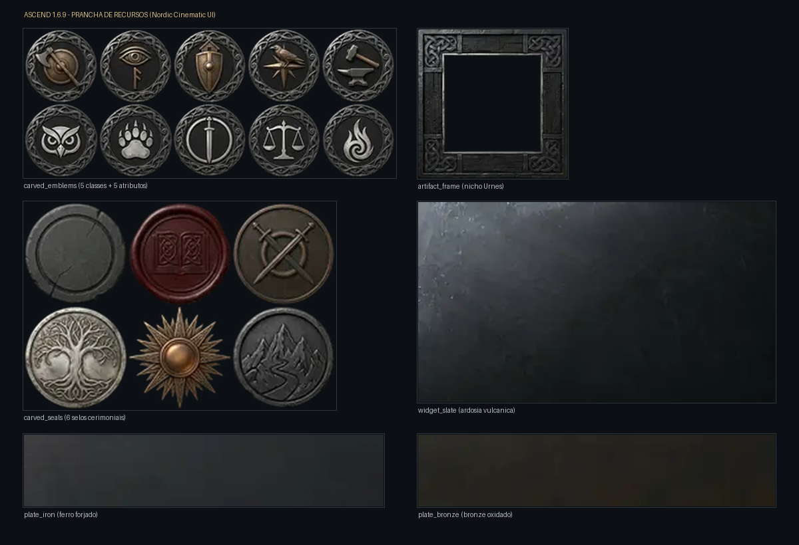 |

## Biblioteca gráfica e iconografia (`CarvedArt.kt` e `drawable-nodpi/*.webp`)

- **25 símbolos vetoriais originais (`Glyph` / `CarvedGlyph`):** família coesa de entalhes nórdicos para navegação, ações e atalhos (incluindo Jornada, Hábitos, Missões, Mundo, Herói, Planejador, Análises, Foco, Inventário, Loja, Conquistas, Crônicas, Sagas e Configurações — `Glyph.Settings` em `CharacterScreen.kt`).
- **6 folhas e superfícies `.webp` originais** produzidas com `image-generator` e inventariadas em [docs/art/README.md](art/README.md):
  - `carved_emblems.webp` (`20.496` bytes): emblemas das cinco classes (`ClassEmblem` em `NorthComponents.kt`) e dos cinco atributos (`AttributeEmblem` em `CarvedArt.kt`, exibidos na faixa de Perfil, em Atributos e nos cartões de hábito `HabitCard`).
  - `carved_seals.webp` (`15.060` bytes): selos cerimoniais (`CeremonialSeal` / `SealKind`), aplicados em missões (`MissionCard2`), conquistas (`SealKind.Reward`) e sagas (`SagaCover` com `SealKind.Saga`).
  - `plate_iron.webp` (`194` bytes) e `plate_bronze.webp` (`212` bytes): placas metálicas usadas via `Modifier.plateMaterial` em `SagaButton` (bronze para ações primárias e ferro para secundárias).
  - `artifact_frame.webp` (`3.400` bytes): moldura entalhada `ArtifactFrame` em volta de `RelicArt` no arsenal/inventário, preservando a diferenciação de raridades e visibilidade dos nichos vazios (`dim`).
  - `widget_slate.webp` (`1.320` bytes): superfície de ardósia do widget (`widget_surface.xml`, `android:alpha="0.18"` e bordas dupla-linha sem preenchimento espichado).

## Evolução dos componentes e telas principais

- **Navegação e abas (`AetherisNavigation.kt`):** `AetherisNavigation` e `AetherisTabs` com `NavigationSigil` desenhado diretamente no traço nórdico em superfície contínua discreta.
- **Jornada (`DesignSystem2.kt`, `JourneyHome.kt`):** `CompactHero` com integração contínua ao fiorde, `dialSize` responsivo ao espaço disponível e atalhos compactos entalhados para Planejador, Análises e Foco.
- **Herói, Inventário e Missões (`CharacterScreen.kt`, `EquipmentScreen.kt`, `RpgDesign.kt`):** redução do excesso de botões superiores, faixa compacta de cinco `AttributeEmblem` no perfil, arsenal em nichos com `ArtifactFrame` sem sobrepor o retrato e distinção visual entre missões comuns e épicas em `MissionCard2`.
- **Botões, campos e progresso (`Design.kt`, `NorthComponents.kt`, `JourneyScreens.kt`):** `Meter` com sulco de pedra, `ChipRow`, `FormField`, `Action`, `Empty` e `SagaButton` com áreas de toque preservadas.

## Comparações reais `1.6.8` × `1.6.9` (renderização Robolectric)

| Área | 1.6.8 | 1.6.9 |
|---|---|---|
| Jornada | 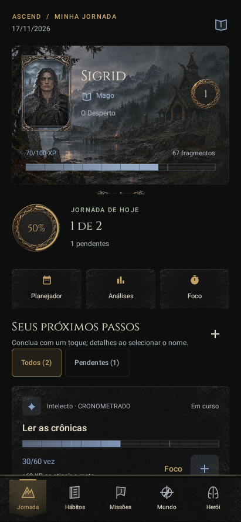 | 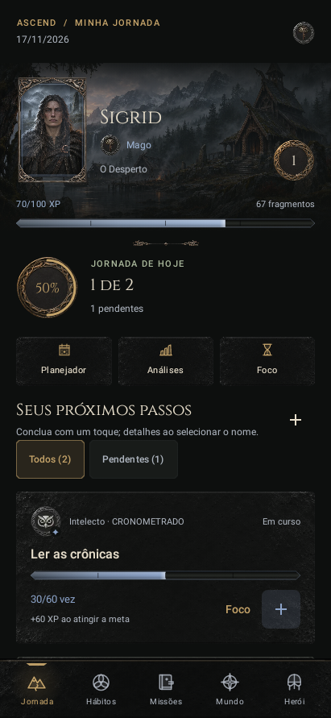 |
| Herói | 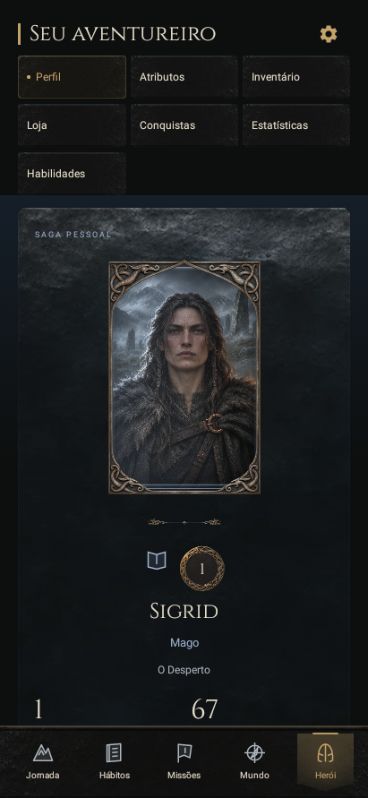 | 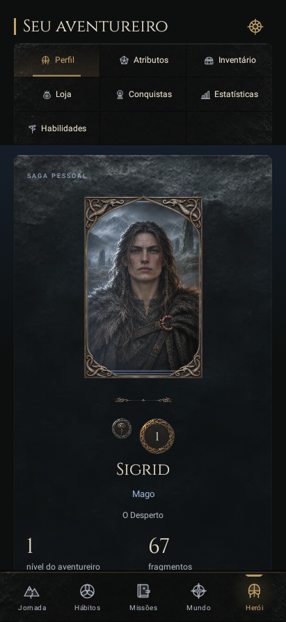 |
| Inventário | 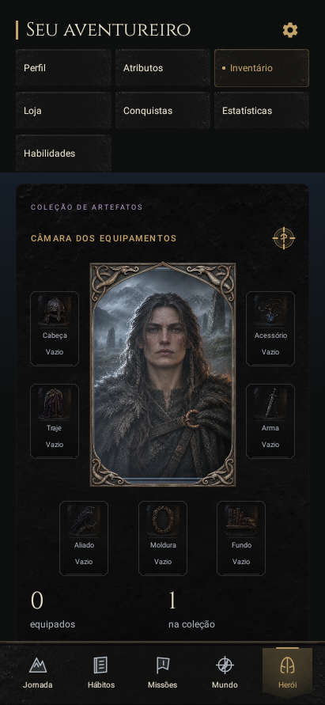 | 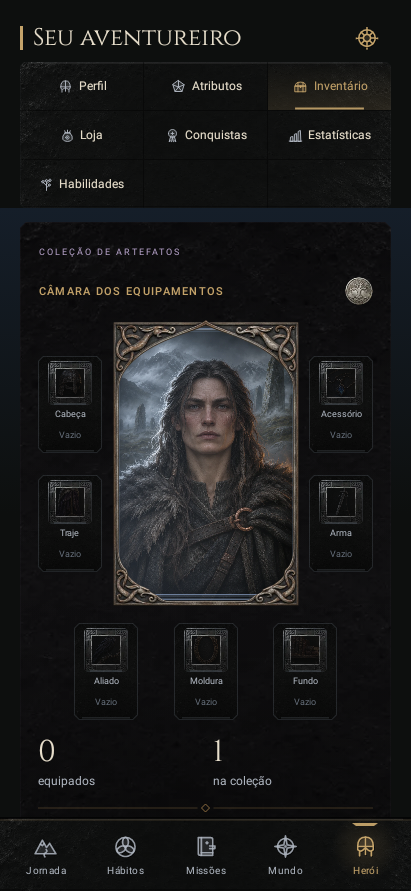 |
| Missões | 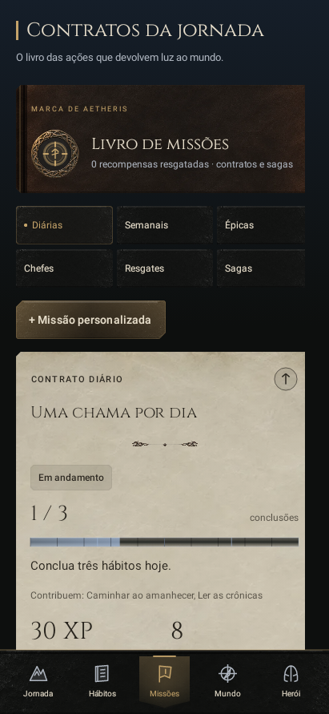 | 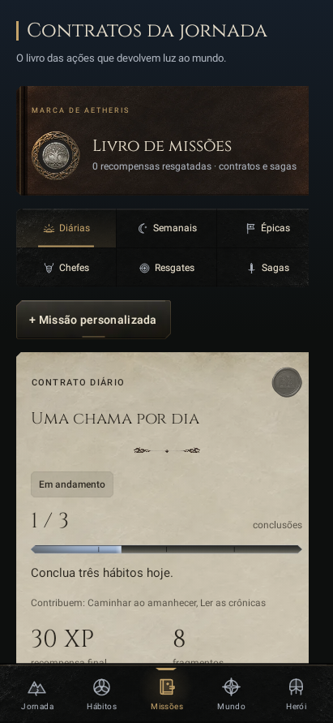 |
| Sagas | 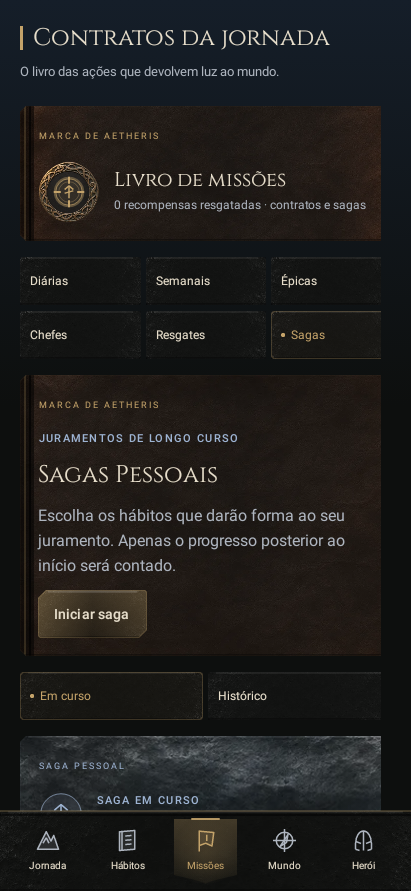 | 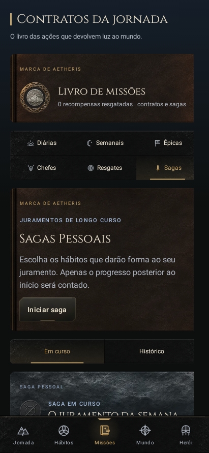 |
| Hábitos | 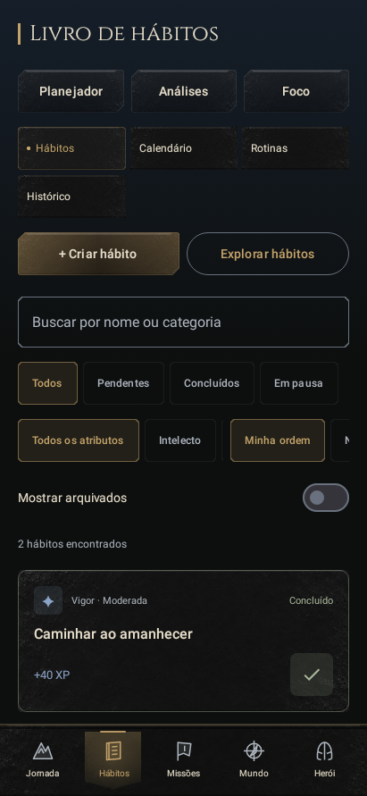 | 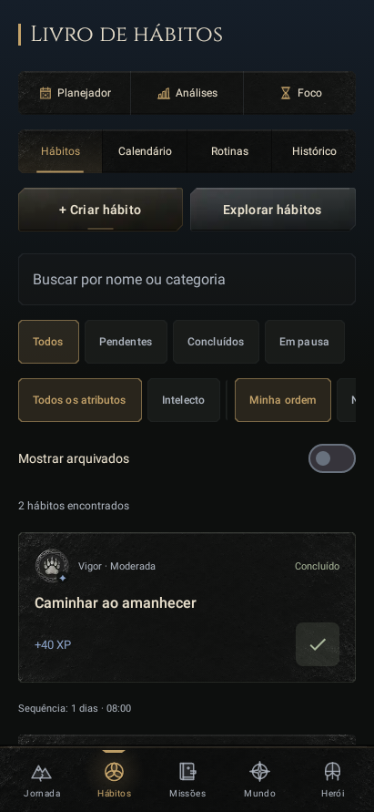 |
| Cronômetro | 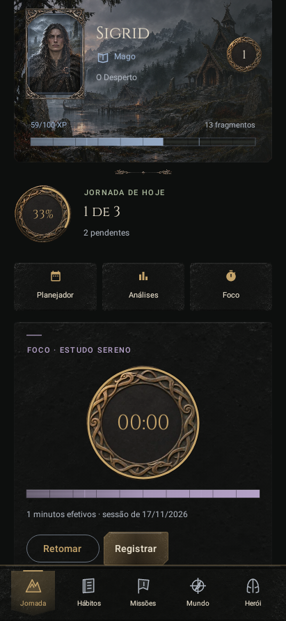 | 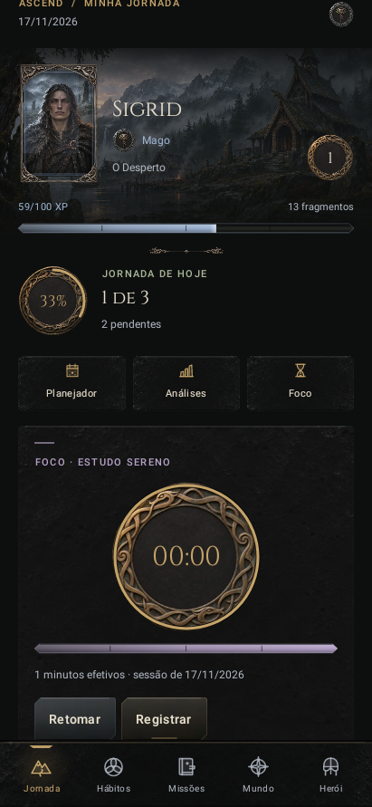 |
| Widget (claro) | 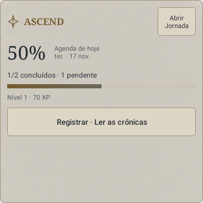 | 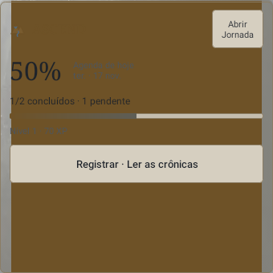 |
| Jornada 320 dp · fonte 130% | 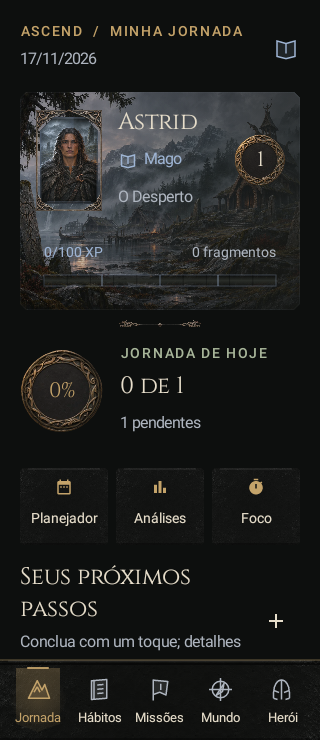 | 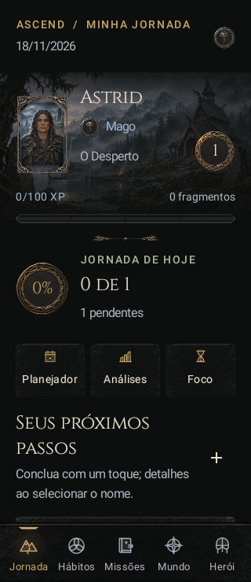 |

## Cenas adicionais e variantes 1.6.9

| Atlas | Crônica | Memórias | Widget escuro 150% |
|---|---|---|---|
| 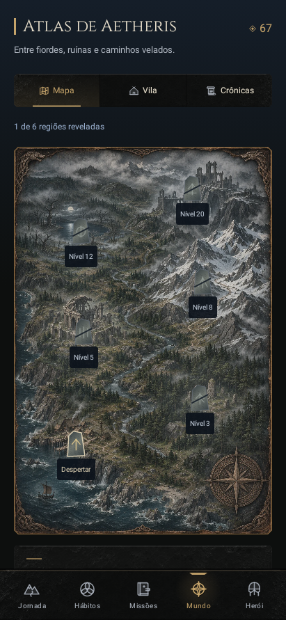 | 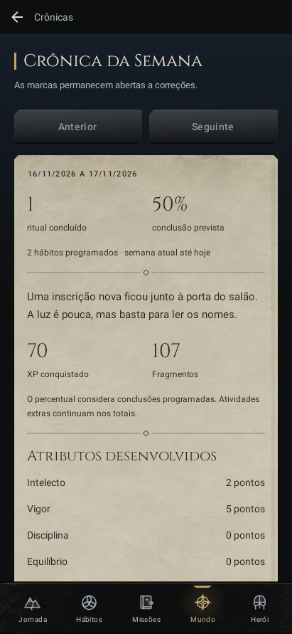 | 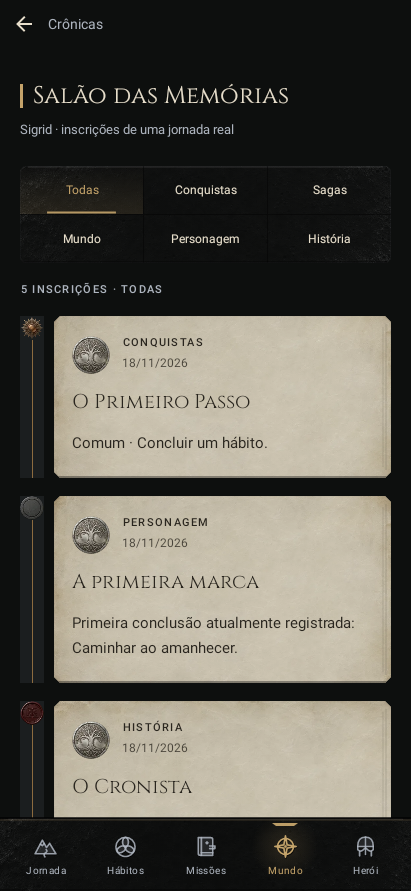 | 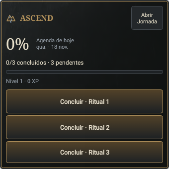 |

Também validadas na série `v1.6.9`: `planejador-160.png`, `planejador-320-160.png`, `analises-160.png`, `inventario-320-texto130.png`, `saga-320-texto130.png`, `widget-compacto-150.png`, `widget-expandido-150.png` e `widget-estreito-130-151.png`.

## Escopo e limitações da validação

- Todas as **22 capturas** em `docs/screenshots/v1.6.9/` foram geradas em testes automatizados headless (Robolectric); não houve execução em aparelho Android físico nem auditoria prática com TalkBack/leitor de tela nesta etapa.
- A suíte completa executada no GitHub Actions (execução `44190969728`, commit `b6bacbb` / `bd58ab3`) registrou **135 testes aprovados** (0 falhas, 0 erros, 0 ignorados) em [validation/BUILD-1.6.9.txt](validation/BUILD-1.6.9.txt) e Android Lint com **0 erros e 22 avisos** em [validation/LINT-1.6.9.txt](validation/LINT-1.6.9.txt).
- O APK gerado na compilação de CI (`22.847.850` bytes, `versionCode 16`, `versionName 1.6.9`, documentado em [validation/APK-1.6.9.txt](validation/APK-1.6.9.txt)) utilizou chave temporária de depuração do runner (`2af2b878...`) porque `ASCEND_KEYSTORE_BASE64` não estava definido nos secrets do GitHub; por isso `downloads/ASCEND-1.6.9.apk` não foi publicado até a assinatura oficial com `ascend-1.1.keystore` (`e1f003ef...`).
