# ASCEND 1.6 — O Renascimento de Aetheris

A entrega combina nova composição visual e produtividade persistida. As comparações abaixo são renderizações nativas de Compose/Views/RemoteViews, não mockups. `ProductVisualTourTest` foi executado com a mesma fixture no código 1.5.2 (`67c3bd1`) em worktree isolado e na 1.6. Os dados de teste são gravados pelo repositório real, sem conteúdo fictício incluído no APK.

## Comparações com a 1.5.2

| Tela | 1.5.2 | 1.6 |
|---|---|---|
| Jornada | 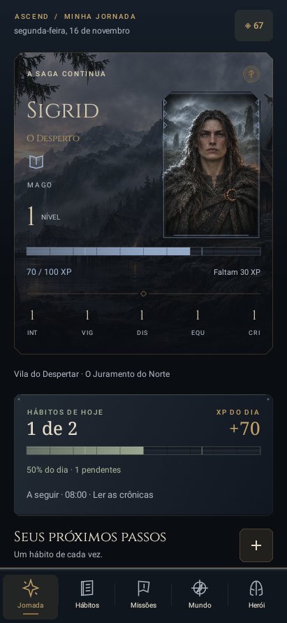 | 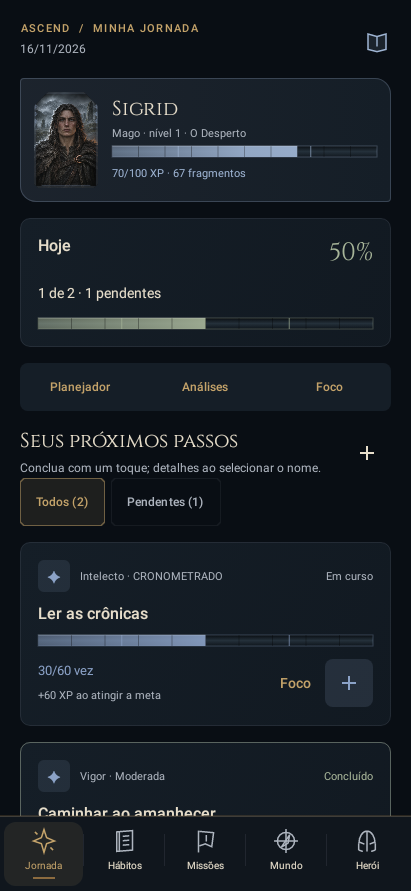 |
| Hábitos | 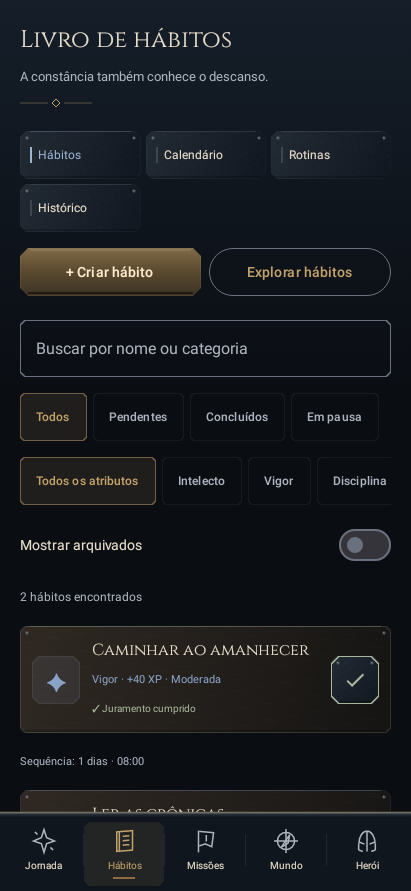 | 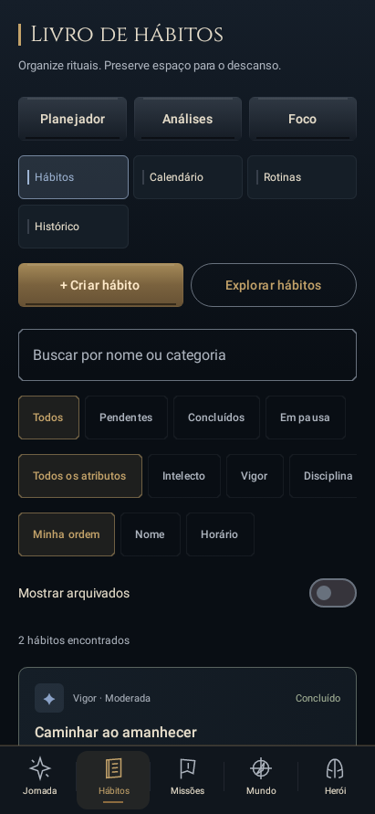 |
| Missões | 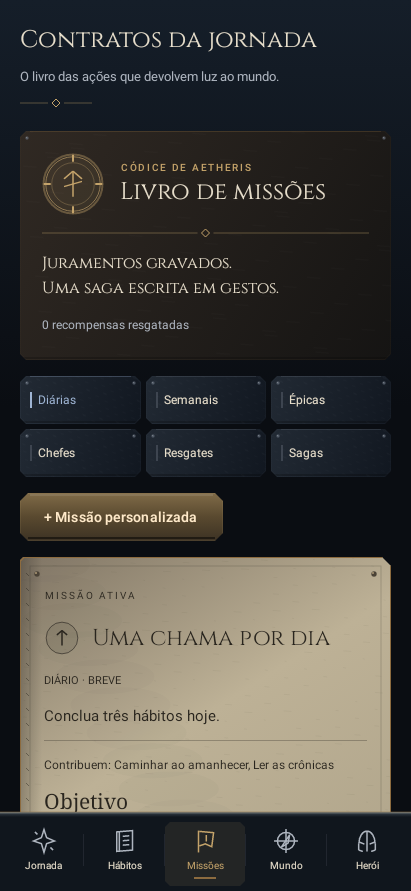 | 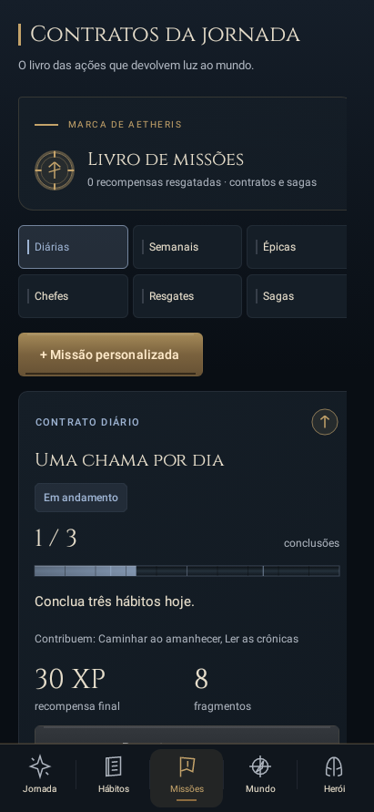 |
| Sagas | 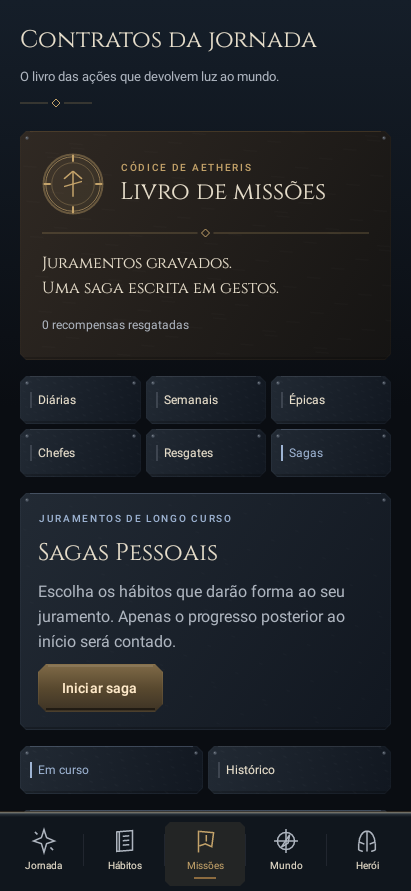 | 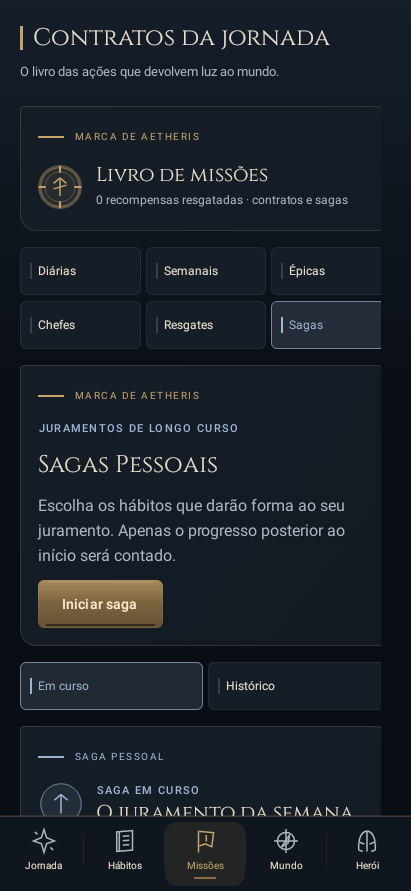 |
| Herói | 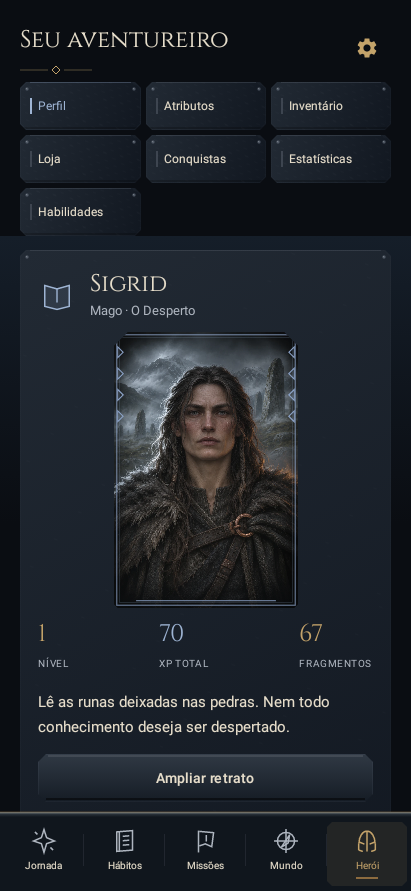 | 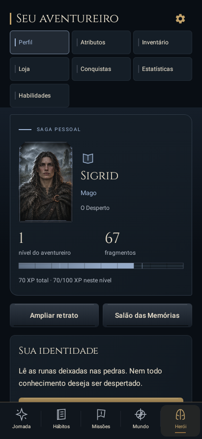 |
| Inventário | 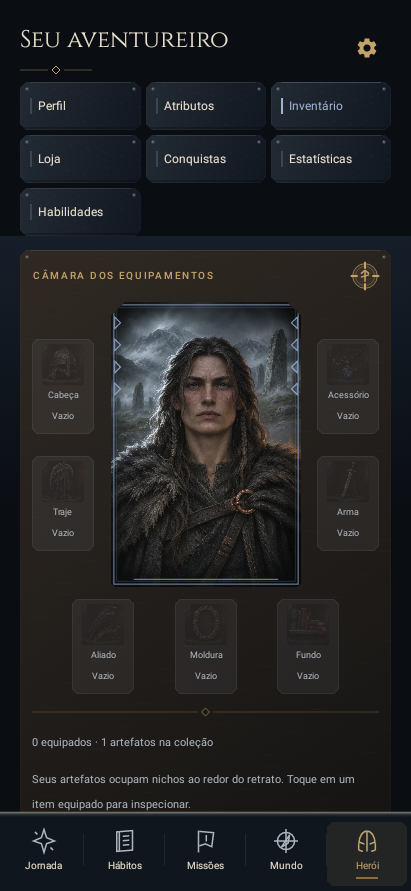 | 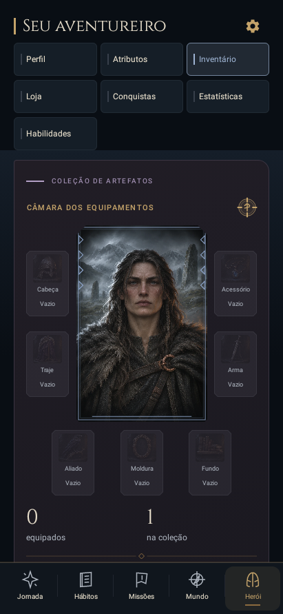 |
| Crônica | 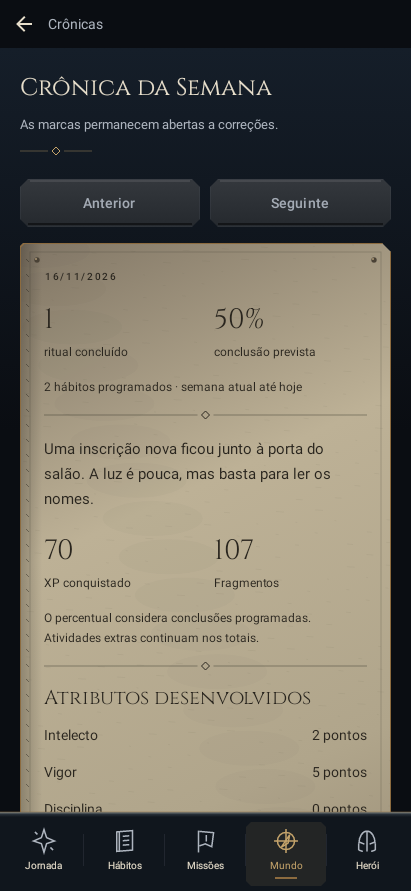 | 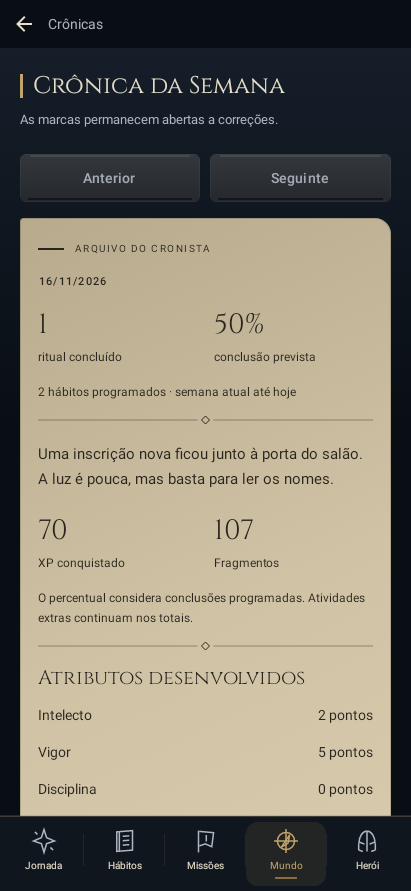 |
| Memórias | 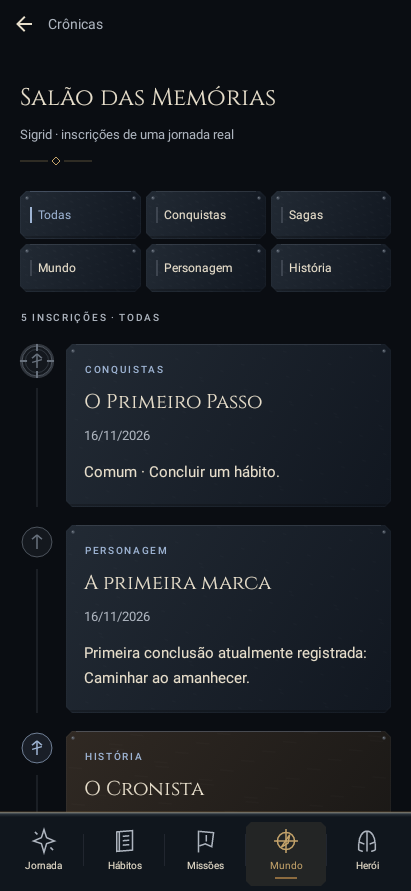 | 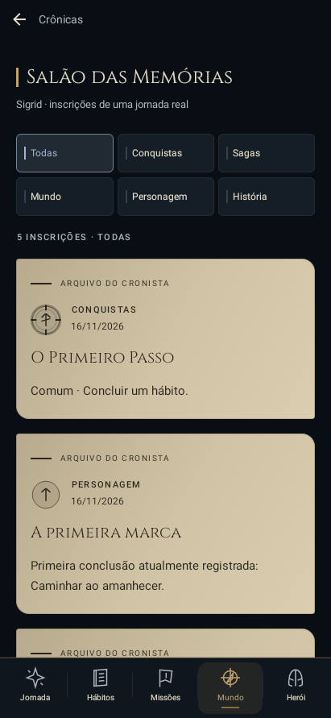 |
| Widgets | 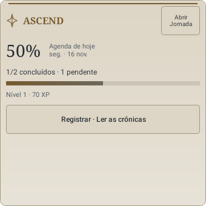 | 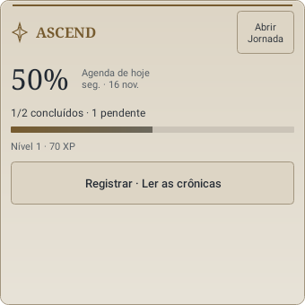 |
| Atlas | 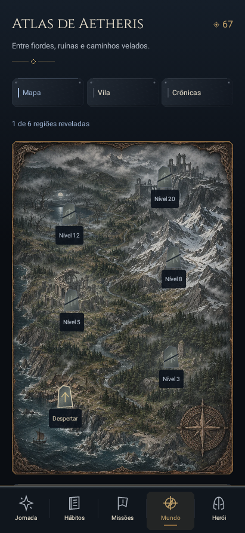 | 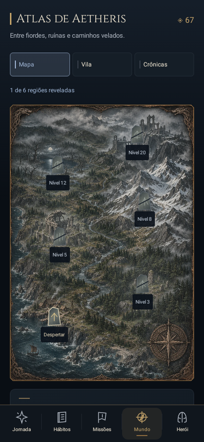 |

## O que mudou de fato

A Jornada deixa o grande painel ilustrado para o Perfil e usa retrato de 64 dp, identidade/XP, progresso diário, acessos e lista operacional virtualizada. Pendências precedem concluídos sem mudar a ordem permanente dos hábitos. O ganho de espaço é de composição, não apenas de margem.

Os contratos deixam de usar o mesmo documento bege para tudo: diários/semanais têm apresentação operacional, épicos/chefes e Sagas recebem contexto cerimonial. Objetivo, estado, narrativa e valores ficam em blocos legíveis. O Perfil passa a ser uma ficha lateral com números em pares e identidade em seção separada. O inventário conserva os nichos e ganha superfície própria de coleção, contagens e inspeção.

As Memórias passam da linha externa a inscrições paginadas com data/categoria/selo integrados. Crônica e narrativa usam o pergaminho com tinta sépia e corpo funcional. Abas, botões, cabeçalhos, métricas e medidores recebem o sistema compartilhado. As pinturas, preços, classes e itens continuam os anteriores.

O Atlas tem refinamento dos componentes e mantém a pintura/geografia; não foi redesenhado do zero. Vila, Floresta e Guardião preservam cenas/transformações e usam os controles compartilhados. Não se afirma ter criado novas pinturas ou novas regiões.

## Novos fluxos reais

| Planejador | Dia selecionado | Ajuste pontual |
|---|---|---|
| 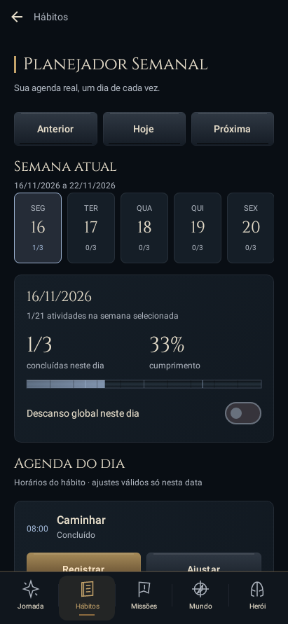 | 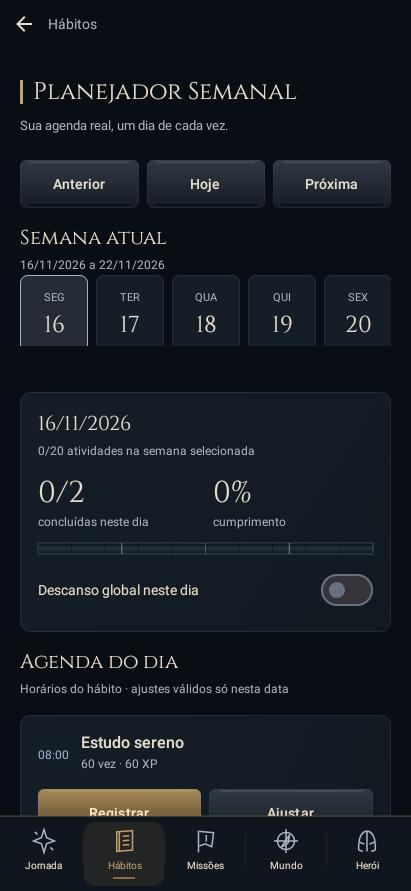 | 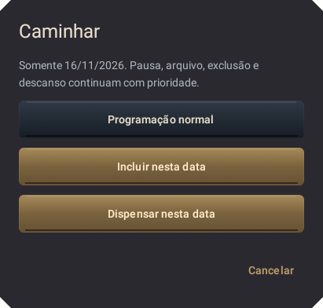 |

| Central de Análises | Análise individual | Foco registrado |
|---|---|---|
| 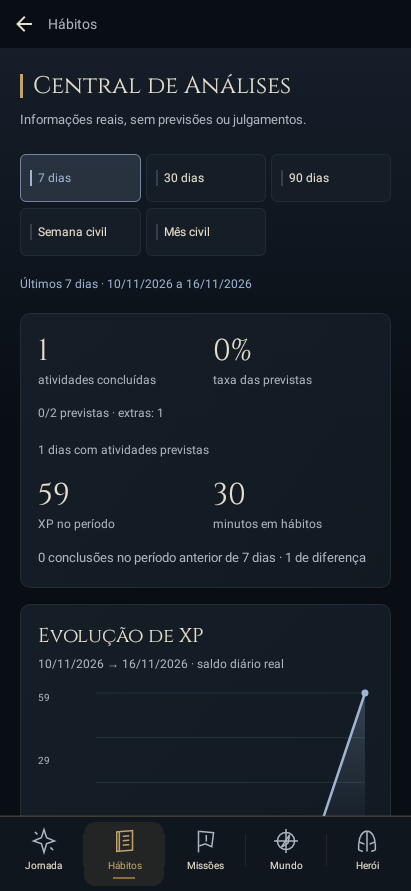 | 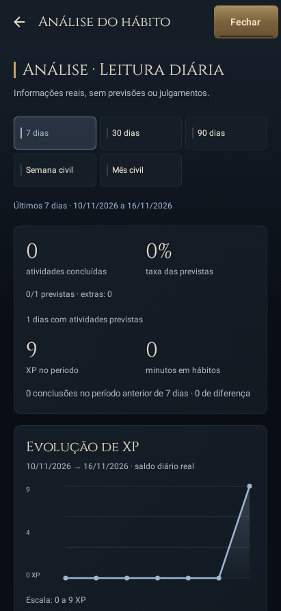 | 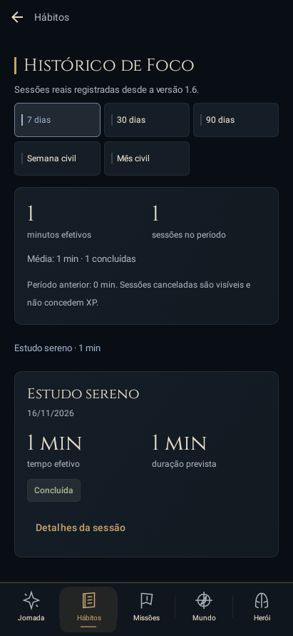 |

[Detalhes da sessão](screenshots/foco-sessao-160.png) · [Jornada com registros](screenshots/jornada-160.png).

## Tela estreita e acesso

| Planejador 320 dp / 130% / claro | Análises na mesma configuração | Foco sem sessões |
|---|---|---|
| 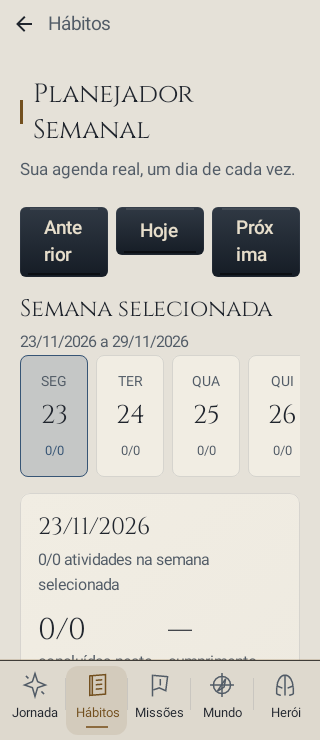 | 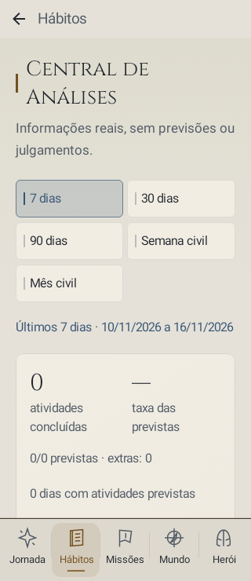 | 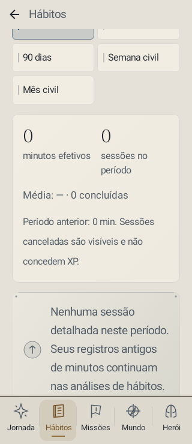 |

Também foram preservados os cenários anteriores de 411 dp, claro/escuro, minimalista, redução de movimento, nomes longos e widgets reduzidos. A revisão das capturas guiou a redução do cabeçalho heroico e a separação de métricas/ações. Foco é configurado em formulário completo para evitar o campo numérico apertado no alerta.

## Limites honestos

Não foi reescrito todo componente legado. Calendário, rotinas, histórico geral e algumas coleções ainda usam as estruturas anteriores de rolagem. O ranking destaca dez hábitos; detalhes individuais e histórico continuam acessíveis. Não houve teste físico de teclado, leitor de tela, gestos, instalação ou launcher.

As imagens de sessões usam tempo controlado no banco de teste para exercitar o encerramento e o histórico; não demonstram uma sessão física de um minuto em aparelho. As comparações têm a mesma fixture no tour; outras capturas de regressão podem usar personagens/estados diferentes. Nenhuma delas é imagem ilustrativa fingindo UI implementada.

[Design System](DESIGN-SYSTEM-2.0.md) · [Produtividade e persistência](PRODUTIVIDADE-1.6.md) · [Validação](../VALIDACAO.md).
