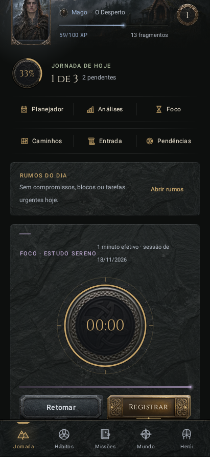
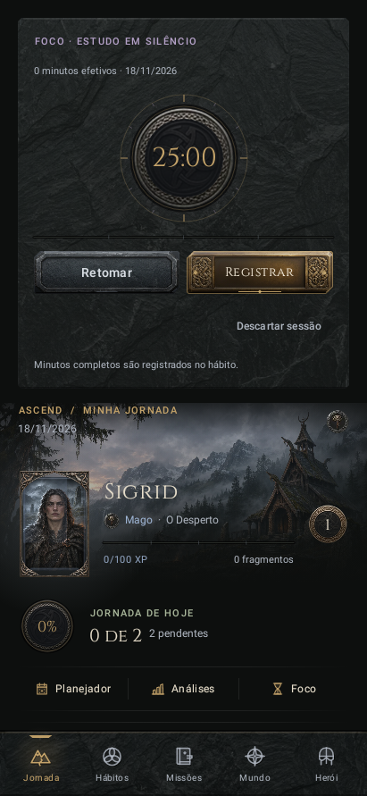

# ASCEND 1.7.0.1 — Comparativo do foco

A sessão ativa passa ao topo da Jornada. A distância até os controles caiu por causa da nova posição, do aro externo de 146 dp e dos metadados em pilha. A textura de ardósia continua recortada proporcionalmente na área medida. A decoração e o aro de astrolábio vêm da Biblioteca da Forja. Em largura reduzida ou fonte ampliada, a placa compacta dá espaço ao texto de registro.

O comparativo usa a captura publicada da 1.7.0 e renderizações reais das interfaces em Robolectric. As sessões e as posições de rolagem não são idênticas. A posição na primeira área visível foi verificada nos testes da 1.7.0.1.

| 1.7.0 · sessão pausada após rolar | 1.7.0.1 · sessão pausada no topo |
|---|---|
|  |  |

| Caso verificado | Captura |
|---|---|
| Hábito ativo, 411 dp, 100%, tema escuro | [Pausar e Registrar visíveis ao abrir](screenshots/v1.7.0.1/foco-habito-411-ativo-1701.png) |
| Hábito pausado após recriação da Activity | [Retomar preserva a mesma sessão](screenshots/v1.7.0.1/foco-habito-411-pausado-1701.png) |
| Projeto ativo, 360 dp, 100%, tema escuro | [Cronômetro e ações antes do cabeçalho](screenshots/v1.7.0.1/foco-projeto-360-1701.png) |
| Tarefa com título longo, 320 dp, 130%, tema claro e minimalista | [Título e botões com fonte ampliada](screenshots/v1.7.0.1/foco-tarefa-320-fonte130-1701.png) |
| Tarefa registrada, 320 dp | [Jornada após encerrar a sessão](screenshots/v1.7.0.1/foco-tarefa-320-encerrado-1701.png) |

A suíte também renderizou [Rumos do Dia](screenshots/v1.7.0.1/tour-jornada-rumos-170.png), [Agenda](screenshots/v1.7.0.1/tour-agenda-dia-170.png), [Pendências](screenshots/v1.7.0.1/tour-pendencias-170.png), [Entrada](screenshots/v1.7.0.1/tour-entrada-170.png) e [Caminhos em 320 dp](screenshots/v1.7.0.1/caminhos-320-170.png). Os testes de foco exercitaram redução de movimento, retorno após sair da Activity, descarte e registro após navegação. A matriz de combinações entre os três tamanhos, fontes e temas não foi executada integralmente. Não houve validação em aparelho físico.
