# ASCEND 1.7.0 — Os Nove Caminhos (Relatório Visual)

Relatório visual das interfaces da versão **1.7.0 (`versionCode 20`)** na branch `feat/ascend-1.7.0`, construídas inteiramente sobre a **Biblioteca da Forja (`1.6.9.19`)**, o **Design System Nórdico (`1.6.9.15`)** e a iconografia vetorial `CarvedArt` (`1.6.9`), preservando todas as telas e ilustrações anteriores.

---

## 1. Integração com a Biblioteca da Forja (`1.6.9.19`)

- Nenhuma pintura, retrato, textura WebP ou componente existente foi substituído ou degradado; os **19 recursos pictóricos da Biblioteca da Forja** seguem ativos nos botões (`ui_plate_primary`, `ui_plate_secondary`, `ui_plate_ceremonial`), superfícies (`mat_iron_nordic`, `mat_bronze_ancient`, `mat_silver_oxidized`, `mat_slate_volcanic`), caixas de diálogo (`ui_frame_dialog`), campos de texto (`ui_field_inscription`), seletores (`ui_tablet_selector`) e barras (`orn_track_progress`, `orn_divider_forged`).
- Todos os novos fluxos respeitam tema escuro, tema claro, redução de movimento e modo minimalista (`LocalAppearance.current.minimal`), além de rótulos em português com pluralização correta.

---

## 2. Capturas Reais Robolectric (`1.7.0`)

### 2.1. Jornada ("Rumos do Dia"), Caminhos e Detalhe do Caminho

| Jornada + Rumos do Dia | Lista de Caminhos | Detalhe do Caminho (Etapas, Tarefas, Subtarefas) |
|---|---|---|
| 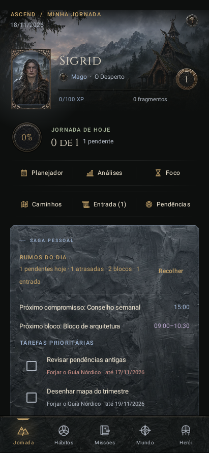 | 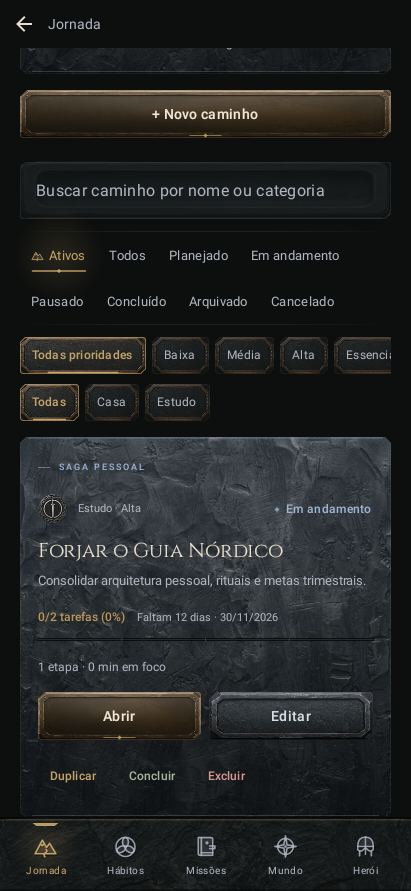 | 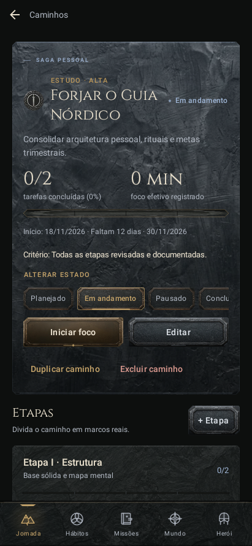 |

### 2.2. Agenda Profissional 2.0 (Dia / Semana / Mês), Caixa de Entrada e Central de Pendências

| Planejador — Semana | Planejador — Dia | Planejador — Mês |
|---|---|---|
| 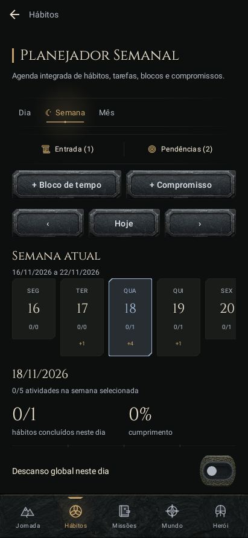 | 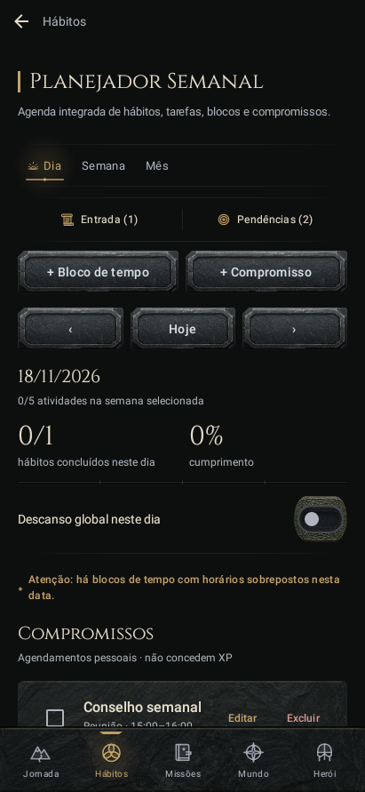 | 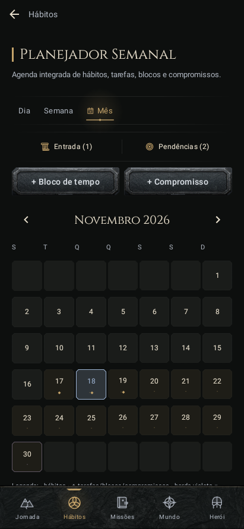 |

| Caixa de Entrada | Central de Pendências |
|---|---|
| 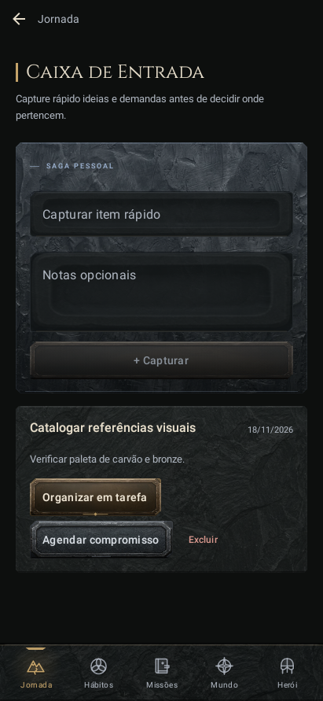 | 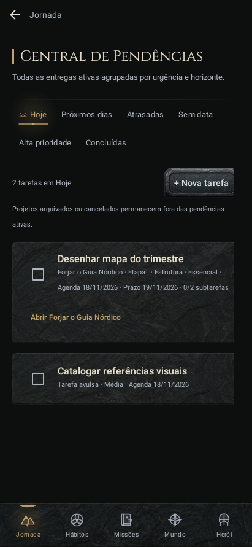 |

---

## 3. Telas Estreitas (`320 dp`), Tema Claro e Fonte Ampliada (`130%`)

As renderizações em largura `w320dp` com fonte `1.30x`, tema claro e modo minimalista passaram por inspeção visual pixel a pixel (`PathsAndAgendaUiTest`):
- **`agenda-320-170.png`:** empilhamento automático de `+ Bloco de tempo` e `+ Compromisso` abaixo de `330 dp` para eliminar quebra no meio da palavra.
- **`caminhos-320-170.png`:** uso de `FlowRow` na linha de progresso/prazo do cartão de Caminho, evitando compressão de contadores em fonte `130%`, com alvos táteis de subtarefas ampliados para `44 dp` (e `48 dp` no checkbox de `Rumos do Dia`).
- **`pendencias-320-170.png`:** cabeçalho com `Column` e `Modifier.weight(1f)` no contador, preservando margens laterais simétricas de `20 dp` sem corte à direita.

| Caminhos (`320 dp / 130% / Claro`) | Agenda (`320 dp / 130% / Claro`) | Pendências (`320 dp / 130% / Claro`) |
|---|---|---|
| 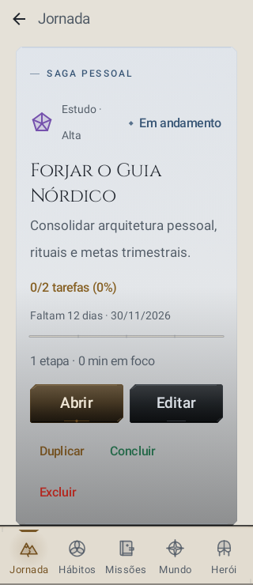 | 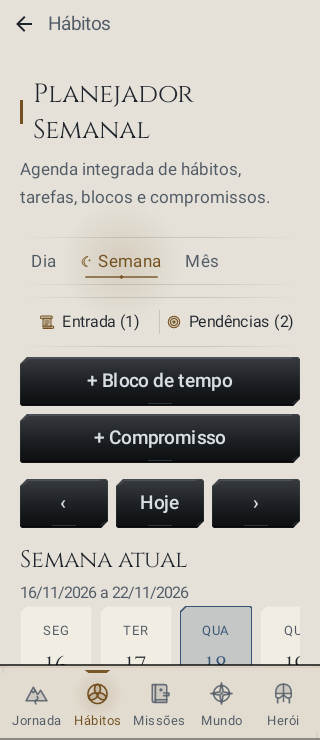 | 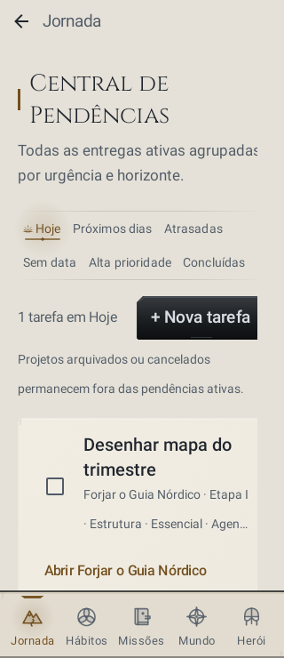 |

---

## 4. Limites Reais Declarados

- Todas as imagens foram renderizadas via Compose em **Robolectric (`API 28`)** sobre configurações reais (`411 dp` padrão e `320 dp` / `130%`).
- Não foram executados testes em aparelho Android físico, launcher físico ou TalkBack ao vivo; o comportamento de atualização sobre a `1.6.9.19` é verificado pelos testes de migração SQLite (`MIGRATION_6_7` sobre esquema real `v6`), compatibilidade de backup (`v8 → v9`), `applicationId` idêntico e assinatura oficial.
