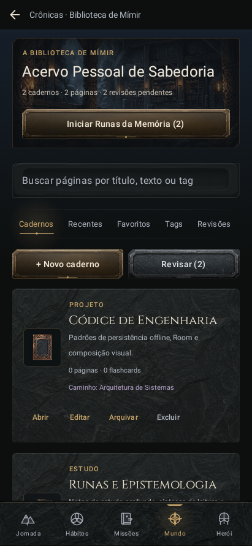
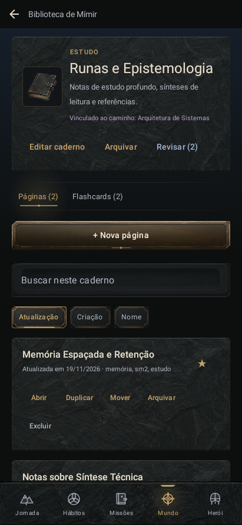
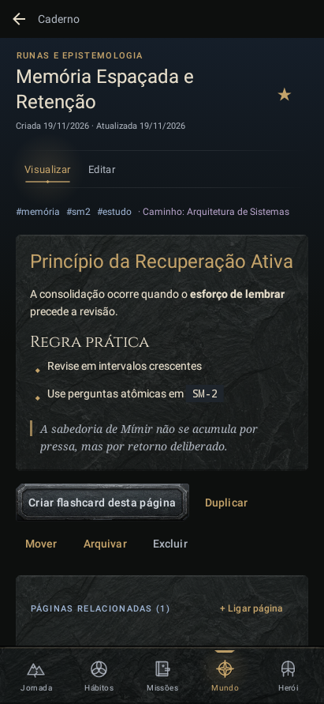
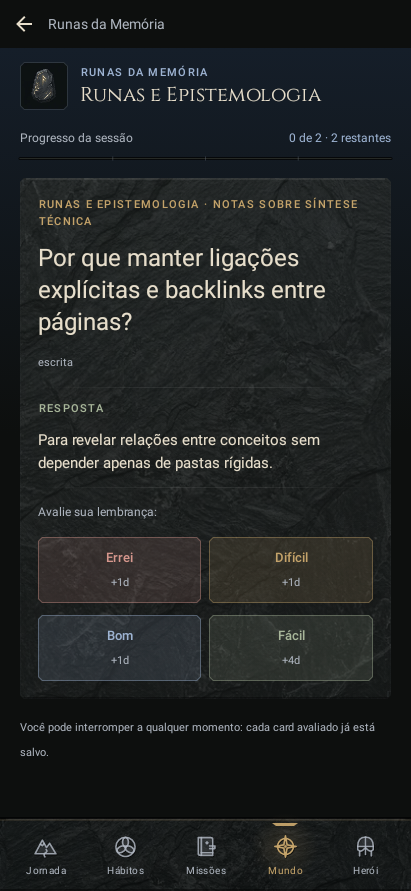
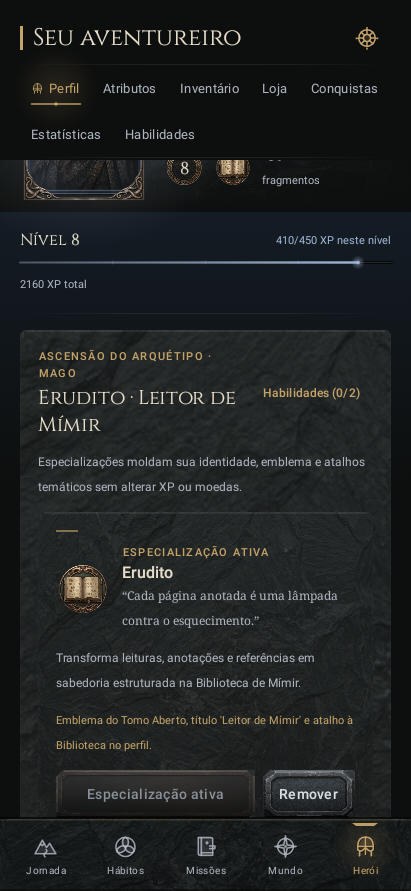
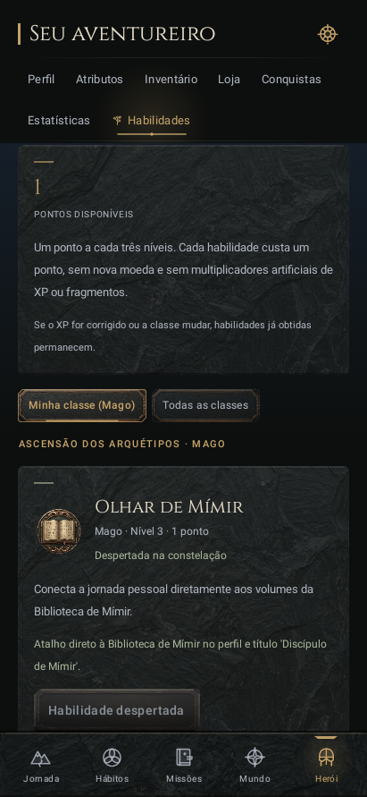
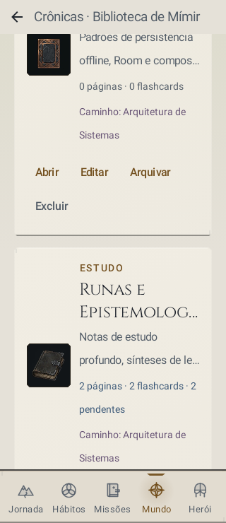

# ASCEND 1.7.1 — Relatório Visual e Acervo Pictórico de Mímir

## 1. Direção artística e orçamento pictórico

A atualização **1.7.1 — A Sabedoria dos Nove Reinos** mantém a identidade nórdica obscura consolidada na Biblioteca da Forja (`1.6.9.19`) e acrescenta exatamente **3 novos recursos pictóricos originais** gerados via ferramenta `generate_image` e otimizados para WebP em `app/src/main/res/drawable-nodpi/`, somando **359.502 bytes (351,1 KB)** — bem abaixo do limite de 1,5 MB e preservando integralmente todos os recursos anteriores.

| Recurso WebP | Dimensões / Formato | Bytes | SHA-256 | Aplicação real |
|---|---|---:|---|---|
| `mimir_library.webp` | `1280 × 704` · WebP RGB | 116,684 | `86bbbb5f0f18bb2b85cecdb436fd566f38eaed9a22bba72996c264f2d985b8b5` | `MimirLibraryBanner` no cabeçalho de `MimirLibraryScreen` com scrim escuro legível e fallback compacto no modo minimalista. |
| `archetype_seals_atlas.webp` | `1280 × 512` · WebP RGBA (`5 × 2`, células `256 × 256`) | 198,934 | `11e04851579cd756abd565f7846f91b3e5d93dfe5b97ef3616b7c58c1df69a7a` | `ArchetypeSealArt` em `HeroStage`, `ArchetypeAscensionPanel` (`CharacterScreen.kt`) e `SkillTree` (`EquipmentScreen.kt`), com transparência limpa e sem moldura quadrada artificial. |
| `mimir_codex_atlas.webp` | `960 × 640` · WebP RGB (`3 × 2`, células `320 × 320`) | 43,884 | `4692aed01ff119a71c4b77ce72bcca62e43918e0fdab07f68a212384fdcb3a2a` | `MimirCodexArt` nas capas de cadernos (`MimirLibraryScreen`, `NotebookDetailScreen`, `NotebookEditorDialog`), card da Biblioteca em `WorldScreen` e cabeçalho de `FlashcardReviewScreen`. |

## 2. Capturas reais (Robolectric nativo)

Todas as 7 capturas foram renderizadas em `MimirAndArchetypesUiTest.kt` e inspecionadas visualmente antes do fechamento:

| Biblioteca de Mímir (`411 dp`) | Caderno e Páginas (`411 dp`) | Página Markdown + Ligações (`411 dp`) |
|---|---|---|
|  |  |  |

| Runas da Memória — Revisão SM-2 | Herói — Especializações | Herói — Habilidades Expandidas |
|---|---|---|
|  |  |  |

| Biblioteca em `320 dp` · Fonte `130%` · Tema Claro · Minimalista |
|---|
|  |

## 3. Refinamentos aplicados após inspeção visual

1. **Remoção do selo deslocado `"COLEÇÃO DE ARTEFATOS"`:** na primeira inspeção das capturas, o uso de `AetherSurface(SurfaceKind.Artifact)` estampava o rótulo de inventário sobre cadernos, flashcards e painel de especializações. Substituído por `SurfaceKind.Operational` em `MimirScreens.kt`, `CharacterScreen.kt` e `WorldScreen.kt`, ganhando limpeza visual e respiro vertical.
2. **Transparência dos 10 selos de arquétipo:** `archetype_seals_atlas.webp` foi verificado célula a célula (`256 × 256` RGBA) para garantir recorte circular limpo sobre pedra escura e tema claro.
3. **Acessibilidade e largura estreita:** validado em `320 dp` com `fontScale = 1.3f`, tema claro e modo minimalista (`mimir-320-171.png`), sem sobreposição de controles ou corte horizontal.

## 4. Limites da validação visual

As renderizações foram geradas via Robolectric (`GraphicsMode.NATIVE`) em `w411dp-h891dp` e `w320dp-h740dp`. Validação em aparelho Android físico, teclado virtual (IME) em telas longas de edição Markdown e leitura por TalkBack seguem como pendência de verificação física.
