# ASCEND 1.7.2 — Relatório Visual & Capturas Reais

Este relatório reúne as **14 capturas reais de produção** renderizadas em Jetpack Compose via Robolectric (`WorldExpansionUiTest`) na versão **1.7.2 — Além das Fronteiras**, diferenciando explicitamente a prancha conceitual de direção de arte das telas executadas pelo aplicativo.

> **Conceito vs. Captura Real:** [`docs/art/concepts/nordic-viking-ui-172.webp`](art/concepts/nordic-viking-ui-172.webp) é exclusivamente prancha conceitual de direção visual (mantida fora do APK). Todas as imagens abaixo são renderizações reais do código Compose compilado na `1.7.2`.

## 1. Prancha de Componentes — Design System 3.0

| Prancha de Componentes 1.7.2 | Atlas de Aetheris 2.0 |
|---|---|
| 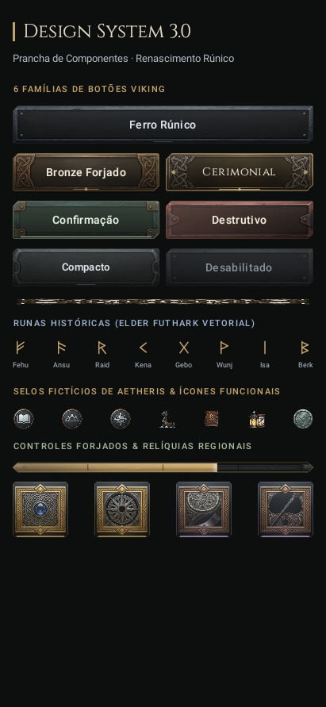 | 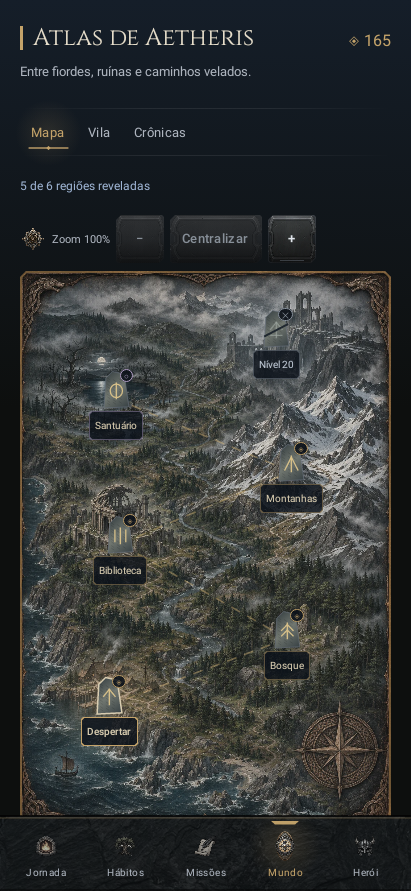 |

## 2. Novas Regiões Exploráveis (Antes e Depois da Restauração)

| Biblioteca das Eras (Abandonada) | Biblioteca das Eras (Restaurada 100%) |
|---|---|
| 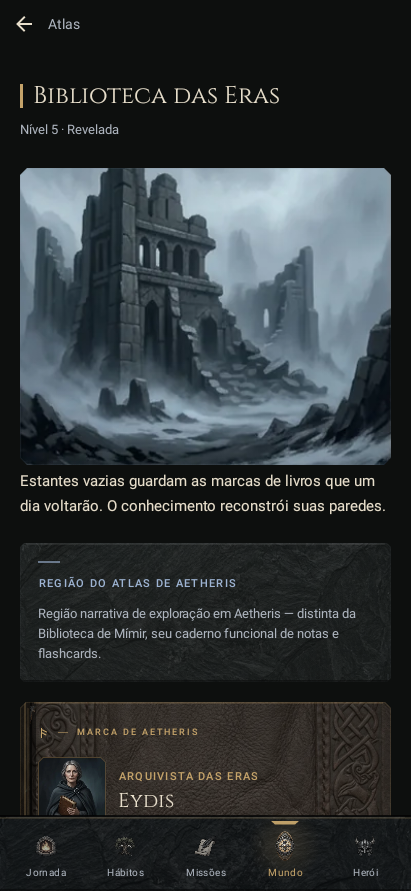 | 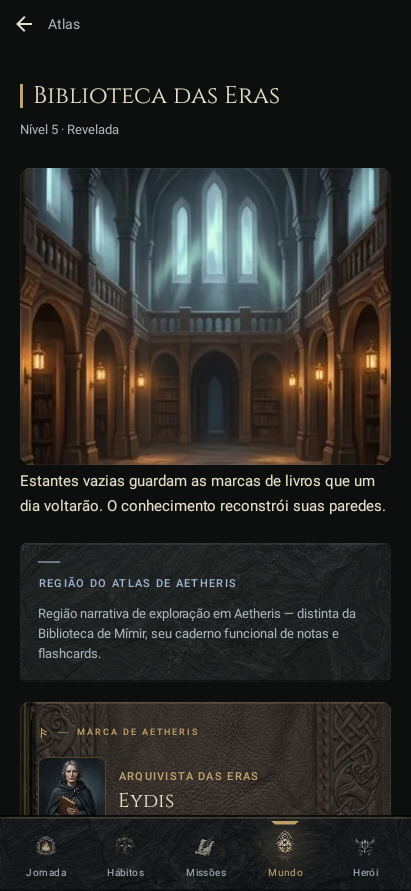 |

| Montanhas da Disciplina (Abandonada) | Montanhas da Disciplina (Restaurada 100%) |
|---|---|
| 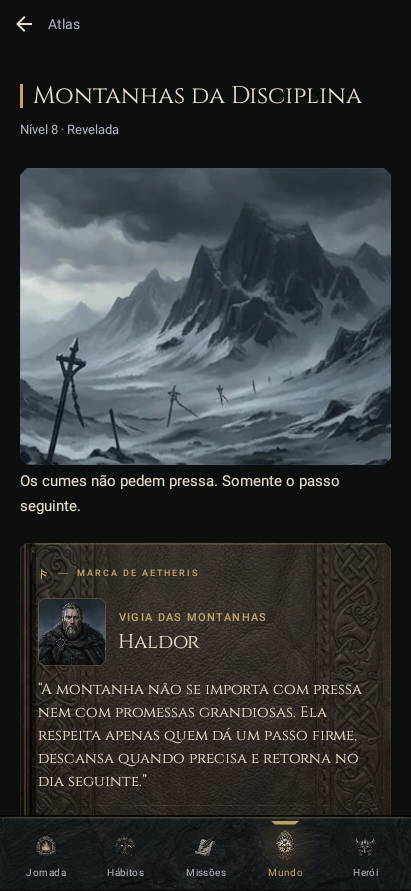 | 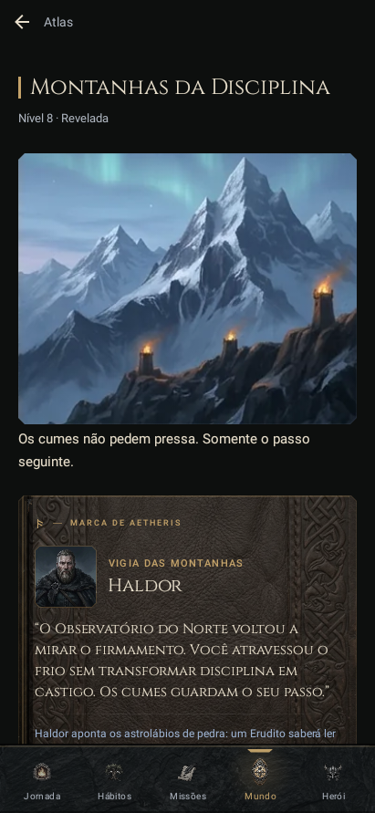 |

## 3. Telas Principais, Relíquias e Integração Produtiva

| Jornada (DS 3.0 + Rumos do Dia) | Foco Ativo | Herói (Especialização & Medalhão) |
|---|---|---|
| 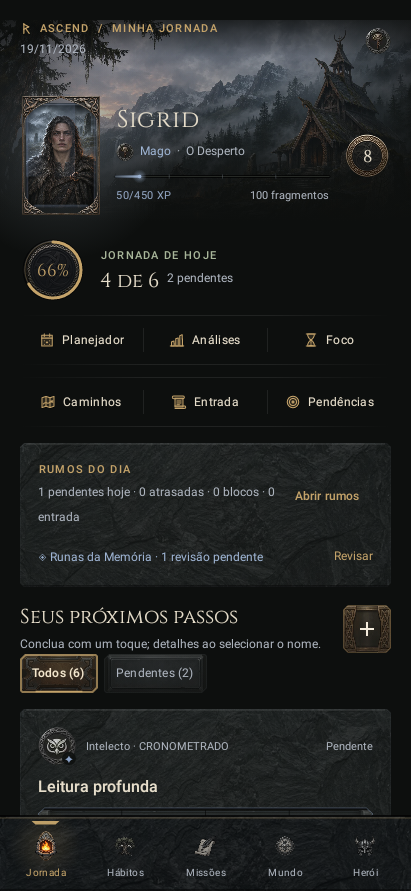 | 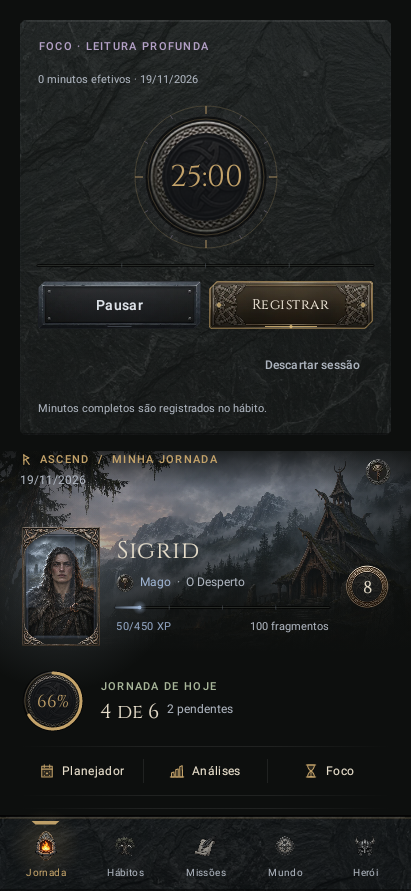 | 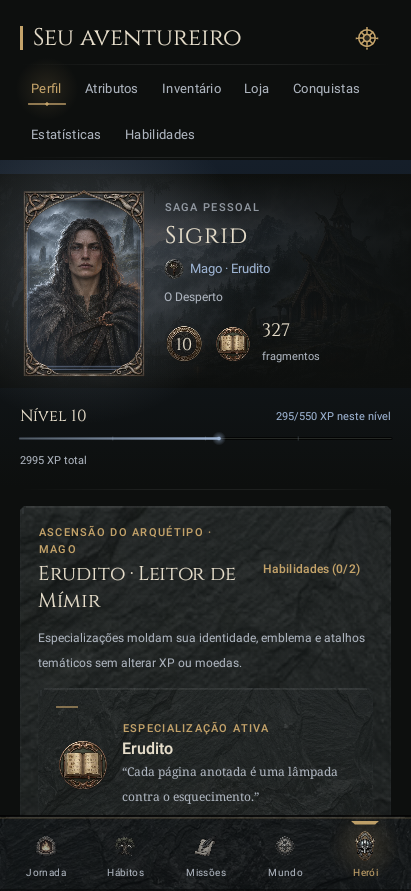 |

| Câmara dos Equipamentos (Relíquia Equipada) | Agenda 2.0 | Biblioteca de Mímir |
|---|---|---|
| 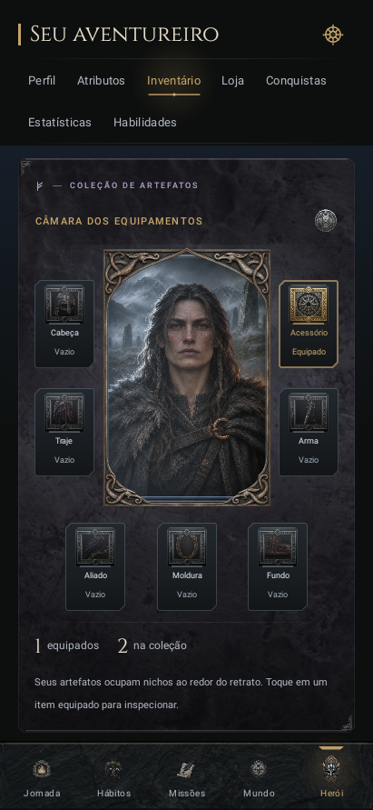 | 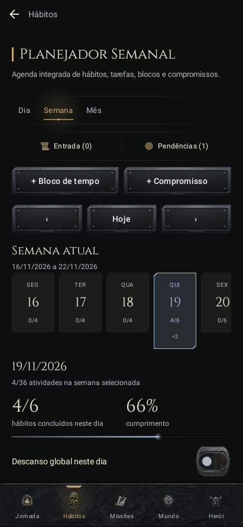 | 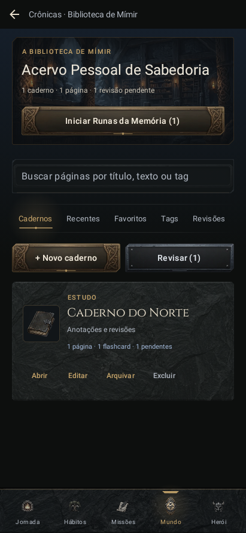 |

## 4. Tema Claro e Acessibilidade (`320 dp` + Fonte `130%`)

| Tema Claro (Velino & Ardósia Clara) | Tela Estreita `320 dp` · Fonte `130%` |
|---|---|
| 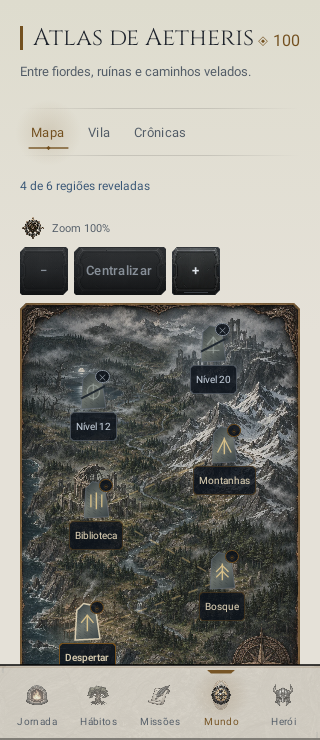 | 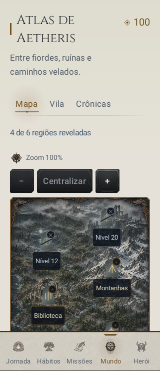 |

## 5. Inspeção Visual e Ajustes Aplicados Antes da Entrega

A primeira rodada de renderizações reais identificou 5 defeitos concretos que foram corrigidos e revalidados visualmente:
1. **`VikingCheckSeal` (`VikingDesignSystem.kt`):** célula `6` do atlas `2 × 4` sofria achatamento horizontal em caixas quadradas → corrigido com recorte quadrado centralizado (`min(cw, ch)`).
2. **`ChipRow` selecionado (`Design.kt`):** filigrana clara reduzia a legibilidade do rótulo ativo no modo escuro → suavizada a alfa (`0.42f`), adicionado scrim escuro central e texto em marfim (`#F3E7CE`).
3. **`Meter` não-slim (`Design.kt`):** emenda vertical sutil no preenchimento metálico → preenchimento contínuo em bronze com brilho uniforme recortado pelo sulco.
4. **Controles de zoom do Atlas 2.0 em `320 dp` + `130%` (`RpgDesign.kt`):** `"Zoom 100%"` quebrava no meio da palavra em `Row` → migrado para `FlowRow` mantendo `"Zoom 100%"` íntegro e os botões `−`, `Centralizar`, `+` com `>= 48 dp`.
5. **Clareza da prancha e inventário (`WorldExpansionUiTest.kt`):** adicionado `Surface(Night, Ink)` na prancha de componentes, descarte de toasts transitórios antes da captura, espera de seed completo da Biblioteca de Mímir e demonstração da relíquia *Bússola do Firmamento* equipada na Câmara dos Equipamentos.

## 6. Limites Declarados

- Todas as capturas são renderizações nativas em Robolectric (`w411dp-h891dp-mdpi` e `w320dp-h740dp-mdpi` com escala `1.3f`), usando personagens de teste.
- Testes em aparelho Android físico (atualização por cima da `1.7.1`, gestos reais de pinça em tela sensível ao toque, teclado IME físico e leitor de tela TalkBack) não foram executados neste ambiente.
