# ASCEND 1.7.3 — Relatório Visual & Capturas Reais

Este relatório reúne as **14 capturas reais de produção** renderizadas em Jetpack Compose via Robolectric (`LivingHeroAndForgeUiTest`) na versão **1.7.3 — A Forja das Lendas**, diferenciando explicitamente a prancha conceitual de direção artística das telas executadas pelo aplicativo.

> **Conceito vs. Captura Real:** [`docs/art/concepts/hero-living-173.webp`](art/concepts/hero-living-173.webp) é exclusivamente prancha conceitual de direção visual (mantida fora do APK). Todas as imagens abaixo são renderizações reais do código Compose compilado na `1.7.3`.

## 1. Módulo I — Retrato Vivo (Base, Equipado e Zoom)

| Retrato Base (3 tons preservados) | Retrato Vivo · Forja (3 tons + camadas) | Zoom & Camadas do Retrato Vivo |
|---|---|---|
| 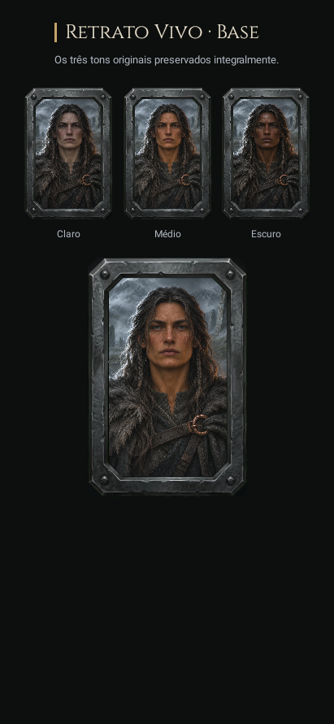 | 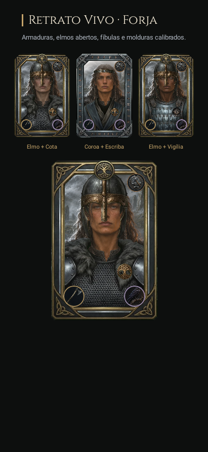 | 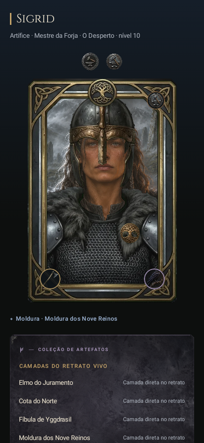 |

## 2. Jornada, Perfil do Herói e Arsenal dos Nove Reinos

| Jornada (Retrato Vivo no cabeçalho) | Perfil do Herói (Especialização & Selo) | Arsenal dos Nove Reinos (7 nichos) |
|---|---|---|
| 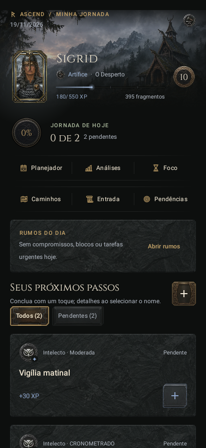 | 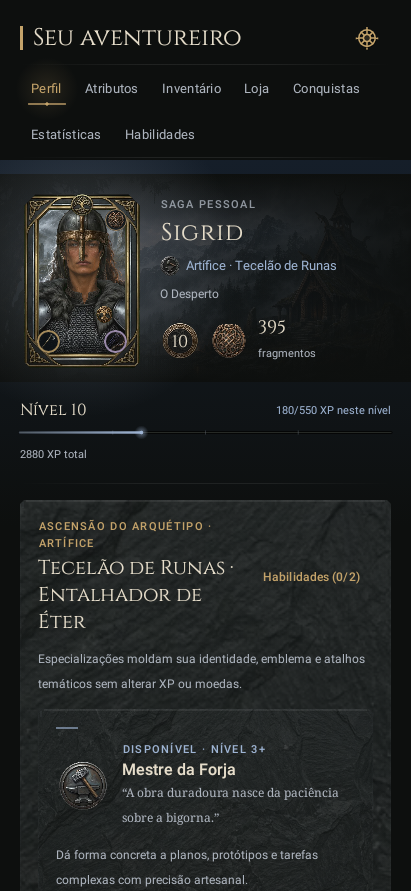 | 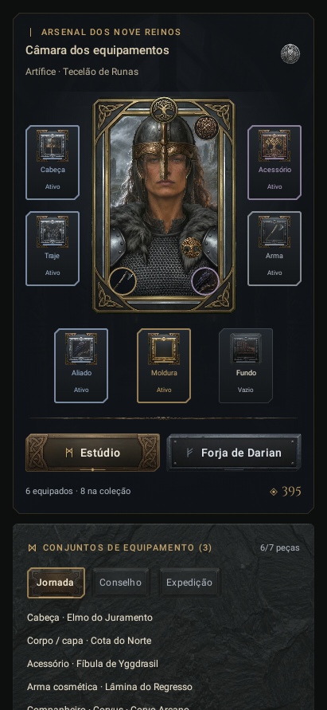 |

## 3. Estúdio de Personalização & 3 Conjuntos de Equipamento

| Estúdio · Prévia ao Vivo | Estúdio · Prévia com Item Bloqueado | 3 Conjuntos (`Jornada`, `Conselho`, `Expedição`) |
|---|---|---|
| 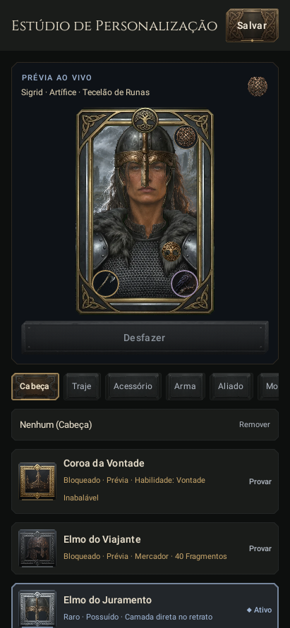 | 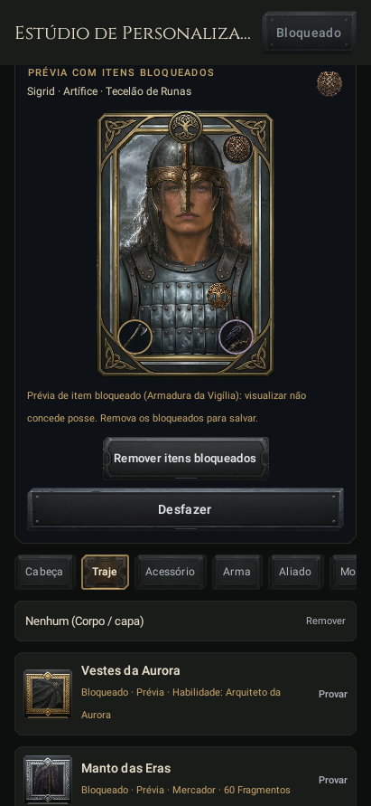 | 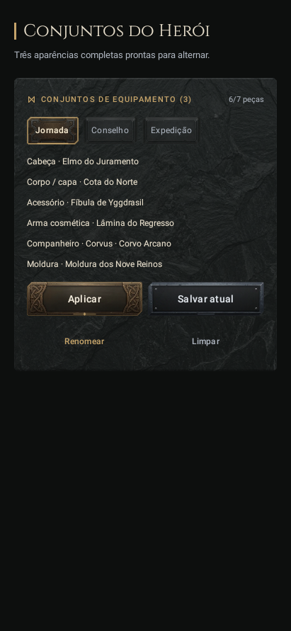 |

## 4. Módulo II — A Forja de Darian (Vila, Oficina e Mestre da Forja)

| Vila do Despertar · A Forja (`building:1`) | Oficina de Darian · Prévia na Bigorna | Diálogo & Selo *Mestre da Forja* |
|---|---|---|
| 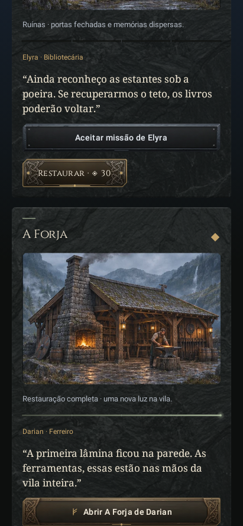 | 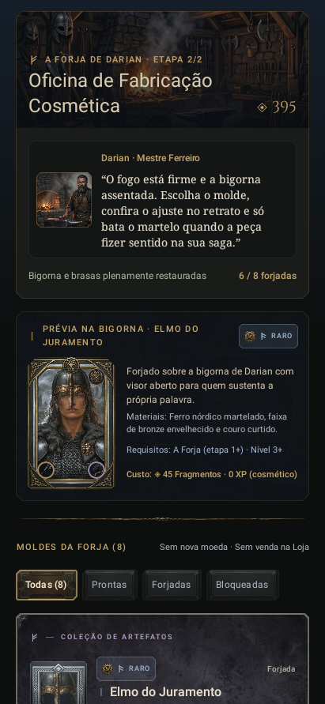 | 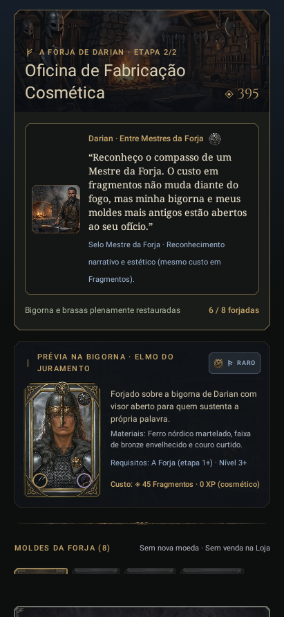 |

## 5. Tema Claro e Acessibilidade (`320 dp` + Fonte `130%`)

| Tema Claro (Velino & Ardósia Clara) | Tela Estreita `320 dp` · Fonte `130%` |
|---|---|
| 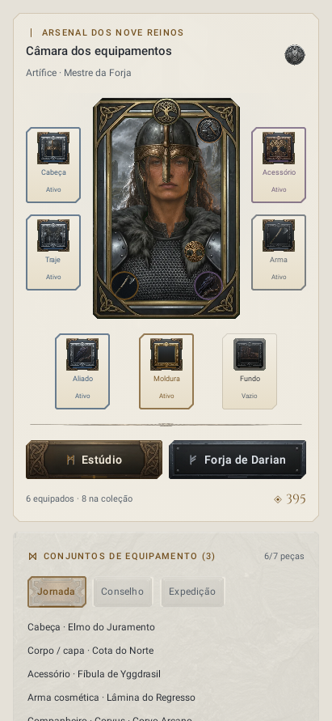 | 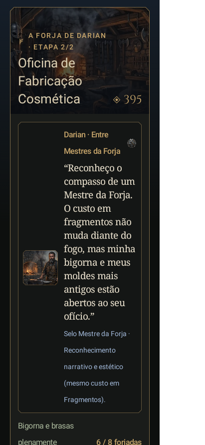 |

## 6. Inspeção Visual e Ajustes Aplicados Antes da Entrega

1. **Alinhamento calibrado de elmos e trajes (`living_helms_atlas.webp`, `living_armor_atlas.webp`):** removidos aros inferiores do *Elmo do Juramento*, forro interno do *Elmo do Viajante* e arco traseiro da *Coroa Rúnica de Mímir*, além de neutralização reforçada de borda verde (*despill*) nas peles e golas — preservando 100% da fisionomia e dos olhos nos 3 tons originais (`wanderer_light`, `wanderer_medium`, `wanderer_dark`).
2. **Contraste no tema claro (`EquipmentScreen.kt`):** cabeçalho do Arsenal e subtítulo do Estúdio ajustados para `Ink` / `Muted` sobre superfície clara de velino (`13-tema-claro-arsenal.png`).
3. **Semântica e desambiguação de ações (`EquipmentScreen.kt`):** preservado o subtítulo `"Câmara dos equipamentos"` sob `"Arsenal dos Nove Reinos"` e renomeado o botão de aplicação de conjuntos para `"Aplicar"`, evitando ambiguidade com o botão `"Equipar"` do diálogo de item.

## 7. Limites Declarados

- Todas as capturas são renderizações nativas em Robolectric (`w411dp-h891dp-mdpi` e `w320dp-h740dp-mdpi` com escala `1.3f`), utilizando personagens de teste.
- Testes físicos em aparelho Android (instalação por cima da `1.7.2`, animações em GPU real, teclado IME físico e TalkBack) não foram executados neste ambiente.
