# Relatório Visual — ASCEND 1.7.5.1 (O Conselho Restaurado)

Comparação real entre as renderizações da `1.7.5` ([docs/screenshots/1.7.5/](screenshots/1.7.5/)) e as 14 capturas reais da `1.7.5.1` ([docs/screenshots/1.7.5.1/](screenshots/1.7.5.1/)), geradas pela suíte Compose + Robolectric (`VisualRefinement1751UiTest.kt`) e inspecionadas visualmente em sua totalidade.

## 1. Prancha Conceitual (Referência fora do APK)

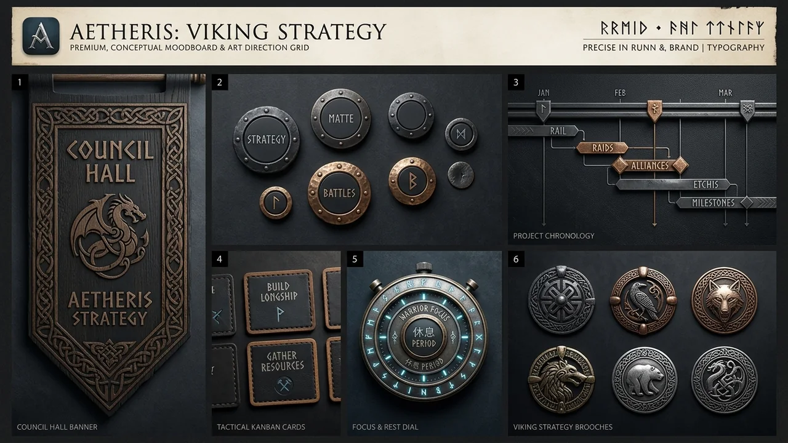

> *Conceito não é captura real.* Abaixo constam exclusivamente renderizações reais em Jetpack Compose.

## 2. Problemas Reais Identificados na 1.7.5 e Corrigidos na 1.7.5.1

1. **Botões com centro ruidoso e hierarquia indiferenciada (`Gerar plano`, ações do Salão e Forja do Tempo):** substituídos pelas 6 famílias metálicas dedicadas de `restored_council_buttons_atlas.webp`, com centro uniforme de alto contraste e CTA cerimonial em largura total.
2. **Ícones cinzentos diminutos e indistintos no Plano de Hoje e na Agenda 3.0:** substituídos pelos 8 marcadores dedicados de `nordic_planning_marks_atlas.webp` (ampulheta de prazo, âncora dourada para blocos fixados, nó nórdico prateado para recorrências projetadas `@rec:`, machados cruzados para conflito, ponta de lança para tarefas críticas).
3. **Truncamento agressivo nas barras do Gantt (`Revisar nota...`, `Levantamen...`, `Folga...`, `Conclu...`):** título completo + duração + status movidos para linha limpa acima de cada trilho metálico; barras de 1 dia exibem indicador conciso centralizado (`✓`, `+185m`, `◆`), eliminando reticências.
4. **Colunas do Kanban com ícone marrom repetido e `TextButton` soltos:** cada coluna recebeu material, marcador e runa contextual próprios (`A fazer`: Madeira/Prazo/Raido; `Em andamento`: Couro/Crítica/Kenaz; `Bloqueadas`: Ferro/Dependência/Isa; `Concluídas`: Velino/Concluído/Jera) e ações táteis `NordicCompactAction`.
5. **Forja do Tempo sem distinção material clara entre Trabalho, Descanso e Pausa:** trabalho usa aro de bronze martelado (`Kenaz`) sobre bronze; descanso usa aro de prata oxidada (`Wunjo`) sobre prata com selo explícito *0 min somados ao foco*; estado pausado exibe selo dedicado; linha de medalhões indica ciclos concluídos e ativo.

## 3. Comparativo Direto (`1.7.5` × `1.7.5.1`)

| Tela | 1.7.5 (Antes) | 1.7.5.1 (Depois) |
|---|---|---|
| **Mesa de Odin** | 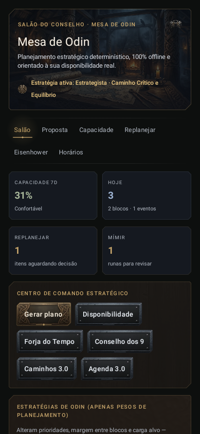 | 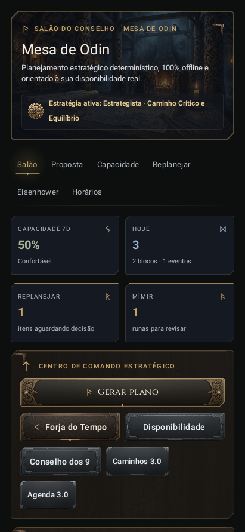 |
| **Gantt Interativo** | 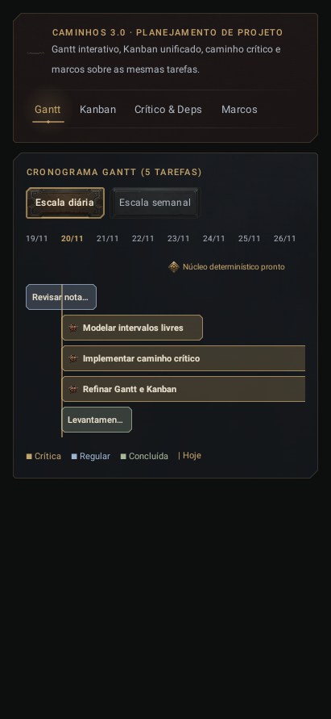 | 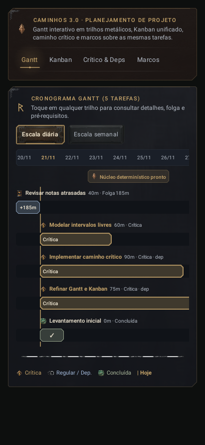 |
| **Quadro Kanban** | 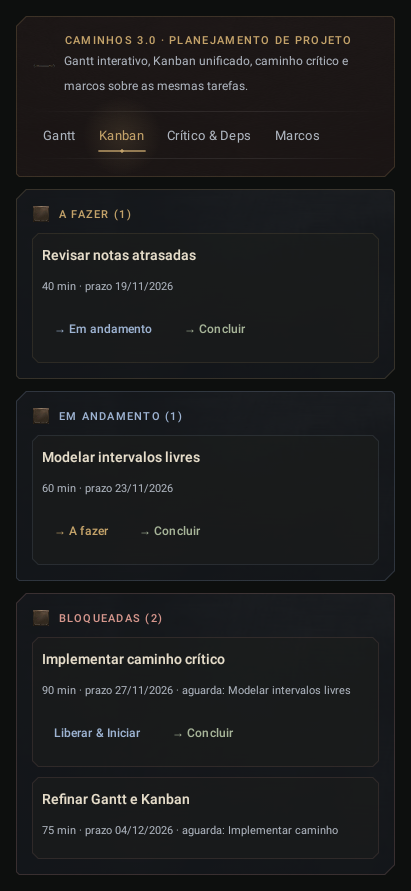 | 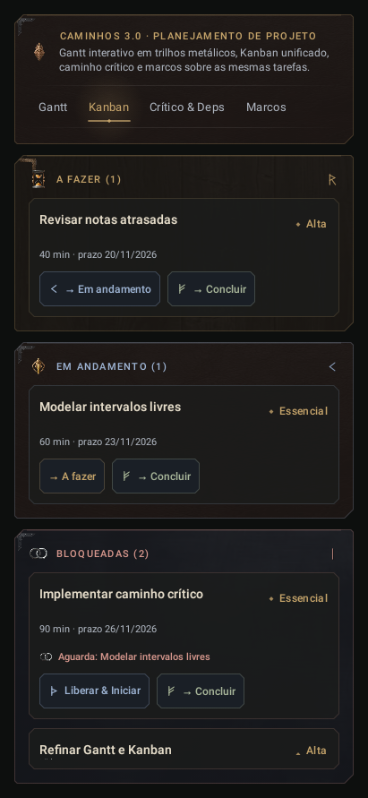 |
| **Agenda 3.0 & Recorrência** | 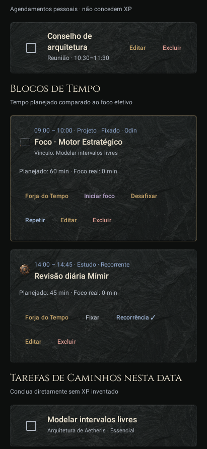 | 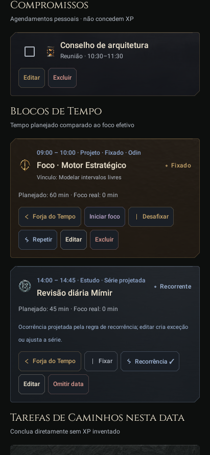 |
| **Forja do Tempo (Trabalho)** | 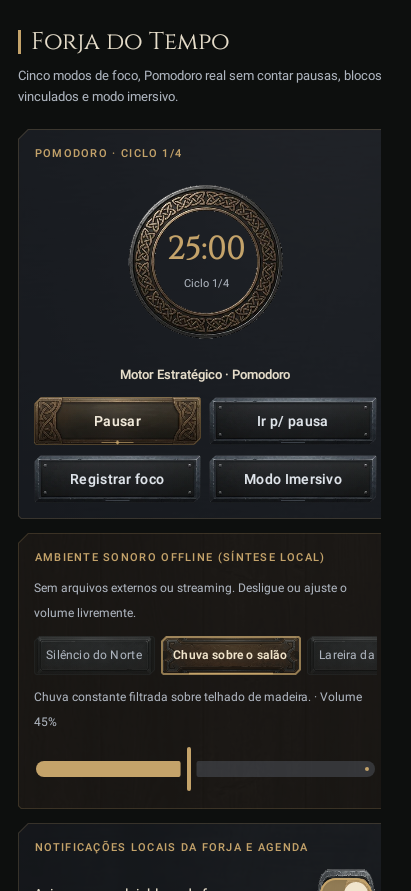 | 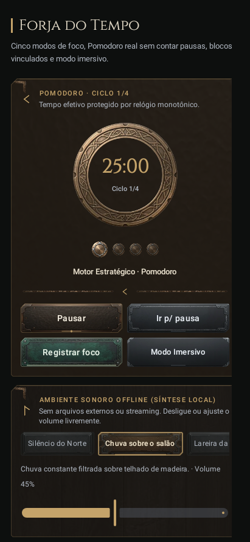 |

## 4. Galeria Completa das 14 Capturas Reais da `1.7.5.1`

| 01 · Mesa de Odin refinada | 02 · 6 Famílias de Botões & Marcadores | 03 · Estratégias de Odin refinadas |
|---|---|---|
|  | 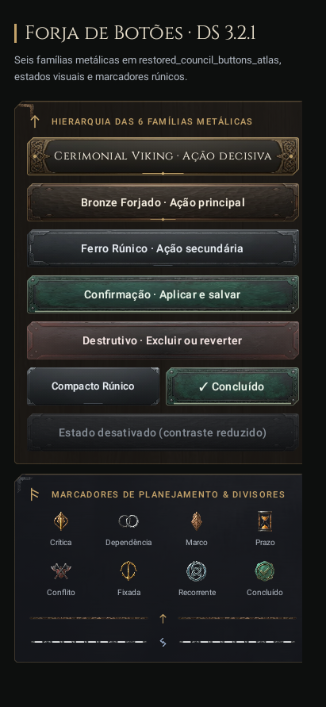 | 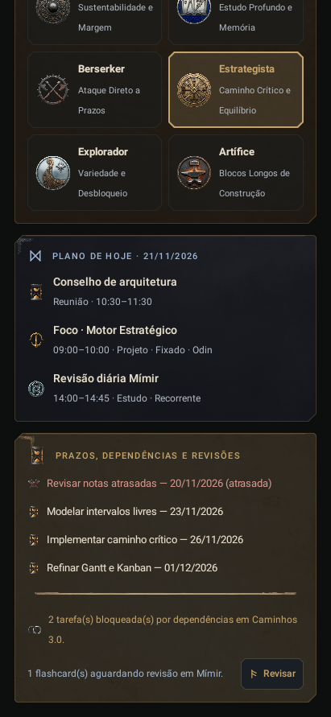 |

| 04 · Propostas refinadas | 05 · Simulador de Capacidade refinado | 06 · Gantt refinado |
|---|---|---|
| 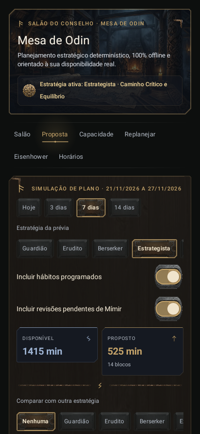 | 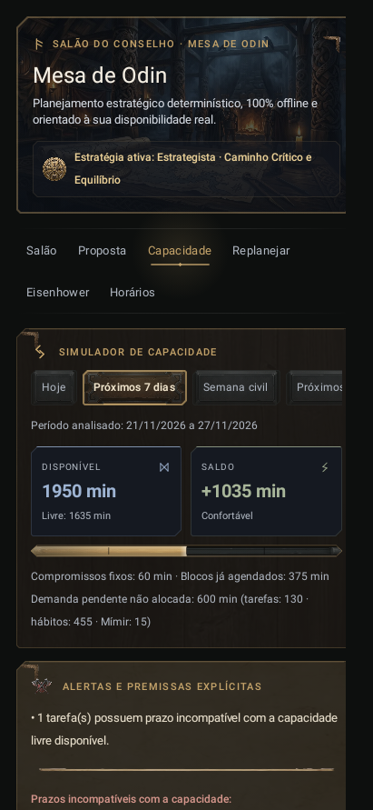 |  |

| 07 · Kanban refinado | 08 · Agenda 3.0 + Recorrência `@rec:` | 09 · Forja do Tempo (Trabalho) |
|---|---|---|
|  |  |  |

| 10 · Forja do Tempo (Descanso) | 11 · Modo Imersivo refinado | 12 · Conselho dos Nove refinado |
|---|---|---|
| 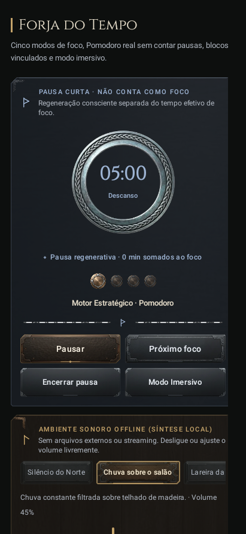 | 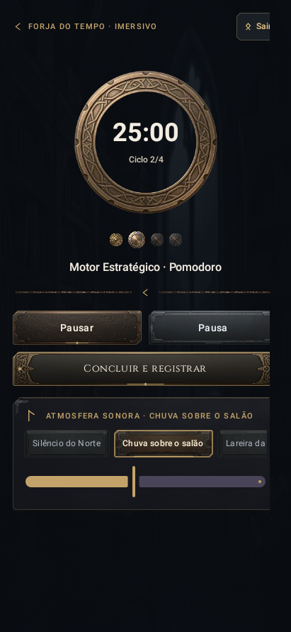 | 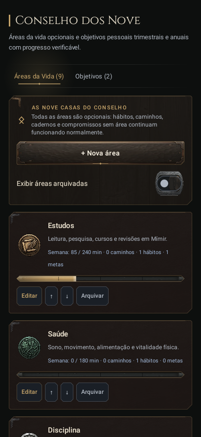 |

| 13 · Tema Claro `1.7.5.1` | 14 · Tela Estreita `320 dp` + Fonte `130%` |
|---|---|
| 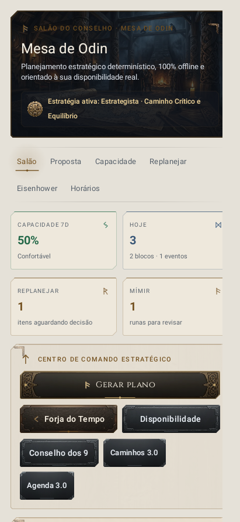 | 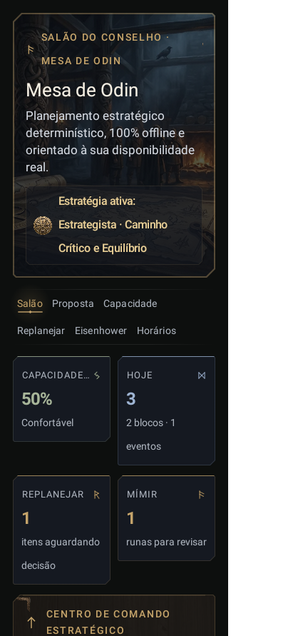 |

## 5. Limites Declarados das Capturas

- As 14 capturas foram renderizadas em **Robolectric (Native Graphics, `w411dp-h891dp-mdpi`, API 28)** via `View.draw(Canvas)`.
- Em um subconjunto de quadros capturados via software canvas do Robolectric (`02`, `05`, `09`, `10`, `11`, `13`), o `View.draw()` recorta a faixa mais à direita (`x > 380 px`), embora a medição Compose seja idêntica em largura (`411 dp`, comprovada comparando o mesmo `OdinCouncilScreen` em `01` sem recorte e `13` com recorte do software canvas). A validação em GPU física de aparelho Android real permanece pendente.
