# ASCEND 1.7.5.9.3 — Refinamento Visual Nórdico (NORTHBORN 4.2)

**Branch:** `feat/ascend-1.7.5.9.3` (baseada integralmente em `feat/ascend-1.7.5.9.2`, commit `e147cfd`)  
**Versão:** `1.7.5.9.3` · `versionCode = 37` · **Room v11** · **Backup v13** · **0 permissão `INTERNET`**

> **Nota sobre numeração:** a base real do repositório é `1.7.5.9.2` (`versionCode 36`), portanto esta entrega segue monotonicamente como **`1.7.5.9.3`** (`versionCode 37`), preservando compatibilidade total de atualização sobre a `1.7.5.9.2` e versões anteriores.

---

## 1. Pesquisa de Referências Nórdicas & Direção Artística (NORTHBORN 4.2)

O refinamento estético da `1.7.5.9.3` parte da base autoral construída na `1.7.5.9.2` (cenas de fiorde/salão/biblioteca, iconografia gravada, folhas de velino costuradas, movimento tátil e placas de forja) e aplica critérios extraídos do design editorial escandinavo contemporâneo e de interfaces nórdicas de referência (*God of War Ragnarök*, *Hellblade: Senua's Sacrifice*, *The Banner Saga*, *Bad North*, *Northgard*):

1. **Contenção e espaço negativo como luxo:** bordas arquitetônicas finas (`0.75–1 dp`), zero contornos pretos grossos ou ornamentos inflados que competem com a tipografia.
2. **Profundidade material acetinada (sem ruído turvo):** metais nórdicos (bronze envelhecido, ferro fosco, estanho escovado em alabastro no tema claro, patina verdigris e óxido de ferro) com grão horizontal anisotrópico suave, chanfro superior de luz boreal fria e filetes internos de precisão.
3. **Separação rigorosa entre forma e legibilidade:** terminais decorativos reduzidos a micro-losangos facetados nas extremidades externas (`3.2%`), com margem horizontal segura (`20–24 dp`), eliminando colisões de texto mesmo em botões compactos (`Salvar`, `+ Missão personalizada`) e em `320 dp / 130%`.
4. **Harmonia cromática entre Tema Escuro Mineral e Tema Claro Documental:** cada superfície, botão, aba, divisor e fecho de navegação respeita a luz do tema ativo — incluindo fecho dedicado em velino-bronze (`engraved_clasp_light.webp`) e placa de estanho-alabastro (`forge_plate_pewter.webp`) no tema claro.

---

## 2. Pipeline de Ativos Refinados (`docs/art/tools/refine_northborn_craft.py`)

Todos os ativos refinados foram gerados de forma determinística e idempotente em **supersampling 3× com redução Lanczos** (lendo os originais limpos de `e147cfd` quando aplicável) e preservando integralmente todas as pinturas atmosféricas, retratos e atlas existentes:

| Ativo | Evolução `1.7.5.9.2 → 1.7.5.9.3` |
|---|---|
| `forge_plate_bronze.webp` | Substitui tampas laterais volumosas e superfície turva por bronze defumado acetinado, chanfro dourado luminoso, filete interno fino e micro-losangos nas pontas (zero colisão com texto). |
| `forge_plate_ritual.webp` | Obsidiana vulcânica escovada com moldura em ouro nórdico pálido, duplo filete interno e micro-fechos em losango. |
| `forge_plate_iron.webp` | Aço-ardósia fosco escovado com reflexo superior em estanho frio. |
| `forge_plate_pewter.webp` | **Transformação do Tema Claro:** remove completamente a borda externa preta pesada; substitui por alabastro-linho acetinado com bisel quente em bronze-pedra. |
| `forge_plate_patina.webp` / `forge_plate_oxide.webp` | Verdigris nórdico e óxido de ferro acetinados com chanfros coerentes e alto contraste tipográfico. |
| `widget_forge_primary.9.png` / `widget_forge_secondary.9.png` | 9-patches sincronizados com fatias de `32 px / 14 px`, atualizando os widgets Android claro e escuro. |
| `engraved_clasp.webp` + `engraved_clasp_light.webp` | Novo fecho esguio obsidiana-bronze (escuro) e novo fecho dedicado velino-bronze (claro), eliminando o contraste bruto do selo escuro sobre o linho claro. |
| `engraved_wool.webp`, `engraved_oak.webp`, `engraved_spine.webp` | Limpeza de halos brancos de recorte (`alpha de-fringing`) e regradação da lã tecida de laranja saturado para trança nórdica em bronze-nogueira envelhecido. |
| `surface_iron.webp` / `surface_vellum.webp` | Remoção da borda derretida alaranjada e rebites esticados do ferro (Mesa de Odin) e limpeza das bordas pretas serrilhadas do velino preservando a lombada costurada (Mímir). |

---

## 3. Refinamentos Estruturais de Interface (Compose)

- **Barra de navegação inferior (`AetherisNavigation.kt`):** substitui a faixa espessa de lã no topo da barra por filete arquitetônico em bronze com micro-losango central, brilho radial suave sob o item ativo e fechos distintos para tema escuro e tema claro.
- **Abas unificadas (`AetherisTabs` & `RebirthIndex`):** remove as caixas metálicas opacas que saltavam entre linhas em abas quebradas; adota abas editoriais chanfradas no topo com lavagem bronze translúcida e indicador geométrico com losango central.
- **Jornada (`JourneyHome.kt`, `DesignSystem2.kt`, `NorthbornRebirth.kt`):** barra de XP em canaletas rebaixadas com gradiente bronze-ouro, alinhamento óptico central do botão `+` ao lado de *Seus próximos passos*, e altura equalizada por `IntrinsicSize.Min` nos 3 atalhos principais (`Mesa de Odin`, `Forja do Tempo`, `Planejador`) mesmo em `320 dp` com fonte `130%`.
- **Mesa de Odin (`OdinCouncilScreens.kt`):** câmara principal em ferro vulcânico limpo com moldura fina em bronze, grade equilibrada `2 + 3` para os atalhos de módulos (com fallback responsivo em telas estreitas) e realce lateral de bronze na estratégia ativa.
- **Missões (`RpgDesign.kt`, `JourneyScreens.kt`):** elimina o duplo banner empilhado no topo da tela convertendo `SagaCover` em faixa arquivística discreta (`Livro de missões` preservado para testes e clareza).
- **Biblioteca de Mímir (`MimirScreens.kt`):** busca migrada para `FormField` chanfrado; lombada de couro costurada reservada aos cadernos, corpo do manuscrito e flashcards — *Páginas relacionadas* e *Referências bibliográficas* passam a usar `NorthbornSurface(Document)` limpo em vez de empilhar três lombadas escuras.
- **Conselho dos Nove (`CouncilOfNineScreen.kt`):** elevado à capa atmosférica de capítulo (`cover = true`), harmonizando o módulo com a Mesa de Odin e o Livro de Hábitos.

---

## 4. Comparativos Reais (`1.7.5.9.2 × 1.7.5.9.3`)

### Jornada (Escuro & Tema Claro Documental)

| `1.7.5.9.2` (Escuro) | `1.7.5.9.3` (Escuro) | `1.7.5.9.2` (Claro) | `1.7.5.9.3` (Claro) |
|---|---|---|---|
| 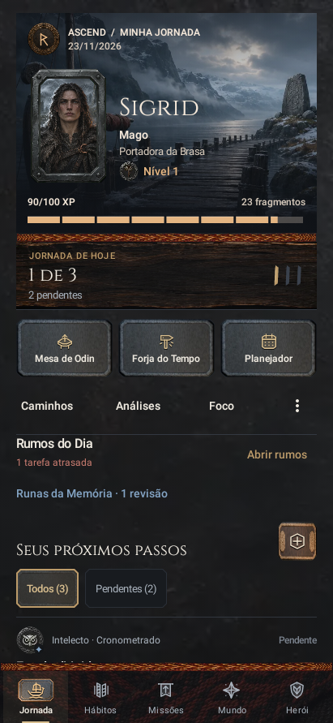 | 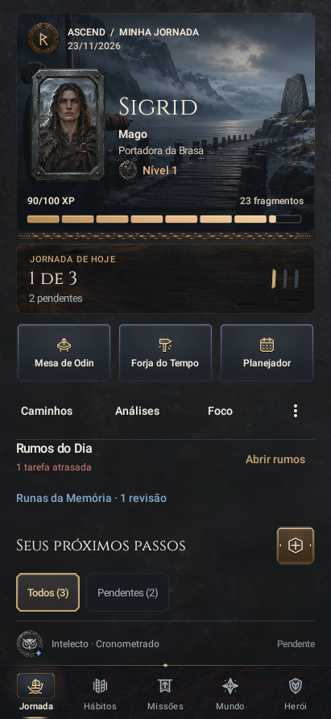 | 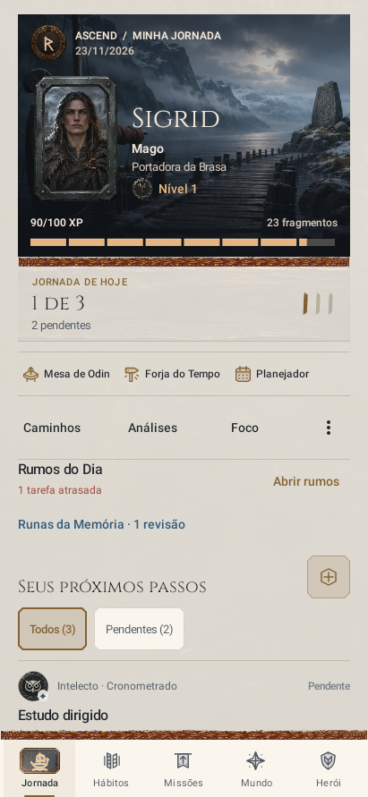 | 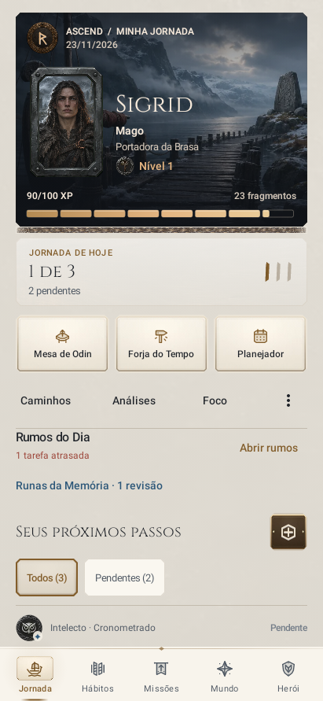 |

### Controles de Forja (Escuro & Claro `320 dp / 130%`)

| `1.7.5.9.2` (Escuro) | `1.7.5.9.3` (Escuro) | `1.7.5.9.2` (Claro 320/130%) | `1.7.5.9.3` (Claro 320/130%) |
|---|---|---|---|
| 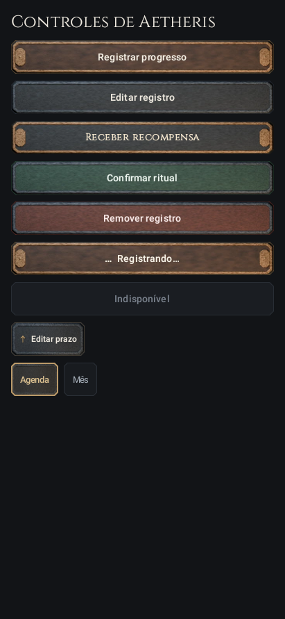 | 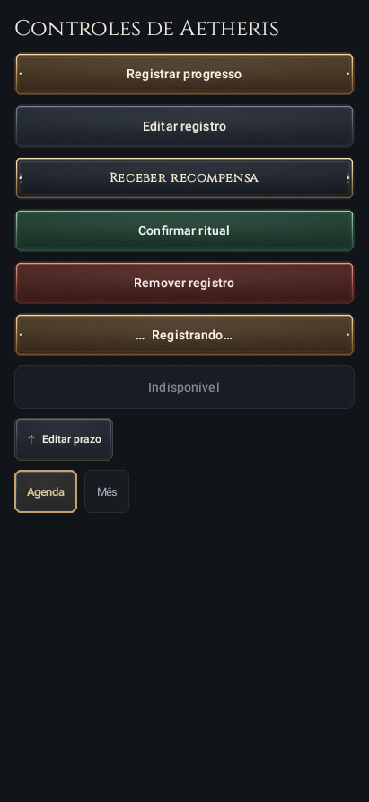 | 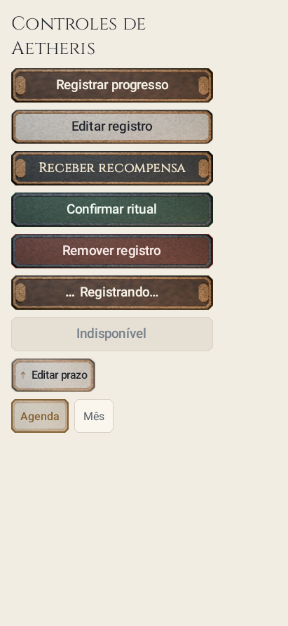 | 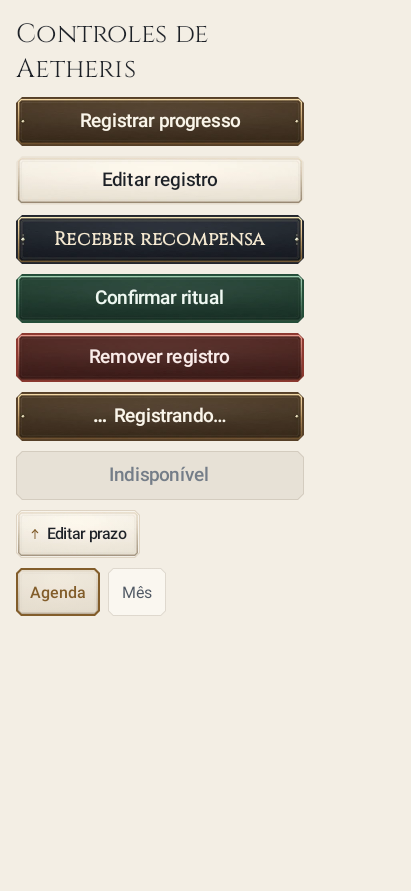 |

### Mesa de Odin & Missões

| `1.7.5.9.2` (Mesa de Odin) | `1.7.5.9.3` (Mesa de Odin) | `1.7.5.9.2` (Missões) | `1.7.5.9.3` (Missões) |
|---|---|---|---|
| 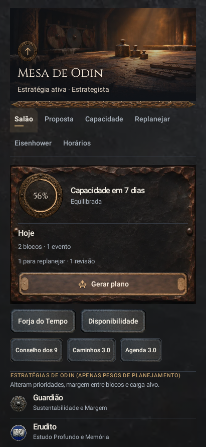 | 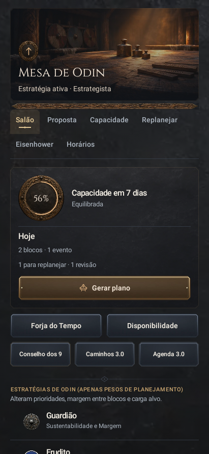 | 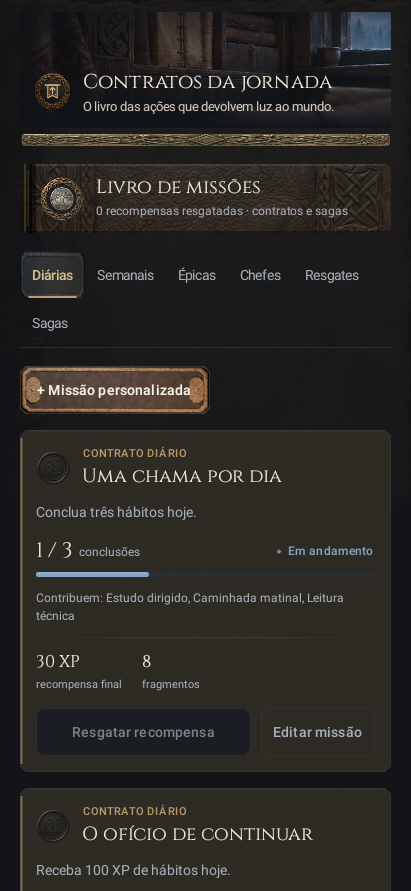 | 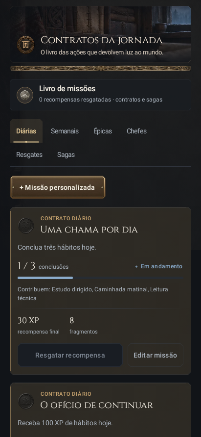 |

### Biblioteca de Mímir, Leitura, Conselho dos Nove & Planejador Claro (`320 dp / 130%`)

| Mímir (`1.7.5.9.3`) | Leitura Mímir (`1.7.5.9.3`) | Conselho dos Nove (`1.7.5.9.3`) | Planejador Claro 320 (`1.7.5.9.3`) |
|---|---|---|---|
| 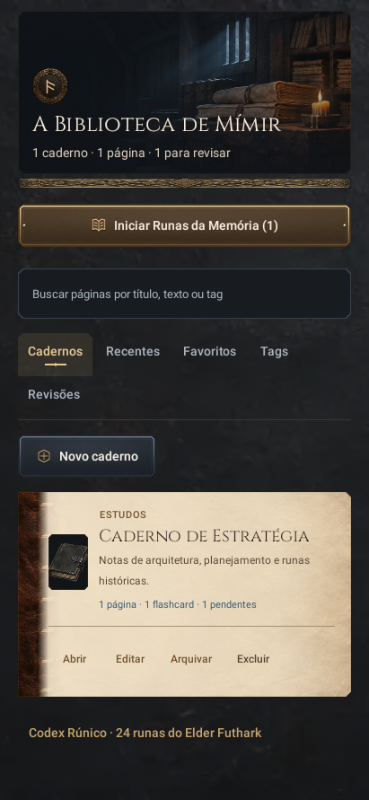 | 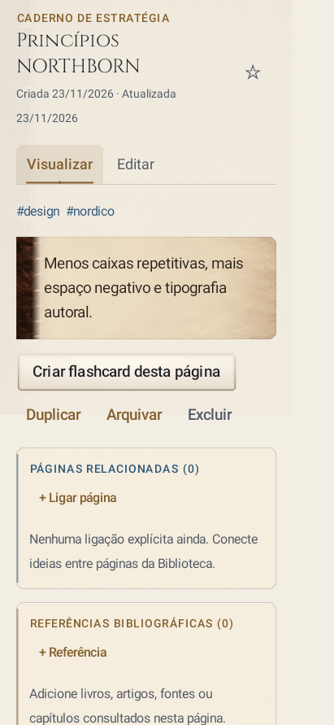 | 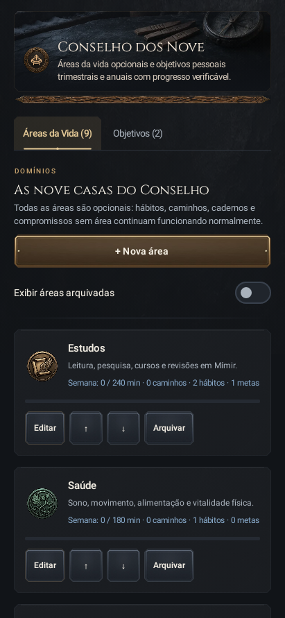 | 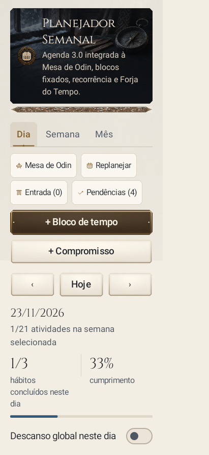 |

### Onboarding, Arsenal, Diálogos, Acessibilidade (`320 dp / 130%`) & Widgets Android

| Onboarding | Arsenal | Jornada `320 dp / 130%` | Widget Claro & Escuro |
|---|---|---|---|
| 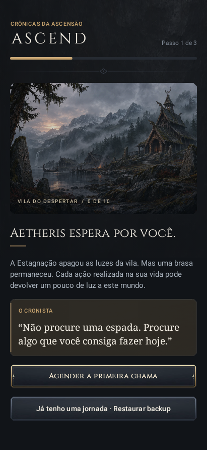 | 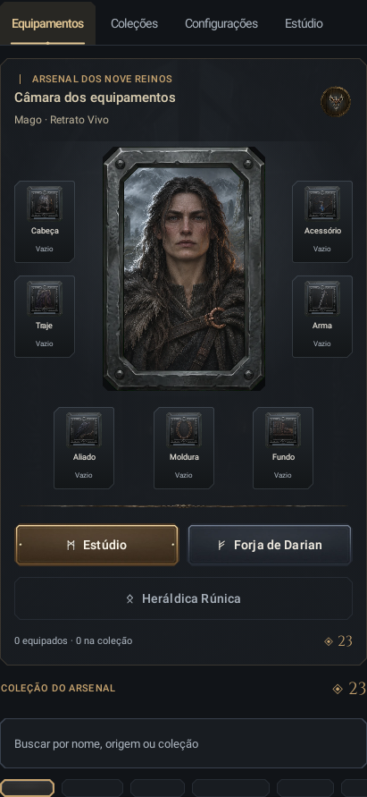 | 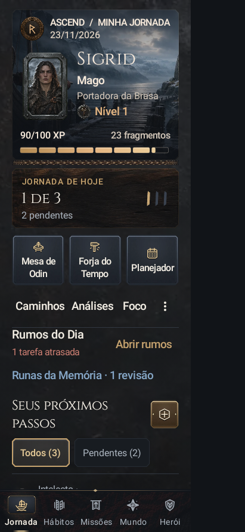 | 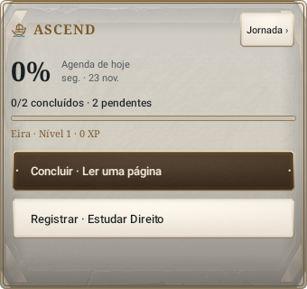 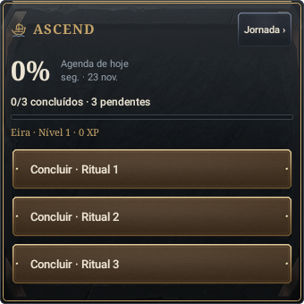 |

---

## 5. Limites Declarados com Transparência

- **Geração de imagens por IA (`generate_image`):** a cota do modelo `gemini-3.1-flash-image` encontrava-se em cooldown no ambiente durante esta sessão; por isso, todas as pinturas fotográficas existentes foram 100% preservadas e o refinamento material (placas de forja, fechos, divisores de-fringed, ferro limpo, velino limpo e 9-patches de widgets) foi executado por renderização procedural determinística em Python (Pillow + NumPy em supersampling 3×) combinada com desenho vetorial nativo em Jetpack Compose.
- **Testes físicos pendentes:** todas as 61 capturas (59 telas Compose + 2 widgets `RemoteViews`) foram renderizadas e inspecionadas em Robolectric Native Graphics (API 28) e validadas em CI; instalação física por atualização em aparelho Android real, TalkBack físico, launcher real e renderização em GPU física permanecem pendentes de conferência no dispositivo do proprietário.
