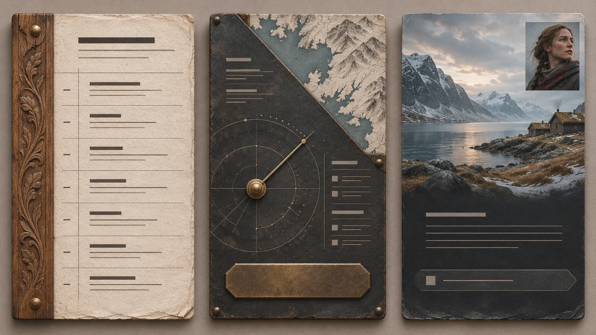

# NORTHBORN 4.1 · Direção artística

| Alternativa | Estrutura | Qualidade e limite |
|---|---|---|
| The Carved Chronicle | Índice em coluna, linha de margem, títulos abertos, lombada concentrada na lateral | A forma do livro dá ritmo à leitura e acomoda listas longas. Uma abertura inteiramente documental reduziria a presença do personagem. |
| The Forged North | Instrumento assimétrico com mapa parcial, escala, leitura de capacidade e comando destacado | A precisão dos instrumentos combina com planejamento. Grades com metal em todas as células recuperariam o peso da versão anterior. |
| The Living Saga | Cena de abertura integrada à identidade e à primeira ação útil | A paisagem localiza a jornada e separa abertura de rotina. Se a pintura ocupar a maior parte da altura, as ações perdem acesso imediato. |

The Carved Chronicle fornece a hierarquia tipográfica e o ritmo das linhas. The Living Saga orienta apenas a abertura da Jornada. The Forged North organiza Odin pelo mapa e pela leitura de capacidade. Mímir leva a gramática editorial à margem de leitura. Cor de ação é verde pátina nos três, com bronze reservado ao acervo cerimonial existente.

## Referências e limites históricos

- O carvalho, a construção naval e o entalhe em Oseberg são referências documentadas. O barco da Jornada tem função atmosférica e pertence à paisagem ficcional de Aetheris. [Museu da Era Viking, Universidade de Oslo](https://www.vikingtidsmuseet.no/english/viking-age/viking-ships/the-oseberg-ship.html)
- Borre, Jelling, Mammen, Ringerike e Urnes descrevem tradições ornamentais distintas. A transição entre animais entrelaçados e motivos heráldicos orienta o uso pontual de selos existentes. As artes novas usam pouco ornamento e não atribuem um estilo arqueológico específico a objetos inventados. [Signe Horn Fuglesang, Hikuin](https://tidsskrift.dk/Hikuin/article/view/111272)
- O compasso de pontas e a carta sem texto de Odin são metáforas contemporâneas de planejamento, desenhadas para Aetheris. A encadernação de Mímir remete a tradições de registro escrito posteriores. Nenhuma dessas duas cenas representa um objeto escandinavo datado da Era Viking.

## Estudos pictóricos

Quatro gerações com a ferramenta nativa do Codex. A prancha compara composições e permanece na documentação. Os estudos abaixo foram inspecionados, otimizados em WebP e integrados como imagens decorativas em áreas delimitadas por conteúdo Compose.

- [Jornada](art/journey-art-study.webp). Horizonte panorâmico frio, margem esquerda escura e abertura de luz à direita. A arte contém apenas a paisagem. O retrato existente continua em Compose com os mesmos equipamentos e sem modificar o rosto.
- [Odin](art/odin-strategy-study.webp). Carta de costa e instrumento em ferro sobre madeira. O recorte à direita preserva a concentração dos objetos e deixa o título sobre fundo graduado.
- [Mímir](art/mimir-library-study.webp). Caderno em linho, páginas claras, madeira e fecho de ferro. O estudo ocupa a abertura do acervo. As páginas de leitura têm superfície lisa.
