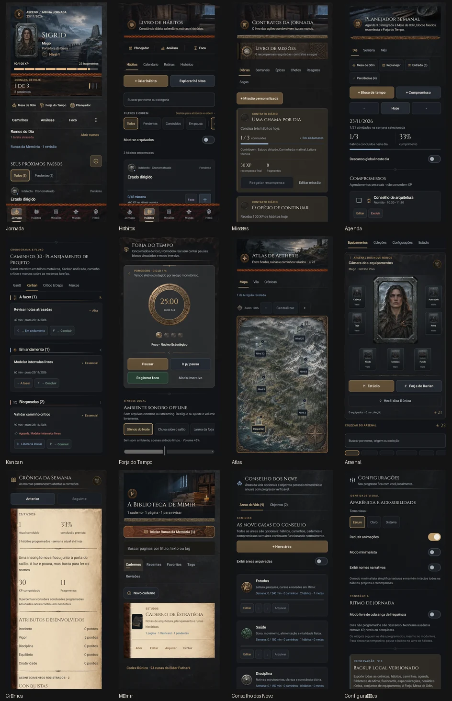

# NORTHBORN 4.1 · Aplicação ao app inteiro

ASCEND 1.7.5.9.2, código 35, partindo do protótipo aprovado em `e971319`. A revisão usa os critérios do UI UX Designer para hierarquia, rótulos, estados, acessibilidade básica e consistência dos componentes. O resultado é a interface Android em Compose.

## Aplicação por fluxo

| Família | Telas e tratamento |
|---|---|
| Rotina | Jornada mantém a abertura cinematográfica e os talhes. Hábitos e Grimório recebem abertura e controles próprios, com foco em registrar, encontrar ou criar um hábito. |
| Estratégia | Mesa de Odin, Planejador, Conselho dos Nove, Caminhos, Caixa de Entrada, Pendências, Análises e Histórico de Foco usam acabamento em ardósia e ferro. Os gráficos mantêm superfícies de baixo ruído. |
| Foco | A Forja do Tempo abre com luz de brasa quando livre. Em sessão, o cronômetro assume a primeira posição. Modo imersivo, som e transições seguem as preferências existentes. |
| Códices | Missões, Sagas, Mímir, Crônica Semanal, Memórias, Diário e Codex usam divisores de arquivo e fundos discretos. Os manuscritos agora têm tinta escura sobre velino em todos os temas, inclusive no modo minimalista. |
| Exploração | Atlas, Vila, regiões, locais e Expedições mantêm mapa, pinturas, estados e marcos. A abertura do Atlas usa uma trilha costeira e os detalhes usam cabeçalhos menores para dar espaço às paisagens existentes. |
| Personagem e oficina | Perfil, atributos, Arsenal, Loja, Conquistas, Estatísticas, Habilidades, retrato e Heráldica compartilham gravuras de metal. O Arsenal tem uma chapa forjada atrás dos nichos. Forja de Darian mantém a arte dos estágios. |
| Controles e sistema | Navegação, botões, abas, campos, estados vazios, configuração, onboarding e formulários compartilham os papéis do sistema de design. O widget adota o navio da Jornada e amplia o botão superior sem mudar as ações. |

## Componentes e usabilidade

- Cabeçalhos ilustrados dão contexto às entradas principais. Os detalhes usam versões compactas. O pano de fundo perde textura ao longo da página para deixar listas e gráficos legíveis.
- Ícones compartilhados adotam as mesmas gravuras da navegação. Os 16 símbolos incluem novos comandos de configuração, voltar e confirmar. As abas, os chips e os botões do sistema compartilhado usam altura mínima de 48 dp. Botões animam sombra e ícone sem encolher a área de toque.
- O Gantt conserva a escala real das barras, inclusive em intervalos curtos. No Kanban e no Planejador, as ações e atalhos passam para outra linha em telas estreitas.
- Formulários preservam os rascunhos e limitam a largura do comando superior para conservar espaço para o título. Retroceder, descartar e confirmar mantêm seus comportamentos.
- Quatro novas cenas foram geradas e recortadas em WebP para Agenda, Atlas, Forja e Arquivo. Permanecem as runas, os materiais e as ilustrações das rodadas anteriores. A tipografia editorial usa Cinzel e os textos de operação conservam a fonte funcional. Redução de movimento e modo minimalista continuam disponíveis.

## Comparações

| Fluxo | Antes | 1.7.5.9.2 |
|---|---|---|
| Hábitos | [Lista anterior](../screenshots/1.7.5.9/04-lista-habitos.png) | [Livro de hábitos](../screenshots/1.7.5.9.2/04-lista-habitos.png) e [Grimório](../screenshots/1.7.5.9.2/53-grimorio.png) |
| Agenda | [Agenda anterior](../screenshots/1.7.5.9/08-agenda-diaria.png) | [Agenda diária](../screenshots/1.7.5.9.2/08-agenda-diaria.png) e [claro a 320 dp com fonte a 130%](../screenshots/1.7.5.9.2/50-planejador-claro-320.png) |
| Caminhos | [Kanban anterior](../screenshots/1.7.5.9/12-kanban.png) | [Gantt](../screenshots/1.7.5.9.2/11-gantt.png) e [Kanban](../screenshots/1.7.5.9.2/12-kanban.png) |
| Atlas | [Atlas anterior](../screenshots/1.7.5.9/20-atlas.png) | [Atlas](../screenshots/1.7.5.9.2/20-atlas.png) e [Exploração](../screenshots/1.7.5.9.2/21-exploracao.png) |
| Arsenal | [Arsenal anterior](../screenshots/1.7.5.9/18-arsenal.png) | [Arsenal](../screenshots/1.7.5.9.2/18-arsenal.png) e [Forja de Darian](../screenshots/1.7.5.9.2/19-forja-darian.png) |
| Arquivo | [Mímir no piloto](../screenshots/1.7.5.9.1-rustico/16-biblioteca-mimir.png) | [Crônica](../screenshots/1.7.5.9.2/47-cronica-semanal.png), [Diário minimalista](../screenshots/1.7.5.9.2/49-diario-minimalista-320.png) e [Missões](../screenshots/1.7.5.9.2/45-missoes.png) |

Capturas de Compose e RemoteViews em Robolectric Native Graphics com personagens e registros de teste. As margens laterais nas telas estreitas pertencem ao host. Instalação em telefone físico, TalkBack, GPU física e o comportamento dos widgets em diferentes launchers ficam pendentes. [Galeria completa](../screenshots/1.7.5.9.2/) · [Validação](../../VALIDACAO.md)
