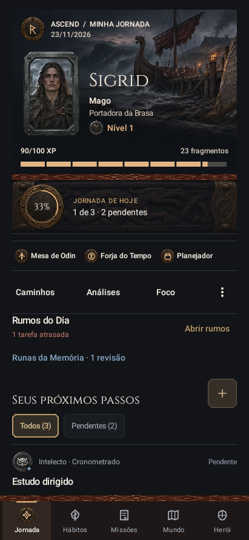
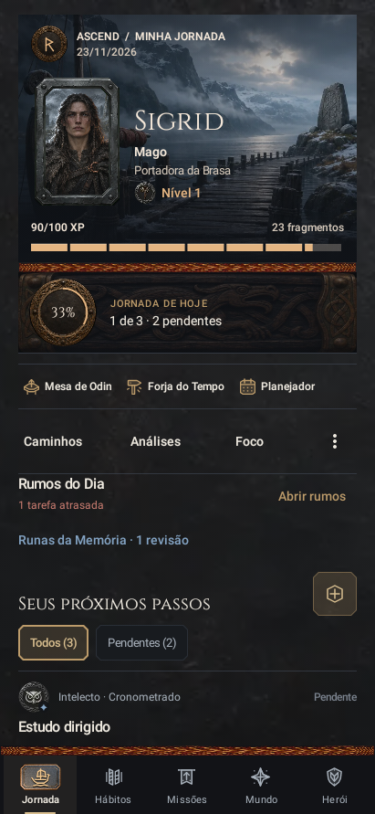
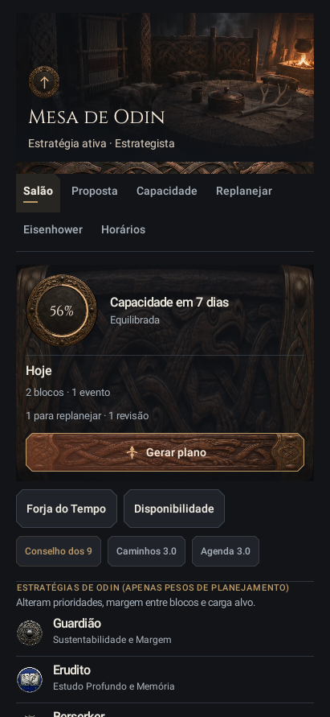
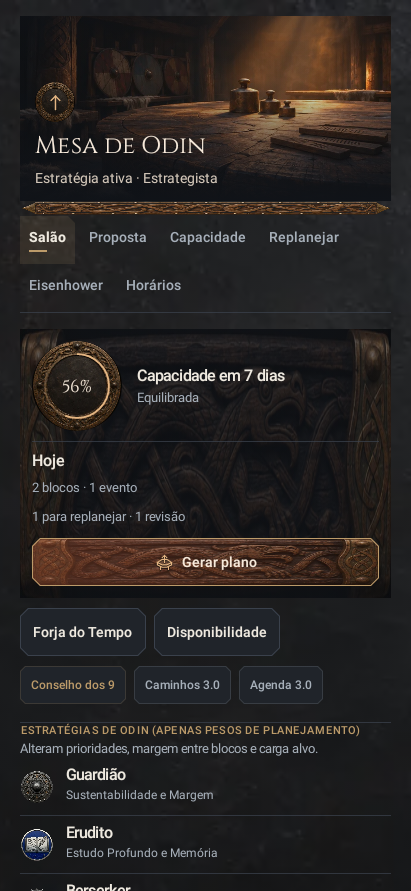
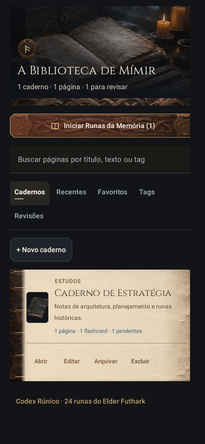
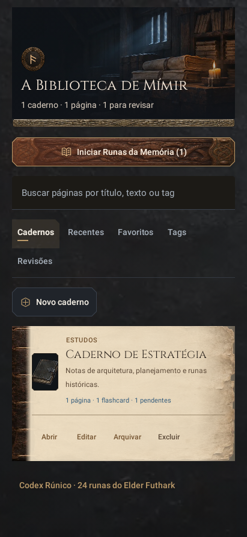

# NORTHBORN 4.1 · Fundos, divisores e iconografia

Quarto protótipo sobre `f0af88a`. Versão 1.7.5.9.1, código 33. A barra nova é compartilhada por todos os destinos. As intervenções de cenário e composição ficam na Jornada, na Mesa de Odin e na Biblioteca de Mímir.

| Tela | Revisão anterior | Novas gravuras |
|---|---|---|
| Jornada |  |  |
| Mesa de Odin |  |  |
| Biblioteca de Mímir |  |  |

## Componentes produzidos

- **13 símbolos originais em Compose Canvas.** O navio, os bastões de contagem, o estandarte, a rosa da bússola e o escudo identificam os cinco destinos. Os demais símbolos aparecem em atalhos, ações e menus de Jornada, Odin e Mímir.
- **Fivela 3D.** Quatro camadas de metal, bordas chanfradas e iluminação quente e fria modeladas em Blender. A textura WebP entra atrás da gravura ativa. Os rótulos e o indicador de seleção permanecem visíveis com a fonte ampliada. A transição de seleção respeita a redução de movimento. [Código da cena reproduzível](../art/tools/engraved_clasp.py)
- **Três divisores.** Lã tecida para a Jornada e a navegação, carvalho entalhado para Odin e metal estampado para Mímir. O desenho em três fatias concentra o ajuste de largura na região central. Em modo minimalista, o traço e os ícones funcionais permanecem.
- **Novos fundos e runas.** A Jornada abre num píer enevoado, Odin recebe luz âmbar sobre a mesa do conselho e Mímir passa para um arquivo de madeira iluminado por vela. O ferro martelado aparece atrás do conteúdo navegável. Raidho, Tiwaz e Ansuz identificam as três aberturas. O significado dessas marcas como selos pertence à ficção de Aetheris.

A ferramenta de geração de imagens produziu duas pranchas, recortadas em sete WebPs para o aplicativo. A fivela foi criada separadamente em Blender. Os oito WebPs somam 287.080 bytes. As pinturas substituídas nesta rodada foram arquivadas com os comparativos. [Arte arquivada](art/anteriores/)

## Referências consultadas

- O trabalho de iluminação e materiais de Loóna orientou a separação entre cenário e controles. As cenas de Aetheris foram produzidas a partir de uma direção própria. [Apple Developer · Behind the Design: Loóna](https://developer.apple.com/news/?id=wg07z90y)
- A discussão sobre legibilidade de ícones pequenos em Diablo IV e o indicador de navegação do Android orientaram o contraste e o tratamento do destino selecionado. [Blizzard · Atualização de design](https://news.blizzard.com/en-us/article/23308274/diablo-iv-quarterly-updatefebruary-2020) · [Android · Navigation bar](https://developer.android.com/develop/ui/compose/components/navigation-bar)
- O catálogo da sala 41 do British Museum foi usado como referência de entrelaçamento animal em peças de metal da época. [British Museum · Sutton Hoo and Europe](https://www.britishmuseum.org/sites/default/files/2021-05/large_print_guide_room_41.pdf)

## Validação visual

A galeria vem de Compose renderizado em Robolectric Native Graphics. Inclui tema claro, modo minimalista e navegação a 320 dp com fonte a 130%. Na captura estreita, a margem à direita pertence à janela de teste. A verificação de TalkBack e a instalação em telefone seguem pendentes. [Galeria](../screenshots/1.7.5.9.1-gravuras/) · [Prancha dos componentes](../screenshots/1.7.5.9.1-gravuras/41-icones-e-divisores.png)
