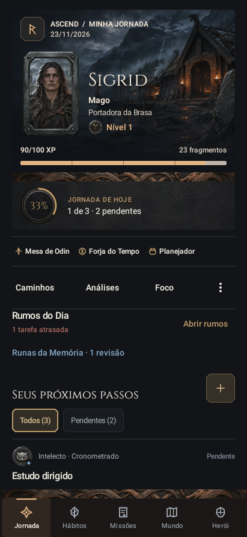
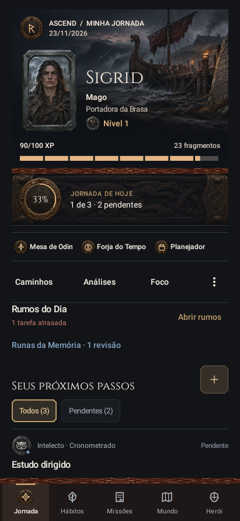
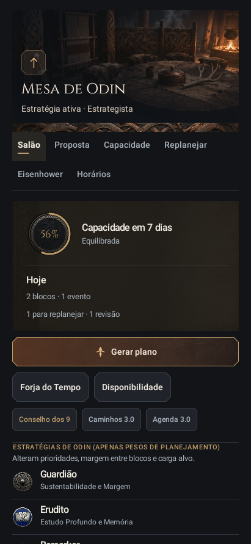
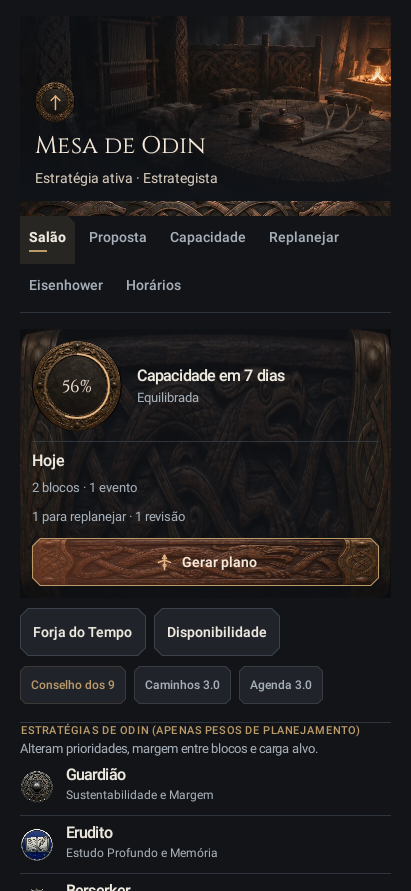
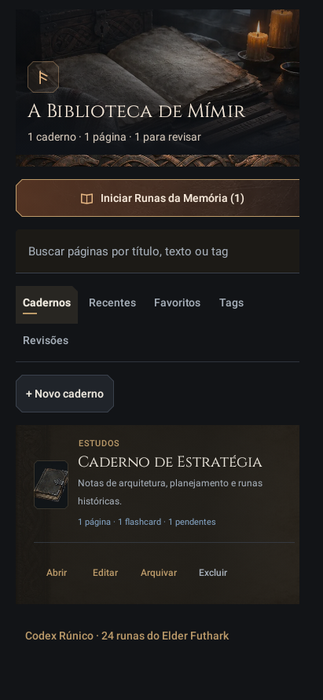
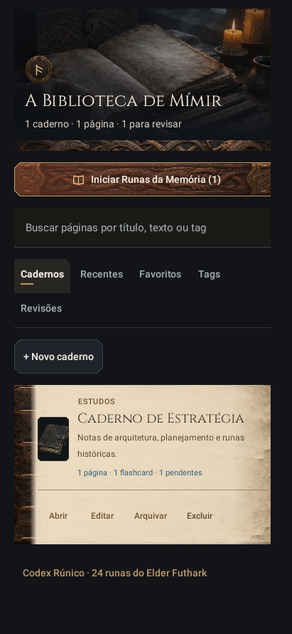

# NORTHBORN 4.1 · Escudo, madeira e velino

Terceiro protótipo de Jornada, Mesa de Odin e Biblioteca de Mímir. Base `a2c9997`, versão 1.7.5.9.1, código de versão 32.

| Tela | Revisão anterior | Novo protótipo |
|---|---|---|
| Jornada |  |  |
| Mesa de Odin |  |  |
| Biblioteca de Mímir |  |  |

## Aplicação

- A Jornada usa uma costa com neblina, píer e navio de casco com tábuas sobrepostas. A régua de XP é dividida em oito marcas. O aro de escudo acompanha o progresso do dia e a lã bordô marca a transição para o painel e a navegação.
- Odin usa o mesmo aro para ler a capacidade semanal. A porcentagem, o resumo diário e a ação **Gerar plano** ocupam a mesma placa de madeira.
- Mímir usa velino claro com lombada costurada no acervo, nas páginas e nos flashcards, incluindo no tema escuro. O contraste da tinta e dos controles é aplicado localmente à folha.
- Os selos rúnicos e a seleção da barra inferior usam a moldura de escudo. Os modos claro e minimalista conservam suas paletas e a preferência de redução de movimento rege os dois indicadores novos.

Duas gerações originais renderizaram a costa e os materiais. O app incorpora cinco recortes WebP. A construção naval e o entrelaçamento animal remetem à cultura material nórdica. O mostrador de progresso, a aplicação das runas e a ornamentação são interpretações ficcionais. O velino costurado remete a tradições manuscritas posteriores. [Referências históricas usadas no piloto](NORTHBORN-ART-DIRECTION.md)

[Navio e costa](art/anteriores/oath_shore.webp) · [Escudo](../../app/src/main/res/drawable-nodpi/oath_shield.webp) · [Madeira](../../app/src/main/res/drawable-nodpi/oath_wood.webp) · [Lã](art/anteriores/oath_braid.webp) · [Velino](art/anteriores/oath_manuscript.webp)

## Capturas

As capturas de interface são renderizações de Compose em Robolectric Native Graphics. A largura do host explica a margem à direita nas amostras estreitas. O comparativo inclui 320 dp com fonte a 130%, tema claro, modo minimalista e a resposta revelada de um flashcard. TalkBack e instalação em telefone seguem pendentes. [Galeria](../screenshots/1.7.5.9.1-entalhe/) · [Plano de expansão](NORTHBORN-ROLL-OUT-PLAN.md)
