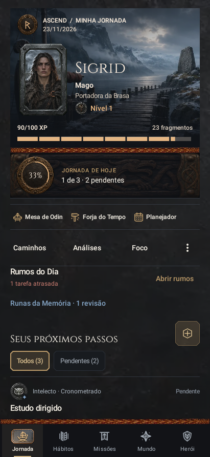
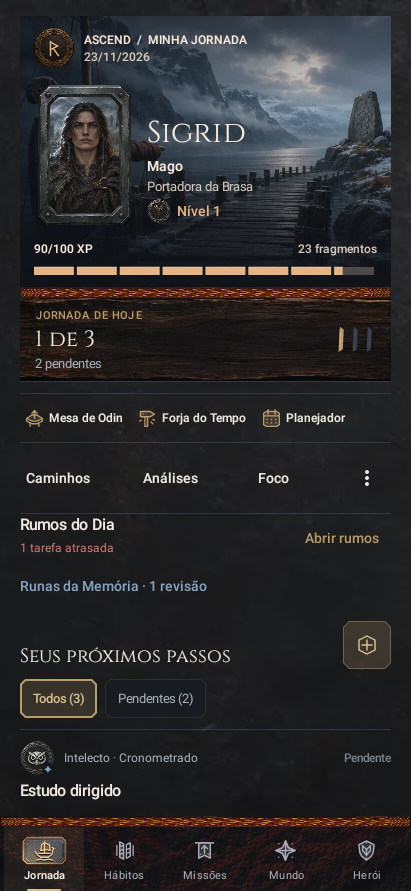
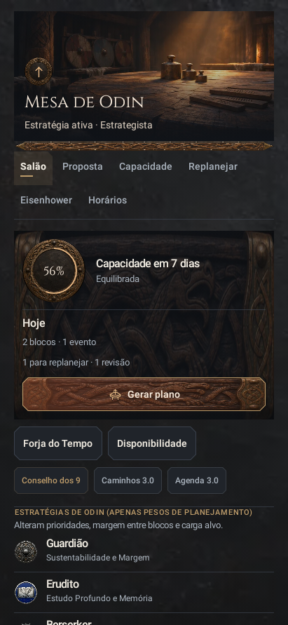
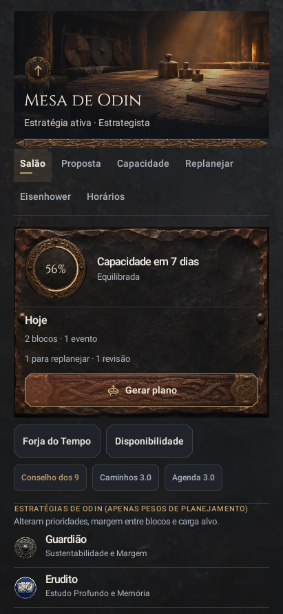
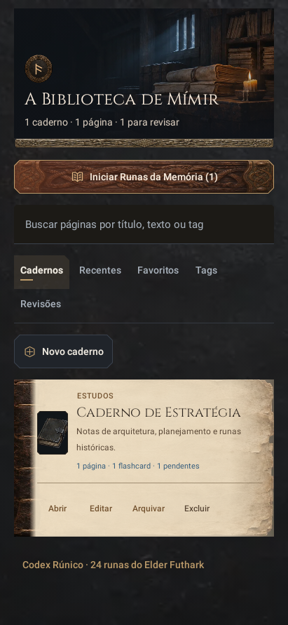
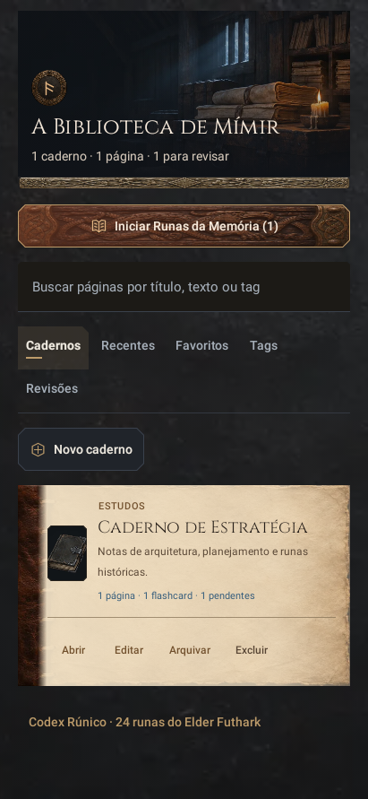

# NORTHBORN 4.1 · Acabamento rústico e movimento

Revisão `1.7.5.9.1` sobre `2760890`, código de versão 34. As três telas piloto usam materiais próprios. A barra e as transições de rota são compartilhadas pelo app.

| Tela | Fundos e gravuras | Acabamento rústico |
|---|---|---|
| Jornada |  |  |
| Mesa de Odin |  |  |
| Biblioteca de Mímir |  |  |

A Jornada usa números grandes e talhes na madeira para mostrar o progresso do dia. O mostrador circular fica reservado à leitura de capacidade em Odin, agora montado junto a rebites em ferro martelado. Mímir usa fibras e bordas irregulares no velino costurado e a barra recebe lã escura. Quatro recortes de uma prancha de materiais gerada entram no APK como WebP. As imagens de interface nesta página são capturas do Compose.

## Movimento

| Elemento | Gatilho | Resposta | Duração |
|---|---|---|---|
| Botões e fivelas | Pressionar e soltar | Sombra do relevo e deslocamento de até 1 dp do conteúdo. A área clicável permanece estável | 90 ms / 150 ms |
| Navegação | Abrir outra tela ou voltar | Entrada em opacidade e deslocamento vertical curto na direção correspondente | até 230 ms |
| Aberturas | Entrar numa cena | Luz e escala assentam uma vez. O texto e os controles ficam no lugar | 340 ms |
| Índice | Trocar a aba | A marca de seleção muda de opacidade e largura | 165 ms |
| Rumos do Dia | Abrir ou recolher | O detalhe acompanha a abertura em altura | 220 ms / 140 ms |
| Marcas de contagem | Atualizar progresso | A luz percorre os talhes conforme o valor exibido | 230 ms |
| Flashcard | Revelar a resposta | A tinta assenta sobre o velino. As opções de avaliação ficam disponíveis no mesmo toque | 235 ms |

Os controles continuam utilizáveis durante o movimento. A preferência de redução de movimento aplica o estado final de imediato, preservando o contraste e o feedback de toque. O modo minimalista conserva a estrutura com superfícies neutras.

## Verificação

A sequência de Mímir usa três quadros capturados com o relógio de teste do Compose. As demais telas incluem tema claro, minimalista e o recorte de 320 dp com fonte a 130%. As verificações foram feitas em Robolectric Native Graphics. Instalação em telefone e TalkBack seguem pendentes. [Galeria](../screenshots/1.7.5.9.1-rustico/) · [Revelação em três quadros](../screenshots/1.7.5.9.1-rustico/mimir-revelacao.webp)
