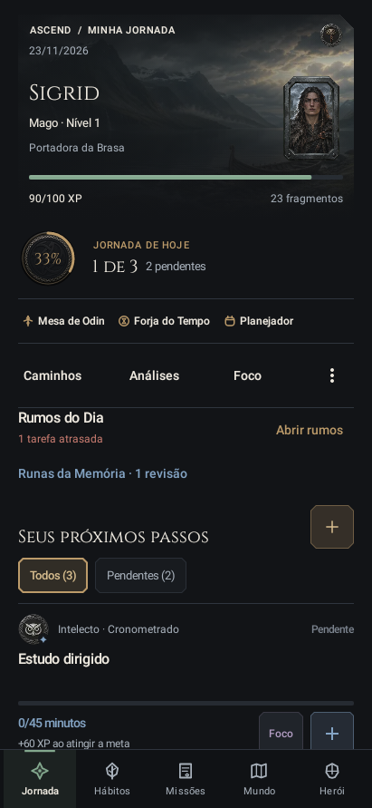
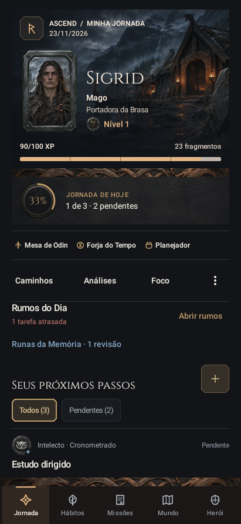
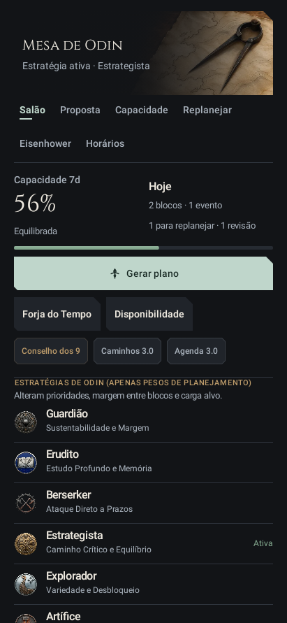
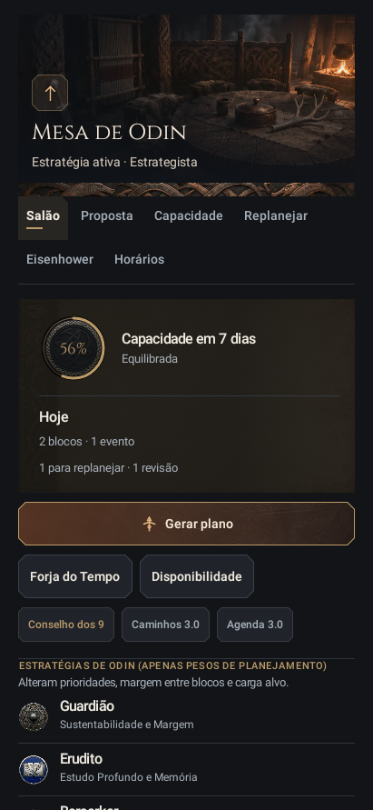
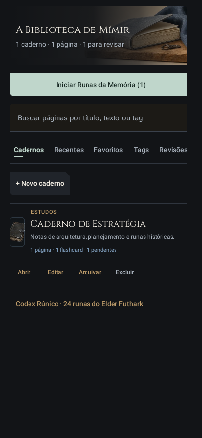
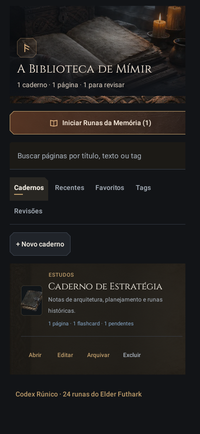

# NORTHBORN 4.1 · Revisão nórdica

Segundo protótipo de Jornada, Mesa de Odin e Biblioteca de Mímir, sobre `d21d503`. O nome da versão continua 1.7.5.9.1. O código de versão subiu para 31 para identificar este instalador de desenvolvimento.

| Tela | Primeiro protótipo | Revisão nórdica |
|---|---|---|
| Jornada |  |  |
| Mesa de Odin |  |  |
| Biblioteca de Mímir |  |  |

## Arte e componentes

- A Jornada abre com um salão de madeira à beira do fiorde, um navio e a luz das forjas. O retrato existente ganhou escala e aparece ao lado de nome, classe e nível. A régua de XP leva ao progresso do dia, sob um friso entalhado.
- Em Odin, a fotografia de referência deu lugar à cena de um salão ficcional. A capacidade usa um mostrador de bronze, com o resumo de hoje e o comando de gerar plano ao alcance. Os valores continuam vindo do planejamento existente.
- Mímir usa manuscritos iluminados por velas na abertura e velino com lombada de couro atrás de cadernos, páginas e flashcards. O texto continua sendo renderizado pelo Compose.
- O friso aparece nas entradas e na navegação dos módulos piloto. Marcas de bronze indicam seleção, os comandos primários usam carvão e cobre, e o modo minimalista suprime as cenas e texturas.

As duas novas gerações são originais. Uma contém o fiorde. Outra reúne as duas cenas e os materiais, recortados em cinco WebPs. Os seis recursos somam 199.674 bytes. Os entrelaçados evocam a tradição escandinava de entalhe e a curva animal de Urnes. Os selos usam Raidho, Tiwaz e Ansuz do conjunto Elder Futhark já renderizado pelo aplicativo. A associação das runas a funções do app é ficcional. Os manuscritos de Mímir remetem à tradição islandesa medieval posterior. [Referências de cultura material consultadas](NORTHBORN-ART-DIRECTION.md)

[Fiorde](art/anteriores/rebirth_fjord.webp) · [Salão do conselho](art/anteriores/rebirth_chart.webp) · [Manuscritos](art/anteriores/rebirth_folio.webp) · [Friso entalhado](art/anteriores/rebirth_carved_rail.webp) · [Velino](art/anteriores/rebirth_vellum.webp)

## Validação visual

Capturas de Compose em Robolectric Native Graphics, com a fixture do primeiro protótipo. As amostras incluem 411 dp, 360 dp, 320 dp com fonte a 130%, tema claro e modo minimalista. A margem lateral em algumas imagens estreitas vem do host de teste. Dispositivo físico, TalkBack e instalação sobre uma versão anterior continuam pendentes. A expansão aos outros módulos permanece sujeita à avaliação deste protótipo. [Variações e capturas](../screenshots/1.7.5.9.1-nordico/) · [Plano de expansão](NORTHBORN-ROLL-OUT-PLAN.md)
