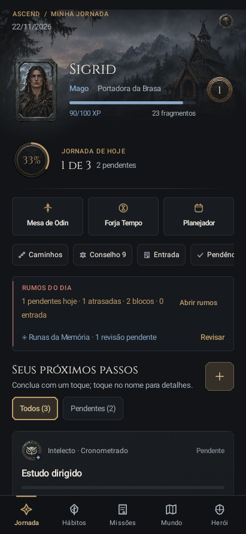
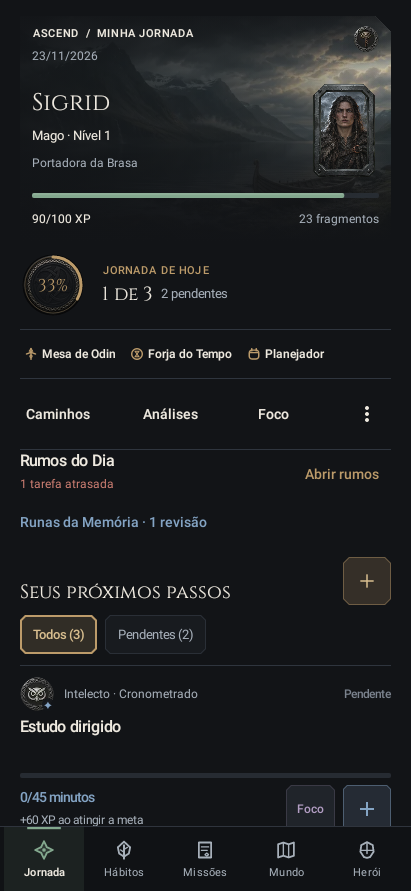
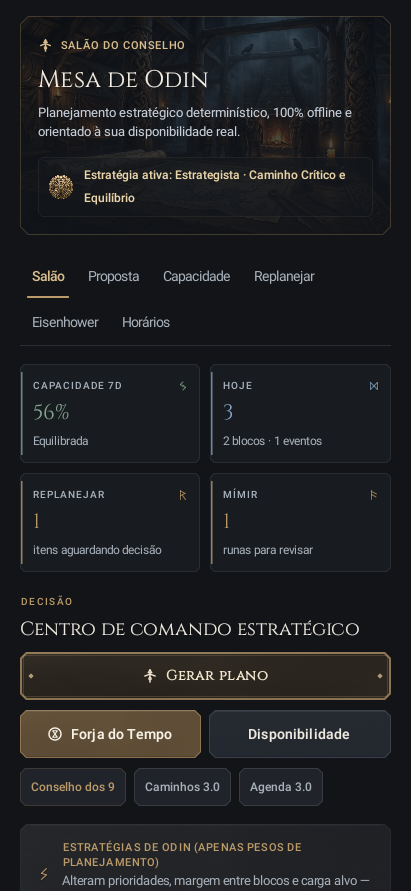
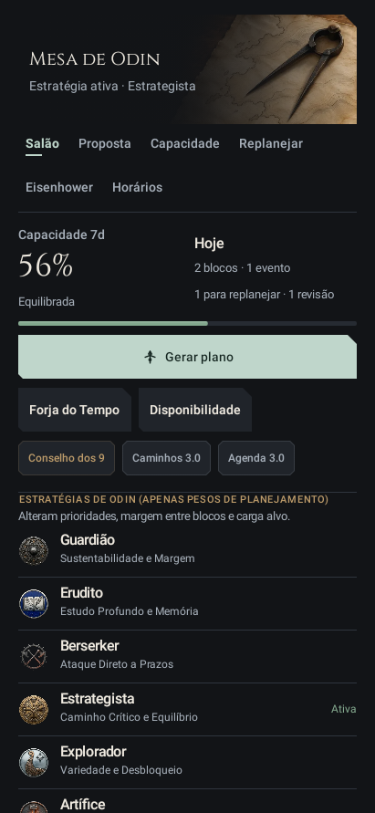
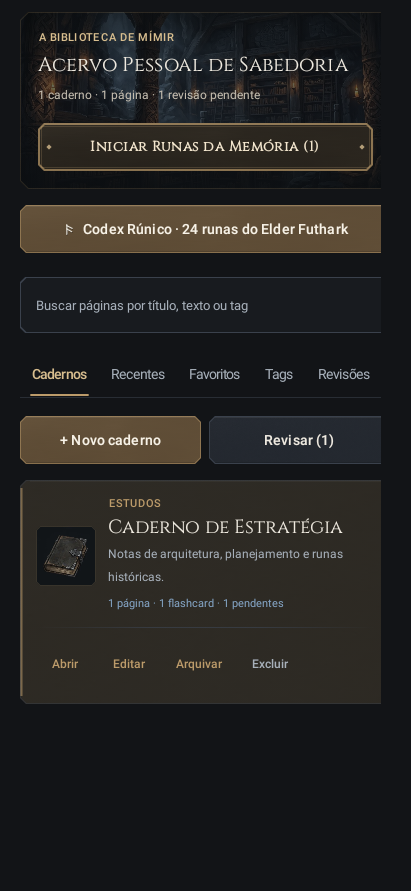
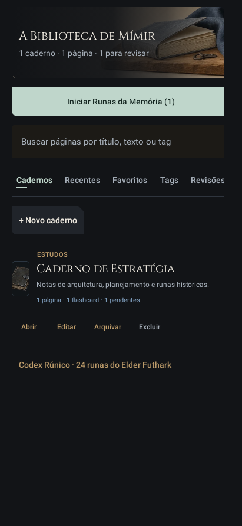

# NORTHBORN 4.1 · Revisão das três telas

Protótipo para avaliação visual. As imagens abaixo vêm de interfaces Compose renderizadas em Robolectric Native Graphics com a mesma fixture do tour anterior. As datas dependem do dia da execução. A [prancha de direção de arte](art/northborn-art-direction.webp) é um estudo separado.

| Módulo | 1.7.5.9 | Protótipo 1.7.5.9.1 |
|---|---|---|
| Jornada |  |  |
| Mesa de Odin |  |  |
| Biblioteca de Mímir |  |  |

## Revisão crítica

- **Jornada.** O nome, a classe, o nível e o retrato fazem parte da abertura. A paisagem acompanha a identidade do personagem. A faixa principal passa para uma segunda linha em 320 dp com fonte a 130% e mantém os rótulos completos. A revisão deixou três atalhos secundários visíveis e um menu para os demais. Rumos do Dia conserva o detalhe ao expandir e ocupa menos altura recolhido. Em telas estreitas, a lista de hábitos continua abaixo da dobra.
- **Odin.** A capacidade tem um eixo próprio e a decisão de gerar plano vem antes das estratégias detalhadas. Retirar a abertura de mapa da aba Proposta deixa o período e a estratégia perto do topo. As abas passam para linhas adicionais em telas estreitas. Os botões de Forja e Disponibilidade também mudam de linha quando a fonte ampliada pede espaço. Os resultados extensos da proposta continuam exigindo rolagem.
- **Mímir.** O caderno tem lombada e margem, com a lista aberta e uma chamada principal de revisão. A leitura, as referências e a resposta do flashcard usam a mesma folha lisa. As ações de vincular páginas e adicionar referências têm espaço próprio para comportar fonte ampliada. O cabeçalho ilustrado fica restrito ao índice.

## Variações e interação

- A Jornada inclui tema claro, modo minimalista, 320 dp com fonte normal e ampliada e uma faixa de atalhos a 360 dp. A abertura do menu Todos os destinos também foi verificada pela árvore de semântica do Compose. [Claro](../screenshots/1.7.5.9.1/25-tema-claro.png) · [320 dp](../screenshots/1.7.5.9.1/28-tela-320dp.png) · [320 dp e 130%](../screenshots/1.7.5.9.1/29-fonte-130.png) · [Minimalista](../screenshots/1.7.5.9.1/27-modo-minimalista.png) · [360 dp](../screenshots/1.7.5.9.1/38-jornada-360.png)
- Odin com [ação principal e abas a 320 dp/130%](../screenshots/1.7.5.9.1/32-odin-320-fonte-130.png), [Proposta selecionada após clicar em Gerar plano](../screenshots/1.7.5.9.1/31-odin-320-fonte-130-proposta.png) e [tema claro minimalista a 360 dp](../screenshots/1.7.5.9.1/37-odin-minimalista-claro-360.png).
- Mímir inclui o índice em tema claro e minimalista, a folha de leitura, a ação de adicionar referências com a fonte ampliada e a resposta revelada. [Claro a 360 dp](../screenshots/1.7.5.9.1/33-mimir-claro-360.png) · [Minimalista a 320 dp e 130%](../screenshots/1.7.5.9.1/34-mimir-minimalista-320.png) · [Leitura](../screenshots/1.7.5.9.1/35-mimir-leitura.png) · [Referências a 360 dp e 130%](../screenshots/1.7.5.9.1/39-mimir-referencias-360-fonte-130.png) · [Resposta revelada](../screenshots/1.7.5.9.1/36-mimir-resposta.png)

O tour injeta a largura e o escalonamento da fonte no Compose e captura a View. A margem à direita nas amostras estreitas faz parte do host de teste. A matriz é representativa. Ela não cobre a combinação de todos os temas, fontes e larguras. Dispositivo físico, TalkBack e IME físico ficam pendentes. A reformulação dos demais destinos depende da avaliação desta etapa. [Plano de expansão](NORTHBORN-ROLL-OUT-PLAN.md)
